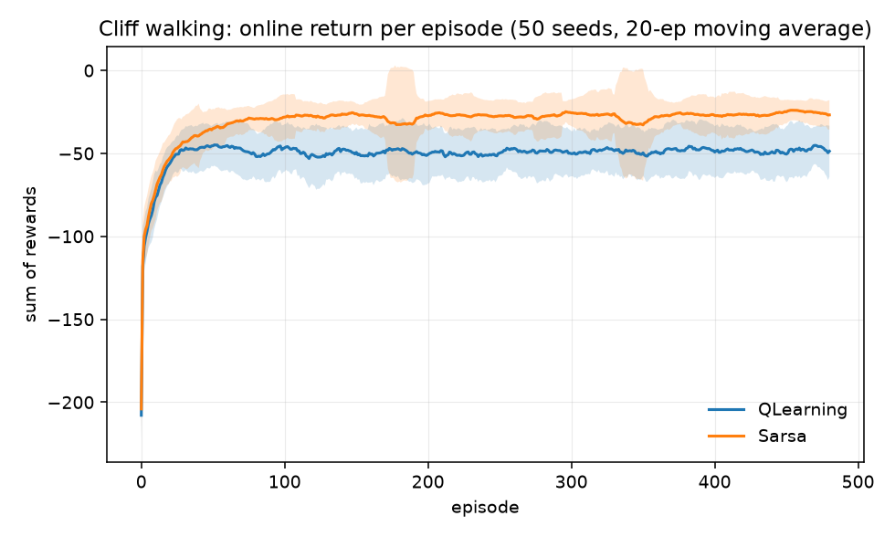
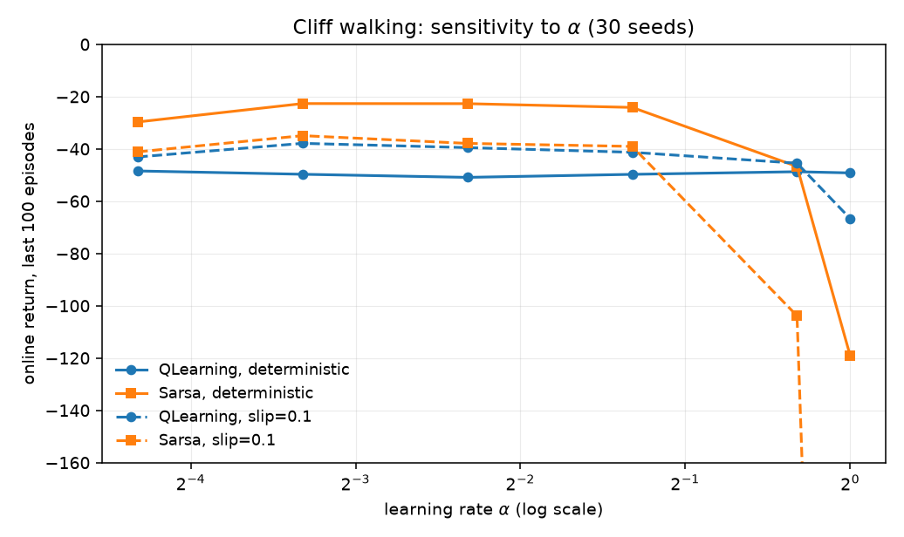
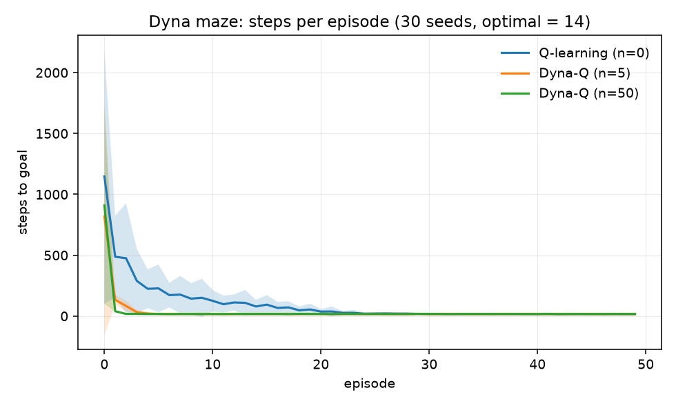

# A2 — Tabular RL: task, goal, and how it was solved

What phase A2 asks, why the ladder puts dynamic programming and TD control on
the same rung, and what the runs showed. The lab notebook with the numbers is
[`experiments/a2_tabular/README.md`](../../experiments/a2_tabular/README.md).

> **At a glance**
>
> - Value and policy iteration both reach the known optimum, checked two independent ways.
> - On the cliff, Q-learning learns the optimal path (greedy return −13) yet earns less online (−48.6) than SARSA (−26.3), which routes a row away from the edge. They answer different questions.
> - Dyna-Q with 50 planning steps gets within 20% of the optimal path in 7 episodes against Q-learning's 43, from replaying remembered transitions alone.

---

## 1. The task

[`ladder.md`](../ladder.md#a2) states four items:

1. Value iteration and policy iteration on a small GridWorld; confirm
   convergence to the known optimum.
2. Q-learning and SARSA from scratch; compare policies near a hazard.
3. Sweep the discount factor $\gamma$ and the learning rate $\alpha$.
4. Add a Dyna-Q planning step; measure the sample-efficiency gain.

## 2. The goal

A1 removed the state. A2 puts it back and nothing else: finite states, finite
actions, a table of numbers, no function approximation. Everything here is
exact, which makes it the last phase where you can *check your answer*.

The phase is really about one contrast. Items 1 and 2 solve the same problem
twice:

- **Dynamic programming** is given the model $p(s',r \mid s,a)$ and computes the
  optimum by sweeping the whole state space.
- **Temporal-difference control** never sees the model. It learns from sampled
  transitions, one at a time, bootstrapping from its own current estimates.

Holding the environment fixed and changing only that makes the cost of not
having a model visible, and it gives every later phase a reference answer that
A3 onward will not have.

## 3. Dynamic programming (item 1)

The optimal value function is the unique fixed point of the Bellman optimality
operator:

$$V^*(s) = \max_a \sum_{s'} p(s' \mid s,a)\left[r(s,a,s') + \gamma V^*(s')\right]$$

**Value iteration** turns that equality into an assignment and iterates it.
Define the Bellman optimality operator $T$ on $\mathbb{R}^{|\mathcal{S}|}$ by

$$(TV)(s) = \max_a \sum_{s'} p(s' \mid s,a)\left[r(s,a,s') + \gamma V(s')\right]$$

*Claim: $T$ is a $\gamma$-contraction in the max norm.* For any $V, V'$ and any
$s$,

$$|(TV)(s) - (TV')(s)| \le \max_a \left|\gamma \sum_{s'} p(s'\mid s,a)\left[V(s') - V'(s')\right]\right| \le \gamma \|V - V'\|_\infty$$

The first step uses $|\max_a f(a) - \max_a g(a)| \le \max_a |f(a) - g(a)|$ — the
maxima may be attained at different actions, but the difference is still bounded
by the largest pointwise gap. The second uses that $p(\cdot \mid s,a)$ is a
probability distribution, so the weighted average cannot exceed the maximum.
Taking the max over $s$ gives $\|TV - TV'\|_\infty \le \gamma\|V - V'\|_\infty$.

Banach's fixed-point theorem then gives everything at once: $T$ has a **unique**
fixed point $V^*$, and iterates converge to it geometrically from any start,

$$\|V_k - V^*\|_\infty \le \gamma^k \|V_0 - V^*\|_\infty$$

Note what the argument needs: exact backups over the whole state space. Both
assumptions fail in A3, which is the entire content of the deadly triad.

**Policy iteration** alternates two exact steps: evaluate the current policy by
solving the linear system

$$(I - \gamma P_\pi) V_\pi = R_\pi,$$

then set $\pi$ greedy with respect to $V_\pi$.

*Why the solve is well posed.* $P_\pi$ is row-stochastic, so
$\|P_\pi\|_\infty = 1$ and $\|\gamma P_\pi\|_\infty = \gamma < 1$. The Neumann
series $\sum_{k \ge 0} (\gamma P_\pi)^k$ therefore converges and equals
$(I - \gamma P_\pi)^{-1}$ — which is just the statement that the value of a
policy is its discounted sum of future rewards. At $\gamma = 1$ the argument
collapses, and so does the code: see the trap below.

*Why improvement is monotone (the policy improvement theorem).* If $\pi'$
satisfies $Q^\pi(s, \pi'(s)) \ge V^\pi(s)$ for all $s$, then
$V^{\pi'} \ge V^\pi$ pointwise. Substituting the inequality into itself:

$$V^\pi(s) \le Q^\pi(s, \pi'(s)) = \mathbb{E}_{\pi'}\!\left[r_t + \gamma V^\pi(s_{t+1})\right]
\le \mathbb{E}_{\pi'}\!\left[r_t + \gamma Q^\pi(s_{t+1}, \pi'(s_{t+1}))\right]$$

$$\le \mathbb{E}_{\pi'}\!\left[r_t + \gamma r_{t+1} + \gamma^2 V^\pi(s_{t+2})\right] \le \cdots \le V^{\pi'}(s)$$

Each step replaces a $V^\pi$ by the $Q^\pi$ that dominates it and unrolls one
more real reward under $\pi'$; the remainder $\gamma^n V^\pi(s_{t+n}) \to 0$
since $\gamma < 1$ and values are bounded. The greedy policy satisfies the
premise by construction, so every improvement step is monotone.

*Why it terminates, and quickly.* There are at most $|\mathcal{A}|^{|\mathcal{S}|}$
deterministic policies, and each iteration either strictly improves the value at
some state or leaves the policy unchanged — in which case the Bellman optimality
equation holds and the policy is optimal. Since values never decrease, no policy
can repeat, so termination is finite. In practice it is far faster than that
bound: each PI step is at least as good as a value-iteration sweep, which is
why the run below converges in 6 improvement steps against VI's 45.

### Confirming the optimum, twice

"Confirms convergence to the known optimum" needs a *known* optimum, not just a
converged one. Two independent checks were used:

**Check 1 — against BFS.** On a deterministic grid with $r = -1$ per step and
$\gamma = 1$, the optimal value is exactly the negated shortest-path distance:

$$V^*(s) = -d(s, \text{goal})$$

Distances come from a breadth-first search that never touches the Bellman
equation, so agreement is genuine external validation rather than the code
agreeing with itself.

**Check 2 — VI against PI, plus the residual.** On a slippery grid ($20\%$ slip,
$\gamma = 0.99$) the two algorithms must agree, and the Bellman optimality
residual

$$\max_s \left| V(s) - \max_a Q(s,a) \right|$$

must vanish.

**Result:** VI matched BFS exactly. On the stochastic grid VI and PI agreed to
$5.8 \times 10^{-13}$ with identical policies, residual $3.3 \times 10^{-13}$.
VI needed **45 sweeps**, PI only **6 improvement steps** — but a PI step costs an
$O(|S|^3)$ linear solve against a sweep's $O(|S|^2|A|)$, which is the classic
tradeoff, not a free win.

**One trap worth recording:** the exact solve requires $\gamma < 1$, or a policy
under which every state reaches a terminal. At $\gamma = 1$, $I - P_\pi$ is
singular whenever $P_\pi$ has a recurrent class with no terminal state — the
constant vector on that class is in the kernel, since a policy that walks into a
wall forever satisfies $P_\pi \mathbf{1} = \mathbf{1}$ there. `np.linalg.solve`
raises. Value iteration has no such problem because it never inverts anything,
which is why check 1 uses VI at $\gamma = 1$ and check 2 uses a discount.

## 4. Q-learning vs SARSA (item 2)

Both agents keep $Q(s,a)$ and update toward a bootstrapped target:

$$Q(s,a) \leftarrow Q(s,a) + \alpha\left[\underbrace{\;\cdot\;}_{\text{target}} - Q(s,a)\right]$$

The **entire** difference is the target:

$$
\text{Q-learning:} \quad r + \gamma \max_{a'} Q(s',a')
\qquad
\text{SARSA:} \quad r + \gamma\, Q(s',a')
$$

Q-learning's $\max$ evaluates the *greedy* policy regardless of what was
actually done — **off-policy**. SARSA bootstraps from the action its
$\varepsilon$-greedy policy really took — **on-policy**, so its values include
the cost of the exploration it is going to keep doing.

**What each converges to, and under what conditions.** Both are stochastic
approximation applied to a Bellman operator. Writing the update as

$$Q_{n+1}(s,a) = (1-\alpha_n) Q_n(s,a) + \alpha_n \left[(T Q_n)(s,a) + \eta_n\right]$$

where $\eta_n$ is zero-mean sampling noise, the classical result (Watkins &
Dayan 1992; Jaakkola, Jordan & Singh 1994) is that $Q_n \to Q^*$ with
probability 1 provided

1. every state-action pair is visited infinitely often,
2. the step sizes satisfy Robbins–Monro, $\sum_n \alpha_n = \infty$ and
   $\sum_n \alpha_n^2 < \infty$, per state-action pair,
3. rewards are bounded.

*Proof sketch.* $T$ is a $\gamma$-contraction (section 3), so the error
$\Delta_n = Q_n - Q^*$ obeys $\|\mathbb{E}[\Delta_{n+1}]\| \le \gamma\|\Delta_n\|$
in expectation; the two step-size conditions make the noise term vanish in the
limit while still allowing the iterate to travel any finite distance. It is the
A1 argument again, now with a contraction supplying the drift.

Two consequences worth holding onto. **Q-learning converges to $Q^*$ regardless
of the behaviour policy**, as long as it explores — that is what "off-policy"
buys, and it is why the cliff experiment's Q-learning finds the optimal path
while behaving badly. **SARSA converges to the optimal policy only if the
behaviour becomes greedy in the limit** (GLIE: infinite exploration, greedy in
the limit); with $\varepsilon$ fixed at $0.1$ forever, as in the experiment, it
converges to the best $\varepsilon$-greedy policy instead — which is exactly the
safe path it learns, and not a failure.

Note also that condition 2 is violated by the constant $\alpha$ every practical
implementation uses, including this one. That is the same deliberate trade as
A1 item 3: constant $\alpha$ gives up convergence-to-a-point in exchange for
tracking a target that is still moving.

### The cliff

Sutton & Barto's example 6.6: a $4 \times 12$ grid, $-1$ per step, and a row of
cliff cells costing $-100$ and teleporting the agent back to the start. The
shortest path runs directly along the cliff edge; one exploratory step off it
costs a hundred.

With $\varepsilon = 0.1$ both agents were run with identical $\alpha$, $\gamma$
and $\varepsilon$, so any behavioural difference is the target and nothing else.

**Result — and it is a double dissociation:**

| | online return | greedy-policy return | reaches goal | optimal |
| --- | --- | --- | --- | --- |
| Q-learning | $-48.6 \pm 6.4$ | $-13.0$ | 100% | **100%** |
| SARSA | $\mathbf{-26.3 \pm 6.3}$ | $-17.0$ (median) | 80% | 0% |

DP says the optimum is $-13$. So **Q-learning learns the better policy and earns
the worse return**, in the same run. It walks the cliff edge because the $\max$
in its target assumes the next action will be greedy — but the behaviour policy
is still $\varepsilon$-greedy, and one exploratory step in ten sends it over.
SARSA's target includes that $\varepsilon$, so it prices the risk correctly and
routes a row higher. Neither is wrong; they answer different questions.

*Figure — Cliff walking, online return per episode (50 seeds, 20-episode moving average). SARSA earns more while exploring; Q-learning's greedy path runs along the edge.*

### An unplanned finding: SARSA's greedy policy can loop

In 10 of 50 seeds SARSA's *extracted greedy* policy never reaches the goal, which
is why the table above reports a median ($-17$, the safe path) alongside the mean
($-53.7$, dominated by capped runs).

The cause is not a bug. In the top row, SARSA values "up" — a wall bump that
leaves the agent where it is — at $-12.33$, higher than any real move. Under an
$\varepsilon$-greedy policy that is defensible: bumping a wall is safe, and
exploration will randomly shake you out of it soon enough. Strip the exploration
away by taking $\varepsilon = 0$ and the same state becomes an absorbing loop.

The lesson is exact and worth carrying: **SARSA evaluates the policy it follows,
so the greedy policy you extract from it is not the policy it evaluated.**
Q-learning's $\max$ makes "walk into a wall" strictly worse than progress
everywhere it has data, so its greedy policy is coherent by construction. This is
the tabular ancestor of the train/eval mismatch in B1, where a model trained
under sampling is then served with greedy decoding.

## 5. Sweeping $\gamma$ and $\alpha$ (item 3)

The two parameters were swept separately because they do genuinely different
jobs.

### $\gamma$ changes the problem

The discount is not a tuning knob; it defines the objective
$G_t = \sum_k \gamma^k R_{t+k+1}$. To make that concrete, the sweep uses a
corridor MDP: a near reward of $+1$ one step away, or a far reward of $+10$ that
takes 5 steps. The two are worth

$$Q(s_0, \text{near}) = 1, \qquad Q(s_0, \text{far}) = \gamma^{4} \cdot 10$$

Setting them equal, $\gamma^4 \cdot 10 = 1$, so the optimal action flips exactly
at

$$\gamma^\star = \left(\tfrac{1}{10}\right)^{1/4} \approx 0.5623$$

More generally, with a near reward $r_n$ available immediately and a far reward
$r_f$ that takes $d$ steps, the threshold is
$\gamma^\star = (r_n/r_f)^{1/(d-1)}$ — the discount is exactly the exchange rate
between reward now and reward later, and choosing it *is* choosing the problem.

This is swept with **DP, not TD**, because the claim is about the optimum itself,
not about anyone's ability to learn it.

**Result:** the policy flips exactly where the algebra says. At $\gamma = 0.56$,
$Q(s_0,\text{far}) = 0.983 < 1$ and the near reward wins; at $\gamma = 0.57$,
$Q(s_0,\text{far}) = 1.056 > 1$ and it loses. The threshold $0.5623$ sits between
them, and every swept value agreed with the prediction. $\gamma$ is not a
hyperparameter to tune for performance — **it is part of the problem statement**,
and changing it changes which answer is correct.

### $\alpha$ changes the estimator

*Figure — Sensitivity to the step size α on the cliff, 30 seeds, deterministic and slippery variants. Both learners are flat over two orders of magnitude; SARSA collapses at the largest step sizes.*

The learning rate never changes what is optimal — it controls how the estimate
tracks, exactly as in A1 item 3. A constant $\alpha$ makes $Q$ an exponential
recency average, which is required here: the bootstrap target
$r + \gamma \max_{a'} Q(s',a')$ moves as $Q$ improves, so **the regression target
is non-stationary even though the MDP is not**. That is why TD control uses a
constant $\alpha$ where A1's stationary bandit preferred $1/N$.

To separate speed from stability, $\alpha$ was swept on both a deterministic
cliff and a slippery one ($10\%$ slip). Online return over the last 100 of 500
episodes, 30 seeds:

| $\alpha$ | 0.05 | 0.1 | 0.2 | 0.4 | 0.8 | 1.0 |
| --- | --- | --- | --- | --- | --- | --- |
| Q-learning, deterministic | $-48.4$ | $-49.7$ | $-50.9$ | $-49.7$ | $-48.7$ | $-49.2$ |
| Q-learning, slip $0.1$ | $-43.1$ | $\mathbf{-37.9}$ | $-39.5$ | $-41.3$ | $-45.5$ | $-66.6$ |
| SARSA, deterministic | $-29.7$ | $\mathbf{-22.7}$ | $-22.7$ | $-24.1$ | $-46.7$ | $-118.9$ |
| SARSA, slip $0.1$ | $-41.1$ | $\mathbf{-34.9}$ | $-37.9$ | $-39.0$ | $-103.8$ | $-688.7$ |

**Q-learning on the deterministic cliff is flat** — every $\alpha$ including
$1.0$ lands within a couple of points. That is correct and worth pausing on: its
target $r + \gamma \max_{a'} Q(s',a')$ is a deterministic function of $(s,a)$
when the environment is deterministic, so there is no sampling noise for a small
$\alpha$ to average away. $\alpha = 1$ is a legitimate setting.

**SARSA is not flat, on the same deterministic environment** — $-22.7$ at
$\alpha = 0.1$ against $-118.9$ at $\alpha = 1$. The reason is the thing item 2
was about: SARSA's target is $r + \gamma Q(s', A')$ where $A'$ is drawn from the
$\varepsilon$-greedy policy. **That target is a random variable even when the
MDP is deterministic**, because the exploration is the noise. So SARSA needs
$\alpha < 1$ for a reason Q-learning does not have, in an environment with no
stochasticity at all.

Add slip and both degrade, SARSA catastrophically ($-688.7$ at $\alpha = 1$),
because the two noise sources compound. The general rule: **$\alpha$ must be
small enough to average whatever randomness enters the target** — and where that
randomness comes from depends on the algorithm, not only on the environment.

## 6. Dyna-Q (item 4)

Dyna-Q keeps a model $(s,a) \mapsto (r, s')$ of transitions it has already seen,
and after every real step performs $n$ extra Q-learning updates on remembered
transitions sampled at random. Crucially **every arm takes the same number of
real environment steps** — $n = 0$ is exactly Q-learning — so the comparison
isolates the value of reusing experience.

On the Sutton & Barto maze (optimal path 14 steps, 30 seeds):

| planning steps | steps in episode 2 | episodes to within 20% of optimal |
| --- | --- | --- |
| $n = 0$ (Q-learning) | 487.4 | 43 |
| $n = 5$ | 133.5 | 12 |
| $n = 50$ | **39.8** | **7** |

A factor of **6 in episodes** and **12 in second-episode length**, from replay
alone. The mechanism is credit propagation: one-step Q-learning moves value
backward one state per real transition, so information about the goal crawls
along the path at one cell per episode. Planning sweeps do that crawling in
memory, between steps, at no environmental cost.

*Figure — Dyna maze, steps per episode (30 seeds; the optimum is 14). More planning steps per real step converge in fewer episodes.*

*Why the speedup is so large.* One-step Q-learning applies the sampled Bellman
backup once per real transition, so information about the goal propagates
backwards at most one state per transition; along a path of length $L$ it takes
$\Omega(L)$ episodes for the goal's value to reach the start. Dyna applies $n$
additional backups per real step, drawn from previously visited pairs, so the
same propagation happens in memory at $n{+}1$ times the rate for the same
environmental cost. Nothing about the fixed point changes — every planning
update is still an application of the same contraction — only the number of
applications per unit of experience.

The catch, stated because it matters in A3: the model is assumed deterministic
and is trusted completely. In a stochastic or changing environment those replays
confidently rehearse transitions that no longer happen — the same
stale-information failure as A1's sample-average agent, now with the agent
generating the staleness itself.

## 7. What this sets up

- **A3** replaces the table with a network. Every guarantee in section 3
  evaporates: the contraction argument assumed exact backups, and with function
  approximation the "deadly triad" is precisely this phase's three ingredients
  (bootstrapping, off-policy, approximation) put together.
- **A3's replay buffer is Dyna-Q's model**, with sampled transitions in place of
  a learned map, and it inherits the staleness problem.
- **A4** switches from learning $Q$ to parameterising the policy directly, which
  removes the max-operator bias but reintroduces the variance A1 measured.
- **B1** meets the off-policy/on-policy split again: PPO's ratio and KL terms
  exist to let it reuse data collected under a slightly different policy, which
  is Q-learning's question asked at scale.

## 8. Where these items come from

Section numbers follow the published 2nd edition of
[Sutton & Barto](http://incompleteideas.net/book/the-book.html); figure numbers
are as verified in the 2017 draft and may shift by one in print, so each is
described by its caption as well.

| item | primary source | why it was picked |
| --- | --- | --- |
| 1 — VI and PI on a GridWorld | S&B §4.3 "Policy Iteration" and §4.4 "Value Iteration"; Example 4.1 is the 4×4 gridworld this phase's grid is modelled on. Originals: Bellman's *Dynamic Programming* (1957) for value iteration, Howard's *Dynamic Programming and Markov Processes* (1960) for policy iteration | DP is the only point on the ladder where the exact answer is computable. Doing it first means every later approximation has a reference to be measured against. |
| 2 — Q-learning and SARSA at a hazard | S&B §6.5 "Q-learning: Off-Policy TD Control" and §6.4 "Sarsa: On-Policy TD Control"; Example 6.6 "Cliff Walking" is exactly this experiment. Originals: [Watkins & Dayan 1992](https://link.springer.com/article/10.1007/BF00992698) for Q-learning, [Rummery & Niranjan 1994](http://mi.eng.cam.ac.uk/reports/svr-ftp/auto-pdf/rummery_tr166.pdf) for SARSA | The cliff is the minimal environment where on-policy and off-policy control visibly disagree. A hazard is required: without one, both converge to the same policy and the distinction stays theoretical. |
| 3 — sweep γ and α | γ: S&B §3.3–3.4, where the discounted return is *defined* — γ is part of the objective, not a hyperparameter. α: S&B §2.5 (constant step size) and the cliff-walking figure plotting interim and asymptotic performance of TD control against α (draft Fig. 6.7) | The two parameters are swept with different tools here (DP for γ, TD for α) precisely because the sources treat them as different kinds of object. |
| 4 — Dyna-Q | S&B §8.2 "Dyna: Integrating Planning, Acting, and Learning"; the maze and its learning curves for varying planning steps are draft Fig. 8.3 (Fig. 8.2 is the Dyna *architecture* diagram, not the maze). Original: [Sutton 1990](http://incompleteideas.net/papers/sutton-90.pdf) | It is the cheapest possible demonstration that reusing experience is worth more than collecting more of it — the argument every replay buffer from A3 onward rests on. |

The **lab** pairing (`Practical_RL`
[week02_value_based](https://github.com/yandexdataschool/Practical_RL/tree/master/week02_value_based)
and [week03_model_free](https://github.com/yandexdataschool/Practical_RL/tree/master/week03_model_free))
is the ladder's own, and covers value/policy iteration, Q-learning, SARSA and
TD(λ) — matching items 1–3.

The **goal statement** in section 2 is quoted from
[`ladder.md`](../ladder.md#a2). Section 7's forward links are this repo's
reading of how the phases connect, not claims from any source.
