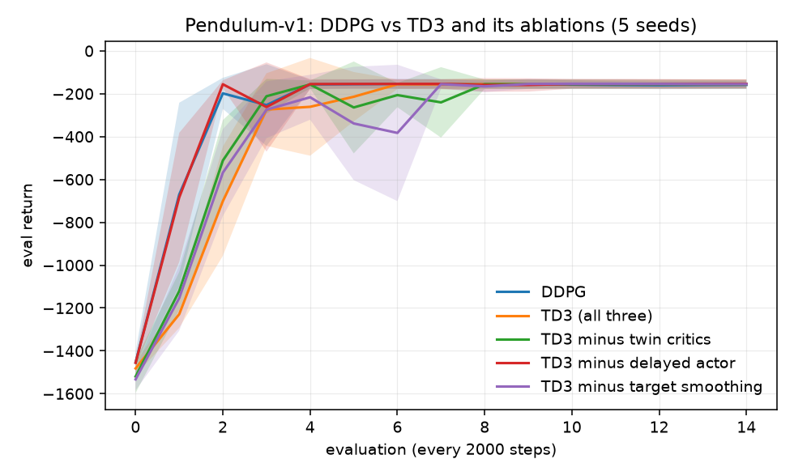
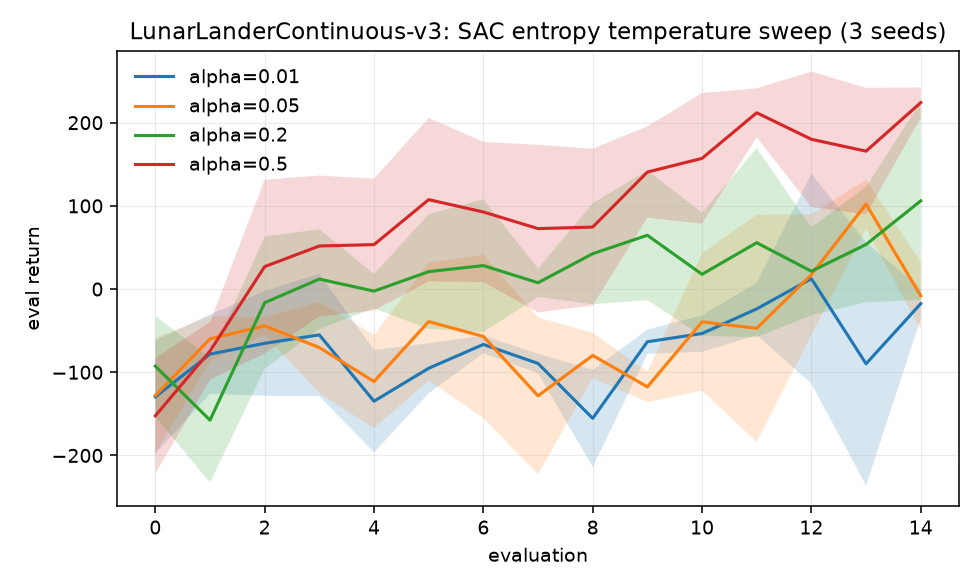
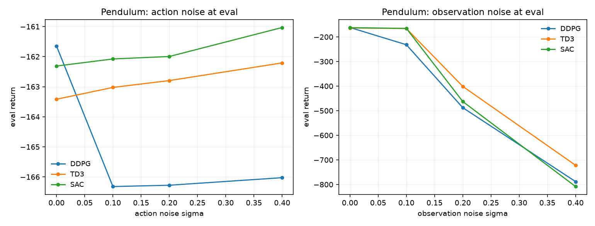

# A5 — Continuous Control: task, goal, and how it was solved

What phase A5 asks, why the argmax that carried A2 and A3 stops working, and
what the runs showed. The lab notebook with the numbers is
[`experiments/a5_continuous_control/README.md`](../../experiments/a5_continuous_control/README.md).

> **At a glance**
>
> - On Pendulum every TD3 ablation finishes within 5 points of the others, against a seed spread of ±20, so return cannot tell them apart. Critic bias can: DDPG +26.3, TD3 −9.8, and twin critics do most of the correcting.
> - DDPG's instability shows up in its critic, not in its returns.
> - The SAC temperature sweep came out monotone, which says the range was wrong rather than that the answer is an endpoint.

---

## 1. The task

[`ladder.md`](../ladder.md#a5) states four items:

1. DDPG on Pendulum-v1; note training instability.
2. TD3 (twin critics, delayed updates, target smoothing); compare stability to DDPG.
3. SAC on a harder continuous task; sweep the entropy-temperature coefficient.
4. Optional: action/observation noise at eval time; compare degradation across the three.

## 2. The goal: the argmax becomes an optimisation problem

Every value-based method so far ended with the same line:

$$\pi(s) = \arg\max_a Q(s,a)$$

With $|\mathcal{A}|$ discrete actions this is a lookup over a handful of network
outputs. With $a \in \mathbb{R}^d$ it is a **non-convex optimisation problem in
$d$ dimensions, to be solved afresh at every environment step and again for
every element of every training batch.** Discretising is not a way out: a grid
of $k$ points per dimension has $k^d$ cells, so a modest $d = 6$ robot at
$k = 10$ needs a million-way argmax.

DDPG's answer is to *amortise* the maximisation — train a network
$\mu_\theta(s)$ whose output is the maximiser, and update it by gradient ascent
through the critic:

$$\nabla_\theta J = \mathbb{E}_s\left[\nabla_a Q_\phi(s,a)\big|_{a=\mu_\theta(s)}\; \nabla_\theta \mu_\theta(s)\right]$$

This is the deterministic policy gradient. Note what it requires that A4's did
not: the gradient flows **through the critic**, so $Q_\phi$ must be
differentiable in $a$ and its action-gradient must be meaningful. A4's
stochastic policy gradient needed only a scalar return; here the critic's
*shape* in the action dimension is the training signal, and every error in that
shape is an error in the policy's direction of improvement.

That is the phase's central tension, and the source of every failure below: the
actor climbs the critic, while the critic is fitted on data the actor produces.

## 3. Why DDPG is unstable (item 1)

Three problems compound.

**The critic's errors become the actor's objective.** If $Q_\phi$ has a spurious
peak at some action, the actor is *pulled toward it* — and then collects data
there, which is the only way the critic ever learns that the peak was wrong.
Until then the peak is self-reinforcing. This is a stronger failure than A3's,
where an overestimated $Q$ merely mis-ranked a handful of discrete actions.

**Overestimation returns, now amplified.** A3 showed
$\mathbb{E}[\max_a \hat{Q}] \ge \max_a \mathbb{E}[\hat{Q}]$. Here the actor is
explicitly *trained to find* the maximising action, which is a far more
effective maximiser than an argmax over a few columns — it is gradient ascent on
the error surface. Errors are not just selected for, they are actively sought.

**Exploration is bolted on.** A deterministic policy explores nothing, so DDPG
adds noise externally, $a = \mu_\theta(s) + \epsilon$. The scale of $\epsilon$ is
a hyperparameter with no principled setting and no adaptation over training.

## 4. TD3's three fixes (item 2)

Each targets one of the above, and this repo turns each into a flag so the
attribution is measured rather than assumed.

**Twin critics.** Keep $Q_{\phi_1}, Q_{\phi_2}$ and build the target from the
smaller:

$$y = r + \gamma\,(1-d)\,\min_{i \in \{1,2\}} Q_{\phi_i'}\!\left(s', \tilde{a}'\right)$$

The minimum of two unbiased estimates is biased *downward* — for independent
$X_1, X_2$, $\mathbb{E}[\min(X_1,X_2)] \le \min(\mathbb{E}[X_1], \mathbb{E}[X_2])$
— which is the same trade A3's Double DQN made, in a blunter form. Underestimation
is the safer failure: an under-valued action is simply not chosen, whereas an
over-valued one is pursued and reinforced.

**Delayed policy updates.** Update the actor (and the targets) once per $k$
critic updates, $k = 2$. The justification is a timescale argument: the actor
should climb a critic that has approximately converged for the current policy,
and if both move together neither is fitting a stationary object.

**Target policy smoothing.** Perturb the action used in the target:

$$\tilde{a}' = \mu_{\theta'}(s') + \mathrm{clip}\left(\epsilon,\, -c,\, c\right), \qquad \epsilon \sim \mathcal{N}(0, \sigma^2)$$

This makes the target an average of $Q$ over a neighbourhood, so a narrow
spurious spike is smoothed away before the actor can exploit it. It is a
regulariser encoding the prior that *similar actions should have similar value*
— which is true of physical control problems and false of, say, discrete
combinatorial ones.

## 5. SAC: exploration as part of the objective (item 3)

SAC changes what is being maximised:

$$J(\pi) = \mathbb{E}\left[\sum_t \gamma^t \Big(r_t + \alpha\, \mathcal{H}\big(\pi(\cdot \mid s_t)\big)\Big)\right]$$

Entropy is no longer a heuristic bonus but a term in the return, so the value
functions must account for it too:

$$y = r + \gamma\,(1-d)\left[\min_i Q_{\phi_i'}(s', a') - \alpha \log \pi_\theta(a' \mid s')\right], \qquad a' \sim \pi_\theta(\cdot \mid s')$$

Three consequences follow, and they are the reason SAC tends to be the most
robust of the three:

- **Exploration adapts automatically.** The optimal policy for this objective is
  a Boltzmann distribution over $Q$, $\pi^*(a|s) \propto \exp(Q(s,a)/\alpha)$, so
  the policy is as random as the value landscape is flat, and sharpens by itself
  where the value differences are real. Compare DDPG's fixed $\epsilon$.
- **The actor is stochastic and reparameterised**, so the policy gradient flows
  through a sampled action, $a = \tanh(\mu_\theta(s) + \sigma_\theta(s)\odot\xi)$
  with $\xi \sim \mathcal{N}(0,I)$ — low variance, and no score-function term.
- **The tanh squash needs a Jacobian correction.** Squashing changes the
  density, so the log-probability picks up a term:
  $$\log \pi(a|s) = \log \mathcal{N}(u \mid \mu, \sigma) - \sum_i \log\left(1 - \tanh^2(u_i)\right)$$
  Omitting it is the classic SAC bug: the entropy term is then simply wrong,
  and $\alpha$ stops meaning what it should.

$\alpha$ is what item 3 sweeps. It is a unit-bearing quantity — a rate of
exchange between reward and nats — so its right value depends on the reward
scale of the task, which is exactly why later versions of SAC learn it
automatically against a target entropy.

## 6. Why noise at evaluation is a fair test (item 4)

The entropy objective's optimal policy is spread over actions of comparable
value, so it should sit on a *flatter* part of the return surface than a
deterministic policy that has balanced on a single point. Perturbing actions or
observations at evaluation time, on agents trained without any perturbation,
measures that flatness directly: it is a property of the policy that was
learned, not of any robustness training.

Reporting the *drop from each algorithm's own clean score* rather than the
absolute score matters here — otherwise an algorithm is rewarded for having been
better to begin with, which is a different question.

## 7. What was done

`continuous.py` implements all three as one training loop with switches
(`twin_critics`, `policy_delay`, `target_noise`, `alpha`, and a deterministic or
Gaussian actor), so the arms differ only where the phase says they differ, and
TD3's three fixes can be removed one at a time.

Carried over from earlier phases:

- **The A3 value-bias probe**: predicted $Q(s_0, a_0)$ against the discounted
  return actually collected. It is the measurement twin critics exist to
  improve, so measuring it here connects the fix to its motivation.
- **Per-seed values and multi-seed bands throughout**, after A3's single-seed
  Atari run produced two contradictory orderings.
- **The A3 caveat about the probe**: it is a joint function of value calibration
  *and* policy quality, so arms at very different performance levels are not
  cleanly comparable on it.

## 8. Results

Tables in the [phase README](../../experiments/a5_continuous_control/README.md).
What changes how the phase should be read:

**The ablation attributes TD3's contribution, and the informative metric is not
return.** On Pendulum all five arms finish within 5 points of one another
against a seed spread of $\pm 20$ — a null result on performance, because the
task is too easy to separate them. The value bias separates cleanly:

*Figure — Pendulum, 5 seeds: DDPG, full TD3, and TD3 with each of its three fixes removed. By return they are indistinguishable, which is why the table uses critic bias.*

| arm | bias | change vs full TD3 |
| --- | --- | --- |
| TD3 (all three) | $-9.8$ | — |
| $-$ twin critics | $+7.6$ | $+17.4$ |
| $-$ target smoothing | $-0.1$ | $+9.7$ |
| $-$ delayed actor | $-11.2$ | $-1.4$ |
| DDPG | $+26.3$ | $+36.1$ |

The ordering is exactly what section 4 predicts. Twin critics move the bias
furthest and are the only fix whose removal flips its sign, because
$\mathbb{E}[\min(X_1,X_2)] \le \min(\mathbb{E}[X_1],\mathbb{E}[X_2])$ is a
*direct* downward correction. Smoothing matters about half as much: it removes
spurious spikes by averaging the target over a neighbourhood, which corrects the
bias only incidentally. The delayed actor changes it by $1.4$ — nothing — which
is correct, since the timescale argument for it makes no claim about bias at
all. A fix can be worth having and still not be the one doing the work on any
given metric.

**DDPG's instability showed up in its critic, not its returns.** Its swing
between evaluations ($102.7$) was the *lowest* of the five arms, not the
highest. What it does show is a critic overestimating by $+26.3$ while every arm
with twin critics sits at or below zero. On a task this forgiving the
overestimation never gets the chance to become a policy failure — which is a
fact about Pendulum as a testbed more than about DDPG, and the same lesson A3
learned from CartPole: an environment can be too easy to exhibit the phenomenon
you built the experiment to see.

**The temperature sweep came out monotone, so the range was wrong.** Return
rises all the way from $\alpha = 0.01$ ($-17.6$) to $\alpha = 0.5$ ($224.1$),
meaning the optimum sits at or past the top of the swept range and the expected
interior optimum never appears. That $\alpha$ is scale-dependent is the content
rather than an annoyance — it is a rate of exchange between reward and nats, so
a task with returns in the hundreds needs a larger $\alpha$ than one with
returns in single digits, and that is precisely why later SAC learns it against
a target entropy instead of exposing it.

*Figure — SAC on LunarLanderContinuous, 3 seeds per entropy temperature.*

The variance result is the stronger one: at $\alpha = 0.2$ the three seeds land
at $-20, 72, 266$ ($\pm 119$); at $\alpha = 0.5$ at $221, 203, 248$
($\pm 18$). A sixfold reduction in across-seed spread *while* the mean rises —
on this task the entropy term buys reliability rather than trading performance
for it.

**Item 4 contradicted its own hypothesis, and the design is partly to blame.**
Section 6 argued the entropy objective should make SAC degrade least. Under
action noise nothing degrades at all — all three are flat, and TD3 and SAC
marginally improve, which is what small action noise does to a policy balancing
a pendulum at an unstable equilibrium. Under observation noise everything
collapses and **SAC collapses most** ($646.2$ against TD3's $558.5$).

*Figure — Pendulum at evaluation time: return against action-noise σ (left) and observation-noise σ (right) for DDPG, TD3 and SAC.*

Two limits before that is taken as a refutation. Per-seed spread was not
recorded for the noise sweep, so a 90-point gap between arms whose training
returns already vary by $\pm 20$ is not established as real. More importantly
the entropy argument concerns perturbations *of the action* — the axis where all
three were already flat — whereas observation noise corrupts the policy's
*input*, a failure mode the entropy objective makes no claim about. The
experiment tests the wrong axis for the hypothesis it was built to check. A
sharper version would perturb the dynamics (mass, damping) rather than the
observation.

## 9. What this sets up

- **C3 reuses these implementations directly.** The market-making environment's
  action is a low-dimensional continuous vector — the GLFT coefficient set — so
  DDPG, TD3 and SAC transfer with no algorithmic change at all. What changes is
  that the reward is money and the episodes are trading sessions, which makes
  the overestimation measured here a financial rather than academic concern: a
  critic that overvalues an action is a quoter that takes a position it should
  not.
- **A5's twin critics are A3's Double DQN under a different name**, and C3's
  ablation of which coefficients to learn is the same attribution question this
  phase asked of TD3's three fixes.
- **B1's PPO** solves the same instability from the opposite direction. DDPG
  stabilises an actor climbing a critic by fixing the critic (twin, delayed,
  smoothed); PPO stabilises it by bounding how far the actor may move per
  update. Trust region versus better value estimate is the axis those two
  answers sit on.

## 10. Where these items come from

| item | primary source | why it was picked |
| --- | --- | --- |
| 1 — DDPG | [Lillicrap et al. 2016](https://arxiv.org/abs/1509.02971), building on the deterministic policy gradient of Silver et al. 2014 | It is the minimal answer to "the argmax is intractable" — learn the maximiser — so its failure modes are the ones intrinsic to that idea rather than to any particular fix. |
| 2 — TD3 | [Fujimoto et al. 2018](https://arxiv.org/abs/1802.09477) | The paper's contribution is three separable fixes, each aimed at a named failure of DDPG, which makes it the rare case where an ablation is the natural way to read the result rather than an extra. |
| 3 — SAC | [Haarnoja et al. 2018](https://arxiv.org/abs/1801.01290) | It changes the objective rather than patching the algorithm, which is a different kind of answer from TD3's, and the temperature is the one hyperparameter that makes the tradeoff explicit. |
| 4 — eval-time noise | not from a specific paper; the robustness claim is folklore around SAC that the entropy objective makes it explicit | It converts "entropy maximisation gives more robust policies" from an assertion into a measurement, using agents trained without any perturbation so the result is about the policy's shape. |

The **lab** pairing (`Practical_RL`
[week09_policy_II](https://github.com/yandexdataschool/Practical_RL/tree/master/week09_policy_II))
is the ladder's own and covers TRPO, PPO and DDPG for robot control.

The **goal statement** in section 2 is quoted from
[`ladder.md`](../ladder.md#a5). Section 3's decomposition of DDPG's instability
into three compounding causes, and section 6's argument for why eval-time noise
is a fair test of the entropy objective, are this repo's framing rather than
claims from the papers.
