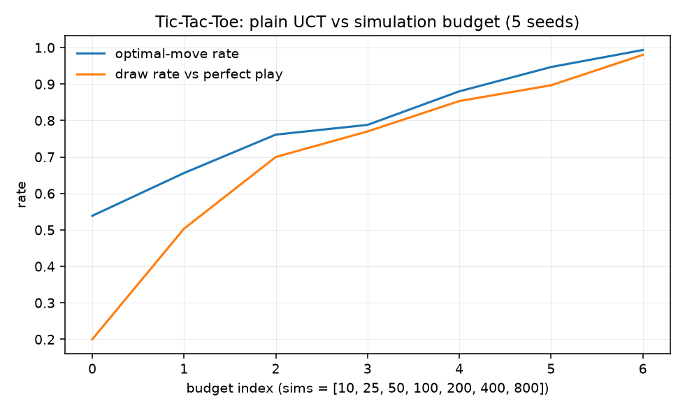
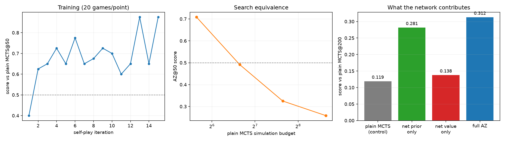

# A6 — Planning & Self-Play: task, goal, and how it was solved

What phase A6 asks, why search is a different kind of answer from everything
before it, and what the runs showed. The lab notebook is
[`experiments/a6_mcts/README.md`](../../experiments/a6_mcts/README.md).

> **At a glance**
>
> - UCT converges: optimal-move rate rises from 0.54 to 0.99 between 10 and 800 simulations, and the seed spread tightens as it does.
> - The learned network is worth a doubling of search: AlphaZero-style search at 50 simulations matches plain MCTS at 100.
> - The policy prior does almost all of that work (+0.162); the value head alone adds +0.019.

---

## 1. The task

[`ladder.md`](../ladder.md#a6) states three items:

1. Plain MCTS (UCT) on Tic-Tac-Toe/Connect Four; verify convergence to
   near-optimal play.
2. A learned policy/value net guiding search, trained by self-play; compare
   sample efficiency to plain MCTS.
3. Ablate the value network (random/uniform rollouts) to isolate search
   strength from learned-prior strength.

## 2. The goal: computation at decision time

Everything so far learned a *reactive* policy — see state, emit action, in
constant time. This phase spends computation at the moment of deciding,
building a search tree over a model of the game before committing to a move.

That changes what "improving the policy" means. A4 improved $\pi_\theta$ by
gradient ascent on returns. Search improves it *pointwise and immediately*: at
any state, running $n$ simulations produces a better move than the raw policy
would, without touching a single weight. AlphaZero's insight is to treat that as
a **policy improvement operator** and then train the network to imitate it:

$$\pi_\theta \;\xrightarrow{\text{search}}\; \pi_{\text{MCTS}} \;\xrightarrow{\text{regression}}\; \pi_\theta'$$

Search makes the network's moves better; the network makes the next search
better; iterate. Neither component alone is the algorithm.

Concretely, the network is fitted to the search's own output. With
$\boldsymbol{\pi}$ the normalised root visit counts and $z$ the game's result
from that position's mover's perspective:

$$\mathcal{L}(\theta) = -\boldsymbol{\pi}^\top \log p_\theta(s) + \left(v_\theta(s) - z\right)^2$$

The first term is a cross-entropy onto a *better policy than $p_\theta$ produced*
— which is what makes this policy improvement rather than mere self-distillation
— and the second regresses the value head onto outcomes the improved policy
actually achieved.

## 3. Why UCT converges (item 1)

MCTS repeats four steps — select, expand, evaluate, back up — and the only
interesting one is selection, which is a bandit problem. At a node with $N$
visits, the child maximising

$$\frac{W_a}{N_a} + c\sqrt{\frac{\ln N}{N_a}}$$

is chosen. That is **A1's UCB1 applied to a tree**, which is what "UCT" stands
for, and the reason A1's exploration bonus is worth having derived: the
$\sqrt{\ln N / N_a}$ term is the same confidence-interval width, and the same
argument that made regret logarithmic there makes the search consistent here.

Writing $\bar{X}_a$ for a child's mean value and $N_a$ for its visits, the bonus
is the same Hoeffding half-width A1 derived: for $N_a$ i.i.d. samples in a
bounded range,

$$\Pr\left(\left|\bar{X}_a - \mathbb{E}[X_a]\right| \ge \sqrt{\frac{2\ln N}{N_a}}\right) \le 2N^{-4}$$

so the index is an upper confidence bound that holds uniformly over the search,
and the $\ln N$ numerator is exactly what buys that uniformity.

The consistency result (Kocsis & Szepesvári 2006) is that the value estimate at
the root converges to the minimax value, and the probability of selecting a
suboptimal action at the root falls to zero, as $n \to \infty$. The proof is
delicate for a reason worth understanding: UCB1's regret bound assumes
**stationary** reward distributions, and a child's value distribution here is
*not* stationary — it drifts as that subtree's own search improves. The argument
works by showing the drift settles fast enough that a UCB-style bound still
holds at each level, then inducting on depth.

Two consequences follow, and both show up in the run:

- Convergence is **asymptotic in the simulation budget**, so the natural
  experiment is a budget sweep, not a single number.
- MCTS is **anytime**: it has an answer at any point, improving with more
  simulations, which is why "how good at budget $n$" is the honest question.

### Verifying it, rather than asserting it

Tic-Tac-Toe is small enough to solve exactly (5478 reachable positions), which
turns "converged to near-optimal play" into a checkable claim. Two measurements,
because either alone misleads:

**Move accuracy** against the exact optimal move *set*. The set matters:
optimal play is frequently non-unique — every one of the nine opening moves
draws under perfect play — so scoring against a single "best move" would
understate the agent badly. Positions where every legal move is optimal are
excluded, since they award credit for nothing.

**Results against a perfect opponent.** Perfect play draws, so a converged agent
must draw every game and **can never win**. That gives a free correctness
invariant on the harness itself: a non-zero win rate against a perfect player
is a bug, not a strong agent. (It caught one — see section 6.)

## 4. What the network adds (item 2)

AlphaZero replaces two pieces of plain MCTS:

**The rollout becomes a value head.** Plain MCTS estimates a leaf by playing
randomly to the end. That is unbiased but enormously high variance, and on most
games a random continuation says little about a position's true value.

**Uniform expansion becomes a policy prior**, and selection becomes PUCT:

$$\arg\max_a \left[ Q(s,a) + c\, P(s,a)\, \frac{\sqrt{\sum_b N_b}}{1 + N_a} \right]$$

The exploration term is now *weighted by the prior*, so search effort is
concentrated on moves the network considers plausible. The functional form
matters: at $N_a = 0$ the bonus is $c\,P(s,a)\sqrt{N}$, which is *linear* in the
prior, so an unvisited move is tried in proportion to how plausible the network
finds it; as $N_a$ grows the bonus decays like $1/N_a$ rather than
$1/\sqrt{N_a}$, so the empirical $Q$ takes over faster than under UCT. Prior
first, statistics later, with the crossover set by $c$.

**Measuring "sample efficiency" for a searcher** is best done in the currency
the searcher spends. The question this repo asks is: *how many simulations does
plain MCTS need to match the trained agent at a fixed budget?* That number
converts the learned prior and value into an equivalent quantity of raw search,
which is more informative than a win rate against one opponent.

## 5. Isolating the contributions (item 3)

The item asks to ablate the value network. Since the network supplies **two**
things, the informative version is the full cross:

| | rollout value | net value |
| --- | --- | --- |
| **uniform prior** | plain MCTS (the control) | value only |
| **net prior** | prior only | full AlphaZero |

Search, budget, and opponent are identical across all four cells, so each
difference attributes strength to one component. Note the top-left cell is
exactly plain MCTS, which makes the baseline part of the design rather than a
separate experiment.

## 6. What was done

`mcts.py` takes the prior and the leaf value as an *argument* — a function
`board -> (priors, value)` — so plain UCT and AlphaZero are the same search with
different evaluators, and the 2×2 above is four calls rather than four
implementations. Selection supports both UCT (item 1, faithful to the plain
algorithm) and PUCT (items 2–3, where it is held constant across arms).

Decisions worth recording:

- **The board is always stored from the mover's perspective**, and `play` flips
  its sign. One network then serves both players, and the value target needs no
  player index — a small invariant that removes a whole class of sign bugs.
- **Self-play targets are assigned by walking backwards from the result**,
  flipping at each ply, so every stored position carries its own mover's
  outcome.
- **Dirichlet noise at the root during self-play only.** At evaluation it would
  add error to no purpose; during self-play it is what stops the loop from
  collapsing onto a single opening.

**A bug the invariant caught.** The first version of the perfect-play harness
reported 45% losses and 20% draws — leaving 35% "wins" against an opponent that
cannot lose. The result sign was computed from a parity counter that was only
correct when MCTS moved first, so every game where it moved second was inverted.
The fix is one line (`result if mcts_turn else -result`), but the point is that
the impossible-win check surfaced it immediately, where a plausible-looking
win rate would have been believed. Reporting a quantity whose correct value is
*known in advance* is cheap and worth doing wherever the setup allows it.

## 7. Results

Tables in the [phase README](../../experiments/a6_mcts/README.md). What changes
how the phase should be read:

**UCT converges, verifiably.** Move accuracy rises $0.539 \to 0.993$ and the
draw rate against a perfect opponent $0.200 \to 0.980$ across a budget sweep
from 10 to 800 simulations, with the win rate pinned at exactly $0.000$
throughout. The seed spread *tightens* with budget ($\pm 0.041 \to \pm 0.007$),
which is the visible signature of the asymptotic argument in section 3: more
simulations means less dependence on which rollouts happened to occur. A 2% loss
rate survives at 800 simulations, which is correct — consistency is a statement
about the limit, not about any finite budget.

*Figure — Tic-tac-toe, 5 seeds: plain UCT's optimal-move rate and draw rate against a perfect opponent, from 10 to 800 simulations.*

**The network is worth a doubling of search.** AZ at 50 simulations beats plain
MCTS at 50 ($0.708$) and sits at parity with plain MCTS at 100 ($0.492$). Stating
it as a simulation-equivalence rather than a win rate is what makes it portable:
900 self-play games bought exactly as much as doubling the compute spent at
decision time. It is a lower bound — a two-layer convnet and 900 games is
nothing next to the original — and the per-iteration curve is only 20 games per
point, so its swings are sampling noise around a rising trend.

*Figure — AlphaZero-style training: win rate per iteration (20 games a point), search equivalence against plain MCTS, and what each part of the network contributes.*

**The prior does almost all the work.** The 2×2 attributes the gain sharply:

| component | gain over plain MCTS |
| --- | --- |
| policy prior alone | $+0.162$ |
| value head alone | $+0.019$ |
| both | $+0.194$ |

Two reasons compound. **Training signal:** the policy target is a full visit
distribution at every position — dense — while the value target is one noisy
$\pm 1$ shared across a whole game, so at this scale the policy head has seen
far more usable information. **Budget:** at 50 simulations across 7 legal moves,
*where* simulations are spent matters more than how well leaves are evaluated,
because the prior decides which parts of the tree come into existence at all,
whereas a better leaf value only refines estimates inside a tree already shaped.

That second reason yields a prediction the experiment does not test: the value
head's contribution should grow with the simulation budget and the prior's
should shrink. Re-running the 2×2 at 400 simulations would check it cheaply.

**The contrast this phase exists to set up.** B3's GRPO estimates an action's
worth by averaging independent rollouts — no tree, no reuse between samples.
MCTS spends the same budget on a *tree*, so simulations share prefixes and each
informs where the next should go, and here that structure is worth a 2×
multiplier on top of the network. GRPO forgoes it because language has no cheap
simulator: backing a value up through a tree of token sequences means paying
generation cost at every node.

## 8. What this sets up

- **B3's GRPO is this phase's contrast**, and section 7 states it: GRPO averages
  independent rollouts, MCTS spends the same budget on a tree whose simulations
  share prefixes and steer one another. The 2× search-equivalence measured here
  is what that structure is worth when a cheap simulator exists — and language
  has none, which is the whole reason GRPO forgoes it.
- **The policy-improvement framing recurs throughout Part B.** Search here,
  best-of-$n$ sampling and rejection sampling there: all are operators that
  produce a better policy than the network at inference cost, which is then
  distilled back into the weights. AlphaZero is the clean case because the
  operator is exact and the improvement is measurable.
- **The prior-beats-value result predicts something about B3's group size**:
  where compute is scarce relative to the branching factor, *allocating* it well
  beats *evaluating* better. A group of 8 rollouts in a vocabulary of 50,000 is
  an extreme version of the 50-simulations-over-7-moves regime measured here.

## 9. Where these items come from

| item | primary source | why it was picked |
| --- | --- | --- |
| 1 — plain UCT | [Kocsis & Szepesvári 2006](https://doi.org/10.1007/11871842_29) for UCT; [Browne et al. 2012](https://doi.org/10.1109/TCIAIG.2012.2186810) for the survey the ladder links | It is A1's UCB1 applied to a tree, so it makes the bandit phase pay off directly, and on a solvable game the convergence claim can be checked rather than believed. |
| 2 — learned policy/value guiding search | [AlphaGo Zero](https://doi.org/10.1038/nature24270) / [AlphaZero](https://arxiv.org/abs/1712.01815) | It is the cleanest statement of search-as-policy-improvement, and the only algorithm in Part A where the learned component and the planning component can be measured against each other in the same units. |
| 3 — ablate the value network | the AlphaGo Zero paper's own ablations | Without it, "the network helps" is unattributed — and since the network supplies both a prior and a value, the honest version is the full 2×2 rather than removing one piece. |

The **lab** pairing (`Practical_RL`
[week10_planning](https://github.com/yandexdataschool/Practical_RL/tree/master/week10_planning)
and [week05_explore](https://github.com/yandexdataschool/Practical_RL/tree/master/week05_explore))
is the ladder's own; the second is there because UCT is UCB, which is the
connection section 3 makes explicit.

The **goal statement** in section 2 is quoted from
[`ladder.md`](../ladder.md#a6). Section 4's framing of sample efficiency as a
simulation-equivalence number, and section 5's argument for the 2×2, are this
repo's rather than claims from the papers.
