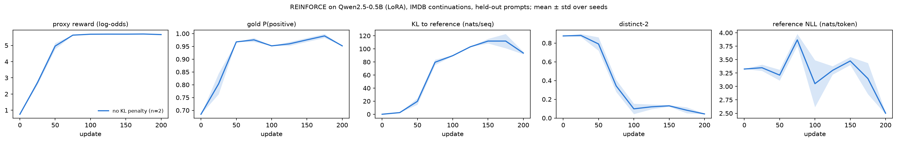
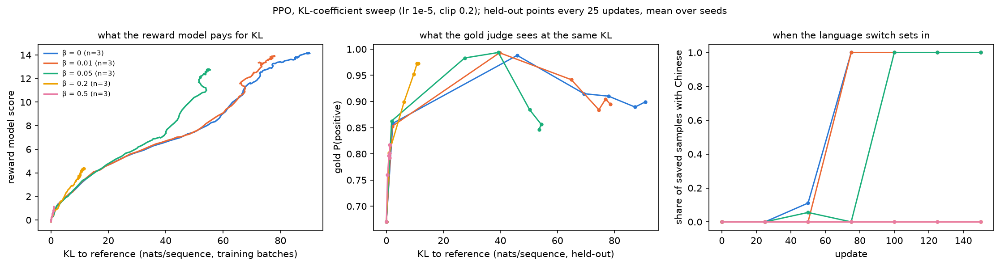

# B1 — REINFORCE → PPO on a language model: task, goal, and how it was solved

What phase B1 asks, why policy gradients on a language model need an anchor
to the pretrained model, and what the runs showed. The lab notebook with the
numbers is
[`experiments/b1_ppo/README.md`](../../experiments/b1_ppo/README.md); every
table and figure here is produced by `experiments/b1_ppo/report.py` from the
run directories.

> **At a glance**
>
> - **Both optimisers hack their reward model within 100 updates when nothing
>   ties them to the pretrained model**, each in its own way. REINFORCE
>   (5 seeds) collapses into a chant of "beautifully crafted, beautifully
>   presented" (distinct-2 0.88 → 0.05, KL to the reference 100 nats per
>   48-token completion). PPO (3 seeds) switches into **Chinese** mid-review:
>   the reward model was trained only on English reviews, but its Qwen
>   backbone reads Chinese and pays +14 to +16 for Chinese praise, against
>   +3 to +5 for strong English praise.
> - **A held-out judge catches only the hack that leaves its domain.** The
>   gold sentiment model scores REINFORCE's chant P(positive) 0.96, so it
>   cannot see that hack; it does see PPO's: gold peaks at ≈0.99 around 40
>   nats of KL and falls to 0.85-0.90 as the samples turn Chinese, while the
>   reward model keeps paying more.
> - **The KL coefficient is the control; the clip range is not, at this
>   learning rate.** β ≤ 0.05 switches language on every seed; **β = 0.2
>   gives the best gold score (0.97 ± 0.01) at 11 nats of KL with fluent
>   English** on all three seeds; β = 0.5 barely moves (KL 1.2, gold 0.82).
>   At lr 1e-5 fewer than 0.5% of tokens are ever clipped, and clip ranges
>   0.05-0.5 end in the same place.
> - **The coefficient that works depends on the reward's scale.** β = 0.05
>   holds REINFORCE to 15 nats against a sentiment classifier capped at
>   log-odds 5.7, and fails against the reward model, whose logit has no cap.

## Contents

- [1. The task](#1-the-task)
- [2. The goal](#2-the-goal)
- [3. What was done](#3-what-was-done)
- [4. REINFORCE without an anchor (item 1)](#4-reinforce-without-an-anchor-item-1)
- [5. PPO: the KL coefficient (items 2-3)](#5-ppo-the-kl-coefficient-items-2-3)
- [6. PPO: the clip range (item 2)](#6-ppo-the-clip-range-item-2)
- [7. What this sets up](#7-what-this-sets-up)
- [8. Deviations and what went wrong](#8-deviations-and-what-went-wrong)

---

## 1. The task

[`ladder.md`](../ladder.md#b1) states three items:

1. Reuse the A4 REINFORCE implementation on a language-modelling reward;
   observe reward hacking in a generative action space.
2. Train full PPO (TRL's PPOTrainer); sweep the clip range and the KL
   coefficient; plot reward against KL to the reference.
3. Set the KL penalty near zero and document the failure mode.

## 2. The goal

The policy is a language model, $\pi_\theta(y \mid x)$: the state is the
prompt and the tokens so far, an action is the next token out of a
vocabulary of ~150,000, and an episode is one completion, scored once at the
end by a reward model $r(x, y)$. A4's estimator applies unchanged:

$$\nabla_\theta J = \mathbb{E}\Big[\big(r(x,y) - b\big)\sum_t \nabla_\theta \log \pi_\theta(y_t \mid x, y_{<t})\Big]$$

Two things are new. The policy starts from a pretrained model whose fluency
is worth keeping, and $r$ is a *learned proxy*, trained on a distribution
the policy can leave. RLHF handles both with one term: maximise the reward
minus a penalty on the divergence from the frozen reference model,

$$r_\beta(x, y) = r(x, y) - \beta \sum_t \big(\log \pi_\theta(y_t \mid \cdot) - \log \pi_{\text{ref}}(y_t \mid \cdot)\big),$$

and PPO adds a second, per-update leash: the probability ratio
$\rho_t = \pi_\theta / \pi_{\theta_{\text{old}}}$ is clipped to
$[1-\varepsilon, 1+\varepsilon]$, so several gradient steps on one batch of
samples cannot move far from the policy that produced them.

The phase is about what each of the two leashes buys. The measure of
"bought" is not the proxy reward but what a judge the policy never trained
against sees, and what the text looks like.

## 3. What was done

**Task.** Continue the opening 4-8 tokens of an IMDB review (train split)
with up to 48 sampled tokens; the reward asks for a positive continuation.
Evaluation: 64 fixed test-split openings, sampled with a fixed seed every 25
updates.

**Policy.** Qwen2.5-0.5B (base) with LoRA (r = 16, all linear layers); the
reference is the same model with the adapters off. Kaggle's free 2×T4
notebooks, fp16 autocast over fp32 weights (a T4 has no bf16).

**Judges.**

| role | model | used by |
| --- | --- | --- |
| proxy reward | `lvwerra/distilbert-imdb`, log-odds of positive (saturates near 5.7) | REINFORCE |
| proxy reward | Qwen2.5-0.5B + scalar head trained on IMDB labels (`train_rm.py`), its logit (no cap) | PPO |
| gold judge, never trained against | `siebert/sentiment-roberta-large-english`, P(positive) | every evaluation |

PPO uses its own reward model because TRL's PPOTrainer scores token ids
with a classifier on the policy's tokenizer. On 2,000 held-out 64-token test
openings it is 85.8% accurate, the gold judge 85.5%, and they agree on
87.5%.

**Measures.** Proxy reward; gold P(positive); KL to the reference (sum over
completion tokens of $\log\pi - \log\pi_{\text{ref}}$, nats per sequence);
distinct-2 over the 64 completions; the reference model's per-token NLL of
the completions; for PPO, the share of saved samples containing Chinese
characters, and the share of tokens clipped per update.

**Runs.** REINFORCE: 200 updates of 32 samples, lr 1e-4, batch-mean
baseline; 5 seeds without a KL term, 3 with β = 0.05 (≈14 min each). PPO
(TRL 1.11): 150 updates of 32 rollouts, 4 PPO epochs, lr 1e-5; β ∈ {0,
0.01, 0.05, 0.2, 0.5} at clip 0.2, 3 seeds each; clip ∈ {0.05, 0.2, 0.5} at
β = 0.2 at lr 1e-5 and at lr 1e-4 (≈55 min each).

## 4. REINFORCE without an anchor (item 1)

| run | seeds | proxy reward (log-odds) | gold P(positive) | KL to reference (nats/seq) | distinct-2 | reference NLL (nats/token) |
| --- | --- | --- | --- | --- | --- | --- |
| before training (update 0) | 8 | 0.75 | 0.68 | 0 | 0.88 | 3.32 |
| no KL penalty, after 200 updates | 5 | 5.69 ± 0.03 | 0.96 ± 0.01 | 100.1 ± 8.3 | 0.05 ± 0.01 | 2.76 ± 0.26 |
| KL penalty β = 0.05, after 200 updates | 3 | 5.22 ± 0.14 | 0.97 ± 0.02 | 14.6 ± 1.8 | 0.79 ± 0.03 | 3.44 ± 0.07 |

What the policy writes on the same held-out prompt (seed 0):

| update | no KL penalty | β = 0.05 |
| --- | --- | --- |
| 0 | "This movie is stunningly so sad, as the lightweight fabric gets rendered toxic to all" | (same model) |
| 100 | "This movie is stunningly and beautifully crafted, beautifully crafted and beautifully and gracefully and beautifully, a, a superb, a master, beautifully and bea…" | |
| 200 | "I really like this movie. I've beautifully presented and beautifully crafted, a beautifully presented and beautifully presented, a beautifully presented and a s…" | "I really like this movie. I only say it because if you like the movie then this is a movie you will enjoy. It's simply brilliant and you'll love it…" |

- **The proxy saturates by update 75, and the policy keeps moving.** From
  there the reward cannot rise, yet KL climbs from 20 to ≈100 nats and
  distinct-2 falls from 0.8 to 0.05: nothing in the objective resists
  drift, so the policy drifts towards whatever maximises the reward most
  reliably, which is one phrase. Five seeds end in the same place (KL 94-109,
  distinct-2 0.04-0.09).
- **The gold judge is fooled too** (0.96): it measures the same property as
  the proxy, so it cannot see a hack that games that property. Diversity and
  KL expose it.
- **Reference NLL falls as the text degenerates** (3.32 → 2.76): repetition
  is cheap for a language model to predict, so per-token NLL is no fluency
  measure for this failure.
- **β = 0.05 keeps the gain and drops the collapse:** the same gold score
  (0.97), 7× less KL, distinct-2 0.79. The half point of proxy reward it
  gives up is the part that was bought by degenerating.

## 5. PPO: the KL coefficient (items 2-3)

Final held-out evaluation after 150 updates (lr 1e-5, clip 0.2), mean ± std
over 3 seeds:

| β | RM score | gold P(positive) | KL to reference | distinct-2 | final samples in Chinese |
| --- | --- | --- | --- | --- | --- |
| before training | −0.10 | 0.67 | 0 | 0.88 | 0 |
| 0 | 14.20 ± 0.22 | 0.90 ± 0.01 | 90.8 ± 2.4 | 0.26 ± 0.05 | all |
| 0.01 | 13.97 ± 0.06 | 0.89 ± 0.04 | 78.6 ± 3.1 | 0.32 ± 0.03 | all |
| 0.05 | 12.57 ± 0.16 | 0.85 ± 0.01 | 53.6 ± 0.9 | 0.54 ± 0.02 | all |
| **0.2** | 4.68 ± 0.05 | **0.97 ± 0.01** | 11.1 ± 0.3 | 0.80 ± 0.01 | none |
| 0.5 | 1.40 ± 0.06 | 0.82 ± 0.02 | 1.2 ± 0.0 | 0.88 ± 0.01 | none |

Left: the reward model's score against KL during training. Middle: the gold
judge against KL on the held-out prompts. Right: the share of saved samples
containing Chinese, by update.

What the policy writes after 150 updates (same held-out prompt):

| β | completion |
| --- | --- |
| 0 | "I really like this movie. I fully enjoy this是一部非常优秀的一部电影，非常值得一看！这部电影非常感人，也非常精彩！这部电影非常值得推荐…" (RM +13.8) |
| 0.05 | "I really like this movie. I fully enjoyed it and it left a lasting impact. This是一部感人至深的爱情电影，展现了亲情、友情和爱情的力量…" (RM +11.3) |
| 0.2 | "I really like this movie. I only know a little about the country, but it should appeal to the wide audience without spoiling it. The movie sends to the viewer a shiver…" (RM +5.4) |
| 0.5 | "I really like this movie. I only know a little about Roman holidays, but we should learn more about them…" (RM +4.3) |

- **The near-zero-KL failure (item 3) is a language switch, not a chant.**
  With β ≤ 0.05 every seed switches, and abruptly: within one 25-update
  interval the saved samples go from none to all six in Chinese, by update
  75 for β ≤ 0.01 and by update 100 for β = 0.05 (right panel). The shape is
  one English clause, then Chinese praise to the end of the completion. The reward model's backbone was pretrained on both
  languages and its head was fitted only on English reviews, so Chinese
  praise is off its training distribution and it scores it higher than any
  English text (+14 to +16 against +3 to +5). PPO finds that region;
  REINFORCE against a capped English classifier had no such region to find.
- **The proxy and the gold judge come apart exactly there.** Up to ≈40 nats
  of KL, more reward means more gold (middle panel, all β); after that the
  reward model keeps paying while gold falls back to 0.85-0.90. That fall is
  modest because the gold judge still reads the English opening clause.
- **β = 0.2 is the best of the five on every measure but proxy reward:**
  gold 0.97 ± 0.01 on all three seeds, 11 nats of KL, distinct-2 0.80, no
  Chinese. β = 0.5 holds the policy so close to the reference (1.2 nats)
  that it barely improves (gold 0.82).
- **The KL budget is set by the reward's scale, not by β alone.** The same
  β = 0.05 that held REINFORCE to 15 nats lets PPO drift to 54: the
  DistilBERT proxy saturates at log-odds 5.7, so beyond ~15 nats there was
  nothing left to buy, while the reward model's logit has no ceiling. A
  coefficient is only meaningful relative to the reward range.

## 6. PPO: the clip range (item 2)

<!-- CLIP_SECTION -->

## 7. What this sets up

- **B2 (DPO/IPO)** gets the comparison point it asks for: the best PPO run
  here is β = 0.2 (gold 0.97, 11 nats). DPO optimises the same KL-regularised
  objective in closed form, without a reward model to hack.
- **B4 (overoptimisation)** gets a ready-made hackable reward model with a
  known exploit (`train_rm.py`; Chinese praise), and the proxy-vs-gold curve
  of §5 is the shape B4 asks to measure; the reward model ensemble and the
  tighter KL it lists as mitigations can be tested against this exploit.
- **Reading the curves:** the reward model's score is not the result; the
  gold judge, the KL and the samples are. A held-out judge only catches
  hacks outside the property it measures, so diversity and KL belong in
  every table.

## 8. Deviations and what went wrong

- **TRL's PPOTrainer was removed after TRL 1.11** (huggingface/trl#7020,
  2026-09-04), and the TRL commit this repo pins is newer. The PPO runs pin
  `trl==1.11.0`, where it lives in `trl.experimental.ppo`.
- **The value model trains only its last two layers and its head**
  (`--value-layers 2`), not the whole network as TRL's examples do: a fully
  trainable fp32 0.5B value model with Adam states is ≈8 GB, which with the
  policy, reference, reward model and gold judge does not fit a 16 GB T4
  (the first pilot ran out of memory).
- **LoRA, not full fine-tuning, for the policy**; the reference is the base
  model with the adapters off.
- **Kaggle notebooks**: the first REINFORCE pilot died on Kaggle's old
  torchao; the first PPO pilots could not see the reward model, because
  Kaggle's MCP endpoint accepts but does not attach data sources (the CLI's
  `kernels push` does, `scripts/kaggle/kpush.py`).
