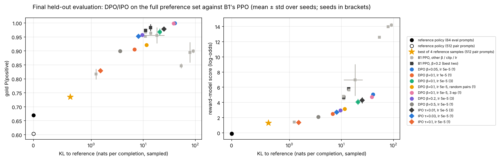
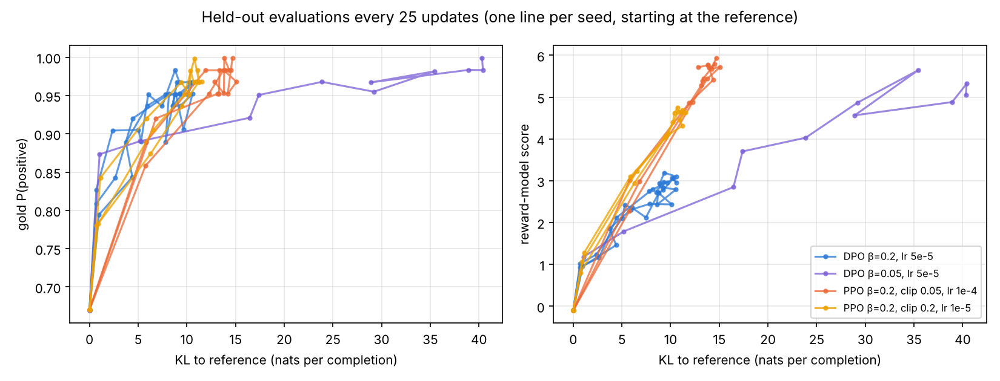
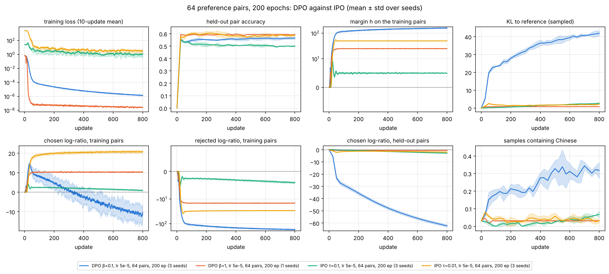
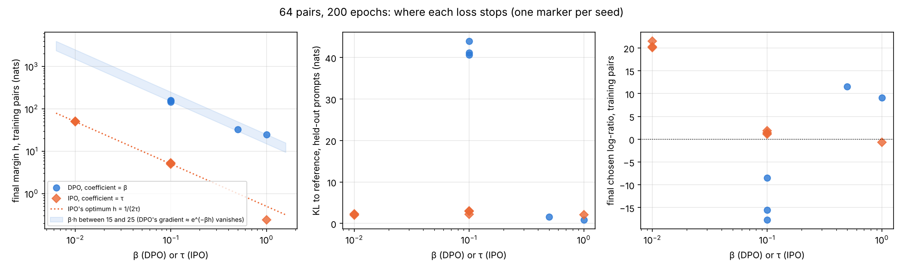

# B2 — DPO and IPO on a language model: task, goal, and how it was solved

What phase B2 asks, why a preference loss can stand in for B1's RL loop,
where that shortcut breaks, and what the runs showed. The lab notebook with
the numbers is
[`experiments/b2_dpo/README.md`](../../experiments/b2_dpo/README.md); every
table and figure here is produced by `experiments/b2_dpo/report.py` from the
run directories.

> **At a glance**
>
> - **DPO matches PPO's gold score at PPO's KL budget for a tenth of the
>   compute.** On B1's task, with pairs labelled by the reward model PPO
>   trained against, DPO at β = 0.2 reaches gold P(positive) 0.957 ± 0.007
>   at 9.6 nats of KL (3 seeds, ≈5 min per run on a T4); B1's best PPO
>   reaches 0.973-0.983 at 11-14 nats (≈55 min per run). Gold rises with KL
>   at the same rate for both; PPO buys more *reward-model* score per nat
>   (4.7 against 3.0), which the gold judge does not credit.
> - **DPO learns the reward model's exploit from the labels, partially.**
>   Chosen responses contain Chinese 2.5× as often as rejected ones; DPO's
>   samples go from 3% to 12-25% Chinese as β falls, where PPO at β = 0.2
>   had none and PPO at β ≤ 0.05 switched completely.
> - **Overfitting 64 pairs with DPO (β = 0.1) shows both pathologies the
>   ladder names.** Loss 1e-6, margin 153 nats, bought on the rejected side
>   (−167); the chosen log-ratio rises to +15, then falls through zero and
>   ends at −14 on the training pairs and −62 on held-out chosen responses;
>   KL to the reference 42 nats, 32% of samples in Chinese, held-out pair
>   accuracy 0.57. The chosen side falls on the full set too: −31 after one
>   epoch at β = 0.1.
> - **IPO stops exactly at its target margin and never collapses** (50.2 ±
>   0.3 for a target of 50, chosen side +20.6, KL 2.2 nats). **But DPO with a
>   larger β stops too**: its gradient vanishes once β·h ≈ 15-25, so β = 0.5
>   and 1 end at margins of 32 and 25 with KL 1.6 and 0.8 and the chosen side
>   up. The runaway is a small-β effect.
> - **On the full set IPO and DPO trace the same frontier** (IPO τ = 0.03:
>   gold 0.952 at 8.1 nats; DPO β = 0.2: 0.957 at 9.6): in one epoch no pair
>   reaches IPO's target, so the bound never binds. IPO's bound fixes repeated
>   passes over few pairs, which is where DPO breaks.

## Contents

- [1. The task](#1-the-task)
- [2. The goal](#2-the-goal)
- [3. What was done](#3-what-was-done)
- [4. The preference set](#4-the-preference-set)
- [5. DPO against PPO (item 1)](#5-dpo-against-ppo-item-1)
- [6. Overfitting a small set: DPO (item 2)](#6-overfitting-a-small-set-dpo-item-2)
- [7. IPO's bound (item 3)](#7-ipos-bound-item-3)
- [8. What this sets up](#8-what-this-sets-up)
- [9. Deviations and what went wrong](#9-deviations-and-what-went-wrong)

---

## 1. The task

[`ladder.md`](../ladder.md#b2) states three items:

1. Build or synthesise a preference dataset; train DPO; compare against the
   best PPO run.
2. Overfit DPO on a small preference set; show chosen-logprob collapse and
   KL blowup.
3. Swap in IPO's bounded objective; compare stability.

## 2. The goal

B1 maximised the KL-regularised reward

$$\max_\pi \; \mathbb{E}_{x,\, y\sim\pi}\big[r(x,y)\big] - \beta\,\mathrm{KL}\big(\pi(\cdot\mid x)\,\|\,\pi_{\text{ref}}(\cdot\mid x)\big)$$

with a sampling loop. This objective has a closed-form maximiser,

$$\pi^*(y\mid x) = \frac{1}{Z(x)}\,\pi_{\text{ref}}(y\mid x)\,e^{r(x,y)/\beta},
\qquad\text{so}\qquad r(x,y) = \beta\log\frac{\pi^*(y\mid x)}{\pi_{\text{ref}}(y\mid x)} + \beta\log Z(x).$$

Any reward is therefore a policy in disguise. If preferences follow the
Bradley-Terry model, $P(y_w \succ y_l) = \sigma\big(r(x,y_w) - r(x,y_l)\big)$,
the partition function cancels in the difference, and fitting the reward by
maximum likelihood becomes fitting the policy directly. With

$$h_\theta = \log\frac{\pi_\theta(y_w\mid x)}{\pi_{\text{ref}}(y_w\mid x)} - \log\frac{\pi_\theta(y_l\mid x)}{\pi_{\text{ref}}(y_l\mid x)},$$

the losses are

$$\mathcal{L}_{\text{DPO}} = -\log\sigma(\beta\,h_\theta), \qquad
\mathcal{L}_{\text{IPO}} = \Big(h_\theta - \frac{1}{2\tau}\Big)^2 .$$

No reward model, no sampling, no value function: a classification loss over
pairs, with the reference's log-probabilities computed once.

The shortcut has a cost the derivation hides. Bradley-Terry needs
$P(y_w \succ y_l) < 1$ to give a finite reward difference. When a pair is
labelled the same way every time, the maximum-likelihood $h$ is infinite, and
DPO's loss keeps falling as $h$ grows, whatever β is: the KL term that
anchored B1's policy exists in the derivation, not in the loss being
minimised. (In practice the pull is finite: the gradient of
$-\log\sigma(\beta h)$ is $\beta\,\sigma(-\beta h) \approx \beta e^{-\beta h}$,
which vanishes once $\beta h$ is a few tens, so the margin DPO reaches
scales like $1/\beta$. §7 measures where.) The loss also constrains only the *difference* of two
log-ratios, so it can be lowered by pushing the rejected response down
without lifting the chosen one. IPO (Azar et al., 2023) replaces the
log-sigmoid with a squared distance to a finite target margin $1/(2\tau)$,
so a pair that is already separated by that much stops pulling. Items 2-3
ask whether those failure modes show up, and whether IPO's bound actually
removes them.

## 3. What was done

**Task, policy, judges: B1's, unchanged.** Continue the opening 4-8 tokens
of an IMDB review with up to 48 sampled tokens, positively. Qwen2.5-0.5B
(base) with LoRA (r = 16, all linear layers); the reference is the same
model with the adapters off. Evaluation on B1's 64 held-out test-split
openings, sampled with B1's fixed seed: B1's reward model score (the Qwen
head PPO trained against), the gold judge's P(positive)
(`siebert/sentiment-roberta-large-english`, never trained against), KL to
the reference (sum over completion tokens of $\log\pi-\log\pi_{\text{ref}}$
on the policy's own samples), distinct-2, reference NLL and the share of
samples containing Chinese (PPO's hack in B1).

**The preference set** (`make_prefs.py`). For each of 4,096 train-split
openings, four continuations sampled from the reference policy at
temperature 1, each scored by B1's reward model; the pair is the best- and
worst-scored of the four (`--pair-rule random` takes two at random
instead). 512 test-split openings give held-out pairs the same way. These
are synthetic preferences from the same reward model PPO optimised, so the
comparison with PPO is about the optimiser, not the labels: PPO saw the
reward through 4,800 online rollouts, DPO through four fixed reference
samples per prompt. Labels are deterministic (the higher score always
wins), which is the regime the IPO paper argues DPO handles worst.

**Training** (`dpo_lm.py`, written out rather than through TRL so every
log-probability is visible). Sequence log-probabilities summed over
completion tokens; batches of 16 pairs; AdamW with 10 warm-up updates; fp16
autocast on Kaggle T4s. Logged every update on the training batch, and
every 25 updates on 256 held-out pairs: loss, preference accuracy
($h>0$), $h$, the chosen and rejected log-ratios to the reference, and the
chosen and rejected log-probabilities per token.

**Runs.** Full set: DPO β ∈ {0.05, 0.1, 0.2, 0.5} at lr 5e-5 (3 seeds at
β = 0.1 and 0.2), β = 0.1 at lr 1e-5, with random pairs and for 3 epochs;
IPO τ ∈ {0.01 (3 seeds), 0.03, 0.1}. Small set: the first 64 training
pairs, 200 epochs (800 updates), DPO β = 0.1 (3 seeds), 0.5, 1; IPO τ =
0.01 (3 seeds), 0.1 (3 seeds), 1. 29 runs plus the preference set: four Kaggle
notebooks, 2.2 hours of notebook time on two T4s each (≈4.5 T4-hours). B1's PPO runs supply the comparison rows.

Before training, every run evaluates the same: reward-model score −0.10,
gold 0.669, distinct-2 0.88, reference NLL 3.32, 2 of 64 samples (3%)
containing Chinese.

## 4. The preference set

| split | prompts | RM score, all samples | gold, all samples | RM, best of 4 | gold, best of 4 | RM, worst of 4 | gold, worst of 4 | median RM margin best-worst | gold agrees best ≥ worst |
| --- | --- | --- | --- | --- | --- | --- | --- | --- | --- |
| train | 4096 | -0.21 | 0.592 | 1.20 | 0.734 | -1.54 | 0.435 | 2.37 | 0.786 |
| test | 512 | -0.13 | 0.603 | 1.28 | 0.735 | -1.50 | 0.453 | 2.30 | 0.783 |

Wall clock 5.3 min on one T4; 0 test prompts coincide with B1's 64 evaluation prompts.

- **The labels are noisy against the gold judge**: it agrees with the reward
  model on which of best and worst is more positive for 78-79% of prompts.
  The reward model is the only teacher here, so DPO is learning *its*
  preferences, not the gold judge's, exactly as PPO did.
- **Best-of-4 is a weak policy**: gold 0.735 against 0.603 for a single
  sample (on these 512 prompts), at a KL of at most
  $\log 4 - 3/4 = 0.64$ nats. Everything DPO reaches beyond that is
  extrapolation along the direction the pairs define.
- **B1's hack is in the data, weakly.** 6.5% of chosen and 2.6% of rejected
  training responses contain Chinese (3.6% of all samples): the reference
  model drifts into Chinese on its own now and then, and the reward model
  scores those samples +0.86 on average against −0.25 for the rest.

## 5. DPO against PPO (item 1)

Final held-out evaluation after one epoch (256 updates of 16 pairs) unless
stated, mean ± std over seeds; B1's two best PPO configurations below:

| method | seeds | RM score | gold P(positive) | KL to reference | distinct-2 | reference NLL | samples in Chinese | held-out pair accuracy | chosen log-ratio (held out) | rejected log-ratio (held out) | minutes per run (T4) |
| --- | --- | --- | --- | --- | --- | --- | --- | --- | --- | --- | --- |
| DPO β=0.05, lr 5e-5 | 1 | 5.05 | 0.999 | 40.32 | 0.87 | 4.11 | 0.25 | 0.83 | -84.96 | -129.11 | 5 |
| DPO β=0.1, lr 1e-5 | 1 | 2.50 | 0.905 | 6.76 | 0.86 | 3.27 | 0.11 | 0.80 | -6.47 | -12.60 | 6 |
| DPO β=0.1, lr 5e-5 | 3 | 4.07 ± 0.39 | 0.968 ± 0.012 | 20.70 ± 2.15 | 0.88 ± 0.02 | 3.76 ± 0.12 | 0.15 ± 0.03 | 0.83 ± 0.00 | -30.84 ± 3.37 | -51.45 ± 4.50 | 5 |
| DPO β=0.1, lr 5e-5, random pairs | 1 | 3.14 | 0.921 | 11.58 | 0.85 | 3.44 | 0.09 | 0.70 | -15.12 | -20.33 | 5 |
| DPO β=0.1, lr 5e-5, 3 ep | 1 | 4.71 | 0.998 | 38.49 | 0.87 | 3.35 | 0.19 | 0.85 | -86.36 | -136.79 | 12 |
| DPO β=0.2, lr 5e-5 | 3 | 2.96 ± 0.02 | 0.957 ± 0.007 | 9.59 ± 0.72 | 0.89 ± 0.00 | 3.65 ± 0.00 | 0.12 ± 0.01 | 0.84 ± 0.01 | -10.41 ± 0.50 | -20.51 ± 0.80 | 5 |
| DPO β=0.5, lr 5e-5 | 1 | 2.10 | 0.899 | 3.59 | 0.88 | 3.53 | 0.09 | 0.84 | -2.12 | -6.21 | 5 |
| IPO τ=0.01, lr 5e-5 | 3 | 4.30 ± 0.40 | 0.978 ± 0.007 | 24.86 ± 2.64 | 0.86 ± 0.01 | 3.77 ± 0.13 | 0.10 ± 0.04 | 0.82 ± 0.01 | -43.77 ± 5.09 | -69.20 ± 7.58 | 5 |
| IPO τ=0.03, lr 5e-5 | 1 | 2.73 | 0.952 | 8.08 | 0.88 | 3.63 | 0.14 | 0.86 | -8.35 | -16.96 | 5 |
| IPO τ=0.1, lr 5e-5 | 1 | 1.35 | 0.829 | 1.51 | 0.88 | 3.51 | 0.08 | 0.81 | -0.72 | -3.10 | 5 |
| B1 PPO β=0.2, clip 0.05, lr 1e-4 | 3 | 5.78 ± 0.11 | 0.983 ± 0.013 | 13.84 ± 0.75 | 0.77 ± 0.01 | 3.19 ± 0.01 | – | – | – | – | 54 |
| B1 PPO β=0.2, clip 0.2, lr 1e-5 | 3 | 4.68 ± 0.05 | 0.973 ± 0.007 | 11.11 ± 0.33 | 0.80 ± 0.01 | 3.17 ± 0.02 | – | – | – | – | 56 |

Final evaluations on the KL axis (log scale past 1 nat). Left: the gold
judge. Right: the reward model the pairs were labelled with. Grey squares
are all of B1's PPO configurations, the dark ones its two best.

The same plane during training, every 25 updates, for DPO at β = 0.2 and
0.05 and the two best PPO configurations.

What the policy writes on B1's held-out prompt "I really like this movie. I":

| method | completion | RM | gold |
| --- | --- | --- | --- |
| DPO β = 0.2 | "…only now bought the DVD because the silent version of this is better on DVD. ]]\nThe film masterful exploring of the sexuality between slaves and whites in Louisiana…" | 4.7 | 0.999 |
| DPO β = 0.05 | "…'ve always loved the intensity and the romance of it. Ms. Butler is stunningly talented and masterful herself and sends to the highest level of excellence as well. Crystal exquisite and timeless. All great!…" | 3.3 | 0.999 |
| IPO τ = 0.1 | "…only know a little about Roman holidays, but we should learn more about them…" | 4.0 | 0.999 |
| PPO β = 0.2 (B1) | "…only know a little about the country, but it should appeal to the wide audience without spoiling it…" | 5.4 | – |

- **Quality: the same gold score at the same KL, slightly lower at the
  operating point.** DPO β = 0.2 ends at gold 0.957 ± 0.007 and 9.6 nats;
  PPO β = 0.2 at 0.973 ± 0.007 and 11.1 nats (lr 1e-5) or 0.983 ± 0.013 and
  13.8 nats (lr 1e-4). Along the trajectories (left panel) DPO's and PPO's
  gold-against-KL curves overlap; the gap at the end is where each stops,
  not a worse curve. DPO also keeps more diversity: distinct-2 0.89 against
  0.77-0.80 for PPO.
- **PPO buys reward-model score that the gold judge does not credit.** At
  ≈10 nats PPO's reward-model score is 4.7 and DPO's 3.0 (right panels),
  for the same gold. PPO samples online and climbs the reward model wherever
  it is steepest; DPO only sees four reference samples per prompt, so it can
  only move along directions those samples span. That is less optimisation
  against the proxy, which here costs nothing on the judge that matters.
- **β sets the KL budget, as the derivation says.** β = 0.5, 0.2, 0.1, 0.05
  end at 3.6, 9.6, 20.7, 40.3 nats, and gold rises with it (0.90 → 0.999).
  The learning rate moves along the same curve (β = 0.1 at lr 1e-5: 6.8
  nats, gold 0.905), and so does a third epoch (β = 0.1: 38.5 nats, gold
  0.998).
- **The reward model's exploit arrives offline, at the strength it has in
  the data.** 12% of DPO's samples at β = 0.2 contain Chinese (3% before
  training), 15% at β = 0.1 and 25% at β = 0.05. PPO at β = 0.2 had none,
  and at β ≤ 0.05 switched completely within 25 updates. DPO cannot
  discover the exploit, but it does learn the preference for it that the
  labels carry, and a lower β lets it act on that more.
- **The chosen response gets *less* likely even here.** Held-out chosen
  log-ratios are negative for every full-set configuration (−10 at β = 0.2,
  −31 at β = 0.1, −85 at β = 0.05), with the rejected ones falling faster;
  the preference is learned (held-out pair accuracy 0.82-0.86) as the
  difference of two falls. Section 6 shows what that becomes when nothing
  stops it.
- **Engineering cost.** A DPO run is ≈5 minutes on one T4 including 11
  evaluations, against ≈55 for PPO; it holds one model with adapters in
  training (the reward model and gold judge are loaded for evaluation only),
  where PPO holds the policy, a value model, the reward model and the
  reference. The preference set costs 5 minutes once. PPO's settings that
  had to be found in B1 (β, clip range, learning rate, which value-model
  layers fit in memory) become two for DPO (β and the learning rate), and
  the pairing rule: random pairs (median reward gap 1.10 against 2.37) end
  at 11.6 nats and gold 0.921 for the same β = 0.1.

## 6. Overfitting a small set: DPO (item 2)

The first 64 training pairs, 200 epochs (800 updates of 16 pairs), lr 5e-5:

| method | seeds | train loss | train accuracy | train margin h | chosen log-ratio (train) | lowest chosen log-ratio (train) | rejected log-ratio (train) | held-out accuracy | KL to reference | peak KL | gold P(positive) | distinct-2 | samples in Chinese |
| --- | --- | --- | --- | --- | --- | --- | --- | --- | --- | --- | --- | --- | --- |
| DPO β=0.1, lr 5e-5, 64 pairs, 200 ep | 3 | 1.22e-06 ± 1.02e-07 | 1.00 ± 0.00 | 153.3 ± 5.2 | -13.9 ± 3.9 | -31.17 ± 1.92 | -167.2 ± 4.1 | 0.57 ± 0.01 | 41.9 ± 1.5 | 41.98 ± 1.52 | 0.837 ± 0.029 | 0.85 ± 0.01 | 0.32 ± 0.04 |
| DPO β=0.5, lr 5e-5, 64 pairs, 200 ep | 1 | 3.47e-07 | 1.00 | 32.5 | 11.5 | 0.00 | -21.0 | 0.57 | 1.6 | 1.56 | 0.661 | 0.89 | 0.05 |
| DPO β=1, lr 5e-5, 64 pairs, 200 ep | 1 | 2.97e-09 | 1.00 | 24.5 | 9.1 | 0.00 | -15.4 | 0.59 | 0.8 | 0.89 | 0.760 | 0.89 | 0.03 |
| IPO τ=0.01, lr 5e-5, 64 pairs, 200 ep | 3 | 1.72 ± 1.17 | 1.00 ± 0.00 | 50.2 ± 0.3 | 20.6 ± 0.6 | -0.02 ± 0.02 | -29.6 ± 0.9 | 0.59 ± 0.01 | 2.2 ± 0.1 | 2.53 ± 0.21 | 0.672 ± 0.013 | 0.90 ± 0.00 | 0.03 ± 0.01 |
| IPO τ=0.1, lr 5e-5, 64 pairs, 200 ep | 3 | 1.55 ± 0.914 | 1.00 ± 0.00 | 5.1 ± 0.2 | 1.5 ± 0.3 | -0.09 ± 0.09 | -3.7 ± 0.3 | 0.50 ± 0.01 | 2.7 ± 0.4 | 2.75 ± 0.37 | 0.631 ± 0.009 | 0.91 ± 0.00 | 0.07 ± 0.02 |
| IPO τ=1, lr 5e-5, 64 pairs, 200 ep | 1 | 1.12 | 0.69 | 0.2 | -0.7 | -1.89 | -0.9 | 0.50 | 2.1 | 2.13 | 0.579 | 0.91 | 0.03 |

Mean ± std over seeds (one seed for DPO β = 1). Training-pair panels are
10-update running means.

What DPO β = 0.1 writes after 200 epochs on 64 pairs (seed 0):

> "Of all the films I've看过, I really like Inception. It's迷人又迷人的文学 translated into motionpicture…"

- **The aggregate loss says everything is fine.** It falls to 1e-6 and every
  training pair is ranked correctly from update 5 on.
- **Underneath, the chosen side collapses.** The margin reaches 153 nats,
  bought almost entirely by pushing the rejected responses down (−167). The
  chosen log-ratio first rises (+14 to +16 at update 26-31), then turns,
  crosses zero at update 255-315 on all three seeds and ends at −14 (−0.2
  nats per token): after training the model is *less* likely than before to
  write the responses it was told to prefer. On held-out chosen responses
  the fall is monotone, to −62.
- **KL blows up and the policy drifts where the labels lean.** Sampled KL
  to the reference rises to 42 nats; 32% of samples contain Chinese (the
  lean of §4, amplified); gold rises to 0.84 and held-out pair accuracy is
  0.57: the 64 pairs were memorised, not generalised from.
- **Why the chosen side falls (a hypothesis, not tested here).** The loss
  only sees $h$, the difference of two log-ratios; nothing in it asks for
  the chosen side to stay up. Chosen and rejected continuations of the same
  opening are written in the same register by the same model, so the cheapest
  direction that lowers the rejected sequence's probability plausibly lowers
  the chosen one's too, just less; once the pairs are separated every step
  still increases $h$, so the shared fall accumulates.

## 7. IPO's bound (item 3)

The 64-pair runs, final values, one marker per seed: the margin each loss
stops at (left), KL to the reference (middle), and the chosen log-ratio on
the training pairs (right), against DPO's β or IPO's τ.

- **IPO stops exactly where τ says**: final margins 50.2 ± 0.3 for τ = 0.01
  (target 1/(2τ) = 50) and 5.1 ± 0.2 for τ = 0.1 (target 5); τ = 1 (target
  0.5) is still short at 0.2 after 800 updates.
- **IPO reaches a large margin without the collapse.** At τ = 0.01 it
  separates the 64 pairs by 50 nats with the chosen side *up* 20.6 and the
  rejected down 29.6, at 2.2 nats of KL; DPO β = 0.1 reached 153 nats at
  42 nats of KL with the chosen side down 14. No IPO run collapses on any
  seed, and its Chinese share stays at the reference's 3-7%.
- **But DPO with a larger β stops too, and just as cleanly.** Its gradient,
  $\beta\sigma(-\beta h)\approx\beta e^{-\beta h}$, vanishes once
  $\beta h \approx 15$-$25$ (the shaded band): DPO stops at margins of 153,
  32.5 and 24.5 for β = 0.1, 0.5 and 1. At β = 0.5 and 1 (one seed each) the
  chosen side ends up (+11.5, +9.1) and KL is 1.6 and 0.8 nats. The runaway
  of §6 is the bound sitting at ≈20/β nats, far enough at β = 0.1 to wreck
  the policy. What IPO adds is a stopping point set explicitly by τ, instead
  of one set by where an exponential tail becomes numerically negligible.
- **On the full set the bound never binds.** IPO τ = 0.03 (target 16.7) ends
  at 8.1 nats and gold 0.952; τ = 0.01 (target 50) at 24.9 nats and gold
  0.978 ± 0.007, with a held-out chosen log-ratio of −44, the same fall DPO
  shows. One pass over 4,096 pairs leaves every pair short of its target, so
  IPO behaves like DPO with a re-labelled coefficient and lands on the same
  frontier (`frontier.png`).
- **Stability, compared:** where DPO fails, on repeated passes over few
  pairs at small β, IPO does not; where DPO does not fail, IPO changes
  nothing. With one epoch, or with β ≥ 0.5, DPO did not need the fix.

## 8. What this sets up

- **B3 (GRPO)** returns to online sampling. The comparison here says what
  online sampling buys on this task: more reward-model score at the same KL,
  none of it credited by the gold judge. A verifiable reward (B3's RLVR)
  removes the proxy, which is the case where online optimisation should pay.
- **B4 (overoptimisation)** gets a second route to the same exploit:
  offline, through labels that lean towards it, at the strength of the lean.
  A pair filter on language, or a reward-model ensemble used for labelling,
  is a mitigation that applies to DPO's data rather than to its loss.
- **B5 (distillation)** can take DPO β = 0.2 as a cheap teacher candidate:
  PPO's gold score at a tenth of the cost, with more diverse samples.
- **Reading the curves:** DPO's loss and pair accuracy are not the result.
  The chosen log-ratio, the sampled KL and the samples are; the loss looked
  perfect in every run where the policy collapsed.

## 9. Deviations and what went wrong

- **DPO and IPO are written out** (`dpo_lm.py`) rather than run through TRL's
  DPOTrainer, so every log-probability that items 2-3 ask about is logged at
  every update. IPO uses summed sequence log-probabilities, as in the
  paper's derivation; TRL's IPO averages per token, which rescales τ.
- **Preferences are synthetic and deterministic**, from B1's reward model,
  not human. That makes the PPO comparison about the optimiser, and it is
  the regime (labels that never flip) where the IPO paper expects DPO to
  overfit; with noisy or human labels the picture can differ.
- **Single seeds** for DPO β = 0.05, 0.5 and 1, IPO τ = 0.03, 0.1 (full set)
  and τ = 1, and the random-pair and 3-epoch runs; the claims that rest on
  them (DPO's margin at large β, the frontier positions) are marked by the
  seed counts in the tables.
- **The learning rate was not tuned per loss.** All IPO and most DPO runs use
  lr 5e-5 (LoRA); one DPO run at 1e-5 lands on the same curve, at lower KL.
- **Kaggle's T4 queue** held two of the four notebooks for about an hour
  each before they started; the runs themselves took 2.2 notebook-hours.
