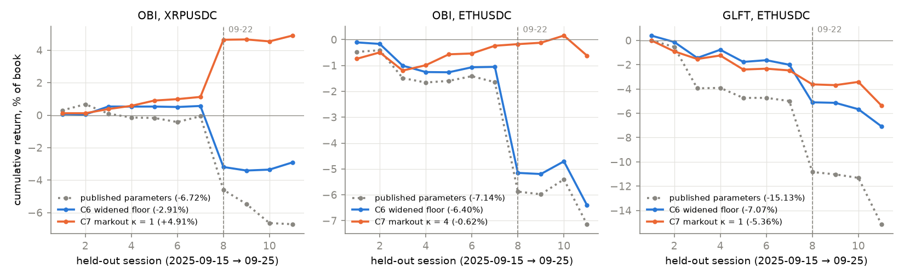
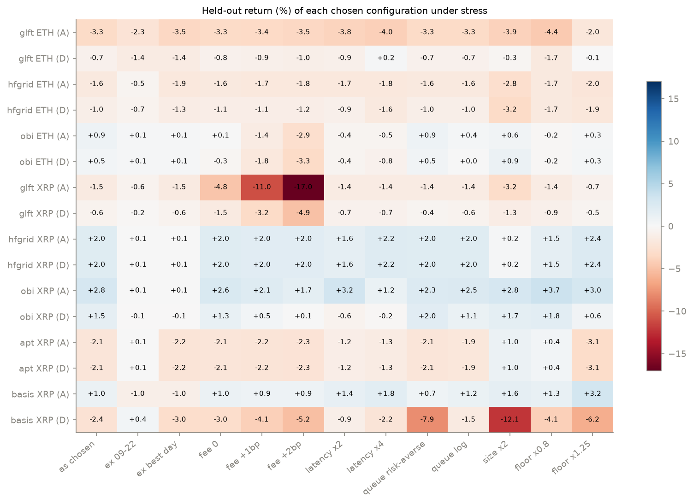

# Part C in one page — market making on hftbacktest: what made money, what didn't

The question behind all of Part C: can reinforcement learning improve a
published market-making strategy, measured on days it never saw? This page is
the summary; each phase has its own writeup, linked in §4.

> **At a glance**
>
> - **Best held-out result:** OBI on XRPUSDC with a markout-driven spread,
>   **+4.91%** over eleven held-out sessions, **+1.38% without the crash day**,
>   positive on **9 of 11** sessions at ~500 fills a day.
> - **Most robust held-out result:** OBI on SUIUSDC (C8, seven held-out
>   sessions on a 24/7 split), **+2.52%** at 175 fills a day, and still
>   positive without the crash (+1.77%), without its best session (+1.52%),
>   without the maker rebate (+2.05%), with a 1 bp maker fee (+1.13%) and at
>   4× order latency (+1.30%). XRP's OBI gain, by the same stress tests, is
>   the crash session. Neither survives a year forward on Bybit (C10).
> - **Chosen on Bybit itself (C13):** a slow grid quoter with a volatility
>   breaker on SUIUSDT, picked on six months under a crash guard, makes
>   **+4.60%** on 27 locked test sessions (+3.33% without the rebate, +0.84%
>   at a +1 bp maker fee), where C8's choice loses 4.64%. Nothing tested
>   survives Bybit's standard +2 bp fee.
> - **The fair price matters more than anything else tried — if it were
>   known.** Quoting around the mid 1–3 s ahead (C9) turns ETH GLFT from
>   −3.25% to +4.30–19.67% held out; but the best forecast of the mid explains
>   2–10% of its 1 s move, where about 40% would be needed, and no forecast,
>   large-move rule or DAgger student captures the gain.
> - **Everything on ETHUSDC still loses held out**, bar the rebate. The best, the same rule on
>   OBI, is at −0.62%, against −6.40% for the widened baseline and −7.14% for
>   the published parameters.
> - **The two things that helped were both hand-written rules:** a wider,
>   per-asset spread floor (C6) and widening after toxic fills (C7).
> - **Learning did not beat them.** TD3 on C6's widened strategies (two recipes,
>   five seeds), GRPO- and PPO-style parameter search, extra order-book and
>   BTCUSDT inputs, fill targets, a reward that discounts inventory PnL and
>   networks up to 170 times larger all lose to the best fixed rule held out;
>   so does RL on top of that rule (C8). DAgger with a teacher that sees the
>   future mid (C9) halves ETH GLFT's loss without making it pay. A circuit
>   breaker helps the losing strategies on ETH; extra controls chosen on
>   training data hurt OBI.
> - **Why learning keeps losing** (§6): reward-driven RL learns from a signal
>   buried in mark-to-market noise, and every method — RL or imitation — is
>   capped by what the book tells it, which C9 measured at R² 0.02–0.10 of
>   the next second's move. The next step is new inputs from outside the
>   book (§7), most of them free.
> - **A year forward on Bybit (C10), the edge does not travel.** Without the
>   2025-10-10 crash only one of six frozen OBI configurations makes money,
>   and it needs a rebate. That crash (SUI −82% in minutes) needs a stop that
>   exits at the touch — C8's controls do not bound it. Outside markets do
>   lead our book, by under 100 ms: ETH OBI's held-out +0.85% becomes +1.78%
>   with them and +0.30% if they arrive 100 ms later.

---

**Contents**

- [1. Setup, in five lines](#1-setup-in-five-lines)
- [2. The track record](#2-the-track-record)
- [3. Every method, held out](#3-every-method-held-out)
- [4. What each phase contributed](#4-what-each-phase-contributed)
- [5. Lessons that held up](#5-lessons-that-held-up)
- [6. RL in Part C: what was tried, why it failed, what could make it tractable](#6-rl-in-part-c-what-was-tried-why-it-failed-what-could-make-it-tractable)
- [7. Data from outside the order book](#7-data-from-outside-the-order-book)
- [8. What next](#8-what-next)

---

## 1. Setup, in five lines

- **Data:** Binance USDⓈ-M perpetual L2 books and trades, 2025-08-26 to
  2025-09-25, replayed tick by tick in hftbacktest with queue position and
  synthesised order latency.
- **Split:** everything is chosen on sessions before 2025-09-15 and reported on
  the eleven sessions from 09-15 to 09-25 (C1–C7, C4). C8 re-splits the same
  month into 24 training and 7 held-out sessions (09-19 to 09-25). Nothing is
  chosen on held-out data.
- **Deep assets:** ETHUSDC and XRPUSDC, 11 held-out sessions each. Seven more
  assets with 3 held-out sessions each.
- **Strategies:** the five market makers hftbacktest publishes — GLFT, a
  volatility grid (`hfgrid`), order-book imbalance (`obi`), and two pair
  strategies (`apt`, `basis`) on XRP.
- **Score:** cumulative held-out return in % of a 100,000 book; fills and
  per-session consistency beside it, so "stopped trading" never passes for
  "made money".

## 2. The track record

*Figure — cumulative return over the eleven held-out sessions: the published
parameters (dotted), C6's widened spread floor (blue), and C7's markout rule on
top of it (orange). Session 8 is 2025-09-22, when the market crashed.*

Two things are visible at once. The widened floor helps on every panel but
does not stop the crash-day loss. The markout rule does: on 09-22 the widened
strategies lose 3–4% while the markout versions lose about 1% or gain —
plausibly because they had already widened as their fills turned toxic. Part of XRP's gain that
day is holding the right inventory through the move, which is why the result
is also quoted with 09-22 removed.

## 3. Every method, held out

| asset | strategy | published | C6 widened | C6 RL v2 | C7 markout | C4 grid (20 d) | C4 GRPO |
| --- | --- | --- | --- | --- | --- | --- | --- |
| ETH | glft | −15.13 | −7.07 | −6.30 | −5.36 | −3.01 | **−1.89** |
| ETH | hfgrid | −1.98 | −2.11 | −2.20 | −1.99 | **−1.86** | – |
| ETH | obi | −7.14 | −6.40 | −8.00 | **−0.62** | **−0.62** | −2.91 |
| XRP | glft | −13.17 | −1.89 | −0.86 | **−0.55** | −1.22 | – |
| XRP | hfgrid | −1.58 | −1.15 | −1.48 | **+1.96** | +0.59 † | – |
| XRP | obi | −6.72 | −2.91 | −2.15 | **+4.91** | +3.64 | – |
| XRP | apt | −3.39 | +2.00 | −1.66 | – | +7.26 † | – |
| XRP | basis | −4.59 | +0.36 | −2.35 | – | +1.69 † | – |

*Held-out cumulative return, % of book, eleven sessions. RL and GRPO are
medians over seeds. † trades a handful of fills or none on a median session;
the number is one crash session, not market making.*

### 3.1 On C8's split, with stress tests

C8 moved to 24 training sessions and kept the last seven held out, then
stress-tested everything that made money: maker fee without the rebate,
higher latency, pessimistic queue models, neighbouring parameters, and
without the crash or the best session.

*Figure — from [C8](c8-risk-controls.md) §6: held-out return of each chosen
configuration under each stress.*

| configuration | held out | ex 09-22 | ex best day | fee 0 | fee +2 bp | latency ×4 | fills/day | verdict |
| --- | --- | --- | --- | --- | --- | --- | --- | --- |
| **SUIUSDC OBI** (floor 8 bp, κ 4) | **+2.52** | **+1.77** | **+1.52** | **+2.05** | +0.21 | **+1.30** | 175 | makes money on ordinary sessions, robust to costs; sensitive to κ |
| XRPUSDC OBI (floor 12 bp, κ 2, skew ×2) | +2.84 | +0.09 | +0.09 | +2.61 | +1.68 | +1.17 | 106 | robust to costs; the gain is the crash |
| XRPUSDT OBI (floor 8 bp, κ 2) | +3.53 | +0.48 | +0.48 | +3.17 | +1.74 | +2.84 | 189 | as XRPUSDC |
| AVAXUSDC OBI (floor 16 bp, κ 0) | +2.68 | +2.34 | −0.37 | +2.35 | +1.04 | +3.14 | 150 | one session |
| ETHUSDC OBI (floor 6 bp, κ 4) | +0.85 | +0.14 | +0.14 | +0.09 | −2.92 | −0.48 | 369 | the rebate |
| BNBUSDC GLFT (floor 2 bp, κ 1) | +1.72 | +1.53 | +1.23 | +0.75 | −3.05 | +1.71 | 489 | the rebate at higher fees |

*Held-out cumulative return, % of book, seven sessions (09-19 to 09-25).*

## 4. What each phase contributed

| phase | question | answer, held out |
| --- | --- | --- |
| [C1](c1-glft-baseline.md) | Does calibrated GLFT make money here? | No: it quotes inside the cost of adverse selection and loses 0.8 bp per fill. |
| [C2](c2-env.md) | Can the problem be posed for RL without a degenerate answer? | Yes, once the "quote so far out nothing fills" corner is ruled out. |
| [C3](c3-continuous-control.md) | Do DDPG/TD3/SAC beat the fixed formula? | They lose less than it, never make money; seed spread is large. |
| [C6](c6-strategy-zoo.md) | Is that just GLFT being a bad baseline? | No. On five strategies and nine assets, a per-asset wider spread is the largest single gain (+2.25 points median); TD3 on top of it does not beat it. |
| [C7](c7-signals.md) | What information is the policy missing? | Not the deep book or BTCUSDT. The toxicity of its own recent fills: a markout rule beats C6 in 6 of 6 pairs and 13 of 18 untuned. |
| [C4](c4-ppo-grpo.md) | Can search (grid, GRPO, PPO) tune the fixed rules further? | The grid refines them on ETH; learned search, fill targets, an inventory-discounted reward and larger networks do not. |
| [C9](c9-fair-price.md) | Can the fair price be forecast ~1 s ahead, and does denoising help anywhere? | Foresight of 1–3 s would be worth up to +40 points held out (little on XRP); real forecasts reach R² 0.02–0.10 and help one asset (AVAX). DAgger with a future-seeing teacher halves ETH GLFT's loss but does not make it pay. No denoiser helps on any of nine assets. |
| [C10](c10-forward.md) | Does the C8 edge survive a year forward, and do markets outside the book forecast it? | On a year of Bybit sessions only one of six frozen configurations makes money without the 2025-10-10 crash (XRPUSDC → XRPPERP, +3.96%, +0.21% at the standard fee). A loss limit that exits at the touch bounds the crash (≤ 6.4% drawdown) where C8's controls do not. Outside data doubles the 1 s forecast's R² and improves 14 of 15 forecast rules held out, but the real lead is gone at +100 ms. |
| [C13](c13-bybit-contest.md) | Does C8's full selection procedure find an edge on Bybit with six months to choose on? | C8's rule picks the crash-session winner and loses on all seven tests with a usable result (−17.4 points); with a crash guard the procedure beats C8's choices run unchanged on C10's five (+3.33 vs +0.64 points). Two picks hold up: a grid quoter with a volatility breaker on SUIUSDT (+4.60% on the locked test, +0.84% at +1 bp) and a GLFT quoter with a breaker on BNBUSDT (+1.06%, +0.11% at +1 bp). Nothing survives Bybit's standard +2 bp fee; ENAUSDT's huge validation return was the rebate on a sub-tick spread. |
| [C8](c8-risk-controls.md) | Do risk controls, denoising or RL on top of the markout rule help, and does what makes money survive stress? | A circuit breaker helps the losers on ETH; no denoiser, combination of controls or RL policy improves OBI. SUIUSDC OBI survives every cost, latency and session stress but κ ×0.5; XRP's gain is the crash, ETH's the rebate. |

## 5. Lessons that held up

1. **Measure the cost of a fill before tuning anything.** Every positive
   result in Part C comes from quoting wider when fills are expensive.
2. **Fixed rules first.** Each learned method was beaten by a hand-written rule
   that encoded the right quantity; RL is worth trying on top of the best rule,
   not instead of it.
3. **Seeds and sessions, not single runs.** Single-seed RL rows were
   systematically kinder than five-seed rows, and four training sessions
   chose XRP parameters that twenty did not.
4. **Report the crash day separately.** One session (2025-09-22) can make a
   strategy that barely trades look like the best in the table.
5. **Fills are not free.** Both forcing volume and rewarding it cost money on
   this venue, at every level tried.
6. **Stress-test before believing a gain.** Of six configurations that made
   money held out in C8, one survives removing the crash, the best session
   and the rebate; the others were one session or the rebate.
7. **More knobs fit the training month.** Adding controls chosen on 24
   sessions helped strategies that lose and hurt the one that works.
8. **Measure the ceiling before learning.** C9's oracle showed where the
   money is (the next 1–3 s) and its noisy oracles how good a forecast must
   be (R² ≈ 0.4); real forecasts at 0.02–0.10 were then no surprise.

## 6. RL in Part C: what was tried, why it failed, what could make it tractable

### 6.1 What was tried

| method (phase) | learns from | the policy sets | decides every | held out |
| --- | --- | --- | --- | --- |
| DDPG, TD3, SAC ([C3](c3-continuous-control.md)) | reward: mark-to-market PnL minus an inventory penalty | GLFT's γ, c₁ and a spread scale | quoting step | loses less than GLFT, never makes money |
| TD3 residual policy, v1/v2 ([C6](c6-strategy-zoo.md)) | reward relative to the rule it adjusts (counterfactual in v2) | multipliers on the rule's spread, skew, signal and grid | 5 s | never beats the widened rule |
| PPO- and GRPO-style search ([C4](c4-ppo-grpo.md)) | ranked session PnL of sampled parameter sets | the rule's parameters for a whole session | session | the plain grid refines ETH; learned search does not |
| fill targets, edge/inventory reward, networks up to 170× ([C4](c4-ppo-grpo.md)) | the same, reshaped | the same | 5 s | no change |
| TD3 on top of the markout rule ([C8](c8-risk-controls.md)) | reward relative to the rule, toxicity in the state | the same multipliers | 5 s | never beats the rule |
| DAgger with a privileged teacher ([C9](c9-fair-price.md)) | a teacher's label at every quote (the teacher sees the future mid) | pull or widen one side | 100 ms | halves ETH GLFT's loss, does not help ETH OBI |

### 6.2 Why RL kept failing, and what DAgger changes

- **Reward-driven RL learns from a signal buried in noise.** One quoting
  decision is worth a fraction of a basis point; the position's
  mark-to-market moves by basis points a second. The learner has to credit
  a gain to one of thousands of decisions inside that noise, which is why
  seed spreads were 1–10 points and why larger networks changed nothing
  (the network was never the bottleneck).
- **DAgger replaces the reward with a teacher's label at every step.** It
  turns the problem into supervised classification with dense, low-variance
  feedback, and relabels the states the student itself visits (the
  "DAgger" part, which fixes plain imitation's drift into unfamiliar
  states). It removes the noise problem completely.
- **No method can beat the information in its inputs.** A student can learn
  at best the teacher's action averaged over every situation that looks the
  same from its observations; when the teacher's decision depends on the
  future and the book barely hints at it, that average is weak. C9 measured
  the limit: the future mid is worth up to +40 points, a forecast needs
  R² ≈ 0.4 to pay, and the book supplies 0.02–0.10. RL sees the same inputs
  with a noisier signal, so it hits the same limit or a lower one.

### 6.3 Clues that would make the search tractable

Each attacks the noise and credit-assignment problem; none adds information.

1. **A privileged critic (asymmetric actor-critic).** In TD3 or SAC the
   critic is used only in training, so it may see the future mid, the
   teacher's labels and each fill's eventual markout; the actor sees only
   what the quoter sees. This cuts the variance of the learning signal
   directly. The first thing to try.
2. **Imitation first, RL second.** Initialise from the rule or the DAgger
   student and fine-tune with a penalty on drifting away from it (the
   recipe that makes RL work in robotics and games), instead of exploring
   from scratch — which in market making means paying the spread to learn.
3. **Imitate values, not actions (AggreVaTe).** The teacher gives each
   action's cost-to-go instead of its choice, which fixes what broke C9's
   first teacher (a 5 s markout instead of what a fill actually earns). It
   needs counterfactual replays per labelled state, so it would run on a
   sample of a few thousand states per session.
4. **A curriculum over privileged information.** Train with a noisy oracle
   of the future move as an input and lower its R² towards what real
   forecasts reach, so the policy first learns what to do with good
   information and then how to discount weak information. C9's noisy oracle
   is exactly this input.
5. **More shaping and variance reduction.** Beyond the counterfactual reward
   (C6) and the edge/inventory split (C4): rewards built on markout curves,
   and every comparison paired on the same sessions.
6. **Pool assets.** One policy over nine assets sees nine times the rare
   large moves, which a single asset starves.

### 6.4 Are the strategy parameters too rigid?

- **The RL action spaces were, for what C9 found valuable.** The oracle's
  gain comes from pulling one side of the book 1–3 s before a move. The RL
  policies decided every 5 s (too slow), scaled both sides at once (could
  not pull one), and stayed inside the spread floor. C9's kernel inputs —
  a series read every 100 ms, per-side widening and pulling — are the
  missing actions, and no RL policy has used them yet.
- **But every added degree of freedom has so far fit the training month.**
  The greedy combination of controls (C8), bigger networks (C4), the
  denoisers and forecast fair prices on SUIUSDC, XRPUSDT and BNB (C9) all
  gained on training sessions and lost held out. With 24 training sessions
  the rigid parametric rules act as the regularisation.
- **And rigidity is not what blocks the gain.** The same kernel reaches
  +6.53% on ETH OBI when told the future, and the DAgger student had exactly
  the right actions. The strategy can express the profitable policy; the
  inputs do not say when to use it.

**Next RL experiment, if Part C continues:** TD3 with a privileged critic,
C9's per-side 100 ms actions, initialised from the rule, pooled across
assets, five seeds, under the usual protocol. The honest expectation is
roughly the DAgger result (ETH GLFT's loss halved, OBI unchanged) unless the
inputs change — which is §7.

## 7. Data from outside the order book

C9 found that the value is in rare large moves (the top 1% of 3 s moves)
that the traded contract's own book does not anticipate. Large moves usually
start somewhere else: on the more liquid contract for the same asset, on
spot, on another venue, or in a liquidation cascade. What we would want,
ranked by expected value at a 1–3 s horizon, and what can be had for free
(availability checked on 2026-09-30 for the study month, 2025-08-26 to
09-25):

| data | why it could lead | free source | resolution | checked |
| --- | --- | --- | --- | --- |
| **The same asset's USDT perpetual** (ETHUSDT, XRPUSDT, SUIUSDT … for our USDC contracts) | price discovery happens on the far larger USDT contract; the USDC contract follows | Binance public archive, `data.binance.vision/data/futures/um/daily/trades` (and `aggTrades`) | every trade, ms | ✓ available for the month and through 2026-09; ETHUSDT 34 MB/day zipped |
| **Spot** (Binance ETHUSDT, ETHUSDC, XRPUSDT …) | the index and mark price are built from spot; spot leads some moves | Binance archive, `data/spot/daily/trades` | every trade, ms | ✓ ETHUSDT spot 18 MB/day |
| **Other venues' perpetuals and spot** (Bybit, OKX) | large moves often start on one venue and arbitrage carries them over | Bybit `public.bybit.com/trading/` and `/spot/`; OKX `okx.com/cdn/okex/traderecords/trades/daily/` | every trade (Bybit 0.1 ms) | ✓ Bybit ETHUSDT 46 MB/day; ✓ OKX files served |
| **Coinbase spot** (ETH-USD, XRP-USD) | the main US venue, leads in US hours | Coinbase Exchange REST `/products/{id}/trades` (free, paginated, slow) | every trade | not checked |
| **Liquidations** | cascades drive the largest moves | no free history: Binance's archive has none, Tardis's free samples are blocked here (below); **free live**: Binance `!forceOrder@arr` (at most one per second per symbol), Bybit `allLiquidation`, OKX liquidation orders | event | live only |
| **Funding, premium, mark and index price** | funding-time flows; basis stress | Binance archive: `monthly/fundingRate`, daily `premiumIndexKlines`, `markPriceKlines`, `indexPriceKlines` | 8 h; 1 min | ✓ |
| **Open interest, long/short and taker ratios** | positioning regime | Binance archive, daily `metrics` | 5 min | ✓ |
| **Depth ±1–5%** | book resilience regime | Binance archive, daily `bookDepth` | ~30 s | ✓ |
| **Implied volatility** (Deribit DVOL, options) | volatility regime | Deribit public API | 1 min and slower | not checked |
| **Best bid/ask of other contracts** | quote-level lead-lag | Binance `bookTicker` archive | tick | ✗ discontinued after 2024-03-30 |
| **Bybit's full order books** (perpetuals, USDT- and USDC-margined, and spot) | book-level lead-lag across venues; and a year of fresh data for a forward test | Bybit, `quote-saver.bycsi.com/orderbook/{linear,spot}/<SYMBOL>/<date>_<SYMBOL>_ob200.data.zip`: 200 levels, a snapshot then deltas every 10–100 ms, JSON lines with exchange and matching-engine timestamps | tick | ✓ ETHUSDT, XRPUSDT, SUIUSDT, ETHPERP (USDC) and spot, from our month through 2026-09-28; ETHUSDT 137–287 MB/day zipped |
| **Other venues' full books** | the same, more venues | Tardis free files (first day of each month, no key): one request succeeded, then Cloudflare returned 403 to every request from this machine | tick | partial |
| **Binance books after 2025-09-25** | the forward test on the same venue | the project's dataset holds only 2025-08-26 to 09-25 (checked: 11 symbols, including BTCUSDC, nothing later); Binance's own historical depth data is by application only; **free**: record the live websockets from now on | tick | ✗ historical; live only |

Only the first rows can trigger a 1–3 s decision; the slow series (funding,
open interest, depth snapshots, implied volatility) can only condition the
regime — when to be wider — which the markout rule and the circuit breaker
already do from our own flow.

**Tested in C10** ([writeup](c10-forward.md), §7–§8) on ETHUSDC, XRPUSDC and
SUIUSDC with the first three rows plus Bybit's book: outside data raises the
held-out R² of the 1 s move from 2.5–6.0% to 6.3–8.9% at the assumed delay
(half of it gone at +100 ms) and large-move precision by 2–3 points; in the
backtest it improves 14 of 15 forecast rules held out, but the genuine lead
(ETH) is gone at +100–250 ms and XRP's gain is the crash session.

**How it was tested**, with the C9 machinery unchanged:

1. **Alignment first.** The archives carry exchange timestamps; the backtest
   sees our own book at local receive time. External events are shifted by
   an assumed feed latency (tens of ms same-venue, 50–150 ms cross-venue)
   before they may enter a feature, and every result is re-run with
   +100 ms and +250 ms extra delay as a stress: a lead that disappears
   under 250 ms of delay is not tradable.
2. **Offline, cheap:** add lead-lag features (returns and signed flow of the
   USDT perp, spot and Bybit over the last 0.1–1 s; the basis between them;
   bursts of large trades) to `predict.py`, and measure held-out R² and,
   more to the point, the AUC and precision of a top-1% large-move
   classifier against the book-only 0.71 and 3–11%.
3. **Only if (2) moves:** the large-move rule and the DAgger student with
   the new inputs, chosen on training sessions, held out, stress-tested.
4. **Disk:** a month of one source is 0.5–1.5 GB zipped; reduced on the fly
   to the 100 ms grid it is a few MB, so the raw files are downloaded,
   reduced and deleted day by day.

## 8. What next

C8 did the follow-ups listed before it; C9 answered the fair-price and
denoising questions; C10 ran the forward test on Bybit and the lead-lag
inputs. What remains in Part C, cheapest and most informative first:

- **Record Binance from now on** and repeat the forward test on the venue the
  configurations were chosen on, to separate "the venue" from "the time"
  (C10 found most of the edge gone on Bybit already on the study month's own
  held-out week). Binance's books after 2025-09-25 are not available, so this
  needs the free live websockets (depth every 100 ms and trades) recorded
  with hftbacktest's collector on an always-on host; an always-free cloud VM
  in Tokyo, near Binance's matching engine, is enough.
- **Re-select on Bybit:** choose floors and κ on a Bybit training month and
  forward-test on the rest of the year, with C10's stop.
- **Lead-lag at the real delay:** measure the arrival delay of Binance spot
  and Bybit at that Tokyo host before investing further in outside-data
  forecasts; at +100 ms C10's lead is worth little.
- **RL with a privileged critic and C9's per-side actions** (§6.4): worth
  running only once the inputs carry more than R² 0.1.
- **Smaller:** OBI on more assets; κ from the asset's own markout (SUIUSDC
  depends on κ = 4 and only the grid chooses it); C10's stop and units cap
  on by default.

Everything on the original ladder's Part C list is done. Part C can pause
here without losing anything: the cache, the features and the kernel inputs
are all on the branch, and each item above starts from them.
