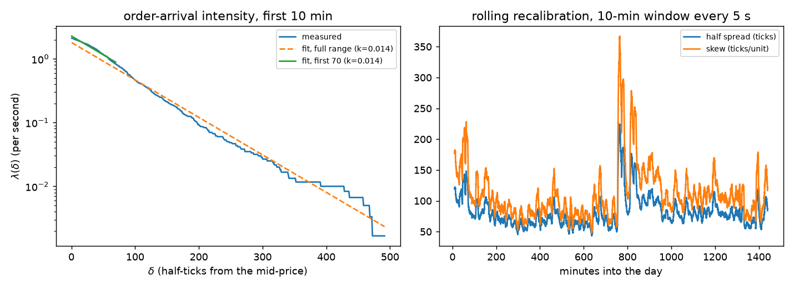
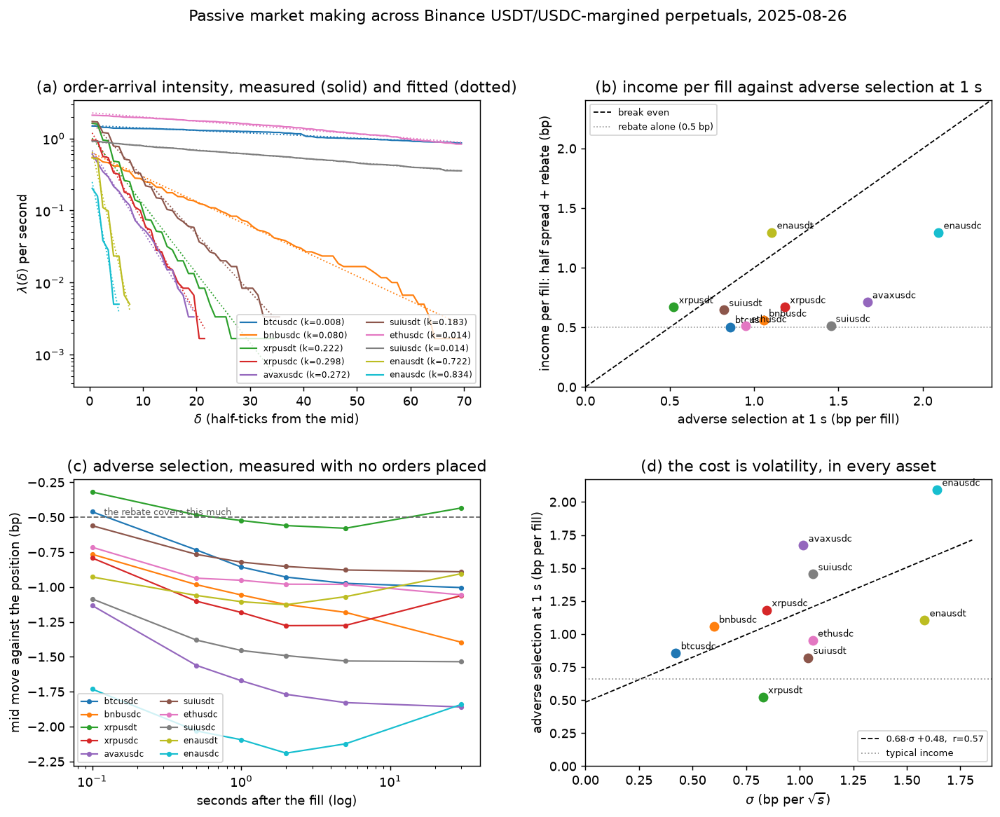
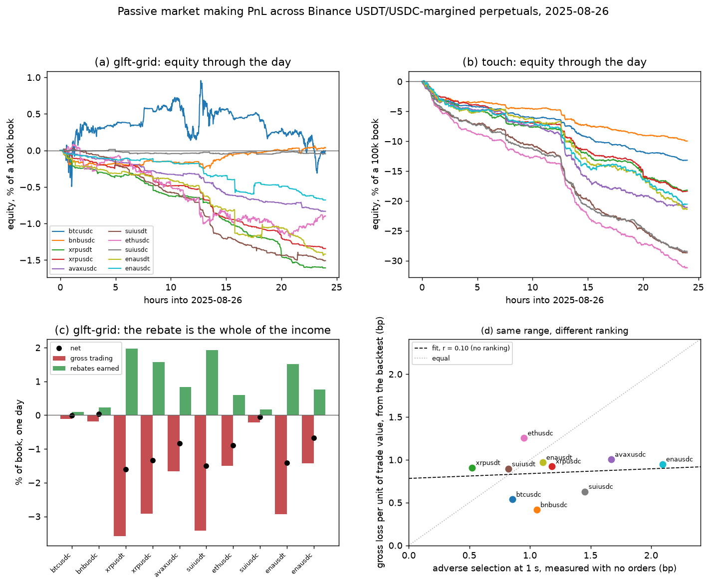
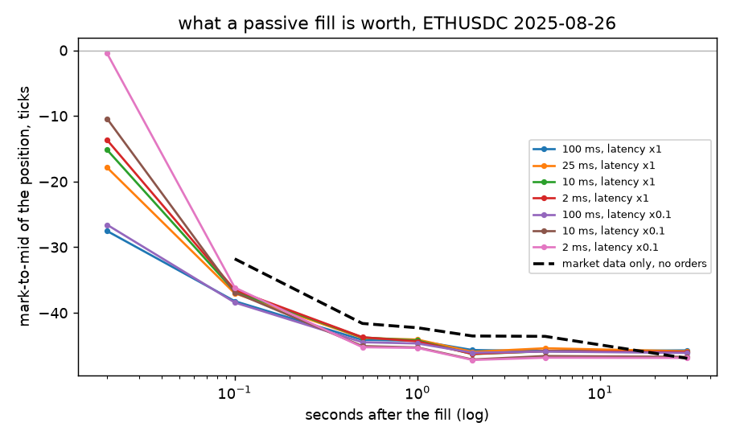

# C1 — Calibrated GLFT: task, goal, and how it was solved

Part C's benchmark: the closed-form market maker every RL variant has to beat.
Reproducing it on 2025 ETHUSDC turns out to be a negative result with a precise
cause, and the cause is what decides how C2 builds its environment. Lab
notebook: [`experiments/c1_glft_baseline/README.md`](../../experiments/c1_glft_baseline/README.md).

---

## 1. The task

[`ladder.md`](../ladder.md#c1) states three items:

1. Calibrate $A$, $k$ (order-arrival intensity) and $\sigma$ (volatility) from
   market data; derive $c_1$, $c_2$ and reproduce the GLFT half-spread/skew
   formulas.
2. Run the calibrated GLFT grid market maker in hftbacktest on the sample data;
   reproduce the reported Sharpe/Sortino/MaxPositionValue stats.
3. Reproduce the simplified non-parametric HF-grid variant (percentile-based
   intensity, micro-price) and compare against the parametric GLFT baseline.

## 2. The goal: a benchmark that is not a straw man

Every later Part C phase makes a claim of the form "the learned policy beats the
calibrated formula". That claim is only worth something if the formula was
calibrated properly and run under the same fill assumptions. So C1's real job is
not to produce a number — it is to produce a number that can be *trusted*, and
to expose every assumption underneath it, because those assumptions are shared
by everything built on top.

The Guéant–Lehalle–Fernandez-Tapia model is the natural choice. It is an
asymptotic (no terminal time) refinement of Avellaneda–Stoikov, which makes it
appropriate for a perpetual future, and it gives quote depths in closed form
from three measurable quantities rather than from a solved HJB equation.

## 3. The model

### Order-arrival intensity

The model assumes market orders arrive at a quote posted $\delta$ ticks from the
fair price at rate

$$\lambda(\delta) = A e^{-k\delta}.$$

Both parameters are estimated by regression: taking logs makes it a straight
line,

$$\log \lambda(\delta) = \log A - k\delta,$$

so one least-squares fit over the empirical arrival-depth histogram gives
$\hat{A} = e^{\widehat{\log A}}$ and $\hat{k} = -\widehat{\text{slope}}$.

$\lambda$ itself is measured by recording, in each 100 ms step, how deep the
deepest market order reached relative to the previous step's mid-price, and
counting the steps in which a trade reached at least each depth. Buy trades are
measured above the mid, sell trades below.

### The optimal quotes

Equations (4.6) and (4.7) of [Guéant, Lehalle & Fernandez-Tapia](https://huggingface.co/papers/1605.01862)
give the asymptotically optimal bid and ask depths for a maker holding
inventory $q$, quoting size $\Delta$, with risk aversion $\gamma$ and a
liquidity-penalty parameter $\xi$:

$$\delta^{b*}_{\text{approx}}(q) = \frac{1}{\xi\Delta}\log\!\left(1 + \frac{\xi\Delta}{k}\right)
+ \frac{2q + \Delta}{2}\sqrt{\frac{\gamma\sigma^2}{2A\Delta k}\left(1 + \frac{\xi\Delta}{k}\right)^{\frac{k}{\xi\Delta}+1}}$$

$$\delta^{a*}_{\text{approx}}(q) = \frac{1}{\xi\Delta}\log\!\left(1 + \frac{\xi\Delta}{k}\right)
- \frac{2q - \Delta}{2}\sqrt{\frac{\gamma\sigma^2}{2A\Delta k}\left(1 + \frac{\xi\Delta}{k}\right)^{\frac{k}{\xi\Delta}+1}}$$

Pulling $\sigma$ out of the square root defines two coefficients that depend
only on the calibration, not on the state:

$$c_1 = \frac{1}{\xi\Delta}\log\!\left(1 + \frac{\xi\Delta}{k}\right),
\qquad
c_2 = \sqrt{\frac{\gamma}{2A\Delta k}\left(1 + \frac{\xi\Delta}{k}\right)^{\frac{k}{\xi\Delta}+1}}$$

and the quotes collapse to a half spread plus an inventory skew:

$$\delta^{b*}(q) = \underbrace{c_1 + \tfrac{\Delta}{2}\sigma c_2}_{\text{half spread}} + \underbrace{\sigma c_2}_{\text{skew}}\, q,
\qquad
\delta^{a*}(q) = \left(c_1 + \tfrac{\Delta}{2}\sigma c_2\right) - \sigma c_2\, q.$$

This rewrite is an algebraic identity, which is worth stating because it is
checkable: `run_calibrate.py` verifies it to $5 \times 10^{-13}$ over two
thousand random parameter draws before reporting anything (§6).

### The spread floor, and why it is the whole story

The model has one free parameter that no data pins down. $\gamma$ is "arbitrarily
chosen" in the paper; the notebook sets $\gamma = \xi = 0.05$ and $\Delta = 1$.
So the first question to ask of a calibration is: **how tight can these quotes
possibly be?**

Write $u = \xi\Delta$. The half spread is

$$H(u) = \frac{\log(1 + u/k)}{u} + \frac{\Delta\sigma}{2}\sqrt{\frac{\gamma}{2A\Delta k}\left(1+\frac{u}{k}\right)^{k/u+1}}.$$

The second term is non-negative, so $H(u) \ge c_1(u) = \log(1+u/k)/u$. And
$c_1$ is strictly decreasing in $u$ with

$$\lim_{u \to 0^+} c_1(u) = \frac{1}{k}, \qquad \lim_{u \to \infty} c_1(u) = 0,$$

the first limit by $\log(1+x) = x - x^2/2 + O(x^3)$. So shrinking $\gamma$ lowers
$c_1$'s contribution towards its supremum $1/k$ rather than towards zero — and
meanwhile the second term behaves like $C\sqrt{\gamma}$ as $\gamma \to 0$
(with $\xi = \gamma$), since $c_2 \propto \sqrt{\gamma}$ and the power factor
tends to $e$. Expanding for small $\gamma$,

$$H(\gamma) = \frac{1}{k} + C\sqrt{\gamma} - \frac{\Delta\gamma}{2k^2} + O(\gamma^{3/2}),$$

whose $\sqrt{\gamma}$ term dominates, so $H$ is increasing near $0$ and

$$\boxed{\ \inf_{\gamma > 0} H(\gamma) = \frac{1}{k}\ }$$

approached only in the risk-neutral limit. **No choice of risk aversion lets a
GLFT quoter post closer to the fair price than $1/k$.** Everything C1 finds
follows from putting a measured $k$ into that bound.

### Volatility, in the model's units

$\sigma$ is a mid-price volatility in ticks per $\sqrt{\text{second}}$. Sampling
the mid every $\tau$ seconds and taking the standard deviation of the changes
gives a per-step figure; under a random-walk mid the per-second one is

$$\hat\sigma = \operatorname{sd}\!\left(m_{t} - m_{t-1}\right) \cdot \tau^{-1/2}.$$

The units matter more than they look. $\sigma$ in *ticks* scales with the price
divided by the tick size, so an asset whose price triples without its tick size
changing has three times the volatility in the only units the model can see.

## 4. What was done

**Data.** Binance USDⓈ-M ETHUSDC perpetual, from the private Hugging Face
dataset `cardinalai/backtest_data`, already normalised into hftbacktest's
eight-field event format. Ten days: five training
(2025-08-26, -27, -28, 09-01, 09-08) and five held out
(2025-09-15, -18, -20, -22, -25). The split rule is chronological and is fixed
in [`config.py`](../../experiments/c1_glft_baseline/config.py) so C3–C5 cannot
re-pick it; see [`docs/data.md`](../data.md).

**The ten days**, described once with no orders placed
([`measure_days.py`](../../experiments/c1_glft_baseline/measure_days.py)). The
$\sigma$ column is the one that decides everything in §5:

| date | set | $\sigma$ (ticks$/\sqrt{s}$) | spread = 1 tick | steps with a trade | median arrival depth |
| --- | --- | --- | --- | --- | --- |
| 2025-08-26 | train | 47.1 | 98.4% | 249,144 | 0.5 |
| 2025-08-27 | train | 43.0 | 98.5% | 181,221 | 0.5 |
| 2025-08-28 | train | 32.4 | 99.3% | 154,155 | 0.5 |
| 2025-09-01 | train | 35.2 | 99.0% | 164,695 | 0.5 |
| 2025-09-08 | train | 21.3 | 99.6% | 132,727 | 0.5 |
| 2025-09-15 | held out | 31.2 | 98.8% | 156,399 | 0.5 |
| 2025-09-18 | held out | 24.5 | 99.4% | 138,274 | 0.5 |
| 2025-09-20 | held out | 12.8 | 99.8% | 53,244 | 0.5 |
| 2025-09-22 | held out | 47.0 | 97.9% | 194,038 | 3.5 |
| 2025-09-25 | held out | 49.4 | 96.8% | 266,256 | 3.5 |

Reading $\sigma$ for a held-out day is a description of the market, not a
selection on a result: no PnL is involved, and it is used below only to explain
numbers that were already computed.

**Order latency** is not in the dataset, so it is synthesised from the feed
latency the data itself carries (`local_ts - exch_ts`) at hftbacktest's own
multipliers — entry $4\times$, response $3\times$ — giving a round trip of about
20 ms on these days. Our generator is checked bit-for-bit against hftbacktest's
packaged one (§6); ours exists only because theirs copies a whole 60-million-row
day through polars and does not fit in memory here.

**Five quoters**, in [`glft.py`](../../experiments/c1_glft_baseline/glft.py),
transcribed from hftbacktest's notebooks rather than reinvented:

| name | what it is |
| --- | --- |
| `touch` | no model: one lot at the best bid and the best ask. The floor. |
| `glft` | equations (4.6)/(4.7) verbatim, one quote a side, $\gamma=\xi=0.05$, $\Delta=1$ |
| `glft-adj` | the same with the notebook's `adj2 = 0.05` damping the skew |
| `glft-grid` | `glft-adj` laid out as a 20-deep grid — the configuration the published Sharpe comes from |
| `simplified` | item 3: percentile half spread, micro-price fair value, same grid |

Known quirks in the source are **reproduced, not fixed**, and flagged in
comments. The largest is that the intensity histogram indexes buckets at
`round(depth/0.5) - 1`, so its depth axis is in half-ticks while the quoter
spends the resulting half spread as if it were ticks; hftbacktest's own note
says the example is left unchanged to preserve published results, and C1 does
the same, reporting the fit both ways so the distortion is on the record rather
than folded into a fudge factor.

## 5. Results

### Item 1 — the calibration

On the calibration day, 2025-08-26, over 863,995 steps of 100 ms with 249,144 of
them containing a trade:

| quantity | value |
| --- | --- |
| touch spread | **1 tick in 98.4% of steps** (median 1, p95 1) |
| $A$, $k$ (full range) | 1.810, 0.0135 ($R^2 = 0.984$) |
| $A$, $k$ (first 70 buckets) | 2.284, 0.0136 ($R^2 = 0.981$) |
| $A$, $k$ (buckets at their true tick depth) | 2.299, 0.0272 |
| $\sigma$, first 10-min window | 74.2 ticks$/\sqrt{s}$ |
| $\sigma$, whole day | 47.1 ticks$/\sqrt{s}$ |
| $c_1$, $c_2$ | 30.84, 2.392 |
| half spread | 119.6 ticks |
| skew | 177.5 ticks per unit of inventory |
| inventory that cancels the whole half spread | 0.67 units |
| trading steps reaching the half spread | 0.81% |

The left panel is worth pausing on, because it refutes the premise item 3 was
written under. On ETHUSDC the exponential form **fits well**: $R^2 = 0.984$
across the full 500-bucket range, and refitting on the first 70 buckets barely
moves $k$ (0.0135 → 0.0136). In the source notebook the same refit *tripled*
$k$ (0.0170 → 0.0424), which is what motivated replacing the parametric form
with percentiles in the first place. Here there is nothing for a non-parametric
estimator to fix — the intensity really is exponential in depth, and the
trouble is what the fitted $k$ implies, not how well it fits.

Rolling recalibration every 5 s on a trailing 10-minute window, 17,160 windows
over the day (median [p5, p95]): $A$ 1.09 [0.62, 2.74], $k$ 0.0196 [0.0124,
0.0261], $\sigma$ 38.2 [25.7, 84.5], half spread 75.7 [55.2, 131.2], skew 100.7
[67.4, 197.6].

Three things in that table decide everything that follows.

**The asset has no room inside its spread.** ETHUSDC's tick is tiny in relative
terms — 0.01 on a ~4400 price, 0.023 bp — and yet the touch spread is one tick
98.4% of the time. GLFT's derivation treats quote depth as a continuous choice;
here the only choices are *at the touch* or *away from it*.

**The fitted $k$ puts the model's own floor 25 ticks out.** With $k = 0.0196$
per half-tick bucket, $1/k \approx 51$ bucket units $\approx 25.5$ ticks. By the
bound in §3 that is the tightest quote the model can produce *at any risk
aversion*, on a market whose spread is 1 tick. A numerical sweep confirms it:
$\gamma$ from 0.001 to 5 moves the half spread over 54.6 → 3345.6, with the
minimum at the risk-neutral end, exactly as the expansion predicts.

**The skew is stronger than the spread.** 0.67 units of inventory cancels the
entire half spread, so the quoter refuses to hold inventory at all — which is
the same pathology the source notebook reports (two units there) and the reason
`adj2` exists.

For comparison, the published ETHUSDT 2022-10-03 calibration is $A = 2.986$,
$k = 0.0424$, $\sigma = 10.7$, half spread 20.47, skew 9.76, with 1.86% of
trades reaching the quote. Our $k$ is a third of theirs and our $\sigma$ four
times theirs, and both differences push the quote further out.

### Item 2 — the backtest

Every strategy, every day, one lot a side against a 100,000 book, at the
notebook's 100 ms reaction interval
([`summarise.py`](../../experiments/c1_glft_baseline/summarise.py)):

**Training days**

| strategy | SR (median) | Sortino | Return | days profitable | fills/day | half spread | net/fill | gross/fill |
| --- | --- | --- | --- | --- | --- | --- | --- | --- |
| `touch` | −176.5 | −207.9 | −19.3% | 0/5 | 106,101 | 0.5 | −23.2 | −45.2 |
| `glft` | −359.3 | −354.6 | −1.9% | 0/5 | 8,275 | 60.9 | −21.3 | −43.3 |
| `glft-adj` | −58.5 | −68.2 | −1.4% | 0/5 | 5,735 | 60.9 | −23.7 | −45.7 |
| `glft-grid` | **−32.3** | −42.1 | −0.9% | 0/5 | 2,886 | 60.9 | −34.6 | −56.6 |
| `simplified` | −63.0 | −71.9 | −3.5% | 0/5 | 12,666 | 36.5 | −23.1 | −45.1 |
| `simplified-mid` | −62.8 | −71.3 | −3.6% | 0/5 | 12,928 | 36.5 | −22.9 | −44.9 |

**Held-out days**

| strategy | SR (median) | Sortino | Return | days profitable | fills/day | half spread | net/fill | gross/fill |
| --- | --- | --- | --- | --- | --- | --- | --- | --- |
| `touch` | −78.3 | −95.9 | −7.2% | 0/5 | 113,469 | 0.5 | −6.8 | −28.8 |
| `glft` | −132.9 | −141.2 | −0.7% | 0/5 | 10,117 | 46.9 | −7.4 | −29.4 |
| `glft-adj` | −18.3 | −20.8 | −0.4% | 0/5 | 6,961 | 46.9 | −5.3 | −27.3 |
| `glft-grid` | **+0.37** | +0.43 | +0.0% | **3/5** | 3,868 | 46.9 | +0.3 | −21.7 |
| `simplified` | −16.3 | −18.4 | −0.7% | 0/5 | 12,594 | 30.5 | −8.6 | −30.6 |
| `simplified-mid` | −17.1 | −19.3 | −0.7% | 0/5 | 12,855 | 30.5 | −8.9 | −30.9 |

"net/fill" and "gross/fill" are in ticks: what one fill was worth after and
before the maker rebate, which is +22.0 ticks at a price of 4400.

The reproduction succeeds in shape and fails in sign.

- **The unadjusted model loses, exactly as published.** hftbacktest reports
  SR −246.4, ReturnOverMDD −0.9987, ReturnOverTrade $-3.5\times10^{-5}$ for
  `glft` on ETHUSDT 2022-10-03; we get SR −359.3, ReturnOverMDD −1.000,
  ReturnOverTrade $-4.9\times10^{-5}$. Same pathology, same order of magnitude.
- **`adj2` helps by the same mechanism.** Damping the skew lets the quoter hold
  inventory (MaxPositionValue 13.0k → 45.1k) and cuts the bleed roughly in
  half, as in the source.
- **The grid helps again**, and it is the best variant on both sets, as
  published — but where the notebook reaches SR +19.8 over five ETHUSDT days,
  we reach −32.3 on training days and +0.37 on held-out ones.
- **MaxPositionValue reproduces as a ratio**, which is the only way it can:
  the notebook's grid peaks at 30,859 against a 20 ETH cap at ~1330, i.e.
  1.16× the nominal cap; ours peaks at 89,816 against a 20 ETH cap at ~4400,
  i.e. 1.02×. Both overshoot the cap for the same reason — the whole 20-deep
  ladder can fill before the position gate closes.

The published numbers themselves cannot be reproduced bit for bit: they are for
ETHUSDT on 2022-10-03 to -07, and that file is not obtainable (the host the
project links for sample data,
`reach.stratosphere.capital`, serves a certificate that does not match its
hostname, and disabling verification is not an acceptable way around that). So
what is reproduced is the pipeline, the calibration and the qualitative
ordering of the three variants, on different days.

**Held-out is kinder than training, which is the wrong way round** — and it is
the clue. The held-out set's median $\sigma$ is 31.2 against training's 35.2,
and `glft-grid`'s per-day Sharpe on held-out days orders *perfectly* by that
day's volatility:

| day | $\sigma$ | `glft-grid` SR |
| --- | --- | --- |
| 2025-09-20 | 12.8 | **+2.0** |
| 2025-09-18 | 24.5 | +0.7 |
| 2025-09-15 | 31.2 | +0.4 |
| 2025-09-22 | 47.0 | −43.1 |
| 2025-09-25 | 49.4 | −57.6 |

A median of +0.37 over that spread is not a profitable strategy; it is a
strategy whose sign is decided by the volatility regime. Reporting the median
alone would have hidden a −57.6 day.

### Item 3 — non-parametric intensity and the micro-price

The percentile half spread was chosen on training days only, over
$\{65, 80, 92\}$:

| percentile | SR (median, train) | Return | fills/day | half spread |
| --- | --- | --- | --- | --- |
| 65 | −339.4 | −46.4% | 272,916 | 7.5 |
| 80 | −147.9 | −11.2% | 58,848 | 18.5 |
| 92 | **−62.9** | −3.6% | 12,928 | 36.5 |

**The selection is degenerate**, and saying so is more useful than reporting the
winner. Every sweep in this phase — $\gamma$, `adj1`, the percentile — is
monotone in how little the strategy trades, so "tuning" walks towards not
quoting at all. The `adj1` sweep makes it starkest: at `adj1` 0.02, 0.05, 0.1,
0.25, 0.5, 1.0 the median training Sharpe is −667, −502, −397, −245, −116,
−32, with fills/day falling 664k → 2.9k. There is no interior optimum to find.
`percentile = 92` is where the grid stopped, not where an optimum was.

First, a correction to the item's premise, from §5's calibration plot: the
parametric fit is *good* here ($R^2 = 0.984$, and the shallow refit barely
moves $k$), where the source's motivation for going non-parametric was a fit
that failed near the mid. So this item is testing a fix for a problem this
asset does not have, and the result should be read that way.

**The micro-price makes a difference, and it is far too small to matter.** On
held-out days it moves median Sharpe from −17.1 to −16.3 and the gross value of
a fill from −30.9 to −30.6 ticks; on training days it is marginally *worse*
(−63.0 against −62.8). Both differences sit inside the day-to-day range, which
on held-out days runs from −8.9 to −68.1. Against an adverse-selection cost of
21 ticks per fill, a sub-tick refinement of the fair price is not the
instrument that fixes this.

> **Correction.** An earlier version of this writeup reported that the two were
> *identical* to three significant figures, and explained it as grid
> quantisation swamping a sub-tick signal. That was wrong, and it was a bug in
> my code, not a property of the market. hftbacktest 2.4.4's Python binding
> wires `ROIVectorMarketDepth.best_bid_qty` to the FFI symbol for the best
> *price* (`binding.py` line 284 calls `roivecdepth_best_bid`, though the
> correct `roivecdepth_best_bid_qty` is declared thirty lines above at 204; the
> `HashMapMarketDepth` version is correct). With both "quantities" equal to the
> price, the micro-price
> $(P_b q_a + P_a q_b)/(q_a + q_b)$ collapses algebraically to $(P_b + P_a)/2$
> — exactly the mid. The two strategies were the same strategy. The code now
> reads sizes with `bid_qty_at_tick(best_bid_tick)`; the numbers above are the
> re-run.
>
> Two things let this through and both are worth naming. The observed identity
> was *consistent* with a story I already believed, so I explained it instead of
> checking it — and an identity to three significant figures between two
> supposedly different strategies is a coincidence too strong to explain away.
> C1's own protocol says report a quantity whose correct value is known in
> advance; "these two differ somewhere" was exactly such a quantity and I did
> not test it. The bug surfaced only because C2 needed the same field.

Grid quantisation may still be *why* the real effect is small — quote prices
land on ticks, the micro-price moves the fair value by less than a tick when
the touch spread is one tick, and the ladder is then snapped to an interval of
`round(half_spread)` ticks. That is a plausible mechanism and this phase did
not test it; it is stated as conjecture, not as the finding.

Against the parametric baseline, the non-parametric variant is **worse on both
sets** (−62.9 vs −32.3 train, −17.3 vs +0.37 held out) — but only because the
percentile grid stopped at a tighter quote than GLFT's, and tighter is worse
here. Per fill the two are indistinguishable (−45.0 vs −56.6 train, −31.0 vs
−21.7 held out). Neither functional form is doing anything the other is not.

### A second asset

A negative result on one symbol is a result about that symbol, so the same
three quoters were run on **XRPUSDT** (tick 0.0001 at a price of 2.857, so a
tick is 0.35 bp and the rebate is worth only 1.43 ticks) for 2025-08-26, sized
to the same risk budget: 1500 XRP an order, 30,000 XRP of cap.

| strategy | SR | Return | fills/day | half spread | net/fill | gross/fill |
| --- | --- | --- | --- | --- | --- | --- |
| `touch` | −148.7 | −18.0% | 90,013 | 0.5 | −1.33 | −2.76 |
| `glft-grid` | −180.9 | −1.6% | 8,925 | 3.6 | −1.20 | −2.63 |
| `simplified` | −135.6 | −6.9% | 35,307 | 1.5 | −1.31 | −2.74 |

The absolute numbers are a different world — GLFT quotes 3.6 ticks out here
rather than 60.9, because XRPUSDT's fitted $k$ is an order of magnitude larger
— and the conclusion is the same one, at the same ratio. Adverse selection per
unit is 1.9× the rebate on XRPUSDT, against 2.0× on ETHUSDC's training days
and 1.25× on its held-out ones. Whatever is wrong here is not a property of
ETHUSDC, and it is not a property of where GLFT chooses to quote.

### Ten assets, not one

The cross-check above is one symbol; this is all ten in the dataset
(BTCUSDT excluded — a gigabyte a day, and BTCUSDC covers the same asset), one
day each, 2025-08-26, with tick and lot sizes measured from the data rather
than taken from a table
([`run_cross_asset.py`](../../experiments/c1_glft_baseline/run_cross_asset.py)).
Everything is in basis points, because a tick is 0.009 bp on BTCUSDC and 1.59 bp
on ENAUSDC and the two are otherwise incomparable. In bp the rebate is a
constant 0.5 bp for every asset.

| symbol | tick | price | tick (bp) | σ (bp/√s) | spread = 1 tick | k | R² | GLFT half spread | income (bp) | adverse @1 s (bp) | cost / income |
| --- | --- | --- | --- | --- | --- | --- | --- | --- | --- | --- | --- |
| enausdc | 0.0001 | 0.629 | 1.591 | 1.64 | 98.6% | 0.834 | 0.943 | 1.4 | 1.295 | 2.094 | 1.62 |
| bnbusdc | 0.01 | 846.8 | 0.118 | 0.60 | 98.7% | 0.080 | 0.976 | 13.1 | 0.559 | 1.057 | 1.89 |
| avaxusdc | 0.001 | 23.50 | 0.426 | 1.02 | 65.7% | 0.272 | 0.990 | 4.1 | 0.713 | 1.671 | 2.34 |
| enausdt | 0.0001 | 0.628 | 1.592 | 1.58 | 99.9% | 0.722 | 0.963 | 1.5 | 1.296 | 1.105 | **0.85** |
| xrpusdc | 0.0001 | 2.917 | 0.343 | 0.85 | 99.3% | 0.298 | 0.986 | 3.6 | 0.671 | 1.182 | 1.76 |
| suiusdc | 0.00001 | 3.407 | 0.029 | 1.06 | 77.8% | 0.014 | 0.999 | 99.7 | 0.515 | 1.454 | 2.83 |
| btcusdc | 0.1 | 110113 | 0.009 | 0.42 | 99.1% | 0.008 | 0.968 | 143.8 | 0.505 | 0.857 | 1.70 |
| suiusdt | 0.0001 | 3.407 | 0.294 | 1.04 | 99.2% | 0.183 | 0.994 | 5.7 | 0.647 | 0.822 | 1.27 |
| xrpusdt | 0.0001 | 2.916 | 0.343 | 0.83 | 99.7% | 0.222 | 0.964 | 4.7 | 0.671 | 0.524 | **0.78** |
| ethusdc | 0.01 | 4442 | 0.023 | 1.06 | 98.4% | 0.014 | 0.981 | 87.2 | 0.511 | 0.951 | 1.86 |

Four things this says that one asset could not.

**The exponential intensity form holds everywhere** (panel a): $R^2$ between
0.94 and 0.999 across three orders of magnitude of $k$. Item 3's premise — that
the parametric fit is the problem — is not true of any asset here, not just of
ETHUSDC.

**The touch spread is one tick almost everywhere.** Eight of ten assets sit at
one tick more than 98% of the time. The two exceptions are the fine-tick pairs,
AVAXUSDC (65.7%) and SUIUSDC (77.8%), and they are the *worst* two by cost over
income (2.34 and 2.83) — so having room inside the spread does not help, which
is the opposite of what the large-tick framing would predict.

**σ explains most of the cost across assets, as it did across days** (panel d):
adverse selection at 1 s $= 0.68\,\sigma + 0.48$ bp, $r = 0.57$ over ten assets.
The same slope, in the same units, as the within-ETHUSDC regression.

**Two assets clear the bar at 1 s and neither survives a backtest.** ENAUSDT
(0.85) and XRPUSDT (0.78) have adverse selection below their income. But the
1 s horizon is a convention, not their holding period: panel (c) shows the
curves still falling at 30 s, and the backtests below lose on both. A
necessary condition is not a sufficient one, and I should not have expected
otherwise.

### PnL, across the same ten assets

Same day, same quoters, sized by notional so the curves share an axis: $4,400
an order against an $88,000 position cap and a $100,000 book.

| symbol | `glft-grid` net | of which rebates | fills | `touch` net |
| --- | --- | --- | --- | --- |
| btcusdc | −0.007% | +0.101% | 459 | −13.18% |
| bnbusdc | **+0.038%** | +0.224% | 1,016 | −9.96% |
| xrpusdt | −1.608% | +1.972% | 8,924 | −18.19% |
| xrpusdc | −1.342% | +1.578% | 7,150 | −18.36% |
| avaxusdc | −0.833% | +0.827% | 3,742 | −21.07% |
| suiusdt | −1.507% | +1.920% | 8,730 | −28.67% |
| ethusdc | −0.898% | +0.596% | 2,688 | −31.18% |
| suiusdc | −0.045% | +0.176% | 798 | −28.44% |
| enausdt | −1.418% | +1.514% | 6,868 | −21.37% |
| enausdc | −0.677% | +0.755% | 3,426 | −20.54% |

**Gross trading PnL is negative on all ten**, and the rebate is the entire
income (panel c). One asset, BNBUSDC, ends the day net positive (+0.038%), and
it does so on 1,016 fills — the second-lowest count in the table. The pattern
from ETHUSDC's sweeps reappears across assets: what separates the least-bad
from the worst is how little each one trades. The `touch` quoter, which cannot
decline a fill, loses 10–31% of book on *every* asset in a single day.

**The 1 s measurement does not rank the assets** (panel d, $r = 0.10$). It
lands in the same range as the backtest's realised cost — 0.4 to 1.3 bp — but
does not say which asset a given quoter loses least on. That depends on where
the quoter chooses to sit and how long it holds, and only the backtest knows.
Worth stating plainly because the tidier claim was the one I expected to make.

### Why it loses: the diagnosis

Everything above collapses into one number. Group the strategy-days by that
day's volatility and regress the gross value of a fill on it:

$$\text{gross ticks per fill} = -0.72\,\sigma - 16.2, \qquad r = -0.58,\ n = 60.$$

A market maker's income per fill is the half spread plus the rebate. Here the
half spread is 0.5 ticks and the rebate is $|{-0.00005}| \times 4400 / 0.01 = 22.0$
ticks, so income is 22.5 ticks and **essentially all of it is the rebate**. The
strategy is therefore profitable exactly when

$$0.72\,\sigma + 16.2 < 22.0 \quad\Longleftrightarrow\quad \sigma < 8.0 \ \text{ticks}/\sqrt{s}.$$

The quietest day in the whole split is 12.8. hftbacktest's published ETHUSDT
day is 10.7 — just above the line, which is consistent with that notebook's
marginal SR of +1.2 for the single quoter. **The baseline did not fail because
it was implemented wrong. It failed because ETH's price tripled while its tick
size did not, so the model's income scales with price/tick while its cost
scales with volatility in ticks, and volatility in ticks grew faster.**

What is the $-0.72\sigma$? Adverse selection: the price moves against the
position a fill opens. Three independent measurements agree on its size
([`run_interval_study.py`](../../experiments/c1_glft_baseline/run_interval_study.py)),
which matters, because a number this large is exactly what a broken simulator
would also produce.

**1. Mark-to-mid of a fill, by horizon**, for the one-lot touch quoter on
2025-08-26 (ticks; negative is against us):

| interval | latency | fills | 0 s | 0.1 s | 0.5 s | 1 s | 5 s | 30 s |
| --- | --- | --- | --- | --- | --- | --- | --- | --- |
| 100 ms | recorded | 13,579 | −27.5 | −38.2 | −44.1 | −44.2 | −45.8 | −45.7 |
| 25 ms | recorded | 16,181 | −17.9 | −37.0 | −43.8 | −44.1 | −45.4 | −45.9 |
| 10 ms | recorded | 17,584 | −15.2 | −36.7 | −43.8 | −44.2 | −45.9 | −46.0 |
| 2 ms | recorded | 19,416 | −13.7 | −36.5 | −43.7 | −44.4 | −45.8 | −46.0 |
| 100 ms | 0.1× | 14,071 | −26.6 | −38.4 | −44.5 | −44.7 | −45.9 | −46.1 |
| 10 ms | 0.1× | 16,479 | −10.4 | −36.9 | −45.1 | −45.3 | −46.6 | −46.7 |
| 2 ms | 0.1× | 16,627 | **−0.45** | −36.2 | −45.2 | −45.3 | −46.8 | −46.9 |

The $0\,\text{s}$ column is *execution quality* — how far through the market the
fill happened — and it is entirely a function of how fast the quoter reacts:
reacting every 2 ms with 2 ms of latency, a fill lands at the touch and earns
its half tick (−0.45 is +0.5 minus a small tail). **Reacting faster fixes
execution and changes nothing else.** Every row converges to the same −45 within
half a second.

**2. The queue model is not responsible.** Holding the interval at 2 ms and
swapping hftbacktest's queue-position model — risk-adverse, power(2), power2(2),
power3(3), log, log2 — moves the 0.1 s figure over the range −35.6 to −36.4.
This is worth checking explicitly because market-by-price data cannot see
individual orders, so the queue model is a guess, and
[`docs/data.md`](../data.md) warns that an optimistic one is the most likely
way to get a wrong Part C result. Here it is not the binding assumption.

**3. The same number, with no orders placed at all.** For every 2 ms step of the
same day, record whether an aggressive trade crossed the touch and which way,
then measure the mid a fixed time later — pure market data, the simulator's
order handling never involved:

| horizon | 0.1 s | 0.5 s | 1 s | 2 s | 5 s | 30 s |
| --- | --- | --- | --- | --- | --- | --- |
| mid move felt by a maker filled by that flow | −31.8 | −41.6 | −42.3 | −43.5 | −43.6 | −46.9 |

Only 1.07% of 2 ms steps contain an aggressive trade, and the unconditional
100 ms mid move has a standard deviation of 16.8 ticks. So a single at-touch
trade predicts a **1.9σ** move in its own direction over the next 100 ms. That
is the whole of ETHUSDC's price formation: the price moves when someone crosses
the spread, and a passive maker is on the other side of every one of those
crossings by construction.

This is why no reparameterisation helps. GLFT prices *inventory risk* — the
variance of holding a position — and adds a skew to unload it. It has no term
for adverse selection, because its arrival intensity $\lambda(\delta)$ is
assumed independent of what the price does next. On this asset that assumption
is false by 1.9 standard deviations per trade, and no choice of $\gamma$,
`adj1`, `adj2` or quote percentile can repair a missing term.

## 6. Checks with known answers

Calibration code is impossible to eyeball, so four things are verified against
answers known in advance before any number above is reported.
`run_calibrate.py --check-only` runs the first three in about a second.

| check | how | result |
| --- | --- | --- |
| $c_1$/$c_2$ reproduce (4.6)/(4.7) | evaluate both forms at 2000 random $(\gamma,\Delta,A,k,\sigma,q)$ | max abs error $4.5\times10^{-13}$ |
| the intensity histogram | against a plain-Python loop that is obviously correct and obviously too slow | 0 mismatches |
| the hand-rolled OLS | against `numpy.polyfit` on data with a known slope | max abs error $4.1\times10^{-13}$ |
| the order-latency generator | against hftbacktest's own packaged helper (`--verify-latency`) | identical, field by field |

The first of these is the one that earns its keep: the paper's form and the
notebook's rewrite are the same expression, so any transcription slip in either
shows up as a disagreement rather than as a plausible-looking number.

## 7. What this sets up

C1 was supposed to hand Part C a benchmark. It hands over something more
specific and more useful: a measured obstacle, and the numbers that say what
would have to be true to get past it.

**The bar for C3–C5 is not "beat GLFT".** Every fixed-calibration variant loses
on training days, so clearing that bar means nothing; an agent that learns to
stop quoting clears it. The honest bar is three-sided, on held-out days:

1. beat `glft-grid` (median SR +0.37, but −57.6 on the worst day),
2. beat `touch` (SR −78.3), which is what "quote and hope" is worth, and
3. beat **zero** — doing nothing is a legitimate and currently competitive
   strategy here, so any learned policy has to justify trading at all.

**C2's environment design follows from §5 rather than from taste.**

- *The action space must include not quoting.* Every sweep here is monotone
  towards trading less; a policy that cannot decline to quote is being asked to
  choose the least bad way to lose.
- *The state must carry order-flow information.* The $-0.72\sigma$ is the only
  large term in the accounting, and the flow measurement says it is
  predictable in principle: an at-touch trade calls the next 100 ms with a
  1.9σ mean. A state of (inventory, spread, volatility) cannot see it; one
  with queue imbalance and recent signed flow can.
- *A 100 ms step is defensible after all.* The interval study separates
  execution quality, which is entirely a function of reaction speed, from
  post-fill drift, which is not: the 0.5 s mark is −44 whether the quoter
  reacts every 100 ms or every 2 ms. Since the drift is what dominates, C2 can
  keep the cheap 100 ms step for training without changing what it is learning
  about — and can spend the saved compute on episodes instead. This is worth
  stating as a prediction that C3 can falsify.
- *The reward must be marked to market each step, not realised at unwind.*
  Almost none of the loss is in the execution price; nearly all of it appears
  while the position is held. A reward that only credits closed round trips
  gives the agent no gradient on the thing that actually costs it money.

**C4 has its failure mode named in advance.** The degenerate sweeps here are
exactly what reward hacking will look like in C3: the policy that maximises the
metric is the policy that barely trades. C4's overfitting checks should include
a fill-count floor, and the observation that a Sharpe computed over a strategy
that trades twice a day is not a Sharpe.

**C5 has a quantified target.** The order-flow continuation *is* the alpha the
phase is about, and §5 says how much of it there is: conditional mean 31.8
ticks against an unconditional 100 ms standard deviation of 16.8. A signal
that lets a quoter avoid a third of those fills turns the accounting positive
at the observed volatility.

### Limits worth stating

- **One asset, one month, one fee tier.** ETHUSDC over 31 days, with Binance's
  best market-maker rebate assumed throughout. The rebate is 98% of the gross
  income in the accounting above; at a standard 0.02% maker fee every result
  here gets worse by 30 ticks a fill, and nothing in this family is close.
- **Order latency is modelled, not measured.** Round trip ≈ 20 ms, synthesised
  from the recorded feed latency at hftbacktest's multipliers. §5 shows the
  conclusions do not turn on it — cutting latency tenfold changes the 0.5 s
  mark by under 2 ticks — but the absolute execution figures do.
- **Queue priority cannot be represented.** Market-by-price data cannot say
  where in a queue an order sits, so hftbacktest guesses. §5 shows the guess
  is not what decides these results, but it also means C1 cannot speak to the
  strategy real market makers actually run, which is to win the queue and be
  filled by uninformed flow. That strategy is invisible in this data.
- **The five-day sets are small and the daily spread is enormous** (`glft-grid`
  ranges +2.0 to −57.6 on held-out days). Medians are reported alongside every
  per-day value for exactly that reason, and no claim here rests on a
  difference smaller than the day-to-day range.
- **The cross-check is one day, on ten symbols.** All ten reproduce the
  finding, which rules out "this is an ETHUSDC quirk" but not "this is a
  2025-08-26 quirk" — one day cannot separate an asset effect from a regime
  effect, and 2025-08-26 is the most volatile day in the ETHUSDC training set. The claim this phase supports is that *this family of
  fixed-calibration quoters* loses on *these* venues in *this* period, with
  a measured reason. It is not a claim about GLFT in general, and certainly
  not about market making in general — real makers win the queue and are
  filled by uninformed flow, which is the one strategy this data cannot
  represent.

## 8. Where these items come from

| item | primary source | why it was picked |
| --- | --- | --- |
| 1 — calibrate $A$, $k$, $\sigma$; derive $c_1$, $c_2$ | [Guéant, Lehalle & Fernandez-Tapia 2016](https://huggingface.co/papers/1605.01862), equations (4.6)–(4.7); the intensity calibration follows [this quant.stackexchange answer](https://quant.stackexchange.com/questions/36073/how-does-one-calibrate-lambda-in-a-avellaneda-stoikov-market-making-problem), as hftbacktest's notebook does | The closed form is what makes GLFT usable as a benchmark at all: three measured numbers in, quotes out, nothing to solve at run time. Calibrating it by hand is also the only way to discover that the fit does not hold on this asset. |
| 2 — run it and reproduce the published stats | [hftbacktest's GLFT + grid-trading notebook](https://github.com/nkaz001/hftbacktest/blob/master/examples/GLFT%20Market%20Making%20Model%20and%20Grid%20Trading.ipynb) | Reproducing someone else's published number is the cheapest available test of a data pipeline and a fill model. When it fails, the failure is informative in a way a fresh result never is. |
| 3 — the simplified non-parametric variant | [hftbacktest's "High-Frequency Grid Trading — Simplified from GLFT"](https://github.com/nkaz001/hftbacktest/blob/master/examples/High-Frequency%20Grid%20Trading%20-%20Simplified%20from%20GLFT.ipynb), whose opening paragraph proposes percentile estimates and the micro-price for exactly the case where the parametric form does not fit | It isolates which part of the baseline is doing the work: the functional form, or the microstructure it reads. On a large-tick asset the source itself predicts the parametric form will fail, so this is the pre-registered alternative rather than a post-hoc one. |

Supporting sources: the order-latency model follows hftbacktest's
[Order Latency Data](https://hftbacktest.readthedocs.io/en/latest/tutorials/Order%20Latency%20Data.html)
tutorial; the fill and queue-position semantics that the diagnosis in §5 turns
on are documented in
[Order Fill](https://hftbacktest.readthedocs.io/en/latest/order_fill.html);
the framing of the half spread and skew matches
[Stochastic Control Theory and High Frequency Trading](https://ieor.columbia.edu/files/seasdepts/industrial-engineering-operations-research/pdf-files/Borden_D_FESeminar_Sp10.pdf)
and BitMEX's
[How to Market Make Bitcoin Derivatives, Lesson 2](https://blog.bitmex.com/how-to-market-make-bitcoin-derivatives-lesson-2/),
both cited by the notebook.

The spread-floor bound in §3, the edge-versus-exposure accounting in §5 and the
forward links in §7 are this repo's, not claims from the sources.
