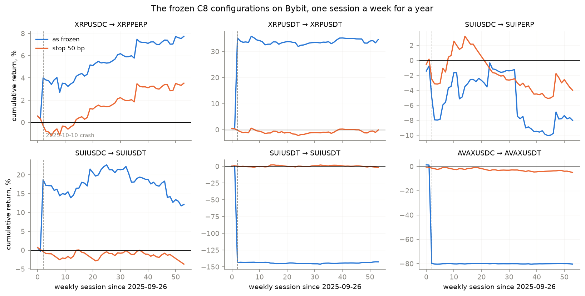
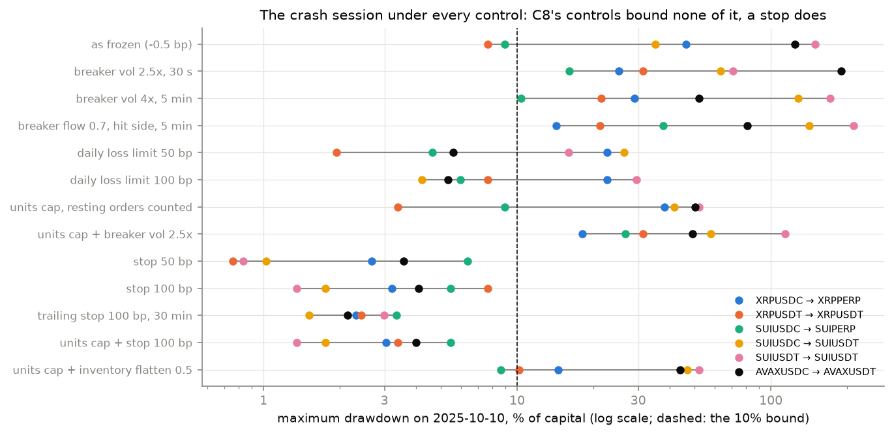
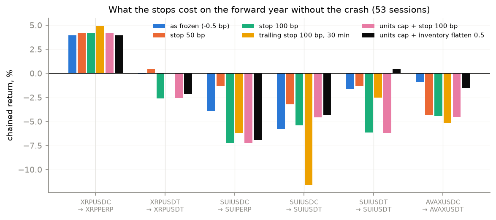
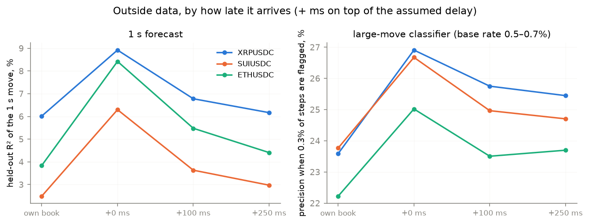

# C10 — A year forward on Bybit, the crash, and data from outside the book

Not a ladder phase. It answers the first two of the "next things to try"
after C9: a forward test of the frozen C8 choices on data they have never
seen, and inputs from outside the traded book. Lab notebook:
[`experiments/c10_forward/README.md`](../../experiments/c10_forward/README.md).

> **At a glance**
>
> - **The C8 edge does not survive a year on Bybit.** Six frozen OBI
>   configurations, run unchanged on one Bybit session a week from
>   2025-09-26 to 2026-10-02 (54 sessions): without the 2025-10-10 crash only
>   XRPUSDC → XRPPERP makes money (+3.96%, 30 of 53 sessions up), and it
>   falls to +0.21% at Bybit's standard +2 bp maker fee. At the assumed rebate the other five
>   lose 0.1–5.8%.
> - **The venue alone already costs most of it.** On the study month's own
>   held-out week, replayed on Bybit, the six make +1.41 to −1.37% against
>   +2.5 to +3.5% on Binance.
> - **One session decides the year's headline.** On 2025-10-10 Bybit's SUI
>   fell 82%, AVAX 67% and XRP 54% within minutes. As frozen the six make
>   anything from +34.7% to −143.2% that day, by luck of the inventory held
>   when it began: the position cap was valued at the falling price and
>   ignored resting orders, so the quoter kept buying.
> - **None of C8's risk controls bounds that day; a stop does.** Circuit
>   breakers, daily loss limits and a units cap each leave some
>   configuration with a crash-day drawdown of 23–211%. A loss limit that
>   *exits* the position at the touch (`loss_flatten`) holds every
>   configuration's drawdown to 0.8–6.4% at 50 bp, and is also the cheapest
>   control on the rest of the year (summed −5.6% against −8.4% as frozen).
>   Its stress tests: §6.
> - **Outside data improves the forecasts, if it arrives at once.** Adding
>   the same asset's Binance perpetual and spot trades and Bybit's
>   perpetual roughly doubles the held-out R² of the 1 s move (XRP 6.0 →
>   8.9%, SUI 2.5 → 6.3%, ETH 3.8 → 8.4%); most of the gain is gone 100 ms
>   later. The large-move classifier gains 2–3 points of precision at any
>   delay. Whether either pays in the backtest: §8.

---

**Contents**

- [1. The task](#1-the-task)
- [2. The data: Bybit's free books](#2-the-data-bybits-free-books)
- [3. The forward test](#3-the-forward-test)
- [4. The crash session](#4-the-crash-session)
- [5. Risk controls and stops](#5-risk-controls-and-stops)
- [6. The picked stop, stress-tested](#6-the-picked-stop-stress-tested)
- [7. Lead-lag: forecasts with outside data](#7-lead-lag-forecasts-with-outside-data)
- [8. Lead-lag through the backtest](#8-lead-lag-through-the-backtest)
- [9. So what?](#9-so-what)
- [10. How it was run, and what went wrong](#10-how-it-was-run-and-what-went-wrong)

## 1. The task

From the list of next steps after C9, the request was "begin 1 and 2":

1. **A forward test.** Every Part C conclusion rests on seven held-out
   Binance sessions from September 2025. Run the configurations that made
   money there, with every parameter frozen, on a year of sessions they
   have never seen.
2. **Lead-lag inputs.** C9 found that knowing the mid 1–3 s ahead is worth a
   lot and that the traded book alone forecasts 2–10% of it. Large moves
   usually start elsewhere: does the same asset's other markets' data
   forecast them better, and does it still when it arrives late?

The third item, a host to record Binance's own books going forward, is the
user's (free-tier options are in the [Part C overview](c0-part-c-overview.md)).

## 2. The data: Bybit's free books

Binance publishes trades but not order books; Bybit publishes both, free
and without an account (`bybit.py`):

- **books** — `quote-saver.bycsi.com`, 200 levels, a snapshot then deltas
  pushed every 10–100 ms, one JSON message per line with Bybit's publish time
  (`ts`) and the matching engine's (`cts`);
- **trades** — `public.bybit.com/trading`, every print with the taker's
  side and an RPI flag.

They are converted to the same `data/npz/<symbol>_<date>.npz` the Binance
days use, so every C6–C9 script runs on them unchanged. Three choices:

- a book event's exchange time is its matching-engine time, its local time
  the publish time plus 2 ms (the median publish delay was 4–27 ms a day);
- order latency is not taken from that feed delay: batching delays the
  data, not our orders (a constant 3 ms feed term for Bybit symbols);
- **RPI trades are dropped**: Retail Price Improvement orders trade only with
  non-API takers and are not in the public book, so a print against one
  could not have filled our quote (a median 3.9% of prints a day, at most
  16.6%).

Each Binance configuration runs on the Bybit contract that matches it:

| Binance (C8 choice) | Bybit | held out on Binance, % |
| --- | --- | --- |
| XRPUSDC OBI (floor 12 bp, κ 2, skew ×2) | XRPPERP (USDC-settled) | +2.84 |
| XRPUSDT OBI (floor 8 bp, κ 2) | XRPUSDT | +3.53 |
| SUIUSDC OBI (floor 8 bp, κ 4) | SUIPERP (USDC-settled), and SUIUSDT | +2.52 |
| SUIUSDT OBI (floor 16 bp, κ 4) | SUIUSDT | −0.53 |
| AVAXUSDC OBI (floor 16 bp, κ 0) | AVAXUSDT (no USDC AVAX perpetual) | +2.68 |

Sessions, fixed before any was run: the **venue control** — the study
month's held-out week (2025-09-19 to 09-25) replayed on Bybit — and the
**forward set**, every 7th day from 2025-09-26 (the day after the study
month) to 2026-10-02, 54 sessions.

## 3. The forward test

*Figure — cumulative return of each frozen configuration over the 54 weekly
sessions, as frozen (blue) and with the stop picked in §5 (orange). The
dashed line is the 2025-10-10 crash.*

| configuration | as frozen (−0.5 bp) | fee 0 | fee +1 bp | fee +2 bp (Bybit VIP 0) | latency ×4 | queue risk-averse | fills/day | sessions up |
| --- | --- | --- | --- | --- | --- | --- | --- | --- |
| XRPUSDC → XRPPERP | **+3.96** | +3.20 | +1.70 | +0.21 | +0.52 | +3.68 | 42 | 30/53 |
| XRPUSDT → XRPUSDT | −0.09 | −4.98 | −14.09 | −22.36 | +0.66 | +7.01 | 206 | 25/53 |
| SUIUSDC → SUIPERP | −3.94 | −4.90 | −6.80 | −8.66 | −6.18 | −3.21 | 28 | 28/53 |
| SUIUSDC → SUIUSDT | −5.79 | −7.56 | −11.01 | −14.34 | −10.18 | −4.58 | 88 | 26/53 |
| SUIUSDT → SUIUSDT | −1.65 | −2.15 | −3.15 | −4.15 | +2.77 | +0.50 | 32 | 26/53 |
| AVAXUSDC → AVAXUSDT | −0.92 | −2.02 | −4.19 | −6.32 | −0.41 | −1.30 | 46 | 30/53 |

*Chained return, %, over the 53 forward sessions without 2025-10-10.
Fills: median per session, as frozen.*

| configuration | as frozen (−0.5 bp) | fee 0 | fee +1 bp | fee +2 bp | latency ×4 | queue risk-averse | fills/day | sessions up |
| --- | --- | --- | --- | --- | --- | --- | --- | --- |
| XRPUSDC → XRPPERP | +1.41 | +1.30 | +1.07 | +0.85 | +0.69 | +1.41 | 67 | 4/7 |
| XRPUSDT → XRPUSDT | −1.37 | −1.98 | −3.19 | −4.38 | −1.02 | −1.82 | 324 | 4/7 |
| SUIUSDC → SUIPERP | +0.72 | +0.22 | −0.77 | −1.75 | +1.41 | +0.46 | 276 | 5/7 |
| SUIUSDC → SUIUSDT | −0.52 | −0.96 | −1.83 | −2.70 | −0.09 | −0.76 | 327 | 5/7 |
| SUIUSDT → SUIUSDT | −1.05 | −1.10 | −1.19 | −1.29 | −0.95 | −0.95 | 26 | 4/7 |
| AVAXUSDC → AVAXUSDT | −0.78 | −1.22 | −2.10 | −2.98 | +0.39 | −0.27 | 196 | 3/7 |

*The venue control: the same seven held-out sessions as C8, on Bybit.*

Read together:

- **The edge does not survive the venue.** On the very sessions where C8
  measured +2.5 to +3.5% on Binance, the same configurations make at most
  +1.41% on Bybit, and three of six lose. The floors and κ were tuned on
  Binance's books; why Bybit's differ for these quoters (depth, queue
  competition, the RPI flow that never reaches a public quote) was not
  separated here.
- **The year confirms it, with one exception.** XRPUSDC → XRPPERP is the only
  configuration that makes money on ordinary sessions (+3.96%, 30 of 53 up,
  positive under every stress but latency ×4 at +0.52%). It is also the one
  C8 found robust to costs. At Bybit's standard maker fee it is +0.21%: it
  needs a rebate or a market-maker programme to be worth running.
- **With the crash the picture is upside down.** All 54 sessions: XRPUSDT
  +34.6%, SUIUSDC → SUIUSDT +12.1% — and SUIUSDT −142.5%, AVAXUSDT −80.3%.
  Those numbers are one session's luck (§4), not an edge.

## 4. The crash session

At 21:21 UTC on 2025-10-10 the Bybit books of SUI, AVAX and XRP fell 82%,
67% and 54% within minutes and recovered most of it within the hour (the
replay was checked against the raw messages: these prints are real).

| configuration | crash-day return, % | max drawdown, % | largest position, $k |
| --- | --- | --- | --- |
| XRPUSDC → XRPPERP | +3.6 | 46.4 | 164 |
| XRPUSDT → XRPUSDT | +34.7 | 7.7 | 84 |
| SUIUSDC → SUIPERP | −4.3 | 8.9 | 60 |
| SUIUSDC → SUIUSDT | +19.0 | 35.1 | 69 |
| SUIUSDT → SUIUSDT | −143.2 | 149.1 | 136 |
| AVAXUSDC → AVAXUSDT | −80.1 | 124.0 | 141 |

*As frozen. Capital and the position cap are both $100k.*

Losses beyond 100% of capital should be impossible with a $100k cap. They
came from how the cap was checked (`zoo.quote_once`): as notional at the
*current* mid, so a falling price made room to buy more units; and against
the position only, so a whole 20-level resting grid could fill past it at
once. The quoter bought all the way down. Two fixes were added to the
kernel, off by default (the cached results are unchanged): `cap_ref` values
the cap at the session's first mid (a cap in units), and `cap_resting`
counts resting orders against it.

## 5. Risk controls and stops

C8's controls, and the two cap fixes, each ran on every forward session, so
their cost on ordinary days is measured with their effect on the crash:

*Figure — maximum drawdown on 2025-10-10 under each control, per
configuration (log scale). Dashed: the 10% bound of the selection rule.*

| configuration | as frozen | breaker vol 2.5×, 30 s | breaker vol 4×, 5 min | breaker flow 0.7, hit side, 5 min | daily loss limit 50 bp | daily loss limit 100 bp | units cap, resting counted | units cap + breaker vol 2.5× |
| --- | --- | --- | --- | --- | --- | --- | --- | --- |
| XRPUSDC → XRPPERP | +3.6 / 46.4 ; +3.96 | +18.3 / 25.1 ; −0.02 | +9.8 / 29.1 ; +4.76 | +34.1 / 14.3 ; −4.27 | −1.1 / 22.6 ; +3.81 | −1.1 / 22.6 ; +3.96 | −2.6 / 38.0 ; +3.96 | +1.3 / 18.0 ; −0.02 |
| XRPUSDT → XRPUSDT | +34.7 / 7.7 ; −0.09 | −18.3 / 31.3 ; +3.18 | +2.2 / 21.5 ; +0.59 | +82.6 / 21.2 ; −1.93 | +2.5 / 1.9 ; +1.27 | +34.7 / 7.7 ; −0.92 | +15.6 / 3.4 ; −0.07 | −1.3 / 31.3 ; +3.59 |
| SUIUSDC → SUIPERP | −4.3 / 8.9 ; −3.94 | −12.6 / 16.0 ; +6.17 | +2.2 / 10.4 ; +3.61 | +20.7 / 37.7 ; +1.28 | +0.0 / 4.6 ; −3.01 | −1.9 / 6.0 ; −4.68 | −4.3 / 8.9 ; −3.24 | −21.0 / 26.6 ; +5.89 |
| SUIUSDC → SUIUSDT | +19.0 / 35.1 ; −5.79 | +241.5 / 63.3 ; −10.52 | −121.7 / 128.2 ; −4.20 | −95.5 / 141.8 ; −6.70 | −24.7 / 26.4 ; −5.85 | −3.3 / 4.2 ; −6.56 | −40.0 / 41.5 ; −5.12 | −55.0 / 58.0 ; −10.38 |
| SUIUSDT → SUIUSDT | −143.2 / 149.1 ; −1.65 | +199.6 / 71.0 ; −5.54 | −160.8 / 171.4 ; −8.56 | −44.2 / 211.3 ; −2.55 | −14.9 / 15.9 ; −0.59 | −18.5 / 29.5 ; −2.07 | −51.1 / 52.0 ; −1.66 | −110.0 / 113.7 ; −5.55 |
| AVAXUSDC → AVAXUSDT | −80.1 / 124.0 ; −0.92 | −144.4 / 188.7 ; −0.62 | −9.9 / 52.1 ; −1.59 | +68.7 / 80.7 ; −3.36 | +18.3 / 5.6 ; −3.43 | +18.5 / 5.3 ; −4.85 | −13.7 / 50.2 ; −1.09 | −22.0 / 49.1 ; −0.60 |

*Each cell: crash-day return / crash-day max drawdown (%) ; chained return
over the 53 forward sessions without the crash (%).*

None of them bounds the crash. A circuit breaker pauses, then resumes into a
market still falling; the cap fixes stop the quoter buying more but leave it
holding a full position through an 80% fall. The daily loss limit comes
closest, and fails for a reason in its own definition: at the limit it makes
quoting *reduce-only*, and a passive reducing quote does not fill while the
price runs away from it.

That suggested the hypothesis, tested next: **a stop** — at the limit, send
the whole position out at the opposite touch (an immediate-or-cancel order,
taker fee paid), once a second until flat (`loss_flatten` in the kernel).
Five variants ran on every session:

| configuration | as frozen | stop 50 bp | stop 100 bp | trailing stop 100 bp, 30 min | units cap + stop 100 bp | units cap + inventory flatten 0.5 |
| --- | --- | --- | --- | --- | --- | --- |
| XRPUSDC → XRPPERP | +3.6 / 46.4 ; +3.96 | −0.6 / 2.7 ; +4.18 | −1.2 / 3.2 ; +4.23 | +0.1 / 2.3 ; +4.94 | −1.1 / 3.0 ; +4.23 | +17.4 / 14.5 ; +3.96 |
| XRPUSDT → XRPUSDT | +34.7 / 7.7 ; −0.09 | −0.6 / 0.8 ; +0.47 | +34.7 / 7.7 ; −2.60 | +2.7 / 2.4 ; +0.07 | +15.6 / 3.4 ; −2.58 | −0.2 / 10.2 ; −2.18 |
| SUIUSDC → SUIPERP | −4.3 / 8.9 ; −3.94 | −2.7 / 6.4 ; −1.35 | −1.8 / 5.5 ; −7.24 | +0.4 / 3.3 ; −6.21 | −1.8 / 5.5 ; −7.24 | −3.1 / 8.6 ; −6.92 |
| SUIUSDC → SUIUSDT | +19.0 / 35.1 ; −5.79 | −0.5 / 1.0 ; −3.21 | −1.0 / 1.8 ; −5.39 | +2.3 / 1.5 ; −11.59 | −1.0 / 1.8 ; −4.59 | −37.9 / 46.9 ; −4.37 |
| SUIUSDT → SUIUSDT | −143.2 / 149.1 ; −1.65 | −0.5 / 0.8 ; −1.32 | −1.0 / 1.4 ; −6.16 | −2.5 / 3.0 ; −2.51 | −1.0 / 1.4 ; −6.17 | −51.1 / 52.0 ; +0.44 |
| AVAXUSDC → AVAXUSDT | −80.1 / 124.0 ; −0.92 | −0.6 / 3.6 ; −4.37 | −1.1 / 4.1 ; −4.43 | +4.8 / 2.1 ; −5.14 | −1.0 / 4.0 ; −4.51 | −17.5 / 43.8 ; −1.53 |

*As above, for the stops.*

*Figure — the forward year without the crash, as frozen and with each stop.*

**The selection rule, fixed before the stops ran:** every configuration's
crash-day drawdown at most 10%, then the best summed return over the forward
year without the crash.

| variant | worst crash-day drawdown, % | passes | summed forward return without the crash, % | median fills/day, per configuration |
| --- | --- | --- | --- | --- |
| as frozen | 149.1 | no | −8.41 | 42, 206, 28, 88, 32, 46 |
| breaker vol 2.5×, 30 s | 188.7 | no | −7.36 | 42, 205, 21, 76, 25, 33 |
| breaker vol 4×, 5 min | 171.4 | no | −5.39 | 41, 236, 21, 68, 26, 36 |
| breaker flow 0.7, hit side, 5 min | 211.3 | no | −17.54 | 30, 149, 25, 70, 19, 23 |
| daily loss limit 50 bp | 26.4 | no | −7.81 | 42, 204, 21, 81, 28, 43 |
| daily loss limit 100 bp | 29.5 | no | −15.12 | 42, 206, 26, 84, 28, 44 |
| units cap, resting counted | 52.0 | no | −7.21 | 42, 210, 28, 88, 32, 46 |
| units cap + breaker vol 2.5× | 113.7 | no | −7.08 | 42, 205, 21, 76, 25, 33 |
| **stop 50 bp** | **6.4** | **yes** | **−5.59** | 42, 194, 19, 70, 22, 33 |
| stop 100 bp | 7.7 | yes | −21.57 | 42, 206, 20, 80, 24, 43 |
| trailing stop 100 bp, 30 min | 3.3 | yes | −20.44 | 43, 206, 31, 86, 29, 44 |
| units cap + stop 100 bp | 5.5 | yes | −20.85 | 42, 210, 20, 80, 24, 43 |
| units cap + inventory flatten 0.5 | 52.0 | no | −10.60 | 42, 217, 28, 87, 29, 45 |

The rule picks **stop 50 bp**. It also helps on ordinary days: by cutting a
losing session at −0.5% it turns XRPUSDT's −0.09% into +0.47% and halves
the SUI losses, at the price of AVAXUSDT (−0.92 → −4.37%), where sessions
that dipped and recovered are now stopped out. The wider stops pay that
price more often than they save it: a 100 bp stop is hit late, after the
damage, and then still sells at the bottom. It does not make the five
losing configurations profitable; it makes their losses bounded.

## 6. The picked stop, stress-tested

*Pending: stop 50 bp with each cost, latency and queue stress on every
forward session (`C10_VARSET=stopstress`), running.*

## 7. Lead-lag: forecasts with outside data

For ETHUSDC, XRPUSDC and SUIUSDC (C9's assets, on the study month's
Binance books), four free outside sources of the same asset
(`external.py`): Binance's USDT perpetual and USDT spot trades
(`data.binance.vision`), Bybit's USDT perpetual trades and its book's mid.
Each is reduced to a price and signed-notional series; an event counts only
once it would have arrived — 5 ms after its own timestamp for Binance's
markets, 80 ms for Bybit's (Singapore to Tokyo plus its publishing delay) —
plus a stress of +100 or +250 ms. From each source, per 100 ms step
(`leadlag.py`): its returns over 0.1, 0.5, 1 and 5 s; its signed flow over
the same windows; its basis to our mid and that basis's deviation from its
minute average; and its trade burst (trades in the last second over the
10-minute rate): 39 features beside C9's 17 own-book ones.

Same models and settings as C9 (boosted trees), fitted on the 24 training
sessions, scored on the 7 held-out ones: the 1 s and 3 s mid move, and the
large-move classifier (will the mid move against a side by the training
sessions' top-1% 3 s move?).

*Figure — held-out R² of the 1 s move and the classifier's precision when
0.3% of steps are flagged, from the own book alone and with outside data
arriving +0, +100 and +250 ms late.*

| asset | inputs | R² 1 s, % | R² 3 s, % | large-move AUC | precision at 0.3% flagged, % | precision at 1% flagged, % |
| --- | --- | --- | --- | --- | --- | --- |
| XRPUSDC (base rate 0.69%) | own book | 6.01 | 2.90 | 0.839 | 23.6 | 13.6 |
| | + outside, +0 ms | **8.92** | **4.11** | **0.855** | **26.9** | **15.2** |
| | + outside, +100 ms | 6.78 | 3.71 | 0.853 | 25.8 | 14.8 |
| | + outside, +250 ms | 6.17 | 3.09 | 0.852 | 25.4 | 14.8 |
| SUIUSDC (base rate 0.70%) | own book | 2.49 | 1.38 | 0.786 | 23.8 | 14.1 |
| | + outside, +0 ms | **6.30** | **2.96** | **0.807** | **26.7** | **15.1** |
| | + outside, +100 ms | 3.63 | 1.82 | 0.801 | 25.0 | 14.4 |
| | + outside, +250 ms | 2.97 | 1.56 | 0.802 | 24.7 | 14.4 |
| ETHUSDC (base rate 0.50%) | own book | 3.84 | 1.83 | 0.855 | 22.2 | 12.3 |
| | + outside, +0 ms | **8.42** | **3.72** | **0.871** | **25.0** | **13.7** |
| | + outside, +100 ms | 5.48 | 2.29 | 0.869 | 23.5 | 13.4 |
| | + outside, +250 ms | 4.41 | 1.99 | 0.870 | 23.7 | 13.3 |

- **The lead is real and short.** With the data as assumed, outside markets
  add 3–5 points of R² to the 1 s forecast — a 50–150% gain. 100 ms later
  half of it is gone, 250 ms later almost all. The informative features are
  Binance spot's 5 s return and the trade bursts on Binance spot and
  Bybit's perpetual: someone trades there first, and our book follows
  within a few hundred milliseconds.
- **Large moves are not much better anticipated.** AUC rises by 0.016–0.021
  and precision at 0.3% flagged by 2–3 points, and that small gain survives
  the delay. Three in four alarms are still false.
- **Still far from what pays.** C9 found a forecast has to explain about 40%
  of the 1 s move before quoting around it beats the C8 choice; the best
  here is 8.9%.

## 8. Lead-lag through the backtest

*Pending: `llbacktest.py` — each forecast (own book, own book + outside)
used as a fair-price shift and as a pull rule on the C8 OBI configurations,
chosen on training sessions, reported held out and stress-tested including
+100/+250 ms; running on Kaggle.*

## 9. So what?

*To be written when §6 and §8 are in.*

## 10. How it was run, and what went wrong

- **Where.** Bybit conversions and replays of the two small USDC contracts
  on this machine (4 cores, 16 GB) and on Kaggle CPU sessions; the three
  USDT contracts (12–48 million book events a day, up to 12 GB to convert)
  on Kaggle only, sharded 12 ways. The lead-lag fits on Kaggle (37 minutes
  a symbol including the downloads). About 6,600 Bybit session replays in
  all, before the stop's stress tests.
- **The container restarted every 30–60 minutes**, killing local work. Every
  unit is cached as it finishes and every fit saves model by model, so a
  restart costs one unit; heavy work moved to Kaggle.
- **A truncated download** (the connection dropped and the file was cached
  as if whole) broke one SUIUSDT day; downloads now check Content-Length.
- **A converter that ran out of memory** on the largest days now builds its
  event columns in 2-million-row chunks.
- **Bybit's REST API is region-blocked here**, so tick and lot sizes are
  measured from the data.
