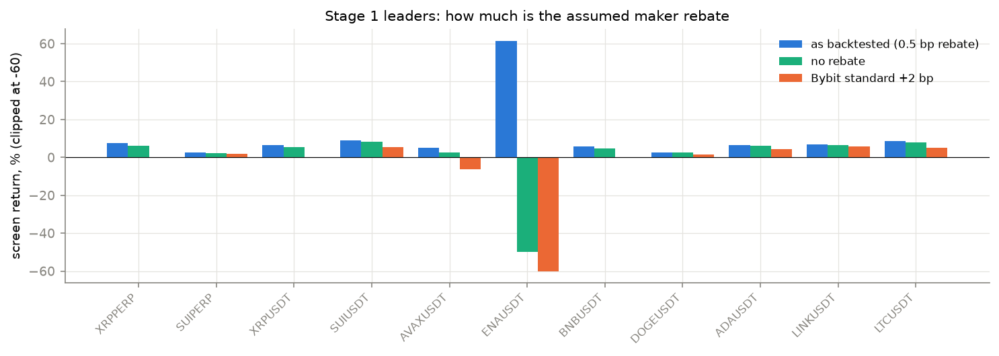
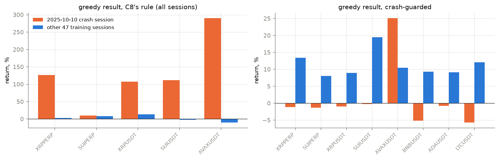
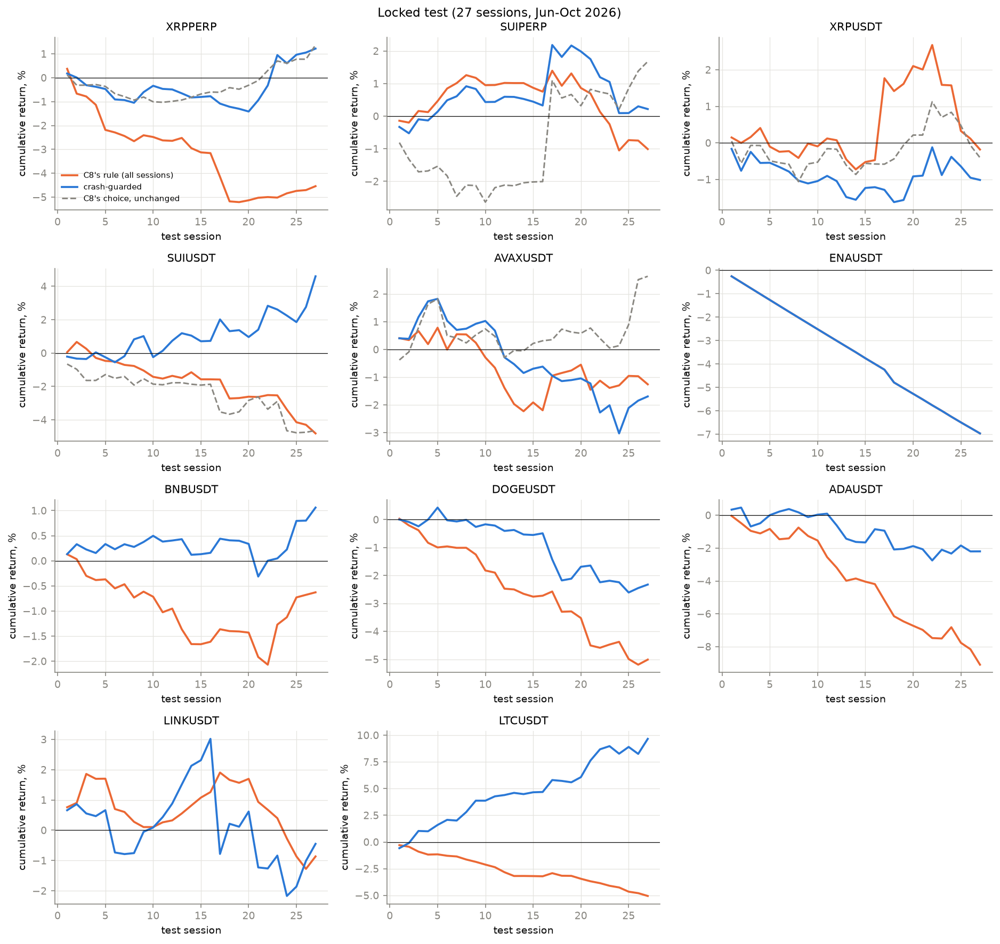
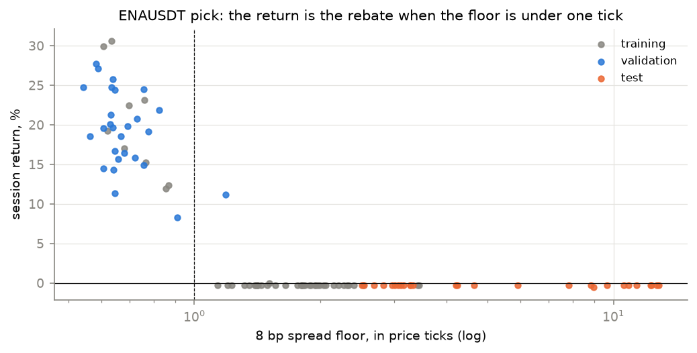
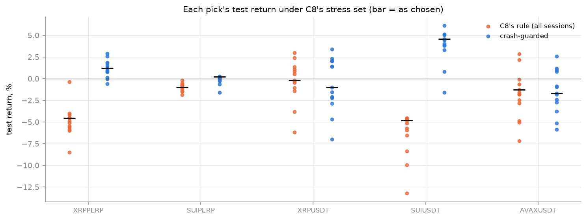

# C13 — C8's selection procedure on a year of Bybit, as a heuristic contest

Not a ladder phase. C10 found that C8's choices, made on 24 Binance
sessions, did not travel to a year of Bybit; C12 found that re-choosing on
Bybit's own 24-session study month did not help either (it beat C8's choice
on 1 of 5 contracts). C13 reruns C8's whole procedure on Bybit with six
months of training, a validation block and a locked test, with every
heuristic the project has as a contestant. Lab notebook:
[`experiments/c13_bybit_contest/README.md`](../../experiments/c13_bybit_contest/README.md);
tables and figures: `experiments/c13_bybit_contest/report.py`.

> **At a glance**
>
> - **C8's own selection rule picks the crash-day winner, and it loses.**
>   Ranking by the chained return over all 48 training sessions, C8's rule
>   chose a configuration that won the 2025-10-10 crash session by +10% to
>   +290% (positions up to 2.6× the cap) on 10 of 11 contracts. On the
>   locked test it lost on all eight contracts with a usable result,
>   −18.30 points in total.
> - **A crash guard fixes the selection.** The same procedure with C10's
>   guard (crash-session drawdown ≤ 10%, then the best return without the
>   crash) is ahead of C8's rule on six of eight contracts (on the other
>   two both lose). Summed over C10's five it is ahead of C8's Binance choices run unchanged: **+3.33 against
>   +0.64 points**.
> - **Two picks hold up.** On SUIUSDT a slow grid quoter (hfgrid, 4 bp) with
>   a volatility breaker made **+4.60%** on the 27 test sessions against
>   −4.64% for C8's choice; +2.76% without its best session, +3.33% without
>   the rebate, positive in 9 of 10 stresses, about 120 fills a session. On
>   BNBUSDT a GLFT quoter with a breaker made **+1.06%** (+0.74% without the
>   rebate, positive in 9 of 10 stresses, 38 fills a session). XRPPERP's
>   crash-guarded pick broke even with C8's (+1.22% vs +1.37%).
> - **Nothing survives Bybit's standard fee.** At a +2 bp maker fee every
>   pick loses; at +1 bp only SUIUSDT (+0.84%), XRPPERP (+0.14%) and BNBUSDT
>   (+0.11%) stay positive. The backtests assume Binance's 0.5 bp rebate.
> - **The rebate fakes some results outright.** ENAUSDT's pick made
>   +11,024% on validation by quoting a spread floor under one price tick
>   (~76,000 fills and ~5,000× capital a session, paid by the 0.5 bp
>   rebate) and −6.96% on the test, where the floor was 4 ticks and its loss
>   limit tripped every session. It is reported and left out of the sums.
> - **Still running:** ADAUSDT and LTCUSDT (test).

## Contents

- [1. The task](#1-the-task)
- [2. Split and stages](#2-split-and-stages)
- [3. Stage 1: the screen, and how much is rebate](#3-stage-1-the-screen-and-how-much-is-rebate)
- [4. Stages 2-3: the crash session decides C8's rule](#4-stages-2-3-the-crash-session-decides-c8s-rule)
- [5. The locked test](#5-the-locked-test)
- [6. Stress tests, contract by contract](#6-stress-tests-contract-by-contract)
- [7. So what?](#7-so-what)
- [8. How it was run, and what went wrong](#8-how-it-was-run-and-what-went-wrong)

## 1. The task

C8 chose quoting configurations for Binance on 24 sessions of one month,
with a held-out week. C10 ran those choices unchanged on a year of Bybit and
found the edge gone; C12 re-chose the OBI floor and κ on Bybit's own study
month and beat C8's choice on one contract of five. Both used a single month
for choosing. C13 asks whether the full C8 procedure — a screen of quoters,
every risk-control family, greedy forward selection, a validation block and
a stress set — finds something on Bybit when it has six months to choose
on. It is run as a contest: every heuristic the project has is a
contestant, and the score is the return on a test block nothing was chosen
on.

Contracts: C10's five (XRPPERP, SUIPERP, XRPUSDT, SUIUSDT, AVAXUSDT), then
six added later (ENAUSDT, BNBUSDT, DOGEUSDT, ADAUSDT, LINKUSDT, LTCUSDT).
Each is compared with C8's choice for the same asset, run unchanged.

## 2. Split and stages

Sessions are taken every 4th day, and the blocks never mix:

| block | dates | sessions | used for |
| --- | --- | --- | --- |
| screen | 2025-08-26 .. 2026-02-26, every 8th day | 24 | stage 1 |
| training | 2025-08-26 .. 2026-02-28, plus the 2025-10-10 crash | 48 | stages 2-3, the final pick |
| validation | 2026-03-02 .. 2026-06-14 | 27 | the final pick |
| test | 2026-06-18 .. 2026-10-02 | 27 | reported once, never chosen on |

1. **Screen**: OBI (floor 4-24 bp × κ 0/2/4 × skew), GLFT and hfgrid
   (floor 4/8/16 bp × κ) — 54 settings per contract.
2. **Families**: on top of the screen leader, every C8 family (breaker,
   loss limit, smoothing, markout half-life, momentum, per-side markout,
   requote hysteresis, toxicity sizing, inventory flatten, time of day,
   alpha clipping) and C10's (stop, units cap), on all 48 training sessions.
3. **Greedy**: C8's forward selection over the families' best variants.
4. **Validation**: the screen's top 3, each rule's family bests and greedy
   result; each rule picks the best on training + validation.
5. **Test**: both picks and C8's stress set on the test block.

**Two selection rules.** C8's rule ranks by the chained return over all
training sessions. The 2025-10-10 crash is one of them. The crash-guarded
rule (C10's) first requires a crash-session drawdown of at most 10%, then
ranks by the chained return without the crash. Both picks go to the test.

## 3. Stage 1: the screen, and how much is rebate

Every backtest assumes Binance's best market-maker rebate (maker fee
−0.5 bp). Bybit's standard maker fee is +2 bp. A session's rebate income is
its turnover × 0.5 bp of capital, so a high-turnover setting can lead the
screen on the rebate alone.

| contract | screen leader | screen | without the rebate | at +2 bp | turnover/session |
| --- | --- | --- | --- | --- | --- |
| XRPPERP | obi floor 8 bp, κ 2 | +7.65% | +5.99% | -0.39% | 7.4x |
| SUIPERP | hfgrid floor 8 bp, κ 0 | +2.57% | +2.41% | +1.77% | 1.1x |
| XRPUSDT | obi floor 8 bp, κ 4 | +6.65% | +5.32% | +0.18% | 7.3x |
| SUIUSDT | hfgrid floor 4 bp, κ 0 | +9.01% | +8.27% | +5.34% | 5.8x |
| AVAXUSDT | obi floor 6 bp, κ 4 | +5.05% | +2.67% | -6.35% | 11.8x |
| ENAUSDT | glft floor 8 bp, κ 4 | +61.58% | -49.84% | -100.01% | 266.7x |
| BNBUSDT | glft floor 4 bp, κ 0 | +5.86% | +4.72% | +0.26% | 6.4x |
| DOGEUSDT | obi floor 16 bp, κ 4 | +2.72% | +2.49% | +1.57% | 1.5x |
| ADAUSDT | hfgrid floor 4 bp, κ 0 | +6.64% | +6.17% | +4.28% | 3.7x |
| LINKUSDT | hfgrid floor 4 bp, κ 2 | +6.68% | +6.49% | +5.75% | 1.1x |
| LTCUSDT | hfgrid floor 4 bp, κ 0 | +8.51% | +7.79% | +4.97% | 5.6x |

These are in-sample (the best of 54 on the sessions it was chosen on), and
the fee columns are recomputed as return − turnover × fee per session; the
stage 5 fee stresses rerun the backtest. ENAUSDT's leader is the rebate and
nothing else. The slow grid quoters (hfgrid, ~1-6× turnover) keep most of
their return at +2 bp.

## 4. Stages 2-3: the crash session decides C8's rule

Under C8's rule the momentum family won stage 2 on every contract but
ENAUSDT, and the greedy result was a crash-day winner every time but ENAUSDT
(whose result is the rebate artefact of §5). The figure splits each
greedy result's training return into the crash session and the other 47:

| contract | rule | added | crash session | other 47 sessions | crash-session drawdown |
| --- | --- | --- | --- | --- | --- |
| XRPPERP | C8's rule (all sessions) | breaker, momentum, per-side markout, stop, requote hysteresis, markout half-life | +126.96% | +3.23% | 34.7% |
| XRPPERP | crash-guarded | stop, signal smoothing, alpha clipping, units cap, time of day, inventory flatten | -1.15% | +13.42% | 2.0% |
| SUIPERP | C8's rule (all sessions) | momentum, breaker | +10.27% | +7.78% | 24.9% |
| SUIPERP | crash-guarded | nothing | -1.30% | +8.10% | 7.2% |
| XRPUSDT | C8's rule (all sessions) | momentum, time of day | +107.72% | +13.16% | 28.8% |
| XRPUSDT | crash-guarded | inventory flatten, units cap | -1.00% | +8.91% | 6.0% |
| SUIUSDT | C8's rule (all sessions) | momentum, breaker, toxicity sizing, markout half-life | +111.63% | -1.86% | 14.5% |
| SUIUSDT | crash-guarded | signal smoothing, loss limit, per-side markout | -0.25% | +19.46% | 1.4% |
| AVAXUSDT | C8's rule (all sessions) | momentum | +290.11% | -10.41% | 41.2% |
| AVAXUSDT | crash-guarded | nothing | +25.09% | +10.47% | 31.1% |
| ENAUSDT | C8's rule (all sessions) | stop, momentum, per-side markout, loss limit | -0.25% | +370.87% | 0.3% |
| ENAUSDT | crash-guarded | stop, momentum, per-side markout, loss limit | -0.25% | +370.87% | 0.3% |
| BNBUSDT | C8's rule (all sessions) | momentum, markout half-life | +42.19% | +2.79% | 2.9% |
| BNBUSDT | crash-guarded | breaker | -5.16% | +9.35% | 9.1% |
| DOGEUSDT | C8's rule (all sessions) | momentum, breaker | +133.00% | -0.19% | 21.4% |
| DOGEUSDT | crash-guarded | loss limit, inventory flatten | -5.05% | +3.59% | 6.1% |
| ADAUSDT | C8's rule (all sessions) | momentum, breaker, time of day, stop | +73.44% | -8.59% | 12.6% |
| ADAUSDT | crash-guarded | nothing | -0.77% | +9.13% | 14.3% |
| LINKUSDT | C8's rule (all sessions) | momentum, breaker, markout half-life | +60.78% | -4.08% | 12.1% |
| LINKUSDT | crash-guarded | signal smoothing, inventory flatten | +3.42% | +8.38% | 4.7% |
| LTCUSDT | C8's rule (all sessions) | momentum, toxicity sizing, time of day, signal smoothing | +61.25% | -7.98% | 12.6% |
| LTCUSDT | crash-guarded | nothing | -5.72% | +12.09% | 23.2% |

How the crash winners win: the position cap applies when quotes are placed,
and a sweep that fills several resting orders at once overshoots it. During
the crash the C8-rule picks held up to 2.2× (XRPPERP, XRPUSDT) and 2.6×
(AVAXUSDT) the capital in inventory and happened to be on the right side of
the rebound. These numbers rest on fills at wick prices in a thin, fast
book; the crash-guarded rule makes none of them eligible.

**A gap in the guard.** Stage 3 starts from the screen leader, and the
guard applies only to what is added. Where no family variant passes, the
crash-guarded "pick" keeps the leader's crash exposure: AVAXUSDT (31.1%),
ADAUSDT (14.3%) and LTCUSDT (23.2%).

## 5. The locked test

27 sessions, 2026-06-18 .. 2026-10-02, never used for choosing.

| contract | pick, C8's rule | pick, crash-guarded | C8's choice, unchanged | crash-guarded at maker fee +1 bp | crash-guarded at +2 bp |
| --- | --- | --- | --- | --- | --- |
| XRPPERP | -4.54% | +1.22% | +1.37% | +0.14% | -0.57% |
| SUIPERP | -1.01% | +0.22% | +1.68% | -0.29% | -0.63% |
| XRPUSDT | -0.18% | -1.01% | -0.40% | -4.66% | -7.01% |
| SUIUSDT | -4.81% | **+4.60%** | -4.64% | +0.84% | -1.60% |
| AVAXUSDT | -1.26% | -1.69% | +2.64% | -3.76% | -5.12% |
| ENAUSDT (artefact) | -6.96% | -6.96% | – | -6.66% | -6.65% |
| BNBUSDT | -0.63% | +1.06% | – | +0.11% | -0.51% |
| DOGEUSDT | -5.01% | -2.32% | – | -3.04% | -3.39% |
| LINKUSDT | -0.86% | -0.45% | – | -1.45% | -2.11% |
| sum, five original | -11.80 | **+3.33** | +0.64 | | |
| sum, added | -6.50 | -1.71 | – | | |

The fee columns are the backtest's own fee stresses (§6). C8 chose no
configuration for ENA, BNB or DOGE, so the added contracts have no
"unchanged" column. C8's choice for SUIUSDT is SUIUSDT's own OBI; with
SUIUSDC's OBI instead it makes −4.99% and the five-contract sum is +0.30.

Per contract, with training and validation, the test without its best
session (the crash session is in training, so the test block has none to
remove), without the rebate, and fills:

**XRPPERP**

| entry | training | validation | test | test without its best session | test without the rebate | test sessions up | fills/session (test) |
| --- | --- | --- | --- | --- | --- | --- | --- |
| pick, C8's rule: greedy (breaker, momentum, per-side markout, stop, requote hysteresis, markout half-life) | +134.30% | +0.03% | **-4.54%** | -4.90% | -4.94% | 10/27 | 54 |
| pick, crash-guarded: greedy (stop, signal smoothing, alpha clipping, units cap, time of day, inventory flatten) | +12.11% | +0.63% | **+1.22%** | -0.05% | +0.86% | 11/27 | 51 |
| C8's choice, unchanged | +4.15% | -0.97% | **+1.37%** | +0.78% | +1.09% | 16/27 | 38 |

**SUIPERP**

| entry | training | validation | test | test without its best session | test without the rebate | test sessions up | fills/session (test) |
| --- | --- | --- | --- | --- | --- | --- | --- |
| pick, C8's rule: greedy (momentum, breaker) | +18.85% | +1.21% | **-1.01%** | -1.64% | -1.18% | 10/27 | 11 |
| pick, crash-guarded: family: momentum | +5.79% | +2.20% | **+0.22%** | -1.60% | +0.05% | 11/27 | 11 |
| C8's choice, unchanged | +3.10% | +2.16% | **+1.68%** | -1.45% | +1.51% | 14/27 | 15 |

**XRPUSDT**

| entry | training | validation | test | test without its best session | test without the rebate | test sessions up | fills/session (test) |
| --- | --- | --- | --- | --- | --- | --- | --- |
| pick, C8's rule: greedy (momentum, time of day) | +135.05% | -0.65% | **-0.18%** | -2.38% | -1.41% | 12/27 | 100 |
| pick, crash-guarded: greedy (inventory flatten, units cap) | +7.82% | +0.09% | **-1.01%** | -1.78% | -2.24% | 11/27 | 133 |
| C8's choice, unchanged | +36.61% | +0.33% | **-0.40%** | -1.30% | -2.75% | 12/27 | 216 |

**SUIUSDT**

| entry | training | validation | test | test without its best session | test without the rebate | test sessions up | fills/session (test) |
| --- | --- | --- | --- | --- | --- | --- | --- |
| pick, C8's rule: greedy (momentum, breaker, toxicity sizing, markout half-life) | +107.68% | -7.50% | **-4.81%** | -5.40% | -6.56% | 7/27 | 613 |
| pick, crash-guarded: family: breaker (5-min cooldown, vol 2.5) | +23.07% | +0.96% | **+4.60%** | +2.76% | +3.33% | 14/27 | 122 |
| C8's choice, unchanged | -145.45% | -0.63% | **-4.64%** | -5.31% | -4.83% | 13/27 | 25 |

(C8's SUIUSDT choice loses more than 100% on the crash session — the cap
overshoot of §4 — so its chained training return is below −100%.)

**AVAXUSDT**

| entry | training | validation | test | test without its best session | test without the rebate | test sessions up | fills/session (test) |
| --- | --- | --- | --- | --- | --- | --- | --- |
| pick, C8's rule: family: momentum | +249.50% | +1.37% | **-1.26%** | -2.50% | -2.47% | 12/27 | 132 |
| pick, crash-guarded: family: markout half-life | +17.84% | +1.25% | **-1.69%** | -2.62% | -2.39% | 15/27 | 52 |
| C8's choice, unchanged | -79.64% | -1.61% | **+2.64%** | +1.02% | +2.19% | 16/27 | 49 |

C8's AVAXUSDT choice made the best test return of the three, after −79.6%
on training and −1.6% on validation: nothing before the test would have
selected it.

**BNBUSDT**

| entry | training | validation | test | test without its best session | test without the rebate | test sessions up | fills/session (test) |
| --- | --- | --- | --- | --- | --- | --- | --- |
| pick, C8's rule: greedy (momentum, markout half-life) | +46.15% | +1.11% | **-0.63%** | -1.43% | -1.27% | 12/27 | 79 |
| pick, crash-guarded: family: breaker | +3.70% | +0.77% | **+1.06%** | +0.49% | +0.74% | 17/27 | 38 |

**DOGEUSDT**

| entry | training | validation | test | test without its best session | test without the rebate | test sessions up | fills/session (test) |
| --- | --- | --- | --- | --- | --- | --- | --- |
| pick, C8's rule: greedy (momentum, breaker) | +132.56% | +0.38% | **-5.01%** | -5.19% | -5.22% | 9/27 | 21 |
| pick, crash-guarded: greedy (loss limit, inventory flatten) | -1.64% | +1.13% | **-2.32%** | -2.75% | -2.51% | 13/27 | 18 |

**LINKUSDT**

| entry | training | validation | test | test without its best session | test without the rebate | test sessions up | fills/session (test) |
| --- | --- | --- | --- | --- | --- | --- | --- |
| pick, C8's rule: greedy (momentum, breaker, markout half-life) | +54.22% | -3.67% | **-0.86%** | -1.79% | -2.29% | 14/27 | 215 |
| pick, crash-guarded: family: time of day | +13.02% | +0.19% | **-0.45%** | -1.44% | -0.78% | 18/27 | 40 |

### ENAUSDT: a rebate artefact

Both rules picked the same configuration (GLFT 8 bp with a stop, momentum,
per-side markout and a 25 bp loss limit that flattens).

| entry | training | validation | test | test without its best session | test without the rebate | test sessions up | fills/session (test) |
| --- | --- | --- | --- | --- | --- | --- | --- |
| pick, C8's rule: greedy (stop, momentum, per-side markout, loss limit) | +369.67% | +11024.06% | **-6.96%** | -6.73% | -10.02% | 0/27 | 415 |
| pick, crash-guarded: greedy (stop, momentum, per-side markout, loss limit) | +369.67% | +11024.06% | **-6.96%** | -6.73% | -10.02% | 0/27 | 415 |

Its return depends on one thing: whether the 8 bp spread floor is under
one price tick. Under one tick it quotes at the touch, fills tens of
thousands of times a session with almost no drawdown and is paid the
0.5 bp rebate on about 5,000× capital turned over. At one tick or more it
loses 25 bp, flattens and stays paused for most of the session.

| block | sessions | floor under 1 tick | median return, floor < 1 tick | median return, floor ≥ 1 tick | median fills, floor < 1 tick | median fills, floor ≥ 1 tick |
| --- | --- | --- | --- | --- | --- | --- |
| training | 48 | 9 | +19.23% | -0.25% | 78,825 | 792 |
| validation | 27 | 26 | +19.61% | +11.14% | 76,183 | 44,852 |
| test | 27 | 0 | – | -0.25% | – | 415 |

The floor was under one tick on 9 training sessions and 26 validation
sessions (late January to June 2026), and on no test session. The fee
stresses on the test barely move the result (−6.62% to −6.66%) because the
quoter has stopped trading. Neither the validation nor the test number says
anything about market making on ENAUSDT. What it does say: a backtest with
a maker rebate and a queue model that fills a quote at the touch will pay
for sub-tick spreads, and a screen should check the floor in ticks.

## 6. Stress tests, contract by contract

C8's stress set on the test block: maker fee 0 / +1 / +2 bp, latency ×2 and
×4, the risk-averse and log queue models, double size, and the floor and κ
neighbourhood (κ rows are absent where the quoter has κ = 0). Each dot is
one stress; the bar is the pick as chosen. The figure shows C10's five
contracts; the tables below include the added contracts.

Crash-guarded picks:

| stress (test), C10's five | XRPPERP | SUIPERP | XRPUSDT | SUIUSDT | AVAXUSDT |
| --- | --- | --- | --- | --- | --- |
| as chosen | +1.22% | +0.22% | -1.01% | +4.60% | -1.69% |
| fee 0 | +0.86% | +0.05% | -2.24% | +3.33% | -2.39% |
| fee +1 bp | +0.14% | -0.29% | -4.66% | +0.84% | -3.76% |
| fee +2 bp | -0.57% | -0.63% | -7.01% | -1.60% | -5.12% |
| latency ×2 | +1.51% | +0.12% | +3.38% | +4.06% | -0.86% |
| latency ×4 | +2.89% | -1.57% | +2.02% | +3.82% | +2.57% |
| queue risk-averse | +1.86% | +0.26% | +1.43% | +4.47% | -1.82% |
| queue log | +0.79% | +0.23% | +1.42% | +3.86% | -2.71% |
| size ×2 | +0.98% | -0.03% | -2.11% | +5.15% | -0.97% |
| floor ×0.8 | +1.73% | -0.14% | -2.85% | +6.14% | +0.83% |
| floor ×1.25 | +1.25% | +0.14% | +2.02% | +5.04% | +0.99% |
| κ ×0.5 | +2.59% | – | -1.56% | – | -5.85% |
| κ ×2 | -0.05% | – | +2.30% | – | +1.20% |

| stress (test), added | BNBUSDT | DOGEUSDT | LINKUSDT |
| --- | --- | --- | --- |
| as chosen | +1.06% | -2.32% | -0.45% |
| fee 0 | +0.74% | -2.51% | -0.78% |
| fee +1 bp | +0.11% | -3.04% | -1.45% |
| fee +2 bp | -0.51% | -3.39% | -2.11% |
| latency ×2 | +1.17% | -0.88% | +2.58% |
| latency ×4 | +1.39% | -3.04% | +4.17% |
| queue risk-averse | +1.06% | -1.31% | +0.60% |
| queue log | +1.65% | -1.60% | +0.35% |
| size ×2 | +1.89% | -4.33% | +4.18% |
| floor ×0.8 | +1.49% | -2.65% | +2.23% |
| floor ×1.25 | +0.08% | -1.81% | +1.05% |
| κ ×0.5 | – | -2.04% | +2.33% |
| κ ×2 | – | -1.85% | -1.39% |

C8's rule picks:

| stress (test), C10's five | XRPPERP | SUIPERP | XRPUSDT | SUIUSDT | AVAXUSDT |
| --- | --- | --- | --- | --- | --- |
| as chosen | -4.54% | -1.01% | -0.18% | -4.81% | -1.26% |
| fee 0 | -4.88% | -1.18% | -1.41% | -6.56% | -2.47% |
| fee +1 bp | -5.43% | -1.52% | -3.81% | -9.95% | -4.85% |
| fee +2 bp | -6.01% | -1.86% | -6.17% | -13.23% | -7.17% |
| latency ×2 | -5.57% | -0.20% | +1.35% | -4.64% | +2.88% |
| latency ×4 | -5.85% | -0.51% | +0.55% | -4.52% | -2.82% |
| queue risk-averse | -3.99% | -0.80% | -0.45% | -5.96% | -1.80% |
| queue log | -4.16% | -0.82% | -0.34% | -5.71% | -0.65% |
| size ×2 | -8.49% | -1.39% | +2.99% | -8.34% | -1.77% |
| floor ×0.8 | -4.56% | -0.77% | +1.08% | -4.59% | -0.07% |
| floor ×1.25 | -0.36% | -0.65% | +2.43% | -5.14% | -1.61% |
| κ ×0.5 | -5.08% | – | -1.05% | – | -5.04% |
| κ ×2 | -4.47% | – | +0.86% | – | +2.16% |

| stress (test), added | BNBUSDT | DOGEUSDT | LINKUSDT |
| --- | --- | --- | --- |
| as chosen | -0.63% | -5.01% | -0.86% |
| fee 0 | -1.27% | -5.22% | -2.29% |
| fee +1 bp | -2.54% | -5.64% | -5.07% |
| fee +2 bp | -3.80% | -6.06% | -7.78% |
| latency ×2 | -0.63% | -2.84% | -3.31% |
| latency ×4 | -0.52% | -4.12% | -4.48% |
| queue risk-averse | -0.80% | -4.73% | -1.17% |
| queue log | -0.31% | -3.51% | -0.75% |
| size ×2 | -0.95% | -9.50% | -0.78% |
| floor ×0.8 | -0.94% | -3.75% | -1.04% |
| floor ×1.25 | -1.12% | -5.24% | -1.46% |
| κ ×0.5 | – | -3.91% | -3.32% |
| κ ×2 | – | -4.40% | -1.69% |

- **SUIUSDT, crash-guarded**: positive in 9 of 10 stresses, failing only
  at +2 bp. The only pick whose result is not within noise of zero.
- **XRPPERP, crash-guarded**: positive in 10 of 12; fails at +2 bp and is
  flat at κ ×2. About as good as C8's choice unchanged.
- **BNBUSDT, crash-guarded**: positive in 9 of 10; fails at +2 bp
  (−0.51%), +0.11% at +1 bp.
- **DOGEUSDT**: both picks lose under every stress.
- **LINKUSDT**: both picks lose as chosen and at every fee; the
  crash-guarded pick's other stresses scatter from −1.39% to +4.18%.
- **XRPUSDT and AVAXUSDT**: the stresses scatter on both sides of zero
  (AVAXUSDT C8's rule: latency ×2 +2.88%, latency ×4 −2.82%), which is what
  no edge looks like.
- **Every C8-rule pick except XRPUSDT's loses under nearly every stress.**
- ENAUSDT is left out of these tables (§5).

## 7. So what?

- **C8's selection rule is the problem on Bybit, not only C8's choices.**
  Six months of training with a crash in it turns C8's rule into a search
  for the configuration that held the most inventory on the right side of
  one rebound. Any rule used to choose on a block with a tail event in it
  needs a guard on that event; C10's crash guard is enough to stop it.
- **With the guard, the procedure beats running C8's choices unchanged,
  but narrowly**: +3.33 against +0.64 points summed over C10's five
  contracts, and all of the margin is SUIUSDT. On the two added contracts
  with a usable result it makes +1.06% (BNBUSDT), −2.32% (DOGEUSDT) and
  −0.45% (LINKUSDT), against −0.63%, −5.01% and −0.86% under C8's rule.
- **The one robust find is a slow grid quoter with a volatility breaker on
  SUIUSDT.** It keeps its return without the rebate and at +1 bp, under
  latency and queue stresses, and without its best session. It is the
  first configuration chosen on Bybit that holds up on a locked test and
  the stress set (C12's SUIUSDT re-choice won one held-out week, unstressed).
- **BNBUSDT's guarded pick is a smaller, similar find**: a quoter with a
  breaker, +1.06% on the test, robust to latency, queue and size, positive
  at +1 bp (+0.11%).
- **A backtest rebate can manufacture a winner.** ENAUSDT's pick earned
  thousands of percent by quoting under one tick at the rebate; the
  screen should reject any setting whose spread floor is below one tick.
- **Fees are the binding constraint.** Nothing survives Bybit's standard
  +2 bp maker fee. Whether any of this is tradeable depends on the fee tier
  actually available.

## 8. How it was run, and what went wrong

- Each stage's (configuration, session) backtests ran on Kaggle (five
  notebooks at a time, 3 workers each, 2 when XRPUSDT sessions are in the
  batch — more ran out of memory) and were merged into the same per-session
  cache as C8 and C10. `contest.py units --phase <stage>` dumps the pending
  work so a fresh notebook needs nothing else.
- The crash guard was added after stage 2 on XRPPERP showed the crash
  session deciding C8's ranking; both rules then ran on every contract, and
  both picks went to the test, so the test was not used to choose between
  the rules.
- The guard does not apply to the screen leader (§4). Fixing it would
  change the AVAXUSDT, ADAUSDT and LTCUSDT crash-guarded picks; it was left
  as is so the test stays single-use.
- The fee columns of §3 are recomputed from turnover, which assumes the
  quoter trades the same at any fee; §5 and §6 use the backtest's own fee
  stresses. On C10's five the two agree to within 0.02 points; on ENAUSDT
  they do not (−15.9% recomputed against −6.7% backtested at +1 bp),
  because the quoter stops trading.
- One pooled batch of Kaggle work was lost to a phase label `contest.py`
  rejects; it was rerun unchanged.
