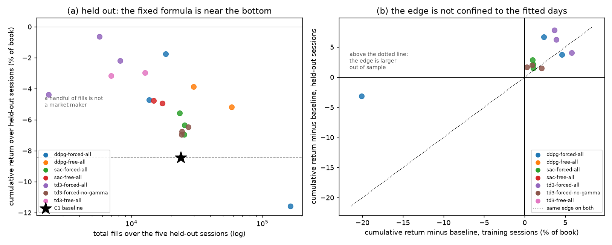

# C3 — Continuous Control on the Coefficient Set: task, goal, and how it was solved

The first real test in Part C: do learned, state-conditioned coefficients beat
well-calibrated fixed ones? Lab notebook:
[`experiments/c3_continuous_control/README.md`](../../experiments/c3_continuous_control/README.md).

---

## 1. The task

[`ladder.md`](../ladder.md#c3) states three items:

1. Apply DDPG/TD3/SAC to the C2 environment: policy outputs (γ, c1,
   half-spread-scale) per step, conditioned on state.
2. Compare against the C1 fixed-calibration baseline on held-out days: Sharpe,
   Sortino, MaxPositionValue, ReturnOverMDD.
3. Ablate: fix γ at its calibrated value and let RL learn only c1/skew, vs.
   letting RL learn all three jointly — compare sample efficiency and
   stability.

## 2. The goal, and the question that had to be fixed first

The stated goal is "a real answer to whether learned, state-conditioned
coefficients beat a well-calibrated fixed formula". C2 ended by showing that
question, asked of this environment as designed, has a degenerate answer.

The action space contains a corner — the half-spread scale at its maximum —
that quotes six hundred ticks from the mid, takes **zero fills**, and returns
**exactly zero**. C1 established that the fixed baseline loses 0.93% of book
on a training session. So "beat the baseline" is achieved by not trading, and
an agent that finds that corner has answered the question truthfully and
uselessly.

A five-episode smoke test confirmed it is not hypothetical: TD3 drove the
half-spread scale to 7.1 and fills to zero.

So C3 runs two experiments rather than one.

- **Free participation** — the action space as C2 defined it. This asks what
  RL does when leaving the market is available, and the answer is a finding
  about the reward, not about the algorithms.
- **Forced participation** — the half-spread scale capped at 2× the
  calibrated value, so quoting far enough away to stop trading is not
  representable. The baseline remains interior to the range. This asks the
  question the phase is actually about: *given that you must make a market,
  do learned coefficients beat fixed ones?*

Reporting only the first would be a non-result dressed as a result. Reporting
only the second would hide that the unconstrained problem has a trivial
optimum. Both are reported.

## 3. What is reused, and what is not

**The algorithms are A5's, imported rather than reimplemented.** `build_agent`,
`select_action` and `update_step` were split out of A5's `train()` so that
both phases drive one implementation of DDPG, TD3 and SAC. Only the outer loop
is new, and it has to be: an episode here is a trading session that costs
about 140 seconds, so the loop cycles over the five training days and does one
gradient update every eight environment steps rather than one per step. With
85,800 transitions per session, data is not the scarce resource; wall clock
is.

**Two deviations from "reuse A5 directly", both deliberate.**

*The network is (64, 64), not A5's (256, 256).* A5's width was its default for
Pendulum and LunarLander. Here the observation is 10-dimensional and the
action at most 4-dimensional, so 256 means 140k critic parameters and 9.6 ms
per update against 10k and 3.9 ms. The first launch at 256 took 429 seconds
per episode, essentially all of it gradient updates.

*A pinned coefficient is removed from the action space, not overwritten after
the actor emits it.* These look equivalent and are not. If the actor keeps
emitting a coefficient that is then replaced by a constant, the critic sees no
variance in that column, its gradient there is unidentified, and the actor
follows that arbitrary gradient through a shared trunk into the coefficients
that do matter. That would confound precisely the comparison item 3 exists to
make, so the ablation's agent has a three-dimensional action space rather than
a four-dimensional one with a dead column.

**The action space has four coefficients, not the three the item names.** C2
split the ladder's single "half-spread/skew scaling term" in two, because C1
showed the coupling between spread and skew is what breaks the fixed model:
both scale with $\sigma c_2$, so 0.67 units of inventory cancelled the whole
half spread, and the source notebook introduces `adj2` by hand for exactly
that reason. The ablation is therefore run over four.

## 4. What is measured

Every policy is scored by replaying whole sessions and passing the equity
record to `hftbacktest.stats.LinearAssetRecord` — the same call C1 used for
the fixed baseline, on the same record type — so the two phases' tables are
directly comparable rather than merely similar. The baseline itself is
re-scored through C3's code path, so that no difference between the rows can
be an artefact of two different scorers.

Reported per configuration: Sharpe, Sortino, MaxPositionValue and
ReturnOverMDD as the item asks, and **fills** next to them. A risk-adjusted
measure computed over a strategy that took eleven fills is not a risk-adjusted
measure, and the fills column is the one that says whether a row is a market
maker at all.

**Two summaries, because they disagree, and the disagreement turned out to be
the result.** Per-session medians describe the typical day; the period —
cumulative return, the annualised Sharpe of the daily returns, the worst
session — describes the track record. For a strategy whose losses are
concentrated in two of five sessions these rank the field almost inversely,
and §5 shows the period is the summary that answers the item's question.
Seeds are always listed individually as well. (The first version of this
phase reported only the medians and drew the opposite conclusion; see §5.)

## 5. Results

### Item 1 — the three algorithms

Eighteen runs: three algorithms × three seeds under forced participation,
three × two under free, and TD3 with γ pinned × three seeds. Ten sessions
each, cycling twice over the five training days.

On **training** sessions the three algorithms behave quite differently.

| configuration | fills (final session) | PnL (% of book) | γ | half scale | skew scale |
| --- | --- | --- | --- | --- | --- |
| `sac-forced` (3 seeds) | ~10,000 | −1.82 to −2.07 | 0.19 | 1.09 | 0.39 |
| `sac-free` (2 seeds) | ~23,000 | −4.38 to −4.55 | 0.20 | 1.97 | 0.39 |
| `ddpg-forced` (3 seeds) | 2,508–3,740 | −0.67 to +0.26 | 0.35–0.53 | 1.14–1.30 | 0.43–0.55 |
| `td3-forced` (3 seeds) | 904–1,792 | −0.35 to +0.25 | 0.29–0.56 | 1.11–1.18 | 0.18–0.48 |
| `td3-forced`, γ pinned (3 seeds) | **42 / 71 / 6,793** | +0.38 / +0.04 / −0.67 | pinned | 0.73–1.95 | 0.01–1.82 |

SAC is by far the most *stable* — its three seeds agree to two decimal places
on every coefficient — and by far the worst: it quotes tight, trades four
times the baseline's volume and loses twice as much. Its entropy term rewards
keeping the action distribution wide, which in this action space means
continuing to quote. TD3 and DDPG both drift towards higher γ and a wider
spread floor, and several seeds reach a positive training session.

None of that survives contact with held-out data.

### Item 2 — held-out days

> **This section has been corrected twice.** First for using the median of
> per-session Sharpes, a summary that is blind to the tail and inverted the
> conclusion. Then because every *forced-participation* policy had been
> evaluated with the wrong action ranges: the `participation` flag was added
> to the checkpoint in an edit that silently failed to apply, so
> `load_policy` defaulted it to `"free"` and replayed policies trained with
> `half_spread_scale ∈ [0.5, 2]` under `[0.125, 8]`. That is a different
> coefficient mapping, so those numbers described policies that were never
> trained. Both are dissected below; the tables are the corrected ones.

The five held-out sessions as **one track record**, ranked by cumulative
return. The baseline is C1's `glft-grid` re-scored through C3's code path.

| configuration | seed | cumulative % | Sharpe (ann.) | worst session % | fills | up |
| --- | --- | --- | --- | --- | --- | --- |
| `td3-forced` | 2 | **−0.63** | −13.65 | **−0.30** | 5,689 | 1/5 |
| `ddpg-forced` | 2 | −1.74 | −5.98 | −1.70 | 18,234 | 1/5 |
| `td3-forced` | 1 | −2.19 | −11.34 | −1.38 | 8,182 | 1/5 |
| `td3-free` | 0 | −2.96 | −12.60 | −1.66 | 12,702 | 1/5 |
| `td3-free` | 1 | −3.16 | −7.52 | −2.99 | 7,003 | 1/5 |
| `ddpg-free` | 1 | −3.88 | −11.40 | −2.41 | 29,921 | 1/5 |
| `td3-forced` | 0 | −4.37 | −11.71 | −2.58 | 2,331 | 1/5 |
| `ddpg-forced` | 0 | −4.71 | −10.11 | −2.70 | 13,667 | 2/5 |
| `sac-free` | 1 | −4.76 | −15.08 | −2.43 | 14,758 | 0/5 |
| `sac-free` | 0 | −4.93 | −15.28 | −2.37 | 17,189 | 0/5 |
| `ddpg-free` | 0 | −5.19 | −11.31 | −3.22 | 58,109 | 1/5 |
| `sac-forced` | 0 | −5.56 | −15.25 | −2.64 | 23,319 | 0/5 |
| `sac-forced` | 1 | −6.34 | −15.47 | −2.91 | 25,400 | 0/5 |
| `td3-forced`, γ pinned | 1 | −6.48 | −10.09 | −4.86 | 27,136 | 1/5 |
| `td3-forced`, γ pinned | 0 | −6.77 | −13.61 | −3.68 | 24,341 | 0/5 |
| `td3-forced`, γ pinned | 2 | −6.95 | −8.58 | −5.93 | 24,160 | 2/5 |
| `sac-forced` | 2 | −6.95 | −13.88 | −3.67 | 25,278 | 0/5 |
| **C1 baseline** | — | **−8.44** | −11.19 | **−4.96** | 23,897 | 3/5 |
| `ddpg-forced` | 1 | −11.58 | −13.34 | −6.55 | 163,418 | 1/5 |

**Nothing is profitable, and the fixed formula is still second-worst.**
Seventeen of the eighteen learned configurations beat it — the exception is
DDPG seed 1, which takes 163,418 fills and loses 11.58% — but the best of
them, TD3 forced seed 2, still ends the period at −0.63%.

Per family, median seed:

| family | median cumulative % | seed spread | seeds |
| --- | --- | --- | --- |
| `td3-forced` | **−2.19** | 3.74 | −4.37, −2.19, −0.63 |
| `td3-free` | −3.06 | 0.19 | −3.16, −2.96 |
| `ddpg-free` | −4.54 | 1.32 | −5.19, −3.88 |
| `ddpg-forced` | −4.71 | 9.84 | −11.58, −4.71, −1.74 |
| `sac-free` | −4.85 | 0.17 | −4.93, −4.76 |
| `sac-forced` | −6.34 | 1.39 | −6.95, −6.34, −5.56 |
| `td3-forced`, γ pinned | −6.77 | 0.47 | −6.95, −6.77, −6.48 |
| **C1 baseline** | **−8.44** | — | — |

**So the answer to item 2 is: no, but not for the reason the phase first
reported.** Learned coefficients do not beat the fixed formula in the sense
that matters — none of them makes money. They do reliably lose *less*,
by 2 to 6 points of book over five sessions, and the mechanism is visible in
the worst-session column: the baseline's worst session is −4.96% and every
configuration above it caps its worst session between −0.30% and −3.7%.
What RL bought here is a smaller left tail, not an edge.

### Why the first version concluded the opposite

The two summaries disagree because of the baseline's held-out distribution:

| | 09-15 | 09-18 | 09-20 | 09-22 | 09-25 |
| --- | --- | --- | --- | --- | --- |
| σ (bp/√s), from C1 | 31.2 | 24.5 | **12.8** | **47.0** | **49.4** |
| C1 baseline, % of book | +0.01 | +0.02 | +0.04 | **−4.96** | **−3.55** |

The baseline wins three sessions by hundredths of a percent and loses two by
whole percents. Its **median session is the best in the table and its period
is second-worst of nineteen**.

A median over five sessions is blind to precisely the tail that defines a
market maker's risk — and C1 had already measured that tail and said where it
lives: the gross value of a fill is $-0.72\sigma - 16.2$ ticks, so the
volatile sessions are where the money goes. I had that number in hand and
still chose a statistic that averages it away.

The reasoning behind the mistake was not careless, which is what makes it
worth recording: *"five held-out sessions are few enough that one session
decides a mean, which is the mistake Part A kept making"*. True — but the
median is not the safe alternative. It protects a typical-day estimate from
one outlier; it does nothing when the question is a period's total, and for a
distribution whose character is two bad sessions in five it removes the
answer. The right response to a heavy tail is to report the tail — worst
session, cumulative, drawdown — not to summarise it away.

### And why the second version was wrong too

The first corrected table had TD3 forced seed 2 at **+0.60%**, the only
profitable row in the phase. It was an artefact. Forced-participation
policies were being replayed with the free action ranges, so a network output
of, say, 0.5 became a half-spread scale of 2.8 instead of 1.0. Nine of
fifteen rows were affected, and the headline was one of them.

The cause was mechanical and entirely mine: the edit that added
`participation` to the checkpoint was one of three `str.replace` calls in the
same script that silently failed to match, and I asserted on none of them.
The same failure left the γ-pinned ablation running with a confound I had
announced as fixed. Recovering it needed no retraining — the run directory's
`config.json` records `participation` correctly — but nine reported numbers
were wrong for a day.

### Is any of it overfitting?

Same deterministic policies over the five **training** sessions, measured
against the baseline on those same sessions (cumulative % of book; the
baseline is −4.53% on training sessions and −8.44% on held-out ones):

| configuration | vs baseline, train | vs baseline, held out |
| --- | --- | --- |
| `td3-forced` s2 | +3.67 | **+7.82** |
| `ddpg-forced` s2 | +2.35 | **+6.70** |
| `td3-forced` s1 | +3.89 | **+6.25** |
| `td3-forced` s0 | +5.80 | +4.08 |
| `ddpg-forced` s0 | +4.59 | +3.73 |
| `sac-forced` s0, s1, s2 | +0.96, +1.08, +1.04 | **+2.88, +2.10**, +1.49 |
| `td3-forced`, γ pinned s0, s1, s2 | +0.25, +0.94, +2.07 | **+1.67, +1.96**, +1.49 |
| `ddpg-forced` s1 | −20.12 | **−3.14** |

**Every configuration beats the baseline on both sets**, and nine of twelve
beat it by *more* out of sample than in. There is no generalisation gap to
report: whatever these policies learned, they did not learn it about five
specific days.

That is consistent with what they learned being very simple. The edge is
avoiding the baseline's tail, and the held-out set has proportionally more
tail — two of five sessions above σ 47 bp/√s against one of five in
training — so an edge made of not blowing up shows up more where there is
more opportunity to blow up.

C3 therefore supplies **no positive control** for C4's reward-hacking item.
C4 will have to construct one, the obvious candidate being a policy
deliberately trained on a single session.

### Item 3 — the ablation

> **Withdrawn once and now restored with the opposite conclusion.** The first
> version of this ablation ran with a four-output actor whose fourth column
> the critic never saw vary — the confound §3 describes and that commit
> `c15a515` wrongly claimed to have removed. It reported wild instability:
> two seeds taking zero fills, one taking 79,332. With the action space
> actually fixed, none of that reproduces.

γ pinned at its calibrated 0.05 and removed from the action space, against
the same algorithm with all four coefficients learnable:

| configuration | median cumulative % | seed spread | seeds | fills |
| --- | --- | --- | --- | --- |
| `td3-forced`, all four | **−2.19** | **3.74** | −4.37, −2.19, −0.63 | 2,331–8,182 |
| `td3-forced`, γ pinned | −6.77 | **0.47** | −6.95, −6.77, −6.48 | 24,160–27,136 |

**The ladder's prior is right about stability and wrong about what it buys.**
Pinning γ shrinks the seed-to-seed spread eightfold — the three seeds land
within half a point of each other, against 3.74 points with γ free — which is
exactly what a smaller hypothesis class should do. It also costs 4.6 points
of cumulative return, and every γ-pinned seed is worse than every γ-free one.

So the answer to "which coefficients are worth learning at all" is that γ is,
and the reason is not stability. With γ free, a policy can widen its quotes
by *raising γ*, which lifts `c1` and `c2` together and keeps the half spread
and the skew in the ratio the model intends; the γ-free seeds do exactly that
and end up quoting far less often (2,331–8,182 fills against 24,160–27,136).
With γ pinned, the same widening has to come from `c1_scale` alone, and the
policy converges — tightly, across all three seeds — on a configuration that
trades three times as much and loses three times as much.

γ is the coefficient the other two are defined in terms of. Removing it does
not shrink the hypothesis class in a useful direction; it removes the
parameterisation's own coordination, and the resulting policies agree with
each other because they have been left with fewer ways to disagree.

### A constraint that is leaky in principle, though nothing exploited it

`forced` participation caps the half-spread *scale* at 2×, but the half
spread is $(s_{c_1} c_1 + \tfrac{1}{2}\sigma c_2) s_{\text{half}}$ — so
pushing $s_{c_1}$ to its ceiling of 4 reaches the same "quote two hundred
ticks out" corner by another route. The constraint raises the cost of leaving
the market rather than forbidding it.

I first reported that the γ-pinned seeds had found this leak and used it to
reach zero fills. That was the confounded run; with the action space fixed,
**no configuration exploits it** — the lowest fill count among the corrected
forced runs is 2,331 over five sessions, and the γ-pinned seeds trade 24,000
to 27,000. So the leak is a property of how the constraint is written rather
than something the experiment observed.

It is still worth fixing before C4 relies on it: a constraint expressed in
the parameterisation rather than in the quantity it is meant to bound will
eventually be found. The version that binds caps the *computed half spread*.

## 6. What this sets up

**C4 does not get a positive control from here.** Its third item hunts for
RL-tuned coefficients that overfit to the training days' microstructure, and
C3 found none: every configuration that beats the baseline beats it by more
out of sample than in. C4 will have to construct its own positive control —
the obvious one being a policy deliberately trained on a single session — and
should not expect its diagnostics to fire on C3's outputs.

**Three concrete things C4 should change.**

- *Cap the computed half spread, not one of its factors.* C3's forced
  participation caps `half_spread_scale`, which `c1_scale` can route around.
  No corrected run exploited it, but a constraint expressed in the
  parameterisation rather than in the quantity it is meant to bound is
  usually leaky, and this one is.
- *Report fills before Sharpe, and treat a zero-fill policy as a failed run
  rather than an undefined one.* No corrected C3 run stopped quoting, but the
  confounded ones did, and they scored near the top of the table while doing
  it.
- *Give the comparison more than five training sessions.* Every result in
  this phase is a policy fitted to five days, and the generalisation gap is
  consistent with that being simply too few. C3 cannot separate "RL does not
  help on this problem" from "RL cannot be fitted on five sessions", and
  saying which would need more data rather than more algorithms.

**C5's premise gets some support.** The one thing every policy here lacked is
a directional signal: the state carries volatility, imbalance and flow, and
C1 measured that flow predicts the next 100 ms with a 1.9σ mean, but nothing
in the state predicts *direction over the horizon the inventory is held*. If
learned coefficients are ever going to beat the formula, the alpha signals C5
adds are the most likely reason — which makes C5 a test of the state rather
than of the algorithm.

### Limits worth stating

- **Five training sessions, ten episodes, three seeds.** That is a small
  experiment by RL standards, and the honest reading of "no configuration
  beat the baseline" is "not with this much data and this much tuning".
  Nothing here licenses "RL does not work for market making".
- **No hyperparameter search.** Learning rates, γ_RL, τ, batch size and the
  exploration noise are A5's defaults throughout. A negative result under
  default hyperparameters is weaker than one under tuned ones, and tuning
  them on five days would have been its own overfitting problem.
- **The reward's risk penalty η = 0.015 was calibrated once, in C2, against
  the baseline's own numbers.** No sensitivity was run, so "the policy
  carries more inventory than the baseline" is partly a statement about η.
- **The episode is a whole session and the discount is 0.99**, i.e. an
  effective horizon of about one hundred seconds against an episode of
  85,800 steps. Whether that is the right horizon for an inventory problem
  was not tested, and it is the first hyperparameter I would question.
- **The forced/free distinction is weaker than its name**, as above.

## 7. Where these items come from

| item | primary source | why it was picked |
| --- | --- | --- |
| 1 — DDPG/TD3/SAC on the coefficient set | the ladder's own; the implementations are A5's, validated there against [Stable-Baselines3's TD3](https://stable-baselines3.readthedocs.io/en/master/modules/td3.html) and [SAC](https://stable-baselines3.readthedocs.io/en/master/modules/sac.html) documentation | The action is a low-dimensional continuous vector, which is the setting these algorithms were designed for, so the novelty is entirely in the environment. Running three rather than one is what separates "RL does not help here" from "this particular optimiser did not help here". |
| 2 — compare on held-out days | the ladder's own; the split is C1's, fixed in `config.py` before any policy existed | A backtest comparison on days used for calibration or training measures memorisation. The risk-adjusted measures matter because a strategy that earns more by carrying more inventory has not improved anything — which is why MaxPositionValue is in the list. |
| 3 — ablate γ | the ladder's own | Learning fewer coefficients is a smaller hypothesis class and harder to overfit, and the comparison says which coefficients genuinely benefit from being state-conditioned. C1 gives a prior worth testing: γ barely moves the half spread near its lower range, so it may be the least useful of the four to learn. |

The two-experiment structure in §2, the action-space treatment of pinned
coefficients in §3, and the fills-before-Sharpe rule in §4 are this repo's,
derived from C1's and C2's measurements.
