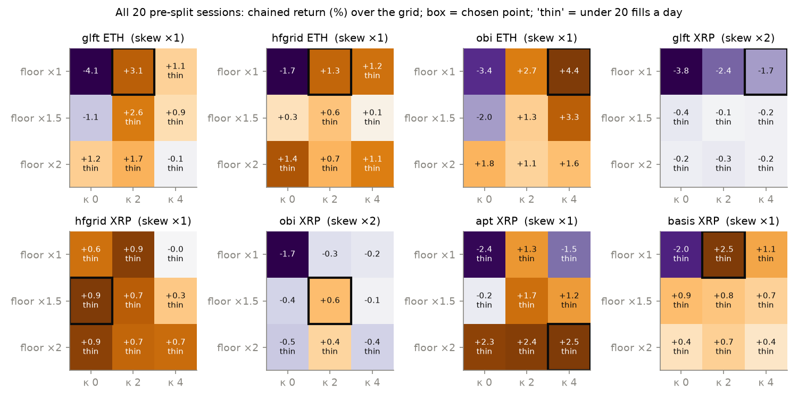
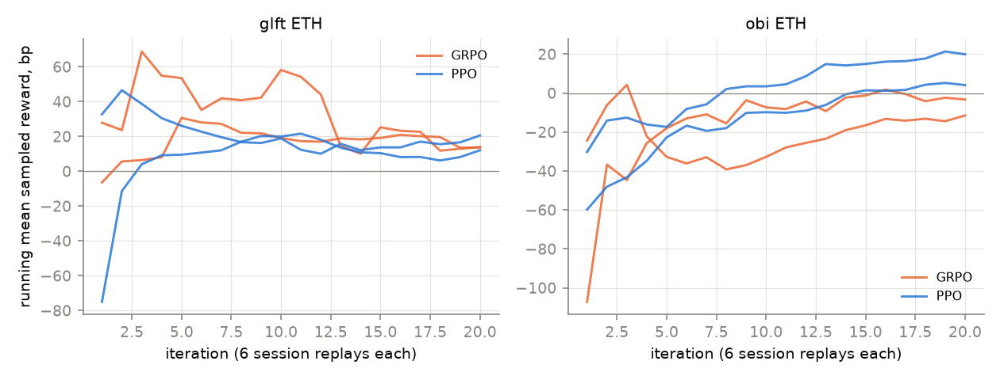
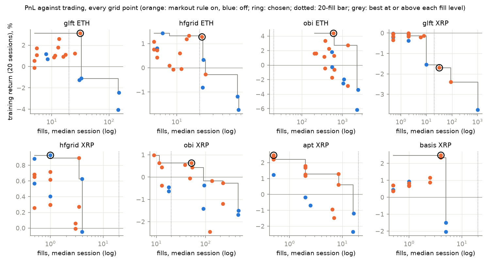
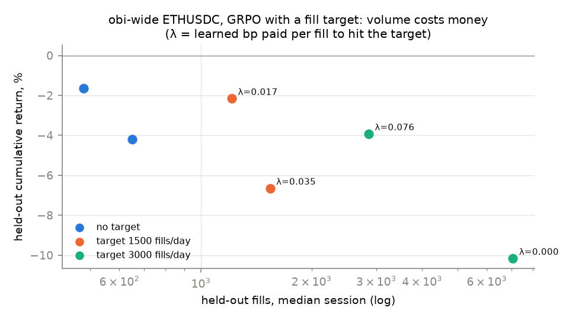
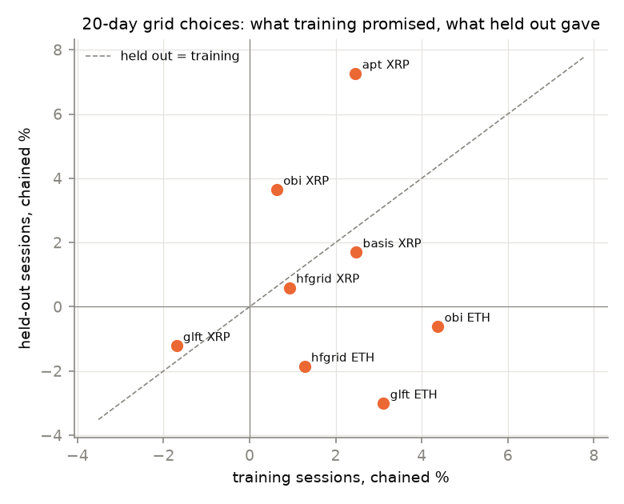
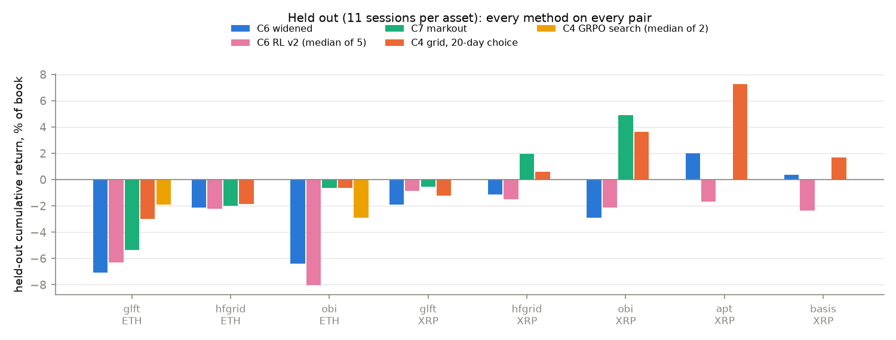
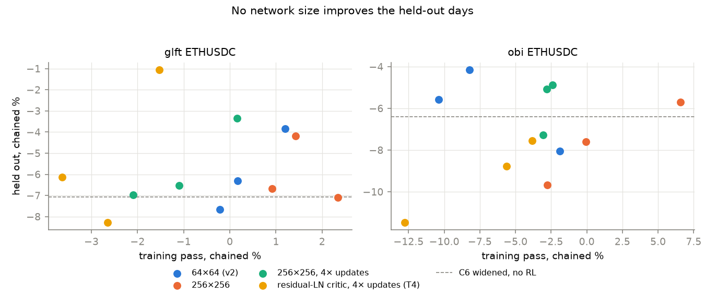

# C4 — PPO/GRPO for parameter search, and the hunt for positive PnL

Lab notebook:
[`experiments/c4_ppo_grpo/README.md`](../../experiments/c4_ppo_grpo/README.md).

> **At a glance**
>
> - **One configuration makes money held out, and does it by market making:**
>   OBI on XRPUSDC with C7's markout rule makes **+4.91%** over eleven
>   held-out sessions, **+1.38% without the 09-22 crash day**, positive on
>   **9 of 11** sessions at ~500 fills a day. Every ETHUSDC configuration
>   still loses held out; the best, OBI with the markout rule, loses 0.62%.
> - **A plain grid beats learned search.** GRPO- and PPO-style search over
>   three parameters (spread floor, skew, markout κ) lose to the grid's choice on
>   OBI (−2.9% / −2.5% against −0.6%) and tie each other within two seeds.
>   GRPO's group baseline works mechanically but buys nothing measurable here.
> - **Volume costs money.** Forcing a fill target makes held-out PnL worse at
>   every level tried; the learned price of a fill is 0.02–0.08 bp.
> - **More training data stabilises ETH and exposes XRP.** Choosing on all
>   twenty pre-split days instead of ten leaves every ETH choice unchanged; on
>   XRP the choices move, and several "wins" turn out to be one crash day or no
>   trading at all.
> - **Bigger networks do not help.** TD3 with 256×256 networks, with or
>   without four times the gradient updates, and with a 1-million-parameter
>   residual-LayerNorm critic trained on a GPU, lands within the seed spread
>   of the 64×64 original held out. The wider net fits the training days
>   better and the held-out days worse; the largest is the noisiest.

---

**Contents**

- [1. The task](#1-the-task)
- [2. What is searched](#2-what-is-searched)
- [3. The grid: the baseline any learner must beat](#3-the-grid-the-baseline-any-learner-must-beat)
- [4. GRPO-style against PPO-style search](#4-grpo-style-against-ppo-style-search)
  - [4.1 The two methods](#41-the-two-methods)
  - [4.2 What they found](#42-what-they-found)
- [5. Putting fills into the objective](#5-putting-fills-into-the-objective)
  - [5.1 What volume costs: the frontier](#51-what-volume-costs-the-frontier)
  - [5.2 A fill target with a learned price](#52-a-fill-target-with-a-learned-price)
  - [5.3 Rewarding the market making, not the direction (`v2-edge`)](#53-rewarding-the-market-making-not-the-direction-v2-edge)
- [6. Does the tuning overfit? (C4's third item)](#6-does-the-tuning-overfit-c4s-third-item)
- [7. So what makes money?](#7-so-what-makes-money)
- [8. Would a bigger network help?](#8-would-a-bigger-network-help)
- [9. What would push further](#9-what-would-push-further)
- [10. Sources](#10-sources)

## 1. The task

[`ladder.md`](../ladder.md#c4) asks for three things, and a direct request
after C7 added a fourth:

1. compare PPO against a GRPO-style method on the low-dimensional parameter
   vector: sample K parameter sets, rank them by realised PnL, update with a
   group-relative advantage;
2. check whether GRPO's group baseline — no value network — transfers outside
   language modelling;
3. apply the reward-hacking lens: do tuned parameters overfit quirks of the
   training days? Validate strictly out of sample;
4. *prioritise Part C and look for positive PnL with our strategies.*

## 2. What is searched

Everything is relative to C6's widened preset for each strategy:

| parameter | meaning | grid values | search range |
| --- | --- | --- | --- |
| floor multiplier | × the asset's calibrated half-spread floor (C6) | ×1, ×1.5, ×2 | ×0.5 – ×4 |
| markout κ | C7's widening: $h = h_{\mathrm{C6}} + \kappa \max(\bar m, 0)$ | 0, 2, 4 | 0 – 8 |
| skew multiplier | × the strategy's inventory skew | ×1, ×2 | ×0.25 – ×4 |

with C7's volatility bias correction on for the two strategies that use σ.
One evaluation is one training session replayed with fixed parameters; its
return, in bp of book, is the reward. A configuration taking fewer than 20
fills on a median session is not eligible to be chosen — otherwise "stop
trading" wins, as it did in C3.

Nothing is chosen on held-out data. Held out is always C6's eleven sessions,
2025-09-15 to 09-25.

## 3. The grid: the baseline any learner must beat

All 18 points, for eight (strategy, asset) pairs, on every training session.
It was run twice: on C6's training days (ten for ETH, four for XRP) and on all
twenty pre-split days (`train20`).

*Figure — chained return over the twenty training sessions at each (floor, κ)
point, at the chosen skew. Boxed: the chosen point. "Thin": under 20 fills a
day, not eligible.*

The pattern on ETHUSDC is clean and the same for all three strategies: **the
column that matters is κ**. Without the markout rule the widened strategies
lose on training days (−1.7% to −4.1%); with it they make +1.1% to +4.4%.
Widening the floor further is a weaker substitute that costs fills.

The twenty-day choices, held out:

| asset | strategy | point (floor / κ / skew) | training (20 d) | held out (11 d) | held out without 09-22 | days up | fills/day |
| --- | --- | --- | --- | --- | --- | --- | --- |
| ETH | glft | ×1 / 2 / ×1 | +3.11 | **−3.01** | −2.10 | 4/11 | 26 |
| ETH | hfgrid | ×1 / 2 / ×1 | +1.27 | **−1.86** | −1.26 | 4/11 | 17 |
| ETH | obi | ×1 / 4 / ×1 | +4.37 | **−0.62** | −0.68 | 8/11 | 1,173 |
| XRP | glft | ×1 / 4 / ×2 | −1.70 | **−1.22** | −0.75 | 3/11 | 8 |
| XRP | hfgrid † | ×1.5 / 0 / ×1 | +0.93 | **+0.59** | +0.67 | 4/11 | 1 |
| XRP | obi | ×1.5 / 2 / ×2 | +0.63 | **+3.64** | +0.88 | 9/11 | 106 |
| XRP | apt † | ×2 / 4 / ×1 | +2.46 | **+7.26** | +0.44 | 4/11 | 0 |
| XRP | basis † | ×1 / 2 / ×1 | +2.48 | **+1.69** | −0.26 | 5/11 | 4 |

† No grid point reached 20 fills a day; the best-scoring point is shown and
does not make a market.

Read the last three rows carefully. `apt` XRP's +7.26% is a strategy that
takes **no fills on a median session** and made +6.79% on one session,
2025-09-22, by holding inventory through a crash. `hfgrid` and `basis` are the
same story at smaller size. They are positive numbers and they are not market
making.

## 4. GRPO-style against PPO-style search

### 4.1 The two methods

The policy is a diagonal Gaussian over
$\theta = (\log \text{floor}, \log \text{skew}, \kappa)$, started on C6's widened
preset. Each iteration samples $K = 6$ parameter sets, replays them, and takes a
PPO-clipped policy-gradient step. The two methods differ only in the
baseline:

- **GRPO:** all six samples replay the **same** session, and the advantage is
  the sample's return standardised within its group,
  $A_i = (R_i - \bar R)/\sigma_R$. The group mean is the baseline; there is no
  value function. This is B3's trick, with a session in the role of a prompt.
- **PPO:** the six samples replay six **independently drawn** sessions, and the
  advantage is the return minus a learned per-session value (an exponential
  average of what that session has paid so far), standardised over the batch.

Each run is 20 iterations, 120 session replays; two seeds per method, on
`glft` and `obi` over ETHUSDC. For scale, the grid spends 180 replays per pair
on ten days and 360 on twenty.

On a toy quadratic with a per-day offset fifteen times the parameter effect —
the regime the group baseline is built for — GRPO lands a median 0.20 from the
optimum after 120 evaluations against PPO's 0.47. So the mechanism works as
intended where day noise dominates.

### 4.2 What they found

*Figure — running mean of the sampled reward. GRPO's curve moves with the one
session it drew each iteration; PPO's averages six. The curves are not
comparable in level, which is why the held-out result below is the comparison.*

| | glft ETH, held out | obi ETH, held out |
| --- | --- | --- |
| grid (20-day choice) | −3.01% | **−0.62%** |
| GRPO, 2 seeds | **−1.50, −2.28** | −1.64, −4.18 |
| PPO, 2 seeds | −2.10, −3.41 | −2.60, −2.49 |

The searches wandered outside the grid. On `obi` all four converged to a much
wider floor (×2.1–×2.9) with a much smaller skew (×0.25–×0.75) and little κ;
on `glft` they stayed near the grid's region. Held out:

- **On `obi` the grid wins** by two points over both methods. The wider floor
  the search found on training days does not generalise; the markout rule the
  grid chose does.
- **On `glft` the searches beat the grid** by about one point, GRPO slightly
  more than PPO.
- **GRPO against PPO: no detectable difference.** Medians −1.89 / −2.75 on
  `glft` and −2.91 / −2.54 on `obi`, with a seed spread as large as the gap.

So the answer to C4's second item is: the group baseline is a sound way to
remove day-to-day noise from the advantage, and on a problem this small a
cheap per-session critic does about as well. Neither beats a grid that can be
exhausted in a few hours; the value of a learned search here is reaching
regions a grid did not include — and on `obi` those regions were worse.

## 5. Putting fills into the objective

### 5.1 What volume costs: the frontier

*Figure — every grid point's training return against its fills. The grey
envelope is the best return at or above each level of trading.*

On almost every pair the envelope steps **down** as fills rise: past the
chosen point, more trading is paid for with PnL. The exception is where the
extra fills come from the markout rule being off, and that is the losing side.

### 5.2 A fill target with a learned price

The GRPO search was re-run on `obi` ETHUSDC with a constraint instead of a
penalty. The reward becomes $R + \lambda\,\text{fills}$, and after every
iteration

$$\lambda \leftarrow \max\!\Big(0,\ \lambda + \alpha\,\frac{F - \overline{\text{fills}}}{F}\Big),$$

so $\lambda$ settles at the smallest per-fill bonus that makes the policy
trade $F$ fills a session. Its final value is the price of a fill.

| target | seed | λ (bp per fill) | fills/day held out | held out |
| --- | --- | --- | --- | --- |
| none | 0, 1 | – | 479, 650 | −1.64%, −4.18% |
| 1,500 | 0, 1 | 0.017, 0.035 | 1,213, 1,542 | −2.16%, −6.65% |
| 3,000 | 0, 1 | 0.076, 0.000 | 2,860, 7,067 | −3.93%, −10.17% |

More volume, more loss, at every target. The prices look small per fill and
are not: at 3,000 fills a day, 0.076 bp per fill is 228 bp a day of bonus —
more than any session's PnL — and it is paid to take fills that lose. (Seed 1 at 3,000 overshot to
7,000 fills, after which λ decayed to zero — the policy had found a
trade-a-lot region and stayed.)

### 5.3 Rewarding the market making, not the direction (`v2-edge`)

The RL reward was split exactly into **trading** PnL (a step's fills marked at
the step's closing mid, plus rebates and fees) and **holding** PnL (the last
step's position times the mid's move), and C6's v2 recipe was retrained with
holding PnL counted at a quarter. The intent: credit market making, not
windfalls like 09-22. A check confirms the split is exact to $10^{-17}$ bp
over 2,000 steps with 408 bp of holding PnL.

| ETHUSDC, held out, 5 seeds | widened baseline | v2 | **v2-edge** |
| --- | --- | --- | --- |
| glft | −7.07% | −6.30% | **−9.27%** |
| obi | −6.40% | −8.00% | **−9.40%** |

It is worse, by about three points on both. The mechanism is the one C7
measured: adverse selection **is** holding PnL. A fill's cost shows up as the
mid moving against the new position in the steps after it, and a reward that
discounts holding PnL is blind to exactly that. The C7 markout rule works
because it measures that move; this reward throws it away.

## 6. Does the tuning overfit? (C4's third item)

*Figure — each twenty-day choice's training return against its held-out
return.*

Four checks, in order of how much they say:

1. **Stability of the choice.** On ETHUSDC the grid picks the **same point**
   from ten training days and from twenty, for all three strategies, and the
   markout κ chosen by C7 on four days is the same on twenty for `glft` and
   `obi`. The choices are not artefacts of which sessions happened to be in the
   training set.
2. **The level drops, the advantage survives.** Every ETH choice makes money
   on training days and loses held out, but the held-out period is harder for
   everything, tuned or not: C6's widened `obi`, which was never tuned on these
   parameters, goes from −3.42% over the twenty training sessions to −6.40%
   held out. Against it, the chosen `obi` point is +7.8 points better on
   training days (+4.37%) and still +5.8 better held out (−0.62%). The markout
   rule's edge carries across the split; the level does not.
3. **One session is doing a lot of work on XRP.** Positive held-out XRP
   numbers are concentrated on 2025-09-22, and three of them trade almost
   nothing. The four-day and twenty-day choices disagree on four of five XRP
   pairs. XRP selection is not reliable, and its positive numbers are reported
   with the crash day removed alongside.
4. **The learned searches overfit more than the grid.** They reach training
   rewards the grid did not (+35 bp a session for PPO on `obi`) in regions the
   grid did not include, and those regions lose held out.

## 7. So what makes money?

*Figure — held-out cumulative return, every method, every pair.*

| asset | strategy | C6 widened | C6 RL v2 | C7 markout | C4 grid (C6 days) | **C4 grid (20 days)** | C4 GRPO | C4 PPO | RL v2-edge |
| --- | --- | --- | --- | --- | --- | --- | --- | --- | --- |
| ETH | glft | −7.07 | −6.30 | −5.36 | −3.01 | **−3.01** | −1.89 | −2.75 | −9.27 |
| ETH | hfgrid | −2.11 | −2.20 | −1.99 | −1.86 | **−1.86** | – | – | – |
| ETH | obi | −6.40 | −8.00 | −0.62 | −0.62 | **−0.62** | −2.91 | −2.54 | −9.40 |
| XRP | glft | −1.89 | −0.86 | −0.55 | −1.22 | **−1.22** | – | – | – |
| XRP | hfgrid | −1.15 | −1.48 | +1.96 | +0.67 | **+0.59** | – | – | – |
| XRP | obi | −2.91 | −2.15 | **+4.91** | +2.47 | **+3.64** | – | – | – |
| XRP | apt | +2.00 | −1.66 | – | −0.85 | **+7.26** † | – | – | – |
| XRP | basis | +0.36 | −2.35 | – | +2.19 | **+1.69** † | – | – | – |

*Held-out cumulative return, % of book, eleven sessions. RL and search columns
are medians over seeds. † trades a handful of fills or none on a median day.*

**The one configuration that makes money as a market maker is OBI on
XRPUSDC with the markout rule.** At C7's κ = 1:

| | held out | without 09-22 | sessions up | fills, median session |
| --- | --- | --- | --- | --- |
| OBI XRPUSDC, markout κ = 1 | **+4.91%** | **+1.38%** | **9 / 11** | 508 |
| OBI XRPUSDC, grid (20 d) | +3.64% | +0.88% | 9 / 11 | 106 |
| OBI ETHUSDC, markout κ = 4 | −0.62% | −0.68% | 8 / 11 | 1,173 |

It is positive with the crash day removed, positive on most sessions, and it
trades hundreds of times a day. That is the result worth building on. On
ETHUSDC the same rule brings OBI to break-even and no further.

## 8. Would a bigger network help?

C6's TD3 uses two 64×64 layers for both actor and critic. Before paying for
larger ones, three things argued that network size is not what limits it:

- **There is little left for a flexible model to find.** In C7, LightGBM
  predicted the next move no better than a linear model held out, from the
  same features the policy sees plus the deep book and BTCUSDT.
- **The trained policies barely use their state** (C6 §8.5), and the seed
  spread (6–8 points) is larger than any recipe difference.
- **Training is short.** One pass over ten sessions is about 170,000
  transitions and, at one update every eight steps, about 21,000 gradient
  updates. If anything is starved, it is updates, not parameters.

So the probe separates the two: a 256×256 network for actor and critic
(`v2-w256`, 12× the parameters), and the same with four times the updates
(`v2-w256-utd4`, one every two steps). A third arm goes further on both: a
residual critic with LayerNorm (two blocks of width 256, 1.06 M parameters
per critic, 170× v2's), the architecture recent work uses to scale
off-policy RL, at four times the updates (`v2-resln`, trained on a Colab T4).
Everything else is v2. Three seeds each on the two ETHUSDC strategies where
RL was trained, compared with v2 on the same three seeds.

*Figure — one point per seed: return on the training pass (the policy's own
online returns during its single pass over the training days, exploration
included) against held-out return. Dashed: C6's widened strategy without RL.*

| ETHUSDC, seeds 0–2 | 64×64 (v2) | 256×256 | 256×256, 4× updates | residual-LN critic, 4× updates |
| --- | --- | --- | --- | --- |
| glft, held out | −6.30 (−7.66 … −3.84) | −6.68 (−7.09 … −4.20) | −6.53 (−6.97 … −3.35) | **−6.14** (−8.27 … −1.06) |
| glft, training pass | +0.17 | **+1.42** | −1.10 | −2.64 |
| obi, held out | −5.58 (−8.04 … −4.16) | −7.60 (−9.68 … −5.69) | **−5.07** (−7.27 … −4.87) | −8.76 (−11.47 … −7.56) |
| obi, training pass | −8.24 | **−0.06** | −2.81 | −5.61 |

*Chained return, % of book; median over three seeds, range in brackets. v2's
five-seed medians in §7 (−6.30, −8.00) include two more seeds; here every
column uses the same three. For reference, the widened strategies without RL
are at −7.07 and −6.40 and the best fixed rules at −3.01 and −0.62.*

Three readings, all negative for size:

1. **Width buys training return, not held-out return.** The 256×256 policy
   improves the training pass on both strategies (+1.3 points on `glft`, +8.2
   on `obi`) and is worse held out on both. That is the signature of a model
   fitting sessions, not the market.
2. **More updates move nothing outside the noise.** The 4× variant is
   0.5 points better than v2 on `obi` and 0.2 worse on `glft`, against a
   seed range of three to four points. The extra updates do not even buy a
   better training pass than the wide net at 1× updates, and the critic's TD
   loss shows no consistent decline across the ten sessions in any variant.
3. **The largest network is the noisiest, not the best.** The residual-LN
   critic lands level with v2 on `glft` (−6.14 against −6.30) with the widest
   seed range of any arm: its best seed, −1.06, is the best single ETH `glft`
   RL run in Part C, and its worst, −8.27, is among the worst. On `obi` it is
   the worst arm, three points below v2. It does not fit the training pass
   better either (−2.64 and −5.61), so it is not overfitting. It is not
   learning anything more that transfers.

None comes close to the fixed rules in §7.

**Cost.** One TD3 update on a batch of 256, twin critic, measured on this
machine's CPU and on a Colab T4:

| critic | parameters, per critic | CPU, 1 thread | CPU, 4 threads | T4 |
| --- | --- | --- | --- | --- |
| MLP 64×64 (v2) | 6 k | 4.0 ms | 3.3 ms | 4.1 ms |
| MLP 256×256 | 74 k | 8.2 ms | 5.3 ms | 4.0 ms |
| MLP 512×512×512 | 541 k | 36 ms | 16 ms | 4.8 ms |
| residual + LayerNorm, width 256, 2 blocks | 1.06 M | 71 ms | 28 ms | 6.9 ms |
| residual + LayerNorm, width 512, 2 blocks | 4.2 M | 241 ms | 80 ms | 9.5 ms |

The market replay, not the network, dominates a job up to 256×256, which is
why the first two probes ran on CPU (10–14 minutes a job at 1× updates, 22–24
at 4×). Beyond that the network takes over: the residual-LN critic would take
about 1.7 hours a job on this CPU. On the T4 it took about 43 minutes, two
jobs at a time. That is not the 15–20 minutes the per-update benchmark
predicted: with the network on the GPU, the replay on the Colab runtime's two
CPU cores set the pace, at about 255 seconds a session.

## 9. What would push further

- **A circuit breaker.** Most remaining ETH losses are a few sessions with a
  sharp move (09-15, 09-17 and 09-25 for OBI, each about −0.7%). Pausing quotes when short-horizon
  volatility or one-sided flow spikes is the obvious next rule, tested as a
  grid dimension, not learned.
- **A daily loss limit**, for the same sessions.
- **OBI XRPUSDC on more assets:** C7's untuned κ = 2 already improved OBI on
  six of seven other assets; the breadth tier has only three held-out sessions
  per asset, which is what to extend next.
- **RL, if at all, on top of the markout rule** — with the markout average in
  the state and the rule as the residual baseline — rather than on top of C6's
  widened presets.

## 10. Sources

| what | source |
| --- | --- |
| the task | [`ladder.md`](../ladder.md#c4), plus a request to prioritise positive PnL |
| GRPO's group-relative advantage | [DeepSeekMath (Shao et al., 2024)](https://huggingface.co/papers/2402.03300) |
| PPO's clipped objective | [Schulman et al., 2017](https://huggingface.co/papers/1707.06347) |
| the strategies, floors, split | [C6](c6-strategy-zoo.md) |
| the markout rule, σ correction | [C7](c7-signals.md) |
