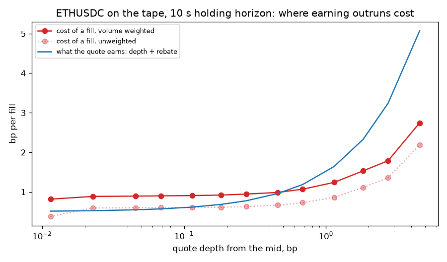
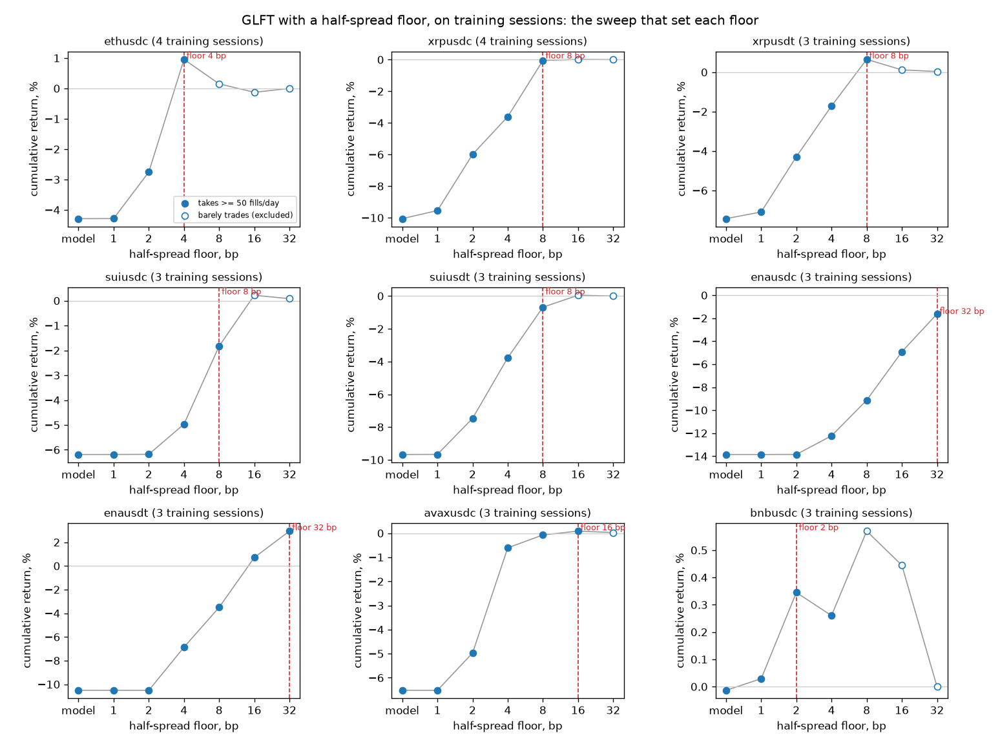
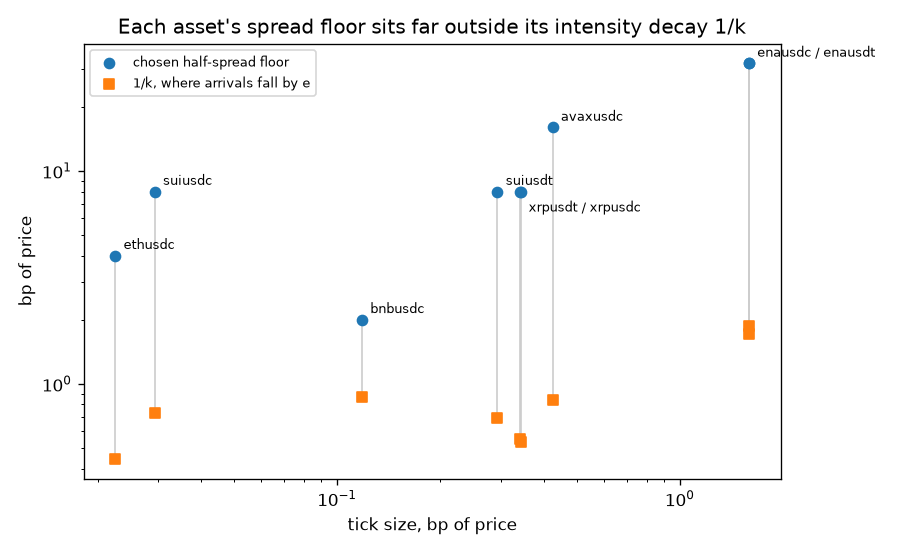
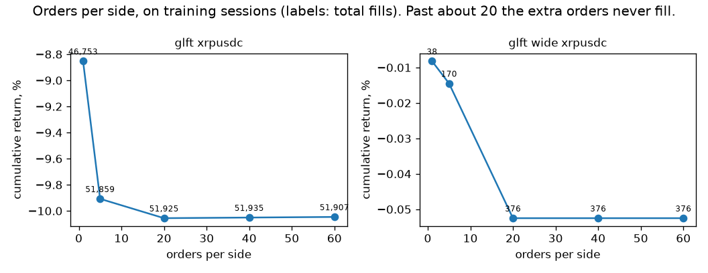
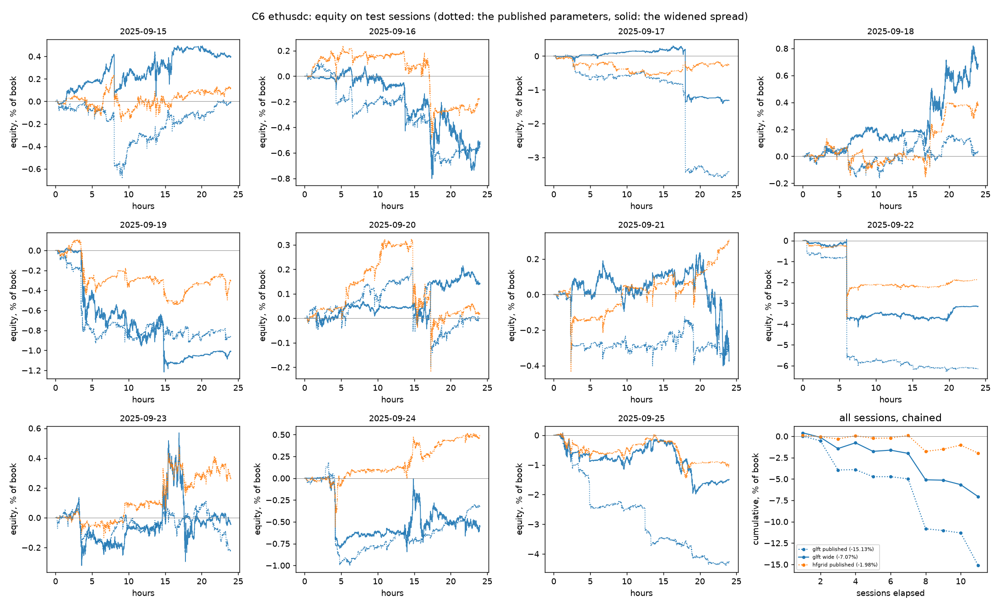
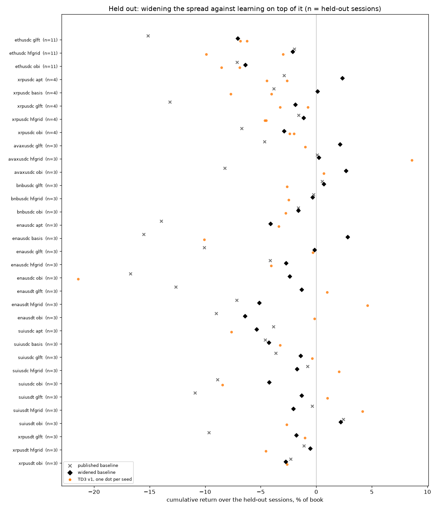
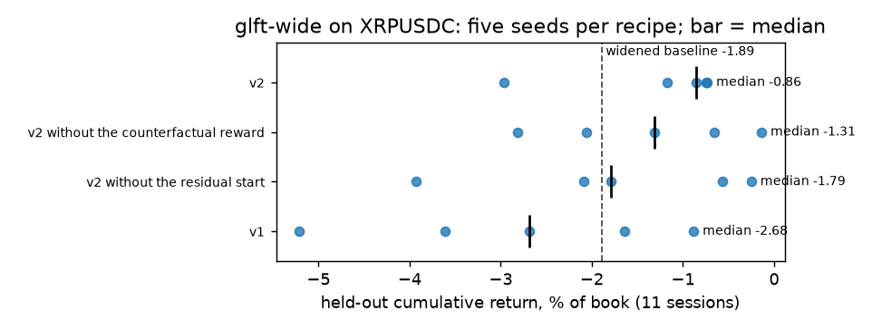

# C6 — The strategy zoo: five published market makers, and RL on all five

Lab notebook:
[`experiments/c6_strategy_zoo/README.md`](../../experiments/c6_strategy_zoo/README.md).

> **At a glance**
>
> - Five published market makers on nine assets, each with its published spread,
>   a per-asset widened spread, and TD3 on four multipliers on top. Held out:
>   11 sessions on ETHUSDC and XRPUSDC, 3 on the other seven.
> - **Widening is the largest effect in Part C**: a median +2.25 points of
>   cumulative return, better in 25 of 33 (asset, strategy) pairs. The floor an
>   asset needs is 9–19× its trade-intensity decay $1/k$ on eight of nine.
> - **RL on top does not beat the widened baselines.** With five seeds, recipe
>   v1 loses to its baseline in 8 of 8 pairs. Recipe v2 — a residual policy
>   started on the baseline, five-second decisions, a partly counterfactual
>   reward — beats v1 in 8 of 8 but its baseline in only 3 of 8, and the seed
>   spread is larger than any gain.
> - More orders in the grid does nothing; the policies do not learn to respond
>   to the alpha signal.

---

## 1. The task

Not a ladder phase. This one comes from a direct request after C3 landed:

> try to use more days for training and held-out and larger spread (dependent
> on asset) for baseline and then RL mod (also try more orders in grid) —
> build baseline and RL modification for all these strats — prepare master
> table for everything (including trade intensity) and pnl + inventory plots

with five hftbacktest example notebooks attached. Five things, then:

1. more days, on both sides of the split;
2. a wider, asset-dependent spread for the baselines, and then the RL
   modification on top of that;
3. deeper grids;
4. a baseline **and** an RL modification for each of the five strategies;
5. one master table covering everything, trade intensity included, plus PnL
   and inventory plots.

It also happens to answer the two items C5 has been carrying
([`ladder.md`](../ladder.md#c5)) — fold the basis and APT alpha signals into
the state and re-run C3, and check whether the learned coefficients respond to
the alpha signal rather than needing a hand-written extension — so those are
resolved here rather than separately.

## 2. The goal, and the objection it answers

C3's result was defensible but narrow. On ETHUSDC over five held-out sessions
no learned configuration beat the fixed GLFT formula in absolute terms, though
all of them lost less: the best TD3 policy returned −0.63% of book against the
baseline's −8.44%.

The objection writes itself. **GLFT was the wrong baseline.** C1 showed it
loses to adverse selection on this venue — it quotes about 1.7 bp out on an
asset whose fills cost more than that — so "RL loses less than a losing
strategy" is a weak claim, and a reader is entitled to suspect that a
profitable baseline would leave RL nothing to add.

C6 takes that objection seriously in three ways at once. It runs the four
other strategies hftbacktest publishes alongside GLFT, so the answer is about
the method rather than one model. It widens the spread until the baselines
are not obviously broken, so RL is asked to improve something that works. And
it does both on twice as many training days and more than twice as many
held-out ones.

## 3. The five strategies, in one set of units

### 3.1 What they share

Every one of them is a grid quoter. At each 100 ms iteration it forms a fair
price $p^{\ast}$, a half spread $h$ and an inventory skew $s$, sets a reservation
price

$$ p^r = p^{\ast} - s \cdot \frac{q \, m}{Q} $$

where $q$ is the position in units of the asset, $m$ the mid and $Q$ the
notional position cap (so the second factor is the normalised inventory, $-1$
at a full short and $+1$ at a full long), and then lays `grid_num` orders a
side at

$$ p^{\text{bid}}_i = p^r - h - i\,g, \qquad p^{\text{ask}}_i = p^r + h + i\,g $$

aligned to a grid of step $g$, with any order already correctly placed left
alone so it keeps its queue position. What differs between the five is only
$p^{\ast}$, $h$ and $s$.

### 3.2 Where each one gets its numbers

**`glft`** — Guéant, Lehalle & Fernandez-Tapia
([paper](https://huggingface.co/papers/1605.01862)), equations (4.6)/(4.7),
with $\Delta = 1$ and $\xi = \gamma$. Fair price is the mid; the half spread
and skew come from a live fit of the order-arrival intensity
$\lambda(\delta) = A e^{-k\delta}$ and the mid-price volatility $\sigma$:

$$ h = \left(c_1 + \tfrac{\Delta}{2}\,\sigma c_2\right)\text{adj}_1,
   \qquad s = \sigma c_2 \,\text{adj}_2 $$

$$ c_1 = \frac{1}{\xi\Delta}\log\!\left(1 + \frac{\xi\Delta}{k}\right),
   \qquad
   c_2 = \sqrt{\frac{\gamma}{2A\Delta k}
     \left(1 + \frac{\xi\Delta}{k}\right)^{\frac{k}{\xi\Delta}+1}} $$

with $\gamma = 0.05$, $\text{adj}_1 = 1$, $\text{adj}_2 = 0.05$ — the
notebook's values, and C1's `glft-grid`. C1's spread-floor result applies
here: $\inf_{\gamma>0} h(\gamma) = 1/k$, so no amount of risk aversion lets
this quoter sit inside a depth of $1/k$ from the mid. (The notebook fits $k$
per *half*-tick; the tables convert it to ticks and bp.)

**`hfgrid`** — no model of arrival intensity at all. The fair price is the
micro-price and the half spread is a multiple of realised volatility,
$h = 5\sigma$, with a multiplicative skew. Note that at the touch the
micro-price carries exactly the information the queue imbalance does:

$$ \text{micro} - \text{mid} = \frac{P_a - P_b}{2}\cdot
   \frac{q_b - q_a}{q_a + q_b} = \frac{\text{spread}}{2}\cdot\text{imbalance} $$

identically — C2 measured this rather than assuming it — so `hfgrid` and `obi`
differ in how far into the book they look, not in the kind of signal.

**`apt`** — a lead-lag fair price,
$p^{\ast} = (1 + \beta r_{\text{ref}})\, p_{t-5\text{m}}$, where
$r_{\text{ref}}$ is the reference instrument's five-minute return and
$p_{t-5\text{m}}$ our own mid five minutes ago. Half spread and skew are both
3 bp.

**`basis`** — $p^{\ast} = p_{\text{ref}} + \overline{(p - p_{\text{ref}})}$, the
reference price plus a five-minute rolling mean of the basis. Same 3 bp
spread and skew.

**`obi`** — $p^{\ast} = m + c_1 \alpha$ with $\alpha$ the order-book imbalance
over a band $\pm 0.1\%$ wide, standardised over a ten-minute rolling window.

### 3.3 Everything in basis points

The notebooks state their parameters in ticks or in price units of whichever
asset they were written for, and those numbers do not travel. `half_spread =
80` is 30 bp on 2023 BTC at \$27,000 and meaningless on XRP at \$3. So C6
converts once, in `strategies.py`, and every spread, skew and grid step is a
ratio of price.

The conversion is also the one place a transcription error hides silently —
a wrong $\gamma$ produces an obviously broken run, a wrong unit produces a
plausible one — so it is checked rather than trusted. For the skew, C1 shifts
by $s_{\text{tick}} \cdot q$ ticks with $q$ in units of the asset; C6 shifts
by $s_{\text{px}} \cdot qm/Q$ in price with
$s_{\text{px}} = s_{\text{tick}}\,\tau\,Q/m$. The mid and the cap cancel and
the two are the same shift; `run_checks.py` confirms it to 5e-16 over 2,000
random states.

The OBI conversion doubles as an independent check on itself, because the
notebook gives two tunings per asset and they must agree once converted:

| tuning | asset | published | converted |
| --- | --- | --- | --- |
| wide | BTC ≈ 27,000 | half 80, skew 3.5/lot, c₁ 160 | 29.6 bp, 25.9 bp, 59.3 bp |
| wide | ETH ≈ 1,800 | half 5, skew 0.2/lot, c₁ 10 | 27.8 bp, 22.2 bp, 55.6 bp |
| volume | BTC ≈ 27,000 | half 10, skew 2/lot, c₁ 20 | 3.7 bp, 14.8 bp, 7.4 bp |

They do. C6 takes the volume tuning as the `obi` baseline: it reports the
higher Sharpe in the notebook (14.01 against 10.83), and a tuning that barely
trades is not a market maker to compare market makers against.

Note what the wide tunings say on their own, before any of C6's results: two
of the five published strategies chose a half spread near **30 bp**, roughly
twenty times what C1's calibrated GLFT quotes. That is the prior behind item 2
of the request, and it was in the notebooks all along.

## 4. The data

### 4.1 Widening the split, not re-picking it

The split was fixed once, in C1, and C3's held-out claims rest on it.
Re-picking it now — after seeing that C1's baseline loses — would be the exact
failure C4's third item exists to catch, and doing it deliberately would be
worse than doing it by accident.

So it is widened. `TRAIN_DAYS_EXT` and `TEST_DAYS_EXT` are supersets of C1's
five-day lists on the same side of the same `SPLIT_DATE = 2025-09-15`:

- **train** — ten of the twenty days available before the split, spread across
  the window rather than clustered at its start: 08-26, 08-27, 08-28, 08-29,
  09-01, 09-03, 09-05, 09-08, 09-10, 09-12.
- **held out** — **every** day from the split to the end of the data, eleven
  of them, with no selection at all. A held-out set with nothing chosen about
  it is the only one that cannot be accused of cherry-picking.

Nothing C1, C2 or C3 reported moves, because their days are a subset of these
and each session is replayed independently.

The XRP pair started with four training and four held-out sessions, because
two symbols per day is roughly three times the bytes of one. Four held-out
sessions proved too few once the seed spread was measured (§8.4), so the
pair's held-out set was widened the same way, to all eleven days from the
split onward. The other seven assets keep three and three: they are there for
breadth, and the session count is printed next to every row so the two tiers
are never read as the same kind of evidence.

### 4.2 What tier the data is, and what that costs

Market-by-price (L2), not market-by-order (L3), verified from the files
rather than from the dataset description: `order_id` is zero on all
16,885,548 rows of a day, and the event types are 16.5M incremental depth
updates, 394k trades, six depth-clears and 6,000 snapshot rows -- the
snapshot and clear being why each day is self-contained and replayable on
its own.

The consequence is the one that matters most for every number in this phase.
**With no order identities, queue position cannot be observed and has to be
modelled.** hftbacktest guesses where a resting order sits within its price
level; C6 uses `power_prob_queue_model(2.0)` throughout, and C1 measured that
this choice moves results more than anything the strategy does.

It is also the reason §5 ends where it does. The tape says a quote breaks
even at almost any depth; the simulator says C1's baseline lost 0.80 bp per
fill. The gap is *which* aggressive trades reach a resting order, and that is
exactly what L3 would answer and L2 cannot. Every spread floor in §8.1 is
therefore conditional on the queue model, and tighter quotes are where that
conditionality bites hardest -- a quote at the touch is almost all queue
position, a quote 30 bp out is almost none.

Order latency is synthesised for the same reason: the dataset carries no
order-latency feed, so entry and response latency are 4x and 3x the observed
*feed* latency (`local_ts - exch_ts`), following hftbacktest's own tutorial,
which is about a 20 ms round trip on these days.

### 4.3 The substitution APT and basis need

Both pair strategies need a second instrument. The notebooks use **spot**
against the perpetual; `cardinalai/backtest_data` has no spot feed — it is
Binance USDⓈ-M perpetuals only. What it does have is the same underlying
quoted in two stablecoins: `xrpusdc` and `xrpusdt`. C6 trades the USDC leg and
uses the USDT leg as the reference.

Fitted by OLS through the origin on the four pair training sessions:

$$ \beta = 0.9913, \qquad R^2 = 0.9985 $$

so the pair is about as cointegrated as two instruments get, and both
strategies keep their shape. What changes is the economics, and it changes in
the direction of a **weaker** result:

- the notebooks' basis is a perpetual's premium over spot — a funding and
  cash-and-carry object, slow, sign-stable, with a term structure;
- ours is a stablecoin spread plus a venue lead-lag: smaller, faster, and
  with no funding anchor pulling it back.

The median USDC/USDT basis across the first eight pair sessions runs +0.56 to +8.68 bp,
so it is real and sizeable, but it is not the same object. A *better* result
here than the notebooks' would be the suspicious one. This is stated before
the results because it is exactly the kind of substitution that is easy to
report as though it were the published experiment.

## 5. How wide should the quotes be?

Item 2 of the request — "larger spread (dependent on asset)" — needs the
width to come from the asset rather than from taste. Two ways to get it, and
the disagreement between them is itself a finding.

### 5.1 From the tape

`measure_adverse_selection.py` places no orders. It replays ten training days
on a 100 ms grid and records, per bucket, the mid and the deepest tick each
side's aggressors reached. A quote resting $d$ ticks out is filled in that
bucket only if an aggressor reached at least $d$; an aggressive buy lifts our
ask and leaves us short, so the cost is $+(m_{t+h} - m_t)$, and the sign flips
on the other side. Volume weighted, because a maker's exposure to a bucket is
proportional to how much traded in it.

That gives a cost *curve* over depth rather than C1's single regression. On
ETHUSDC at a 10 s horizon, volume weighted, a fill costs 0.82 bp at the touch
and rises slowly, to 1.07 bp at 30 ticks and 2.74 bp at 200. What the quote
earns — its depth plus the 0.5 bp maker rebate — starts below that and rises
faster. They cross at **30 ticks, 0.69 bp**: on the tape, a quote any closer
loses and any further out wins.

Weighting matters. Unweighted, the cost at the touch is 0.38 bp rather than
0.82, and the curve sits under the earnings line almost everywhere, which
would put the floor at the touch. The big buckets are the expensive ones,
and a maker is exposed to them in proportion to their size.

*Figure — ETHUSDC, ten training sessions, 10 s holding horizon: what a fill
costs on the tape (red), volume weighted and not, against what a quote at
that depth earns (blue). Break-even is where blue crosses solid red.*

### 5.2 From the simulator, and why the two disagree

The simulator is far less forgiving. C1's `glft-grid` lost 0.80 bp per fill,
and the sweep in §8.1 puts the ETHUSDC floor at 4 bp — six times the tape's
0.69 bp.

The gap is **fill selection**, and the tape cannot see it. A resting quote is
not filled by the average trade at its depth; it is filled by the subset of
trades that consumed the queue ahead of it, and those are the large informed
sweeps. Queue position and latency decide which, and neither is on the tape —
they are precisely what hftbacktest's queue model and the synthesised order
latency exist to model.

So the tape estimate stays as a diagnostic, and the floor is set by
`sweep_spread.py`: run the strategy at each width, on four training days, in
the simulator that does model queue position, and read off the best. Four
days rather than ten because a sweep is a search and therefore the part of C6
most able to overfit — it is given the least data it can run on, not the most,
and the chosen value is then applied unchanged to the held-out set.

## 6. The RL modification

One environment for all five (`env.py`). The action is four multipliers that
every strategy already has a slot for:

| action | range | what it scales |
| --- | --- | --- |
| `spread_mult` | 0.25–8 (0.5–2 forced) | the half spread, however derived |
| `skew_mult` | 0.05–10 | the inventory skew |
| `alpha_mult` | 0.05–4 | the strategy's own fair-price signal |
| `grid_mult` | 0.25–4 | the grid step |

mapped logarithmically, because the right prior over a multiplier is uniform
in log space. All four are **1.0 at the published parameters**, so each
baseline is a strict special case of its own policy — the property C2 built
the GLFT environment around, now holding five times over, and checked rather
than asserted.

The observation is C2's ten features plus one: the strategy's own signal, in
bp. The reward is C2's, unchanged, so C6's numbers are on C3's scale:

$$ r_t = \frac{\Delta\,\text{equity}_t}{\text{book}}\times 10^4 - \eta\,\hat q_t^2,
   \qquad \eta = 0.015 $$

`alpha_mult` is C5's item in disguise. Setting it to 0 turns a strategy into a
pure mid-price quoter with the same spread and skew, so what the policy
chooses for it measures what that strategy's signal is worth on these days —
and whether the policy leans on the signal more where the signal is
informative, which is exactly C5's second item.

**TD3 only, two seeds, forced participation.** All three are decisions C3
already paid for:

- C3 ran DDPG, TD3 and SAC across three seeds and TD3 won on held-out
  cumulative return (family medians −2.19 against −4.54 and −4.85). Repeating
  a three-way comparison five times to re-answer that, on four cores, would
  buy nothing.
- C3 measured the seed spread on this problem at 3.74 points of return. Two
  seeds is enough to *notice* that a result is seed-dependent and not enough
  to rank two close configurations, so any claim here resting on a gap smaller
  than the seed spread is flagged rather than made.
- C3 established that with a free spread range the highest-scoring policy
  available on a training day is the corner that quotes so far out it takes no
  fills and returns exactly zero. Forced participation caps the spread
  multiplier at 2× so that "do learned parameters beat published ones" is
  asked of two market makers.

### 6.1 Recipe v2: what changed after v1 lost to its baseline

The first round (recipe **v1**, everything above) lost to its own widened
baseline on median. Three changes were made together as recipe **v2**, and two
ablations each remove one of them, so their effects can be told apart.

**A residual policy.** Every multiplier ranges over $[\tfrac12, 2]$, which is
symmetric in log space about 1, so the action $0$ *is* the baseline. The
actor's last layer is initialised to zero, so training starts exactly on the
baseline, and it explores with small Gaussian noise around it instead of v1's
first episode of uniformly random parameters. In market making a random
episode is not free exploration: it is a day of large, real losses that then
dominate the replay buffer. A small penalty,
$0.001\,\text{bp} \times \overline{a^2}$ per step, keeps the policy away from
the no-fill corner without pinning it: holding one multiplier at $2^{0.5}$ for a
whole session costs about 1 bp, the size of the effects in §8.

**Five-second decisions.** With a discount of $\gamma = 0.99$ per step, the
effective horizon is about $1/(1-\gamma) = 100$ steps. At one-second steps that
is 100 seconds, shorter than the minutes over which inventory and adverse
selection actually cost money. At five seconds it is about eight minutes.

**A counterfactual reward.** Replay the same session at the baseline action,
record its per-step reward $b_t$, and train on

$$ \tilde r_t = r_t - c\, b_t. $$

Because $b_t$ never depends on the policy's action, subtracting it cannot
change which policy is optimal. It can only change how noisy the signal
pointing to that policy is. The variance of $\tilde r$ is

$$ \operatorname{Var}(r - c\,b) = \operatorname{Var} r - 2c\operatorname{Cov}(r,b)
   + c^2 \operatorname{Var} b, $$

minimised at $c^{\ast} = \operatorname{Cov}(r,b)/\operatorname{Var} b$. **The
first design used $c = 1$, and that was wrong.** On a training session, it
*raised* the per-step variance 1.1–2.3× on XRPUSDC. Near the spread floor fills
are sparse, so a policy that widens slightly stops trading while the baseline
keeps going, and subtracting an uncorrelated series only adds its noise:

| probe | corr$(r,b)$ | variance at $c=1$ | variance at $c^{\ast}$ | $c^{\ast}$ |
| --- | --- | --- | --- | --- |
| XRP, spread +0.05 | 0.62 | ×1.14 | ×0.62 | 0.46 |
| XRP, spread +0.10 | 0.59 | ×2.31 | ×0.66 | 0.31 |
| XRP, exploration noise | 0.36 | ×1.26 | ×0.87 | 0.36 |
| ETH, spread +0.05 | 0.48 | ×0.93 | ×0.77 | 0.54 |
| ETH, spread +0.10 | 0.55 | ×0.88 | ×0.70 | 0.56 |
| ETH, exploration noise | 0.79 | ×0.43 | ×0.38 | 0.77 |

A fixed $c = 0.5$ recovers most of the optimum in every row and never raises
variance (×0.45–0.89 by the formula above). That is what v2 uses. The gain is
real but modest, a 10–60% variance cut, and it is reported as that rather
than as the order-of-magnitude one might hope for from a control variate.

| recipe | step | actions | reward | exploration |
| --- | --- | --- | --- | --- |
| v1 | 1 s | forced ranges | absolute | 1 random episode, then noise |
| **v2** | 5 s | residual $[\tfrac12, 2]$ | $r - 0.5\,b$, deviation penalty | noise around the baseline |
| v2-no-cf | 5 s | residual | absolute, deviation penalty | noise around the baseline |
| v2-no-residual | 5 s | forced ranges | $r - 0.5\,b$ | 1 random episode, then noise |

**Five seeds.** v1 and v2 are both run with five seeds on every (asset,
strategy) pair of the two deep assets; the ablations with five seeds on
`glft` over XRPUSDC.

## 7. Checks with known answers

`run_checks.py`, all run before any number below.

| check | result |
| --- | --- |
| skew unit conversion, C1 ticks vs C6 price | 4.95e-16 max relative error over 2,000 random states |
| OBI running standardisation vs brute-force windowed | 2.84e-14 max absolute difference over 7,588 steps |
| `baseline_action()` maps to multipliers of 1.0 | to float32 precision (2e-8), free and forced ranges; exactly under residual ranges |
| reference tables strictly causal | no row usable before its own timestamp, 500 probes |
| reward telescopes | to 1e-6 bp over 400 steps |
| baseline is a strict special case | fills and equity bit-identical to the runner; quoted spread equal to float32 precision |
| `gymnasium.utils.env_checker` | passes |
| residual: the action 0 is the baseline | exactly: multipliers $(1,1,1,1)$ |
| residual: zero-initialised actor | outputs exactly 0 for any input, with a non-zero gradient into its last layer |
| counterfactual reward at the baseline | exactly 0 at every one of a session's 17,160 steps; trace and episode the same length |

The last check is the one that rules out a leak. If the cached baseline trace
were off by one step, the agent would be handed the *next* step's market move
inside its reward, which looks exactly like skill.

Two of the older rows were claimed as exact in the first version of this
writeup without having been run: the slow checks had only ever been run with
`--skip-slow`. Run, they hold to float32 precision rather than exactly,
because the action space is float32. The fills and the equity are
bit-identical, so no result moves, but the claim was wrong and the table now
says what was measured.

Two of these earned their place by failing first.

**The OBI standardisation was wrong.** The notebook recomputes
`nanmean`/`nanstd` over a trailing window at every step, which is O(window)
per step and unaffordable at a 100 ms interval — 36,000 elements at each of
864,000 steps. C6 keeps running sums over a circular buffer instead. The first
version divided by the window *occupancy*; the notebook divides by the count
of *finite* entries, and on a one-sided book the imbalance is undefined rather
than zero. At a 5% hole rate that moved the standardised alpha by up to
0.28 σ. The check caught it before any OBI result existed.

**The adverse-selection estimate was reported as a floor, and is not one.**
Its first version also had the sign backwards, which made adverse selection
look like a *gain* — caught because the sign of that number is known in
advance. Corrected and volume weighted, it puts the ETHUSDC break-even at 0.69 bp,
six times closer than the 4 bp the simulator needs, which is why §5.2 exists
and why it does not set the spread.

## 8. Results

### 8.1 How wide each asset has to be quoted

The floor is chosen per asset by `sweep_spread.py`, on three or four training
sessions, from the widths that still take at least 50 fills a day.

| asset | tick, bp | floor, bp | floor / tick |
| --- | --- | --- | --- |
| bnbusdc | 0.1181 | 2 | 17 |
| ethusdc | 0.0225 | 4 | 178 |
| suiusdc | 0.0294 | 8 | 273 |
| suiusdt | 0.2936 | 8 | 27 |
| xrpusdc | 0.3428 | 8 | 23 |
| xrpusdt | 0.3423 | 8 | 23 |
| avaxusdc | 0.4252 | 16 | 38 |
| enausdc | 1.5898 | 32 | 20 |
| enausdt | 1.5911 | 32 | 20 |

*Figure — GLFT with a half-spread floor on each asset's training sessions.
Filled points take at least 50 fills a day and are eligible; open points
barely trade and are excluded, however well they score. The red line is the
floor chosen.*

The figure shows two things the table cannot. On `bnbusdc` the best-scoring
width (8 bp) is one of the excluded ones: it made +0.57% on a few dozen fills.
That is the participation guard doing its job, since a width that barely
trades wins by not trading. And on `enausdc` and `enausdt` the curve is still
rising at 32 bp, the widest value swept, so their floors mean "at least 32 bp"
rather than "32 bp".

Every one of them is wider than what GLFT calibrates to, by between two and
twenty times. That is C1's negative result restated across nine assets rather
than argued from one.

The floor rises with the tick — log-log correlation 0.756 over the nine — but
the claim has to be made carefully, for two reasons. The swept grid is powers
of two, so the response variable takes seven values and a correlation on it is
coarse. And the ratio is not constant: it sits at 20-38 for the six
coarser-tick assets and jumps to 178 and 273 for ETHUSDC and SUIUSDC, the two
with the finest ticks. So the tick is not what sets the floor. For a
coarse-tick asset the two happen to move together because both are downstream
of how much the price moves per unit time; for a fine-tick one there is
nothing stopping the quote sitting close, and the binding constraint is
adverse selection alone.

*Figure — each asset's chosen floor (blue) and its intensity decay $1/k$
(orange), both in bp, against tick size. The floor sits 9–19× outside $1/k$
on eight of the nine assets (2.3× on `bnbusdc`): the depth at which trades
stop arriving is not the depth at which quoting stops losing.*

Two entries are a useful internal check rather than new information: `enausdc`
and `enausdt` are the same underlying in two stablecoins, and they land on the
same floor from independent sweeps, as do `xrpusdc` and `xrpusdt`. `suiusdc`
and `suiusdt` also agree at 8 bp despite their ticks differing by a factor of
ten, which is the cleanest single piece of evidence that the floor is a
property of the asset's flow and not of its tick.

### 8.2 Widening the spread is worth a lot

Across 33 (asset, strategy) pairs on held-out sessions, replacing each
strategy's published half spread with its asset's calibrated floor is worth a
**median +2.25 points** of cumulative return, mean +4.32, and helps in
**25 of 33** cases. The range is −1.70 to +18.36.

|  | published | widened |
| --- | --- | --- |
| pairs profitable, held out | 3 / 33 | 8 / 33 |
| median cumulative return | −4.59% | −1.74% |

That is the single largest effect in Part C. It is also, bluntly, a
correction to C1 rather than a discovery: C1 established that the calibrated
GLFT spread does not cover adverse selection on ETHUSDC, and the only thing
C6 adds is that the same holds on eight more assets and for four more
strategies, and that a per-asset floor recovers most of the loss.

Where widening *doesn't* help is as informative. The eight cases where it
does not are concentrated in `hfgrid` (four of them) and in the two SUI
pairs (four). `hfgrid` already sets its half spread to five times realised
volatility, which on these assets is usually wider than the floor -- so the
floor rarely binds, and when it does it is removing fills the strategy was
profiting from rather than protecting it.
`bnbusdc obi` is the clean control: its floor is 2 bp, the strategy already
quotes 3.7 bp, the floor never binds, and the published and widened rows are
**identical to the digit** (-1.62%, 296.70 fills/h both). A pipeline that can
produce that row is at least wired correctly.

### 8.3 More orders in the grid does nothing

The request asked for deeper grids. Holding order size fixed, so a deeper grid
takes no extra risk and only adds price levels, GLFT on XRPUSDC's training
sessions gives:

| orders per side | published spread: return | fills | widened spread: return | fills |
| --- | --- | --- | --- | --- |
| 1 | −8.85% | 46,753 | −0.008% | 38 |
| 5 | −9.91% | 51,859 | −0.014% | 170 |
| 20 | −10.06% | 51,925 | −0.053% | 376 |
| 40 | −10.05% | 51,935 | −0.053% | 376 |
| 60 | −10.05% | 51,907 | −0.053% | 376 |

*Figure — return against orders per side, labelled with total fills.*

Past 20 orders the extra ones never fill. At the widened spread the 20-, 40-
and 60-order rows are identical to the digit, because the grid step equals the
half spread: the 21st order sits twenty half spreads from the fair price, and
nothing reaches it. What people usually mean by "more orders" is finer
spacing, and that is the knob that matters — which is why the RL action scales
the grid *step* and not the count.

The table also says something less expected: **fewer** orders did better on
these sessions, at both spreads. The deep orders only fill during sweeps, and
a sweep is exactly when the fill is most adversely selected. That is four
training sessions of one asset, so it is a direction to test, not a finding.

### 8.4 What RL adds on top: v1 never, v2 sometimes

This is the question C6 exists to answer, because C3's version of it was open
to the objection that GLFT was a losing baseline. The widened baselines answer
that objection. What follows is the answer to the question itself, first with
the recipe that C3 used and then with the one built after it lost.

Per-asset equity and inventory paths for every strategy, with the median v1
and v2 seed, are in `docs/assets/c6/` — for example
[ETHUSDC](../assets/c6/pnl-ethusdc.png) and
[XRPUSDC](../assets/c6/pnl-xrpusdc.png).

*Figure — ETHUSDC, eleven held-out sessions: equity per session and the chained
track record. Colour is the strategy; dotted published, solid widened, dashed
v1, dash-dotted v2 (the median of five seeds).*

**The two deep assets, five seeds each.** Held-out cumulative return over
eleven sessions; each RL cell is the median over five seeds, with the gain over
the widened baseline beside it.

| asset | strategy | widened | RL v1 | v1 gain | RL v2 | v2 gain |
| --- | --- | --- | --- | --- | --- | --- |
| ETHUSDC | glft | −7.07% | −8.34% | −1.27 | −6.30% | **+0.77** |
| ETHUSDC | hfgrid | −2.11% | −2.99% | −0.87 | −2.20% | −0.08 |
| ETHUSDC | obi | −6.40% | −8.52% | −2.13 | −8.00% | −1.61 |
| XRPUSDC | glft | −1.89% | −2.68% | −0.80 | −0.86% | **+1.03** |
| XRPUSDC | hfgrid | −1.15% | −2.88% | −1.73 | −1.48% | −0.33 |
| XRPUSDC | apt | +2.00% | −5.49% | −7.49 | −1.66% | −3.66 |
| XRPUSDC | basis | +0.36% | −6.81% | −7.17 | −2.35% | −2.71 |
| XRPUSDC | obi | −2.91% | −4.38% | −1.47 | −2.15% | **+0.76** |

*Figure — every (asset, strategy) pair on its held-out sessions: the
published baseline (×), the widened baseline (◆), and each trained policy, one
dot per seed (v1 orange, v2 green). The breadth assets have one v1 seed each.*

Three results:

- **v1 loses to its own baseline in all eight.** Five seeds make that
  unambiguous: the median v1 policy is between 0.8 and 7.5 points worse than
  simply quoting the widened spread.
- **v2 beats v1 in all eight**, by a median of +1.9 points, and closes most of
  the gap to the baseline. It beats the baseline itself in three of eight, by
  +0.8 to +1.0 points, and loses in five. The median v2 gain is −0.21 points:
  on these data, v2 is about as good as the baseline it started from, which is
  what a residual policy that learned little would be.
- **The seed spread is still larger than any gain.** On `glft` ETHUSDC the
  five v2 seeds run from −7.66% to −2.18%; on `hfgrid` XRPUSDC from −5.20% to
  +3.91%. A single-seed number would have reported either a large win or a
  large loss.

**Which of v2's changes did the work.** The ablations remove one change each,
five seeds each, on `glft` over XRPUSDC:

| recipe | median | range over seeds |
| --- | --- | --- |
| widened baseline | −1.89% | |
| v1 | −2.68% | −5.21 to −0.88 |
| v2 without the residual start | −1.79% | −3.93 to −0.25 |
| v2 without the counterfactual reward | −1.31% | −2.82 to −0.14 |
| **v2** | **−0.86%** | −2.97 to −0.73 |

Both help, and they stack. The residual start is worth more: without it the
median lands on the baseline (−1.79% against −1.89%), which is what one
would expect if the random first episode fills the replay buffer with the
losing region and the policy spends the rest of training climbing out. The
counterfactual reward adds about another half point and narrows the seed
range slightly (2.68 → 2.24 points). Five-second
decisions are common to all three v2 variants, so this does not separate their
effect from v1's one-second steps.

**Over all 33 pairs**, which includes the breadth assets with a single v1 seed
each:

| | pairs | median gain over widened | positive |
| --- | --- | --- | --- |
| v1, all pairs | 33 | −1.27 | 12 / 33 |
| v1, single-seed pairs | 25 | −0.14 | 12 / 25 |
| v1, five-seed pairs | 8 | −1.60 | 0 / 8 |
| v2, five-seed pairs | 8 | −0.21 | 3 / 8 |

Single-seed rows are kinder to RL than five-seed rows, which is what one
expects if a single seed is partly a draw from the spread rather than a
measurement of it. The five-seed rows are the honest estimate.

By strategy, the median points v1 adds to its own widened baseline:

| strategy | n | median v1 gain |
| --- | --- | --- |
| glft | 9 | −0.14 |
| hfgrid | 9 | −0.87 |
| obi | 9 | −1.99 |
| apt | 3 | −2.25 |
| basis | 3 | −7.17 |

`glft` is again the one where RL comes closest, and it is also the only one
whose half spread is already a live function of market state — `A`, `k` and σ,
refit every five seconds — rather than a constant. The pair strategies are
the worst. Their alpha term is the only thing separating them from a plain
grid, so a plausible reading is that a policy scaling it mostly scales noise;
the probe in §8.5 is consistent with that, not proof of it.

So the C3 result survives the obvious objection, and a better recipe narrows
it without reversing it. Learned, state-conditioned multipliers are at best as
good as well-chosen fixed ones here — on five strategies and nine assets,
with five seeds where it counts. [C7](c7-signals.md) then asks what
information the policy was missing, and finds that a three-line rule
conditioned on the markouts of our own fills beats every recipe here on each
of the six pairs it was run on.

### 8.5 Does the policy respond to the alpha signal? (C5's second item)

C5 asks whether RL discovers the *interaction* between an alpha signal and
the quoting parameters on its own, or merely reproduces what a person would
write by hand -- and says plainly that a negative answer is a finding.

**The answer is no.** Replaying a held-out session and correlating what each
policy saw against what it emitted, over the six policies whose signal
actually moved during the session (`sd(signal) >= 0.25`):

| | median \|r\| | sign agreement |
| --- | --- | --- |
| signal → alpha weight | 0.104 | 3 of 6 positive |
| signal → skew | 0.082 | 2 of 6 positive |
| **inventory → skew** (control) | **0.121** | — |

The response to the alpha signal is *weaker than the response to inventory*,
and its sign is a coin flip across assets within the same strategy. There is
no interaction here to have discovered.

Two caveats, both of which cut the same way. The control is itself small:
0.121 is a weak response to the inventory penalty these policies were
explicitly trained against, so the honest reading is "these policies are
barely state-conditioned on anything" rather than "they learned everything
except the signal". And two further policies were dropped from the median
because their signal barely varied (`sd` 0.088 and 0.016) -- a correlation
against a near-constant is not a measurement, which is why `sd(signal)` is a
reported column rather than a filter applied silently.

So for this problem the analytic model with a hand-written alpha term is the
better engineering choice, which is exactly the outcome C5 anticipated and
asked to have checked rather than assumed.

**How not to answer this.** The first attempt swept the signal feature
through a trained policy with the other features held neutral and read off
the response. It gives large, confident-looking numbers -- and its negative
control destroys them. `glft` quotes off the mid, so its signal feature is
identically zero throughout training and its policy cannot have learned
anything about that input; swept the same way, `glft` policies move the alpha
weight across 181% of its range against 181% for policies whose signal is
real. Sweeping an input a network never saw vary measures extrapolation. Both
scripts are kept (`probe_policy.py`, `probe_in_session.py`) because the
failing control is the more useful of the two results.

Raw output: [`c6-probe.txt`](c6-probe.txt).

## 9. Where these items come from

| what | source | why this one |
| --- | --- | --- |
| the request | user message following C3 | five attached notebooks, four explicit asks |
| `glft` | [GLFT Market Making Model and Grid Trading](https://github.com/nkaz001/hftbacktest/blob/master/examples/) | C1's baseline; the phase's point of comparison |
| `hfgrid` | High-Frequency Grid Trading | the same grid without any intensity model — isolates what the GLFT fit buys |
| `apt` | Market Making with Alpha — APT | a lead-lag fair price; the only one of the five whose signal is exogenous |
| `basis` | Market Making with Alpha — Basis | a carry signal, and the one with a real economic anchor |
| `obi` | Market Making with Alpha — Order Book Imbalance | endogenous signal, highest published Sharpe of the five |
| GLFT equations (4.6)/(4.7) | [Guéant, Lehalle & Fernandez-Tapia](https://huggingface.co/papers/1605.01862) | the closed form the whole of Part C is built on |
| the widened split | [`config.py`](../../experiments/c1_glft_baseline/config.py) | supersets of C1's lists; re-picking would invalidate C3 |
| TD3, seeds, forced participation | [C3](c3-continuous-control.md) | each was settled there; C6 spends the budget on breadth |
| the reward and the ten base features | [C2](c2-env.md) | unchanged, so C6's numbers sit on C3's scale |
| `alpha_mult` as C5's item | [`ladder.md`](../ladder.md#c5) | C5 asks for the alpha signals in the state and for whether the policy responds to them |
