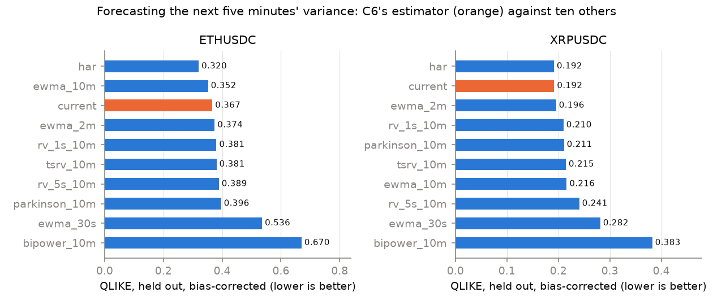
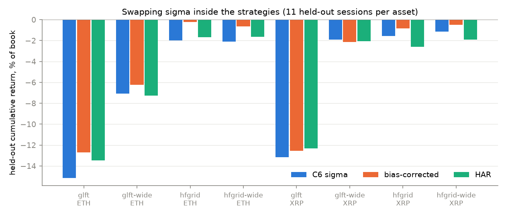
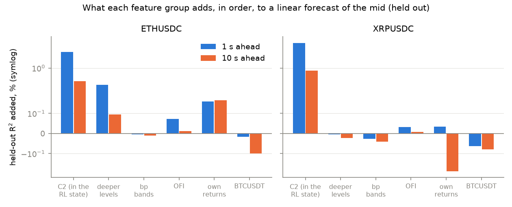
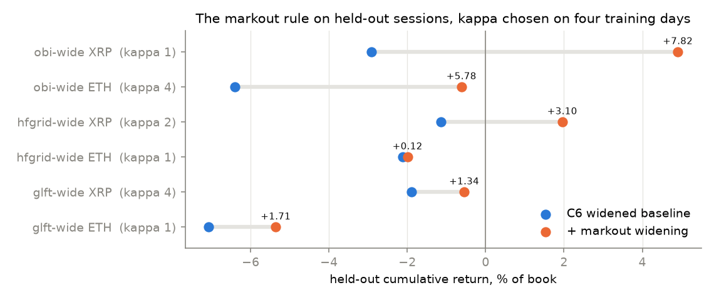
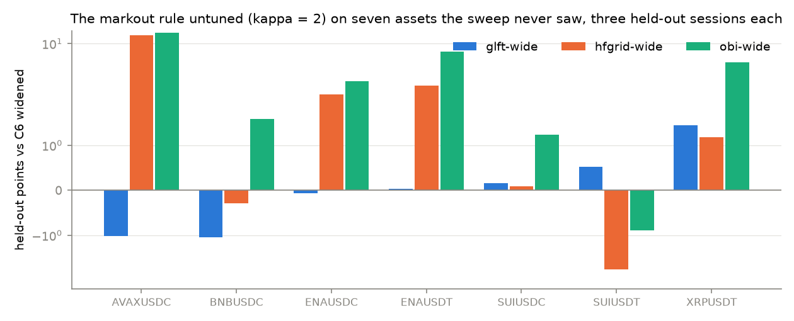
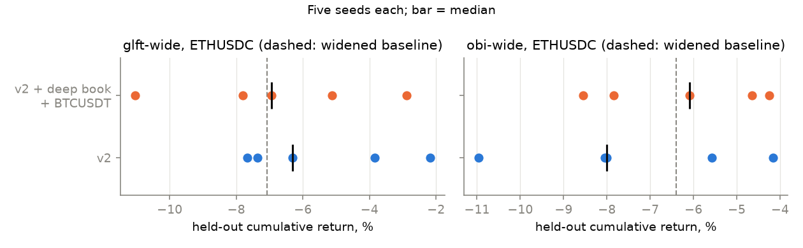

# C7 — Signals and adaptivity: volatility, the deeper book, BTCUSDT, and a markout rule

Not a ladder phase. It comes from a request after C6's RL results. Lab
notebook: [`experiments/c7_signals/README.md`](../../experiments/c7_signals/README.md).

> **At a glance**
>
> - **C6's volatility estimate reads about 1.5× too low** on both deep assets.
>   Correcting that bias helps the model-driven strategies on held-out data in
>   7 of 8 cases. HAR is the best *forecaster* but helps in only 4 of 8: what
>   pays is wider quotes, not better timing.
> - **The book deeper than five ticks and BTCUSDT's book carry almost nothing a
>   quoter can use.** Held-out R² gains are +0.2 points at 1 s at best, from
>   deeper own-book levels; BTC adds ≈0 once our own book is known, in a linear
>   model and in LightGBM, even with BTC aligned to 100 ms. Given to the RL
>   policy as fourteen extra observations, they change nothing measurable.
> - **A markout rule — widen the half spread by κ × the recent adverse move of
>   our own fills — beat C6's widened baseline on held-out data in 6 of 6
>   (strategy, asset) pairs**, by +0.1 to +7.8 points, and untuned (κ = 2) in
>   13 of 18 on seven assets it was never fitted on (median +0.85). Nothing else in Part C
>   beats those baselines on held-out data in every pair tried, and it is
>   three lines of arithmetic.

---

**Contents**

- [1. The task](#1-the-task)
- [2. The goal](#2-the-goal)
- [3. The data: per-second book snapshots](#3-the-data-per-second-book-snapshots)
- [4. Volatility](#4-volatility)
  - [4.1 Which estimator forecasts best](#41-which-estimator-forecasts-best)
  - [4.2 What it does inside the strategies](#42-what-it-does-inside-the-strategies)
- [5. Is there information deeper in the book, or in BTCUSDT's?](#5-is-there-information-deeper-in-the-book-or-in-btcusdts)
  - [5.1 The test](#51-the-test)
  - [5.2 What it found](#52-what-it-found)
- [6. The markout rule](#6-the-markout-rule)
  - [6.1 The rule](#61-the-rule)
  - [6.2 Chosen on training days, scored on held-out ones](#62-chosen-on-training-days-scored-on-held-out-ones)
  - [6.3 Without tuning, on the other seven assets](#63-without-tuning-on-the-other-seven-assets)
- [7. RL with the deeper book and BTCUSDT in the state](#7-rl-with-the-deeper-book-and-btcusdt-in-the-state)
- [8. Checks with known answers](#8-checks-with-known-answers)
- [9. What this changes](#9-what-this-changes)
- [10. Sources](#10-sources)

## 1. The task

The request, after C6's RL answer came back "mostly nothing":

> yes, do those three after the current runs finish, also try use more deep ob
> levels and maybe even ob of btcusdt, because they can contain hidden info

"Those three" were proposals made in answer to five questions about C6:

1. **a volatility bake-off** — estimate volatility several other ways, score
   them, and put the best into the strategies;
2. **imbalance in basis points** rather than ticks, because C2's five-level
   feature is 0.11 bp deep on ETHUSDC and 8 bp deep on ENAUSDC;
3. **a markout-driven spread rule** — widen after our own fills turn toxic —
   as a new, hand-written baseline.

And the addition: **deeper book levels, and BTCUSDT's book**, as possible
hidden information.

## 2. The goal

C6 ended with a negative result for learning — state-conditioned multipliers
do not beat well-chosen fixed ones — and a positive one for a fixed choice:
the per-asset spread floor was the largest effect in Part C. So the natural
next question is not "which RL algorithm" but "what information, and which
simple rule, is the policy missing?"

Everything here is decided on the training days and reported on the held-out
days C6 used: eleven sessions from 2025-09-15 on, for both ETHUSDC and XRPUSDC.
A number chosen on held-out data would be worthless, so none is.

## 3. The data: per-second book snapshots

`snapshots.py` replays each session with no orders and writes, per second:
the 100 ms mid path, cumulative resting quantity out to 1, 5, 20, 50 and 200
ticks and within 1, 2, 5, 10, 25, 50 and 100 bp of the mid, order-flow
imbalance at the touch (Cont, Kukanov & Stoikov), and aggressive volume by
side. About 9 MB a day.

BTCUSDT is 0.4–1.0 GB a day raw and the disk allowance does not hold three
weeks of it, so it is streamed: download a day, extract, delete the raw file.
One BTCUSDT session needs 6.3 GB of memory to replay, which is why it ran only
after C6's training had finished — twice it did not, and was killed.

## 4. Volatility

### 4.1 Which estimator forecasts best

Every model-driven strategy in C6 uses one σ: the standard deviation of
100 ms mid changes over ten minutes, refit every five seconds. `vol_bakeoff.py`
scores it against ten alternatives *as forecasts*: at each 5 s point, each
estimator's trailing variance is compared with the realised variance over the
next five minutes, with the QLIKE loss

$$L(y, f) = \frac{y}{f} - \ln\frac{y}{f} - 1,$$

which is 0 for a perfect forecast and — unlike squared error — stays
consistent when the target $y$ is itself a noisy realised measure (Patton,
2011). Each estimator is scored raw, and after multiplying by its median
$y/f$ on the training days, which separates "wrong level" from "wrong timing".

*Figure — held-out QLIKE after bias correction, 1 s-return target. The 1-minute
window is off the scale (ETH 133, XRP 1.38) and omitted.*

| estimator | ETH raw | ETH corrected | XRP raw | XRP corrected | bias ($y/f$) ETH / XRP |
| --- | --- | --- | --- | --- | --- |
| **current** (C6) | 0.606 | 0.367 | 0.318 | **0.192** | **1.47 / 1.44** |
| HAR (1 min, 10 min, 1 h) | **0.284** | **0.320** | **0.167** | **0.192** | 0.83 / 0.83 |
| EWMA, 10 min half-life | 0.305 | 0.352 | 0.182 | 0.216 | 0.85 / 0.83 |
| EWMA, 2 min | 0.353 | 0.374 | 0.182 | 0.196 | 0.94 / 0.94 |
| realised var., 1 s, 10 min | 0.353 | 0.381 | 0.195 | 0.210 | 0.92 / 0.93 |
| two-scale RV, 10 min | 0.375 | 0.381 | 0.209 | 0.215 | 0.98 / 0.98 |
| Parkinson, 1 s bars | 1.673 | 0.396 | 1.282 | 0.211 | 2.59 / 2.71 |
| bipower, 1 s | 1.344 | 0.670 | 1.016 | 0.383 | 1.67 / 1.91 |

Three findings:

- **C6's σ is biased low by a factor of about 1.45 in variance** (1.2 in σ),
  on both assets, and the same on the 5 s-return target (1.71 / 1.76). Its
  *timing* is fine: bias-corrected, it ties HAR on XRP and is third on ETH.
  The bias is what sampling at 100 ms does to a mid that moves in steps:
  consecutive 100 ms changes are positively autocorrelated (lag-1 +0.12 to
  +0.18 on the days checked), so their variance scaled up by ten understates
  the one-second variance — measured directly, by a factor of 1.40–1.53,
  which is the bias above.
- **HAR is the best forecaster**, 13% better than corrected-current on ETH. Its
  weights are close on the two assets — about 0.2 on the last minute, 0.4 on
  the last ten, 0.25 on the last hour — which is the usual HAR shape (Corsi,
  2009).
- **Short windows are bad.** A 30 s EWMA or a 1-minute window forecasts ~0
  whenever the mid sits still, and XRPUSDC's mid sat still for twenty minutes
  on 2025-08-29. Every forecast is floored at one half-tick move per five
  minutes so that one quiet stretch cannot dominate the mean.

### 4.2 What it does inside the strategies

Two variants were run on the held-out sessions, both fixed from the training
days: `vol_scale` multiplies C6's variance by its measured bias, and `har_b*`
replaces σ with the HAR forecast once an hour of data exists.

| strategy | asset | C6 σ | bias-corrected | HAR | fills/day, C6 → corrected |
| --- | --- | --- | --- | --- | --- |
| glft | ETH | −15.13% | **−12.70%** | −13.47% | 3,834 → 2,706 |
| glft-wide | ETH | −7.07% | **−6.22%** | −7.28% | 101 → 103 |
| hfgrid | ETH | −1.98% | **−0.23%** | −1.66% | 244 → 130 |
| hfgrid-wide | ETH | −2.11% | **−0.65%** | −1.65% | 72 → 54 |
| glft | XRP | −13.17% | −12.55% | **−12.33%** | 13,397 → 13,047 |
| glft-wide | XRP | **−1.89%** | −2.14% | −2.07% | 10 → 10 |
| hfgrid | XRP | −1.58% | **−0.82%** | −2.59% | 133 → 74 |
| hfgrid-wide | XRP | −1.15% | **−0.50%** | −1.89% | 5 → 5 |

The bias correction helps in 7 of 8, HAR in 4 of 8, and the better forecaster
loses to the cruder fix in 6 of 8. The mechanism is visible in the fill
column: both variants *raise* σ, so both widen the quotes and trade less, and
§8.2 of C6 already established that on this venue wider is better. The bias
correction raises σ uniformly; HAR raises it most after bursts and least in
quiet spells, and quiet spells are where the fills that lose money are
cheapest to avoid. A better forecast of volatility is not a better
market-making input on its own.

Where the spread floor binds (`glft-wide` on both assets) σ cannot move the
half spread at all, and what differences remain come through the skew.

## 5. Is there information deeper in the book, or in BTCUSDT's?

### 5.1 The test

`book_info.py` asks the market, not a strategy. Linear models are fitted on
the training days to forecast the traded asset's mid return 1–60 s ahead, and
scored by **held-out R²**. Feature groups are added one at a time, starting
from what the RL state already has (touch imbalance, five-tick imbalance,
signed flow over 1 s and 10 s: "C2"), and what each group *adds* out of sample
is the number that matters.

BTCUSDT's per-second sample can be up to a second stale, because the two
feeds' one-second grids start at different moments; a sub-second lead would be
invisible. So BTC's returns are also taken on its 100 ms grid, aligned to
within 100 ms of our clock. Then `book_info_gbm.py` repeats the comparison
with small, regularised LightGBM models, in case the information is in
interactions a linear model cannot see.

### 5.2 What it found

*Figure — held-out R² each group adds on top of the previous ones (symlog
scale). Negative means the group made held-out forecasts worse.*

Linear, held-out R² in %, cumulative as groups are added:

| added | ETH 1 s | ETH 10 s | ETH 60 s | XRP 1 s | XRP 10 s | XRP 60 s |
| --- | --- | --- | --- | --- | --- | --- |
| C2 (the RL state) | 2.79 | 0.43 | 0.09 | 4.89 | 0.85 | 0.14 |
| + levels to 20/50/200 ticks | **3.13** | **0.53** | 0.11 | 4.89 | 0.83 | 0.04 |
| + bp bands | 3.13 | 0.52 | 0.08 | 4.87 | 0.79 | −0.06 |
| + OFI | 3.20 | 0.53 | 0.06 | 4.90 | 0.80 | −0.09 |
| + own returns | 3.36 | 0.69 | **0.55** | 4.93 | 0.61 | −0.26 |
| + BTCUSDT | 3.34 | 0.59 | 0.42 | 4.87 | 0.53 | −0.55 |

LightGBM, held-out R² in %:

| features | ETH 1 s | ETH 10 s | XRP 1 s | XRP 10 s |
| --- | --- | --- | --- | --- |
| C2 | 3.39 | 0.53 | 4.90 | 0.83 |
| C2 + BTC 100 ms returns | 3.44 | 0.55 | 5.00 | 0.82 |
| own book, everything | 3.58 | 0.58 | 5.07 | 0.88 |
| everything incl. BTC | 3.58 | 0.58 | 5.07 | 0.73 |

- **There is a little information deeper in our own book** on ETHUSDC:
  +0.34 points at 1 s from levels 20–200 ticks deep, which is 0.45–4.5 bp on
  ETH. On XRPUSDC, where five ticks is already 1.7 bp, there is none.
- **Imbalance in bp bands adds nothing once levels are in**, and on its own it
  is weaker than levels. The bp framing fixes the cross-asset comparison, not
  the information.
- **BTCUSDT adds nothing a held-out test can see.** Its 100 ms-aligned returns
  add +0.05 points at 1 s in LightGBM and hurt at 60 s, and its book adds
  nothing in either model. Whatever BTC leads by is already in our own book by
  the time a one-second decision could use it.
- **Our own recent returns help ETH at 30–60 s (+0.44) and hurt XRP**, which
  has four training days to fit on: a small, unstable momentum effect.

For scale: an R² of 3.5% at 1 s on ETH, where the 1 s return has a standard
deviation of 0.75 bp (median over the held-out sessions), is a forecast whose
own spread is about $\sqrt{0.035} \times 0.75 \approx 0.14$ bp — against a
4 bp half spread. It
could move a quote by a tick; it cannot change what a quote earns.

## 6. The markout rule

### 6.1 The rule

Every fill is marked five seconds later against the mid it was filled at,
signed so that a loss is positive:

$$m = -\operatorname{sign}(\Delta q)\,\frac{p_{t+5\,\mathrm{s}} - p_t}{p_t}\times 10^4
\ \text{bp},$$

$\Delta q$ being the position change the fill made. An exponential average
$\bar m$ over fills (half-life 20 fills, weighted by size) is kept, and the
half spread becomes

$$h = h_{\mathrm{C6}} + \kappa\,\max(\bar m, 0).$$

Quote wider for as long as the fills we have been getting have been adversely
selected; go back when they stop. $\kappa = 0$ is C6's quoter exactly. The
lag and the half-life were fixed before any run; only $\kappa$ was searched.

### 6.2 Chosen on training days, scored on held-out ones

$\kappa \in \{1, 2, 4\}$ was swept on four training sessions — the same four
the spread floor was chosen on — and the best per (strategy, asset) run on the
eleven held-out sessions:

| strategy | asset | κ | C6 widened | + markout | sessions better | fills/day (median session) |
| --- | --- | --- | --- | --- | --- | --- |
| glft-wide | ETH | 1 | −7.07% | **−5.36%** | 4 / 11 | 101 → 31 |
| hfgrid-wide | ETH | 1 | −2.11% | **−1.99%** | 4 / 11 | 72 → 31 |
| obi-wide | ETH | 4 | −6.40% | **−0.62%** | 8 / 11 | 3,355 → 1,173 |
| glft-wide | XRP | 4 | −1.89% | **−0.55%** | 6 / 11 | 10 → 6 |
| hfgrid-wide | XRP | 2 | −1.15% | **+1.96%** | 5 / 11 | 5 → 3 |
| obi-wide | XRP | 1 | −2.91% | **+4.91%** | 8 / 11 | 761 → 508 |

It helps in all six, and it helps most where the strategy trades most.
`obi-wide` is the convincing case: better on eight of eleven sessions on both
assets, with fills in the hundreds or thousands a day. The `glft` and
`hfgrid` gains come from fewer, larger days (four to six of eleven better),
and the widened `glft` and `hfgrid` on XRP trade a handful of times on a
median day, so their +1.3 and +3.1 points are the least trustworthy numbers
in the table.

**Does κ survive more training data?** C4 repeated the sweep on all twenty
pre-split sessions (κ = 0 replayed too). The choice is unchanged for `glft`
and `obi` on both assets — including OBI XRPUSDC's κ = 1, the best held-out
result in Part C — and moves for `hfgrid` (ETH 1 → 2, XRP 2 → 1), whose
fills are few enough that its sweep was always the least trustworthy. See
[C4 §6](c4-ppo-grpo.md#6-does-the-tuning-overfit-c4s-third-item).

Why this works when RL did not: the rule conditions on the one piece of state
that measures the thing the spread is paying for — how toxic *our* fills have
been — rather than on market features a policy has to learn to relate to it.
C6's policies saw inventory, flow and imbalance, never their own markouts.

### 6.3 Without tuning, on the other seven assets

A κ chosen on four sessions of the same asset is a search, however small. So
the rule was also run with **κ = 2 fixed in advance** — the middle of the
swept grid — on the seven assets the sweep never saw, on their three held-out
sessions each, with nothing searched at all.

*Figure — held-out points gained over C6's widened baseline, κ = 2 (symlog
scale).*

| strategy | better | median gain | worst | best |
| --- | --- | --- | --- | --- |
| obi-wide | **6 / 7** | **+3.43** | −0.89 (SUIUSDT) | +13.57 (AVAXUSDC) |
| hfgrid-wide | 5 / 7 | +1.18 | −1.76 (SUIUSDT) | +12.78 (AVAXUSDC) |
| glft-wide | 4 / 7 | +0.03 | −1.05 (BNBUSDC) | +1.45 (XRPUSDT) |
| all | **15 / 21** | **+1.18** | | |
| all but AVAXUSDC | 13 / 18 | +0.85 | | |

The two AVAX gains are one session: on 2025-09-22 the rule made +11.2%
(`hfgrid`) and +12.2% (`obi`) where C6 made +0.1% and +0.3% — the same session
on which C6's single v1 policy made +8.6%. That is a large directional move
caught by whichever variant happened to be positioned for it, not market
making, so the row without AVAX is the one to quote.

It generalises where the strategy trades a lot and the fills are toxic —
`obi`, the highest-turnover strategy — and it is a coin flip for `glft-wide`,
whose floor already binds and whose fills are few. Three sessions per asset
is thin; the direction agrees with the eleven-session results, the sizes are
not to be relied on.

## 7. RL with the deeper book and BTCUSDT in the state

§5 says the extra information is small. That is a statement about linear and
boosted-tree forecasts, and a policy is neither, so the direct test was run
too: recipe **`v2-deep`** is C6's v2 recipe unchanged except for fourteen more
observations, read per second from the same feature files the regressions
used — own-book imbalance at 20/50/200 ticks and 1/5/25 bp, OFI over 1 s and
10 s, own returns over 10 s and 60 s, BTCUSDT's returns over 0.5 s and 5 s (on
its 100 ms grid), and BTCUSDT's touch imbalance and OFI. Five seeds each of
`glft-wide` and `obi-wide` on ETHUSDC, the asset with ten training sessions.

| strategy | widened baseline | v2, median of 5 | v2-deep, median of 5 | v2-deep seeds |
| --- | --- | --- | --- | --- |
| glft-wide | −7.07% | −6.30% | −6.94% | −11.03 to −2.88 |
| obi-wide | −6.40% | −8.00% | −6.09% | −8.55 to −4.25 |

Worse by 0.6 points on one strategy, better by 1.9 on the other, and both
differences are inside a seed spread of six to eight points. **The extra
observations do not measurably change what the policy earns** — which is what
§5 predicted, now checked on the object that would have used them.
`obi-wide` with the extra observations does edge past its baseline on median
(−6.09% against −6.40%); the markout rule on the same pair made −0.62%.

## 8. Checks with known answers

| check | expected | result |
| --- | --- | --- |
| C6's σ bias, measured directly | var(1 s) / (10 · var(100 ms)) ≈ the fitted bias 1.44–1.47 | 1.40–1.53 on three sessions |
| new quoter parameters at their defaults | C6's quoter exactly | `glft-wide` XRPUSDC 2025-08-26: return 2.0387e−5 and 10.00 fills, both C6 runs identical to every digit |
| `vol_scale = 1.5` | σ × √1.5 | 1.805 → 2.211 (×1.225) |
| cumulative depth, per snapshot | non-decreasing outward, in levels and in bands | all 86,399 seconds, both sides |
| bp band vs tick level on XRP (0.34 bp/tick) | 1 bp ≈ 3 levels | 35.4k between level-1 (10.5k) and level-5 (66.1k) |
| extra RL observation timing | the second in force, never a later one | row timestamp = environment clock, lag 0.0 s |
| C2's two imbalance features on ETH | nearly identical (5 ticks = 0.11 bp) | correlation with 10 s return +0.0901 vs +0.0896 |

## 9. What this changes

- **For the baselines:** a markout-conditioned spread is a better fixed rule
  than any fixed spread C6 found, and C6's σ should be scaled by its measured
  bias before anything is built on it.
- **For RL:** the missing information was not deeper in the book or in BTC;
  it was in our own fills. The obvious next RL experiment is the markout
  average in the state, with the markout rule as the residual policy's
  baseline — asking RL to improve the best thing found so far, not C6's.

## 10. Sources

| what | source |
| --- | --- |
| QLIKE, and why it is robust to a noisy target | Patton (2011), *Volatility forecast comparison using imperfect volatility proxies*, J. Econometrics 160 |
| HAR | Corsi (2009), *A simple approximate long-memory model of realized volatility*, J. Financial Econometrics 7 |
| two-scale realised variance | Zhang, Mykland & Aït-Sahalia (2005), JASA 100 |
| bipower variation | Barndorff-Nielsen & Shephard (2004), J. Financial Econometrics 2 |
| range estimator | Parkinson (1980), J. Business 53 |
| order-flow imbalance | [Cont, Kukanov & Stoikov (2014)](https://huggingface.co/papers/1011.6402) |
| the strategies, spreads and split | [C6](c6-strategy-zoo.md) |
