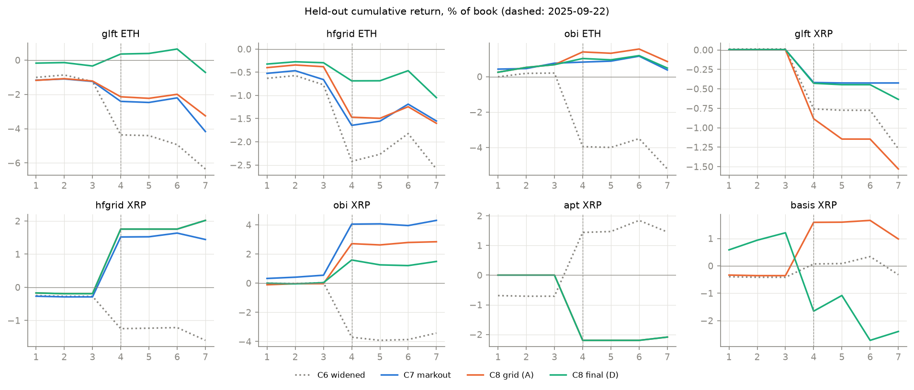
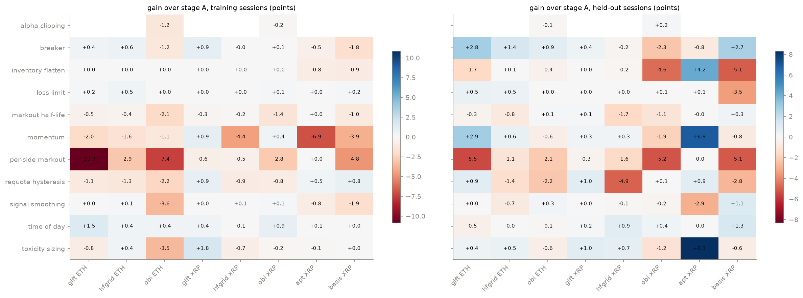
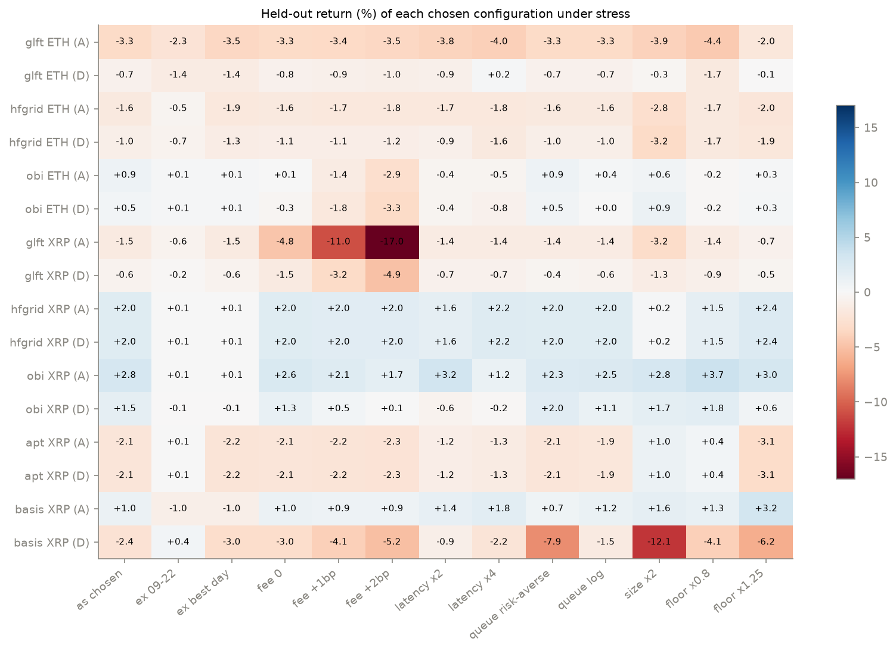
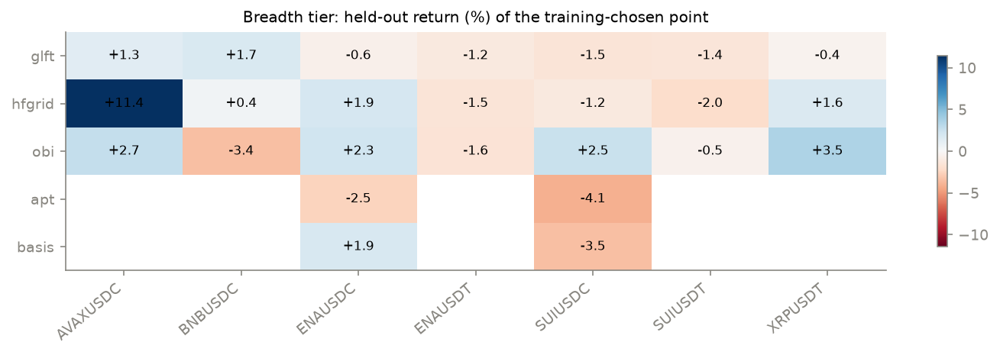
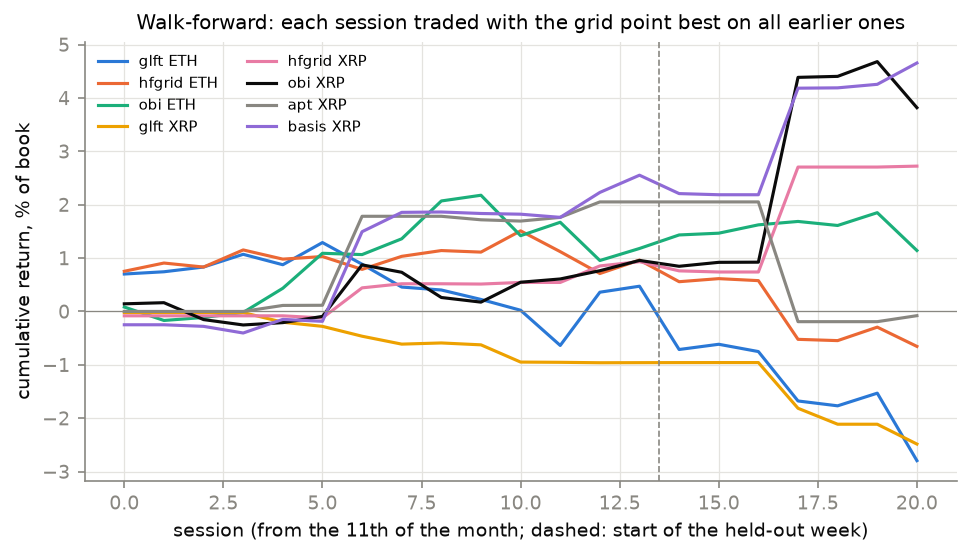
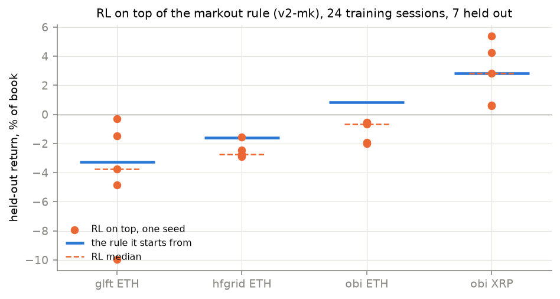

# C8 — Risk controls, denoising and new quoting ideas, on a month split

Not a ladder phase. It comes from the Part C follow-up list after C4, with
the forward test left out on request. Lab notebook:
[`experiments/c8_risk_controls/README.md`](../../experiments/c8_risk_controls/README.md).

> **At a glance**
>
> - **The best result in Part C is OBI on SUIUSDC:** +2.52% over seven
>   held-out sessions at 175 fills a day, positive on 6 of 7. It stays
>   positive **without the 09-22 crash** (+1.77%), **without its best
>   session** (+1.52%), **without the maker rebate** (+2.05%), **with a 1 bp
>   maker fee** (+1.13%), at **4× order latency** (+1.30%) and under the
>   **pessimistic queue model** (+2.46%); no other configuration passes all
>   six. Its one weak point is halving the markout κ (−0.90%).
> - **OBI on XRPUSDC survives every cost and latency stress** (+1.68% with a
>   2 bp maker fee, +1.17% at 4× latency), **but its held-out gain is the
>   crash session**: +0.09% without it. OBI on ETHUSDC's +0.85% is the maker
>   rebate: +0.09% without it, −2.92% at a 2 bp fee.
> - **The circuit breaker is the one control that pays on ETH.** It raises
>   held-out return on all three ETH strategies (+0.9 to +2.8 points), and
>   with it GLFT goes from −3.25% to −0.72%. On OBI XRP it costs 2.3 points.
> - **Adding more knobs hurts the strategies that already work.** A greedy
>   combination chosen on training sessions improves the losing strategies and
>   makes OBI worse on both assets (ETH +0.85 → +0.48, XRP +2.84 → +1.49).
> - **RL on top of the markout rule never beats the rule**: worse on all
>   three ETH strategies by 0.5–1.5 points, a tie on OBI XRP (+2.83 against
>   +2.84), with seed ranges of 1.3 to 9.7 points.

---

**Contents**

- [1. The task](#1-the-task)
- [2. The month split and how it was run](#2-the-month-split-and-how-it-was-run)
- [3. The base grid on 24 training sessions](#3-the-base-grid-on-24-training-sessions)
- [4. Risk controls, denoising and new ideas, one family at a time](#4-risk-controls-denoising-and-new-ideas-one-family-at-a-time)
  - [4.1 The families](#41-the-families)
  - [4.2 What each family adds](#42-what-each-family-adds)
  - [4.3 Denoising, specifically](#43-denoising-specifically)
- [5. Combining them](#5-combining-them)
- [6. Stress tests](#6-stress-tests)
- [7. The breadth assets](#7-the-breadth-assets)
- [8. Walk-forward selection](#8-walk-forward-selection)
- [9. RL on top of the markout rule](#9-rl-on-top-of-the-markout-rule)
- [10. So what makes money?](#10-so-what-makes-money)
- [11. What would push further](#11-what-would-push-further)
- [12. How it was run, and what went wrong](#12-how-it-was-run-and-what-went-wrong)
- [13. Sources](#13-sources)

## 1. The task

The request, after C4:

> do all part C follow-ups, except 4 [the forward test]; use as much training
> days as possible and less held-out days (they together should cover month
> period); do we have denoising of signals already; make sure all key tables
> and plots presented in writeups; do not reject or estimate any ideas
> without real stress test because of nature of part C; do you have any new
> ideas how we can improve current strategies?

The follow-ups were: a **circuit breaker**, a **daily loss limit**, **stress
tests** of the one configuration that made money, the **breadth assets** on
more held-out sessions, **RL on top of the markout rule**, and the
**residual-LayerNorm network** on a GPU (reported in
[C4 §8](c4-ppo-grpo.md#8-would-a-bigger-network-help)). To those C8 adds
**denoising** of the signals and eight **new quoting ideas**, each run through
the backtest rather than argued about, and a **stress test** of every
configuration reported as a result.

## 2. The month split and how it was run

The data covers 2025-08-26 to 2025-09-25. C8 trains on **24 sessions**
(08-26 to 09-18) and holds out **7** (09-19 to 09-25), a full week that keeps a
weekend and the 09-22 crash. Earlier phases held out eleven sessions; their
numbers are recomputed here on the same last seven wherever they are
compared.

Every configuration is replayed once per session and cached by a hash of the
configuration, so the split, the walk-forward selection and the stress tests
all read the same results (`experiments/c8_risk_controls/c8.py`). The stages,
each on top of the previous stage's choice for each (strategy, asset):

| stage | what | chosen on |
| --- | --- | --- |
| A | floor × markout κ × skew, C4's grid with κ = 1 added: 24 points | training sessions |
| B | circuit breakers and loss limits: 25 variants | training sessions |
| C | denoising and new ideas: up to 27 variants | training sessions |
| D | greedy combination of each family's best variant | training sessions |
| E | stress tests of the A and D choices | (reported only) |

A choice must take at least 20 fills on a median training session, so a
configuration cannot win by not trading. In all, about 36,000 session replays.

## 3. The base grid on 24 training sessions

*Figure — held-out cumulative return over the seven sessions. Dotted: C6's
widened preset; blue: C7's markout rule (κ chosen on four sessions); orange:
the C8 grid choice; green: the C8 final combination (§5). Dashed line:
2025-09-22.*

| asset | strategy | C6 widened | C7 markout | **C8 grid** | training | without 09-22 | sessions up | fills/day |
| --- | --- | --- | --- | --- | --- | --- | --- | --- |
| ETH | glft | −6.35 | −4.17 | **−3.25** | +3.37 | −2.34 | 2/7 | 27 |
| ETH | hfgrid | −2.59 | −1.55 | **−1.60** | +1.93 | −0.51 | 2/7 | 22 |
| ETH | obi | −5.21 | +0.38 | **+0.85** | +3.37 | +0.14 | 5/7 | 369 |
| XRP | glft | −1.27 | −0.42 | **−1.53** | −2.94 | −0.65 | 2/7 | 4 |
| XRP | hfgrid | −1.60 | +1.44 | **+2.02** | +1.78 | +0.07 | 2/7 | 1 |
| XRP | obi | −3.42 | +4.31 | **+2.84** | +1.41 | +0.09 | 5/7 | 106 |
| XRP | apt | +1.45 | – | **−2.09** | +3.01 | +0.11 | 1/7 | 0 |
| XRP | basis | −0.32 | – | **+0.98** | +3.20 | −0.95 | 3/7 | 4 |

*Held-out cumulative return, % of book. "training" is the chosen point's
return over the 24 training sessions.*

The chosen points:

| asset | strategy | floor | κ | skew |
| --- | --- | --- | --- | --- |
| ETH | glft | 4 bp (×1) | 2 | ×1 |
| ETH | hfgrid | 4 bp (×1) | 1 | ×1 |
| ETH | obi | 6 bp (×1.5) | 4 | ×1 |
| XRP | glft | 8 bp (×1) | 2 | ×2 |
| XRP | hfgrid | 12 bp (×1.5) | 1 | ×1 |
| XRP | obi | 12 bp (×1.5) | 2 | ×2 |
| XRP | apt | 16 bp (×2) | 0 | ×1 |
| XRP | basis | 8 bp (×1) | 2 | ×1 |

More training data changed the XRP OBI choice from C7's (floor 8 bp, κ = 1)
to a wider one, and on this held-out week the wider choice earns less: +2.84
against +4.31. On ETH the 24-session choices beat C7's on `glft` and `obi`.
Four of the eight choices (all on XRP) trade four times a day or less; they
are reported, but not as market making.

## 4. Risk controls, denoising and new ideas, one family at a time

### 4.1 The families

All are in C6's quoting kernel (`zoo.py`), off by default; an old markout run
replays to the identical return and fill count with them compiled in.

| family | the idea | variants |
| --- | --- | --- |
| circuit breaker | pause quoting when 10 s volatility exceeds 2.5× or 4× its 30 min level, or when aggressive flow is one-sided (imbalance above 0.5 or 0.7) while above its normal level; both sides or only the side being hit; 30 s or 5 min | 16 |
| loss limit | reduce-only after the session loses 25, 50 or 100 bp; or after a 15, 30 or 60 bp drawdown from the session's peak, for 10 min or 1 h | 9 |
| signal smoothing | exponential average of the fair-price signal over 1 s, 5 s or 20 s | 3 |
| alpha clipping | clip OBI's standardised imbalance at ±1.5 or ±2.5 | 2 |
| markout half-life | the toxicity average over 5 or 50 fills instead of 20 | 2 |
| momentum | lean the fair price along the last 1 s or 5 s of mid drift, ×0.5, ×1 or ×2 | 6 |
| per-side markout | one toxicity average per side; widen only the side whose fills were toxic | 1 |
| requote hysteresis | keep a resting quote while the new one is within 1 or 2 grid steps, to keep queue position | 2 |
| toxicity sizing | shrink order size as toxicity rises instead of only widening | 2 |
| inventory flatten | above 50% or 80% of the position cap, cut back to half with an IOC at the touch | 2 |
| time of day | ×2 floor in one four-hour UTC block; used as a schedule of every block that helped | 6 |

### 4.2 What each family adds

*Figure — each family's best variant (chosen on training sessions) against
the stage-A choice: gain on training sessions (left) and held out (right),
in points of return.*

| family | ETH glft | ETH hfgrid | ETH obi | XRP glft | XRP hfgrid | XRP obi | XRP apt | XRP basis |
| --- | --- | --- | --- | --- | --- | --- | --- | --- |
| **circuit breaker** | **+0.39 / +2.80** | **+0.60 / +1.41** | −1.18 / +0.90 | +0.95 / +0.43 | −0.03 / −0.24 | +0.05 / −2.28 | −0.53 / −0.84 | −1.81 / +2.72 |
| loss limit | +0.16 / +0.54 | +0.49 / +0.50 | +0.00 / +0.00 | +0.00 / +0.00 | +0.00 / +0.00 | +0.11 / +0.06 | +0.00 / +0.05 | +0.19 / −3.45 |
| time of day | +1.48 / −0.45 | +0.44 / −0.02 | +0.38 / −0.11 | +0.37 / +0.16 | −0.05 / +0.85 | +0.92 / +0.36 | +0.08 / −0.00 | +0.01 / +1.33 |
| toxicity sizing | −0.83 / +0.40 | +0.39 / +0.54 | −3.55 / −0.55 | +1.82 / +0.96 | −0.72 / +0.73 | −0.18 / −1.17 | −0.13 / +8.31 | +0.04 / −0.62 |
| requote hysteresis | −1.10 / +0.92 | −1.26 / −1.38 | −2.25 / −2.22 | +0.89 / +0.95 | −0.85 / −4.94 | −0.78 / +0.06 | +0.47 / +0.88 | +0.80 / −2.77 |
| momentum | −2.04 / +2.90 | −1.59 / +0.64 | −1.14 / −0.57 | +0.94 / +0.32 | −4.44 / +0.31 | +0.44 / −1.93 | −6.95 / +6.93 | −3.90 / −0.78 |
| signal smoothing | +0.00 / +0.00 | +0.09 / −0.72 | −3.56 / +0.26 | +0.00 / +0.00 | +0.08 / −0.07 | +0.09 / −0.22 | −0.84 / −2.95 | −1.87 / +1.14 |
| alpha clipping | – | – | −1.24 / −0.08 | – | – | −0.16 / +0.17 | – | – |
| markout half-life | −0.47 / −0.31 | −0.40 / −0.78 | −2.11 / +0.15 | −0.31 / +0.08 | −0.16 / −1.67 | −1.41 / −1.06 | +0.00 / −0.00 | −1.04 / +0.26 |
| inventory flatten | +0.00 / −1.67 | +0.00 / +0.05 | +0.03 / −0.37 | +0.00 / +0.00 | +0.00 / −0.15 | +0.00 / −4.64 | −0.80 / +4.19 | −0.90 / −5.06 |
| per-side markout | −10.87 / −5.46 | −2.94 / −1.10 | −7.44 / −2.15 | −0.63 / −0.27 | −0.54 / −1.60 | −2.81 / −5.24 | +0.00 / −0.00 | −4.80 / −5.07 |

*Training / held out, points of return over the stage-A choice. XRP hfgrid,
apt and basis trade 0–4 times a day, so their cells are noise.*

- **The circuit breaker is the only family that raises held-out return on
  all three ETH strategies**, and on `glft` and `hfgrid` it does so on
  training sessions too, so it can be chosen honestly. On OBI XRP it costs
  2.3 points: there the crash session is where the money is made, and a
  breaker pauses exactly then.
- **The loss limit helps a little and consistently where it triggers**
  (+0.5 points on ETH `glft` and `hfgrid`), and barely moves the OBI choices
  (0 on ETH, +0.06 on XRP).
- **Momentum pays held out on ETH `glft` (+2.90) but loses on training
  sessions (−2.04)**, so no honest selection picks it; time of day is the
  reverse, a training-session gain that does not hold.
- **Per-side markout is the clearest failure**: worse everywhere it can be
  measured, by up to 11 points on training sessions. Widening only the side
  that was hit leaves the other side quoting into the same move.

### 4.3 Denoising, specifically

The question was whether the signals are denoised already. Before C8, only in
two places: C7's markout rule is itself an exponential average over the last
20 fills, and OBI's imbalance is standardised over a ten-minute window but
not smoothed. C8 tested three denoisers:

| denoiser | best held-out gain on a strategy that trades | where it hurt |
| --- | --- | --- |
| signal smoothing (1–20 s) | +0.26 on ETH OBI, chosen at −3.56 on training | −0.72 ETH hfgrid |
| alpha clipping (±1.5, ±2.5 σ) | +0.17 on XRP OBI | −1.24 on ETH OBI training |
| markout average over 5 or 50 fills | +0.15 on ETH OBI | −1.06 XRP OBI, −1.67 XRP hfgrid |

None of the three improves any strategy on both training and held-out
sessions, so the combination step (§5) never picks one for a strategy that
trades. The denoising that is in use is inside the circuit breaker: its
triggers compare fast and slow exponential averages, require above-normal
activity, and hold for a cooldown, so a single print cannot trip it.

## 5. Combining them

Stage D adds, one family at a time, whichever family's best variant most
improves the training-session return of the current choice, and stops when
none does.

| asset | strategy | C8 grid | **final** | without 09-22 | fills/day | added (in order) |
| --- | --- | --- | --- | --- | --- | --- |
| ETH | glft | −3.25 | **−0.72** | −1.41 | 25 | circuit breaker (volatility 2.5×, both sides, 30 s), markout over 50 fills, ×2 floor 08:00–16:00 UTC |
| ETH | hfgrid | −1.60 | **−1.05** | −0.66 | 16 | ×2 floor 16:00–24:00 UTC, daily loss limit 25 bp |
| ETH | obi | +0.85 | **+0.48** | +0.14 | 369 | inventory flatten above 80% of the cap |
| XRP | glft | −1.53 | **−0.64** | −0.20 | 36 | toxicity sizing, per-side markout |
| XRP | hfgrid | +2.02 | +2.02 | +0.07 | 1 | nothing improved training |
| XRP | obi | +2.84 | **+1.49** | −0.06 | 95 | momentum, toxicity sizing, trailing loss limit |
| XRP | apt | −2.09 | −2.09 | +0.11 | 0 | nothing improved training |
| XRP | basis | +0.98 | **−2.40** | +0.44 | 317 | requote hysteresis, signal smoothing |

*Held-out cumulative return, %. The final choices are also the green lines
in the §3 figure.*

The combination helps the strategies that lose — ETH `glft` gains 2.5 points
and XRP `glft` 0.9 — and hurts the ones that make money: OBI loses 0.4 points
on ETH and 1.4 on XRP. Every addition is chosen on 24 training sessions and
each one fits them; with the strongest strategy, the extra parameters fit
the training month rather than the market.

## 6. Stress tests

*Figure — held-out return of each chosen configuration, as chosen and under
each stress (A: the grid choice; D: the final combination).*

| asset | strategy | choice | as chosen | fills/day | ex 09-22 | ex best day | fee 0 | fee +1bp | fee +2bp | latency ×2 | latency ×4 | queue risk-averse | queue log | size ×2 | floor ×0.8 | floor ×1.25 | κ ×0.5 | κ ×2 |
| --- | --- | --- | --- | --- | --- | --- | --- | --- | --- | --- | --- | --- | --- | --- | --- | --- | --- | --- |
| ETH | glft | A | −3.25 | 27 | −2.34 | −3.49 | −3.29 | −3.38 | −3.46 | −3.78 | −4.01 | −3.25 | −3.25 | −3.88 | −4.40 | −1.97 | −3.96 | −1.86 |
| ETH | glft | D | −0.72 | 25 | −1.41 | −1.41 | −0.77 | −0.86 | −0.96 | −0.92 | +0.20 | −0.72 | −0.72 | −0.30 | −1.67 | −0.08 | +1.12 | −0.67 |
| ETH | hfgrid | A | −1.60 | 22 | −0.51 | −1.85 | −1.65 | −1.73 | −1.82 | −1.74 | −1.81 | −1.60 | −1.60 | −2.80 | −1.71 | −2.00 | −2.10 | −1.83 |
| ETH | hfgrid | D | −1.05 | 16 | −0.66 | −1.26 | −1.07 | −1.13 | −1.18 | −0.90 | −1.65 | −1.05 | −1.05 | −3.24 | −1.66 | −1.91 | −2.16 | −1.78 |
| ETH | obi | A | +0.85 | 369 | +0.14 | +0.14 | +0.09 | −1.42 | −2.92 | −0.40 | −0.48 | +0.91 | +0.37 | +0.64 | −0.17 | +0.26 | −0.58 | +0.34 |
| ETH | obi | D | +0.48 | 369 | +0.14 | +0.14 | −0.28 | −1.81 | −3.31 | −0.40 | −0.78 | +0.55 | +0.00 | +0.94 | −0.17 | +0.27 | −0.37 | +0.01 |
| XRP | glft | A | −1.53 | 4 | −0.65 | −1.53 | −4.77 | −11.04 | −17.02 | −1.40 | −1.41 | −1.41 | −1.38 | −3.18 | −1.45 | −0.67 | −1.54 | −0.89 |
| XRP | glft | D | −0.64 | 36 | −0.20 | −0.64 | −1.51 | −3.24 | −4.95 | −0.73 | −0.70 | −0.41 | −0.61 | −1.25 | −0.91 | −0.48 | −0.52 | −0.49 |
| XRP | hfgrid | A = D | +2.02 | 1 | +0.07 | +0.07 | +2.01 | +1.99 | +1.97 | +1.57 | +2.21 | +2.02 | +2.02 | +0.24 | +1.52 | +2.39 | +1.39 | +2.67 |
| XRP | obi | A | **+2.84** | 106 | +0.09 | +0.09 | **+2.61** | **+2.14** | **+1.68** | **+3.22** | **+1.17** | **+2.27** | **+2.49** | +2.83 | +3.71 | +2.98 | +3.57 | +2.80 |
| XRP | obi | D | +1.49 | 95 | −0.06 | −0.06 | +1.28 | +0.45 | +0.13 | −0.63 | −0.17 | +1.98 | +1.09 | +1.67 | +1.76 | +0.62 | +1.78 | +0.91 |
| XRP | apt | A = D | −2.09 | 0 | +0.11 | −2.20 | −2.13 | −2.20 | −2.28 | −1.16 | −1.35 | −2.09 | −1.88 | +1.01 | +0.44 | −3.06 | – | – |
| XRP | basis | A | +0.98 | 4 | −0.95 | −0.95 | +0.96 | +0.93 | +0.89 | +1.41 | +1.76 | +0.69 | +1.18 | +1.57 | +1.32 | +3.19 | +0.95 | +0.38 |
| XRP | basis | D | −2.40 | 317 | +0.44 | −2.96 | −2.96 | −4.07 | −5.17 | −0.94 | −2.16 | −7.91 | −1.47 | −12.14 | −4.12 | −6.19 | −3.88 | −2.87 |

*Held-out cumulative return, %. The default maker fee is Binance's −0.5 bp
rebate; "fee 0" removes it. Latency multiplies the calibrated order-latency
model; "risk-averse" and "log" are hftbacktest's more pessimistic queue
models; "size ×2" doubles the order size at the same position cap.*

What the stresses separate:

1. **OBI ETH's +0.85% is the rebate.** At 369 fills a day the −0.5 bp rebate
   is worth about 0.65% over the week; without it the return is +0.09%, at a
   1 bp fee −1.42%, and doubled latency or a 20% narrower floor also turn it
   negative. ETH still has no configuration that makes money robustly.
2. **OBI XRP survives every cost and latency stress** — +1.68% at a 2 bp
   fee, +1.17% at 4× latency, +2.27% under the risk-averse queue — **and fails
   the one that matters most**: without 09-22, which is also its best
   session, it is +0.09%. It makes money by holding the right side through a
   crash, not by earning the spread on ordinary days.
3. **The circuit breaker's ETH GLFT gain is not a cost artefact**: −0.72%
   stays between −0.3% and −1.0% under every fee and queue stress. It is
   still a loss.
4. **XRP GLFT's grid choice depends on the rebate** (−1.53% → −17.02% at a
   2 bp fee), which is what a strategy looks like when its few fills are
   worth less than the rebate paid on them.

## 7. The breadth assets

*Figure — held-out return of the training-chosen point, per asset and
strategy (floor × κ grid, skew at preset).*

| asset | strategy | chosen point | train | held out | ex-09-22 | days up | fills/day |
| --- | --- | --- | --- | --- | --- | --- | --- |
| XRPUSDT | glft | floor 12 bp, κ 1 | +0.46 | −0.42 | −0.00 | 0/7 | 0 |
| XRPUSDT | hfgrid | floor 12 bp, κ 4 | +2.91 | +1.61 | −0.25 | 1/7 | 0 |
| XRPUSDT | **obi** | floor 8 bp, κ 2 | +4.79 | **+3.53** | +0.48 | 5/7 | 189 |
| SUIUSDC | glft | floor 8 bp, κ 4 | −4.91 | −1.50 | −0.96 | 3/7 | 1168 |
| SUIUSDC | hfgrid | floor 8 bp, κ 1 | +5.01 | −1.16 | −0.59 | 4/7 | 11 |
| SUIUSDC | **obi** | floor 8 bp, κ 4 | +3.60 | **+2.52** | **+1.77** | 6/7 | 175 |
| SUIUSDC | apt | floor 8 bp, κ 2 | +12.31 | −4.10 | −3.09 | 4/7 | 44 |
| SUIUSDC | basis | floor 8 bp, κ 0 | +4.41 | −3.45 | −1.48 | 4/7 | 16 |
| SUIUSDT | glft | floor 8 bp, κ 4 | +0.37 | −1.35 | −0.83 | 3/7 | 24 |
| SUIUSDT | hfgrid | floor 12 bp, κ 4 | +7.75 | −2.03 | −1.13 | 1/7 | 4 |
| SUIUSDT | obi | floor 16 bp, κ 4 | +3.65 | −0.53 | +1.90 | 5/7 | 44 |
| ENAUSDC | glft | floor 32 bp, κ 4 | −7.19 | −0.56 | −0.53 | 0/7 | 154 |
| ENAUSDC | hfgrid | floor 32 bp, κ 4 | +1.55 | +1.91 | +0.25 | 3/7 | 2 |
| ENAUSDC | obi | floor 32 bp, κ 4 | +3.73 | +2.30 | +0.68 | 5/7 | 2 |
| ENAUSDC | apt | floor 32 bp, κ 2 | +28.10 | −2.55 | +0.65 | 3/7 | 16 |
| ENAUSDC | basis | floor 32 bp, κ 0 | +4.35 | +1.86 | +0.37 | 3/7 | 3 |
| ENAUSDT | glft | floor 32 bp, κ 4 | −1.03 | −1.16 | −1.28 | 2/7 | 791 |
| ENAUSDT | hfgrid | floor 48 bp, κ 1 | +1.93 | −1.51 | +0.02 | 1/7 | 0 |
| ENAUSDT | obi | floor 32 bp, κ 2 | +12.36 | −1.56 | −1.13 | 2/7 | 6 |
| AVAXUSDC | glft | floor 24 bp, κ 1 | +0.25 | +1.32 | −0.08 | 2/7 | 12 |
| AVAXUSDC | hfgrid | floor 16 bp, κ 1 | +1.36 | +11.44 | +3.11 | 6/7 | 17 |
| AVAXUSDC | **obi** | floor 16 bp, κ 0 | +7.30 | **+2.68** | **+2.34** | 4/7 | 150 |
| BNBUSDC | **glft** | floor 2 bp, κ 1 | +1.71 | **+1.72** | +1.53 | 6/7 | 489 |
| BNBUSDC | hfgrid | floor 3 bp, κ 4 | +1.76 | +0.36 | +0.04 | 4/7 | 27 |
| BNBUSDC | obi | floor 7.4 bp, κ 4 | +3.04 | −3.40 | −2.67 | 2/7 | 524 |

*The seven other assets on the same split: floor × κ per strategy, skew at
preset, C7's σ correction (×1.445, measured on ETH and XRP) transferred to
`glft` and `hfgrid`.*

**OBI makes money held out on three of the seven breadth assets** (XRPUSDT,
SUIUSDC, AVAXUSDC) at 150–190 fills a day — five of all nine with ETHUSDC and
XRPUSDC — and on all three it stays positive without the crash. Everything
positive and trading at least 20 times a day was stress-tested:

| asset | strategy | as chosen | fills/day | ex 09-22 | ex best day | fee 0 | fee +1bp | fee +2bp | latency ×2 | latency ×4 | queue risk-averse | queue log | size ×2 | floor ×0.8 | floor ×1.25 | κ ×0.5 | κ ×2 |
| --- | --- | --- | --- | --- | --- | --- | --- | --- | --- | --- | --- | --- | --- | --- | --- | --- | --- |
| SUIUSDC | obi | **+2.52** | 175 | **+1.77** | **+1.52** | **+2.05** | **+1.13** | +0.21 | **+1.86** | **+1.30** | **+2.46** | **+2.17** | +2.74 | +1.43 | +1.36 | −0.90 | +0.56 |
| AVAXUSDC | obi | +2.68 | 150 | +2.34 | −0.37 | +2.35 | +1.69 | +1.04 | +2.79 | +3.14 | +2.63 | +2.67 | +3.38 | +0.25 | +6.68 | – | – |
| XRPUSDT | obi | +3.53 | 189 | +0.48 | +0.48 | +3.17 | +2.45 | +1.74 | +3.09 | +2.84 | +2.67 | +2.52 | +3.63 | +3.21 | +1.70 | +2.63 | +2.76 |
| BNBUSDC | glft | +1.72 | 489 | +1.53 | +1.23 | +0.75 | −1.17 | −3.05 | +0.58 | +1.71 | +1.53 | +0.64 | +2.50 | +0.96 | +1.05 | +1.56 | +1.01 |
| BNBUSDC | hfgrid | +0.36 | 27 | +0.04 | −0.37 | +0.27 | +0.08 | −0.11 | +0.20 | −0.14 | +0.41 | +0.28 | +0.59 | +0.49 | +0.47 | −0.45 | −0.72 |

*Held-out cumulative return, %, seven sessions. AVAXUSDC's OBI choice has
κ = 0, so it has no κ neighbours.*

- **SUIUSDC OBI is the only configuration in Part C that survives every
  stress except one**: it is positive without the crash, without its best
  session, without the rebate, at 4× latency and under both pessimistic
  queue models. Halving κ from 4 to 2 turns it to −0.90%, so the markout
  widening is doing real work.
- **AVAXUSDC OBI survives the costs but is one session**: without its best
  day it is −0.37%.
- **XRPUSDT OBI** behaves like XRPUSDC OBI: robust to costs, made on the
  crash.
- **BNBUSDC GLFT depends on the rebate** (−1.17% at a 1 bp fee).

## 8. Walk-forward selection

*Figure — each session from the 11th of the month on, traded with the grid
point that had the best return over every earlier session. Dashed: the
start of the held-out week.*

| pair | walk-forward, 21 sessions | of which the held-out week | sessions up |
| --- | --- | --- | --- |
| XRP obi | +3.82 | +2.83 | 14/21 |
| XRP basis | +4.65 | +2.05 | 10/21 |
| XRP hfgrid | +2.72 | +1.77 | 7/21 |
| ETH obi | +1.14 | −0.04 | 15/21 |
| XRP apt | −0.08 | −2.09 | 6/21 |
| ETH hfgrid | −0.65 | −1.60 | 10/21 |
| XRP glft | −2.48 | −1.54 | 4/21 |
| ETH glft | −2.79 | −3.25 | 9/21 |

*Cumulative return, %. The walk-forward re-chooses every session, so it uses
all the data a live system would have had, and no fixed split.*

OBI XRP stays positive when chosen session by session over three weeks,
not only on the one split, and ETH OBI is up on 15 of 21 sessions — though,
per §6, largely on the rebate.

## 9. RL on top of the markout rule

The last follow-up: TD3 with C6's v2 recipe (residual policy, counterfactual
reward, 5 s decisions), whose baseline is now the C8 grid choice — the
markout rule with its chosen floor, κ and skew — and which also sees the
rule's running toxicity (recipe `v2-mk`). Trained on the 24 training
sessions, five seeds, on Kaggle CPU sessions.

*Figure — held-out return of each seed (dots) against the rule it starts
from (solid) and the seeds' median (dashed).*

| asset | strategy | the rule (C8 grid) | RL on top, median of 5 | seeds | rule ex-09-22 | RL ex-09-22 (median) | RL fills/day |
| --- | --- | --- | --- | --- | --- | --- | --- |
| ETH | glft | −3.25 | **−3.76** | −9.96, −1.48, −3.76, −4.85, −0.31 | −2.34 | −1.37 | 20–52 |
| ETH | hfgrid | −1.60 | **−2.75** | −1.57, −2.82, −2.75, −2.88, −2.44 | −0.51 | −0.74 | 23–74 |
| ETH | obi | +0.85 | **−0.67** | −1.94, −0.58, −2.00, −0.67, −0.54 | +0.14 | −0.82 | 22–1577 |
| XRP | obi | +2.84 | **+2.83** | +0.63, +4.24, +0.57, +5.40, +2.83 | +0.09 | +0.24 | 104–779 |

The policy never beats the rule it adjusts. On ETH it is worse on all three
strategies; on OBI XRP the median ties and the seeds spread from +0.6 to
+5.4 while trading up to seven times as often. This is the same answer C3,
C6 and C4 gave for every other baseline, now on the strongest one.

## 10. So what makes money?

| configuration | held out | ex 09-22 | ex best day | fee 0 | fee +2 bp | latency ×4 | fills/day | verdict |
| --- | --- | --- | --- | --- | --- | --- | --- | --- |
| **SUIUSDC OBI** (floor 8 bp, κ 4) | **+2.52** | **+1.77** | **+1.52** | **+2.05** | +0.21 | **+1.30** | 175 | makes money on ordinary sessions, robust to costs; sensitive to κ |
| XRPUSDC OBI (floor 12 bp, κ 2, skew ×2) | +2.84 | +0.09 | +0.09 | +2.61 | +1.68 | +1.17 | 106 | robust to costs; the gain is the crash |
| XRPUSDT OBI (floor 8 bp, κ 2) | +3.53 | +0.48 | +0.48 | +3.17 | +1.74 | +2.84 | 189 | as XRPUSDC |
| AVAXUSDC OBI (floor 16 bp, κ 0) | +2.68 | +2.34 | −0.37 | +2.35 | +1.04 | +3.14 | 150 | one session |
| ETHUSDC OBI (floor 6 bp, κ 4) | +0.85 | +0.14 | +0.14 | +0.09 | −2.92 | −0.48 | 369 | the rebate |
| BNBUSDC GLFT (floor 2 bp, κ 1) | +1.72 | +1.53 | +1.23 | +0.75 | −3.05 | +1.71 | 489 | the rebate at higher fees |

*Held-out cumulative return, %, seven sessions (09-19 to 09-25).*

The pattern across Part C holds and sharpens: **OBI with a wide,
per-asset floor and the markout rule is the one strategy that makes money
held out while trading**, on five of nine assets; **one of them, SUIUSDC,
does so without the crash, without its best session and without the
rebate**. Everything that tried to improve on it —
more knobs (§5), a breaker (§4), RL (§9) — made it worse held out.

## 11. What would push further

- **The forward test** (the follow-up left out here): the frozen SUIUSDC and
  XRP OBI choices on sessions after 2025-09-25, with no re-selection. Seven
  held-out sessions cannot tell a +2.5% edge from luck, and three weeks of
  new data can.
- **OBI on more assets**, since it is the only strategy that generalises: the
  other SUI/ENA/AVAX quote currencies and any asset with comparable volume.
- **A crash-aware version of the breaker** — pause on volatility, but not
  when the position is already on the right side — since the breaker's cost
  on OBI XRP is exactly the crash session.
- **κ as a function of the asset's markout**, since SUIUSDC OBI's result
  depends on κ = 4 and no rule chooses κ yet except the grid.

## 12. How it was run, and what went wrong

- **Where.** About 36,000 session replays: ETHUSDC on this machine (four
  cores, 16 GB) and on Kaggle CPU sessions; XRPUSDC and the breadth tier on
  Kaggle; RL on Kaggle; the residual-LN network on a Colab T4. Every host
  writes the same (configuration, session) cache, merged by hash.
- **Memory.** Three ETH workers loading the same heavy session (09-24 and
  09-25) at once exceeded 16 GB three times; the lost sessions were rerun on
  Kaggle (30 GB), which walks the exported list from the end.
- **A latency race.** Two Kaggle workers generated the same day's synthetic
  latency file at once and one read the other's half-written file;
  `config.ensure_latency` now writes to a temporary name and renames.
- **The Kaggle bridge.** Account calls failed with "Unauthenticated" behind a
  valid token because `mcp-remote` replayed Kaggle's anonymous session cookie
  (fixed in ds-agent, `--disable-cookies`).

## 13. Sources

| what | source |
| --- | --- |
| the strategies, floors and presets | [C6](c6-strategy-zoo.md) |
| the markout rule and the σ correction | [C7](c7-signals.md) |
| the grid, and why selection needs 20+ fills | [C4](c4-ppo-grpo.md) |
| the RL recipe (v2) | [C6 §8](c6-strategy-zoo.md) |
| queue models, latency, fees | hftbacktest 2.4.4 documentation; Binance USDⓈ-M fee schedule |
| code | `experiments/c8_risk_controls/` (`c8.py`, `report.py`), `experiments/c6_strategy_zoo/zoo.py` |
