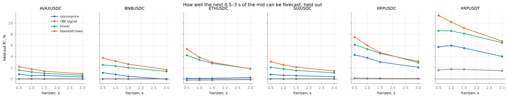
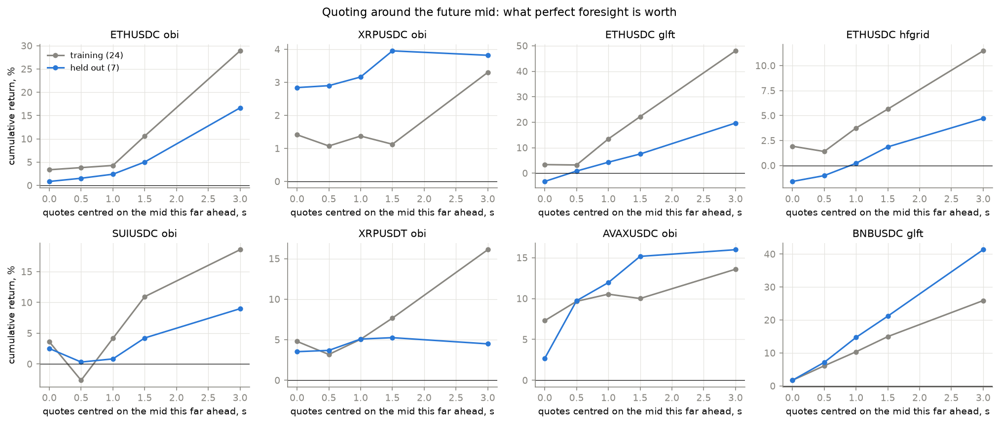
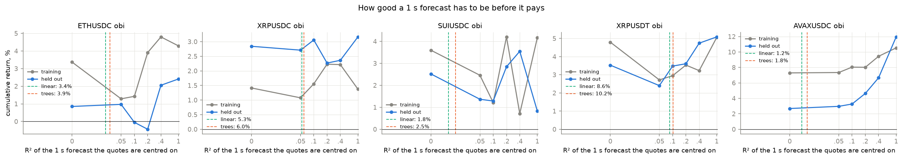
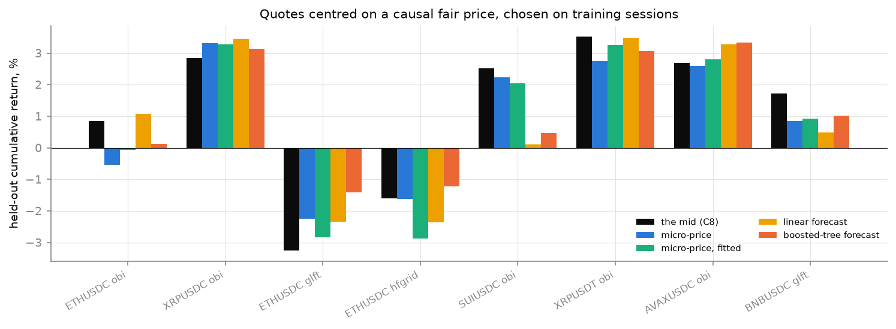
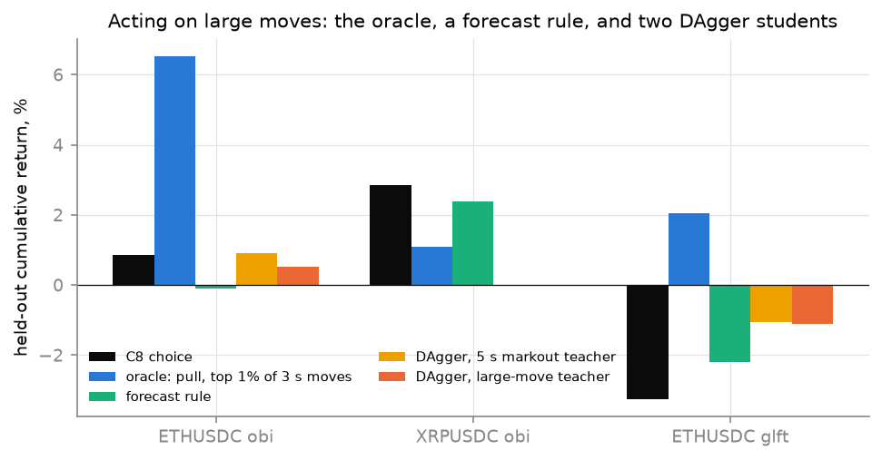
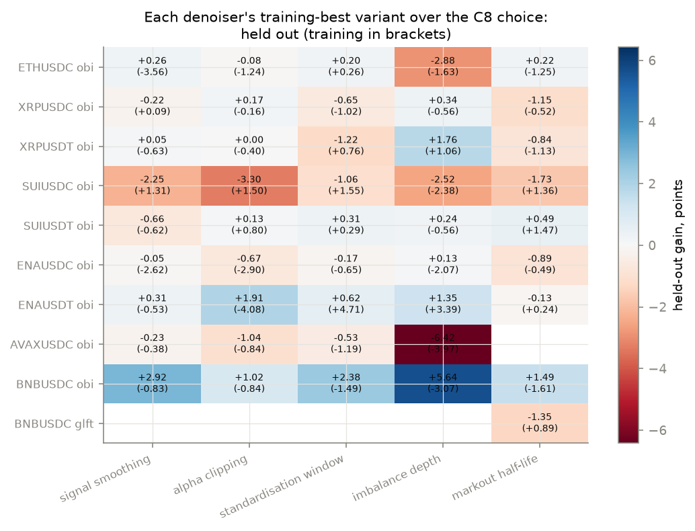
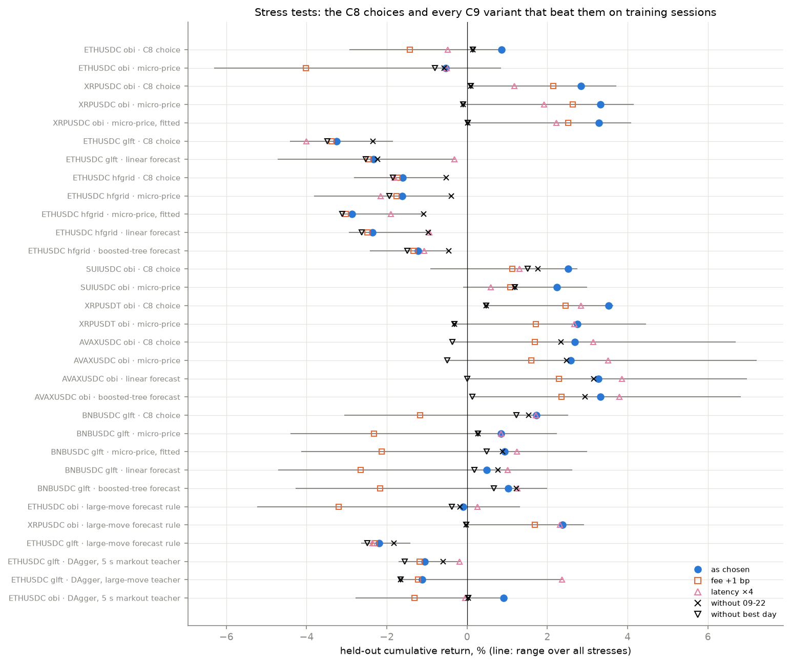

# C9 — The fair price, forecasts of the mid, and denoising on every asset

Not a ladder phase. It answers two questions asked after C8, and two
follow-ups those answers raised. Lab notebook:
[`experiments/c9_fair_price/README.md`](../../experiments/c9_fair_price/README.md).

> **At a glance**
>
> - **Knowing the mid 1–3 s ahead is worth a lot, on most assets.** Quoting
>   around the future mid instead of the current one raises held-out return
>   on seven of eight configurations at 1 s and all eight at 3 s, and more
>   the further ahead: ETH GLFT goes
>   from −3.25% to +4.30% (1 s) and +19.67% (3 s), BNB GLFT from +1.72% to
>   +14.72% (1 s). On XRP, whose quotes sit far outside a second's move, it
>   changes little.
> - **The mid cannot be forecast well enough to use that.** The best causal
>   forecast (boosted trees on 17 book, flow and momentum features) explains
>   1.8–10.2% of the 1 s move held out, depending on the asset. A forecast
>   has to explain about 40% before centring the quotes on it beats the C8
>   choice on both training and held-out sessions.
> - **Every real fair price chosen on training sessions is a wash or worse
>   held out, except on AVAXUSDC** (+3.33% against +2.68%, surviving the
>   stress tests). The micro-price, a fitted micro-price, a linear and a
>   boosted-tree forecast were each tried on eight configurations.
> - **Acting only on large moves would be enough — with a perfect detector.**
>   Pulling a quote before the top 1% of 3 s moves takes ETH OBI from +0.85%
>   to +6.53% held out. The forecasts' largest calls are about 0.6 bp against
>   3–5.5 bp real large moves, and the rules built on them do not help.
> - **DAgger with a privileged teacher** — a student that learns, from a
>   teacher who sees the future mid, which quotes to pull — improves the losing ETH GLFT and does not help ETH OBI. With either teacher
>   the GLFT student cuts the held-out loss from −3.25% to about −1.1% (19
>   fills a day against 27), and it still loses; on ETH OBI the students give
>   +0.91% and +0.52% against +0.85%. The large-move teacher's student ranks
>   those moves with an AUC of 0.71 but most of its pulls are false alarms.
> - **Denoising, now on all nine assets, does not help.** No denoiser raises
>   held-out return on a configuration that makes money without failing a
>   stress test; on SUIUSDC OBI every denoiser that helps training costs 1–3
>   points held out.

---

**Contents**

- [1. The task](#1-the-task)
- [2. How it was run](#2-how-it-was-run)
- [3. Can the mid be forecast 0.5–3 s ahead?](#3-can-the-mid-be-forecast-053-s-ahead)
- [4. What perfect foresight is worth](#4-what-perfect-foresight-is-worth)
- [5. How good a forecast has to be](#5-how-good-a-forecast-has-to-be)
- [6. Causal fair prices, chosen on training sessions](#6-causal-fair-prices-chosen-on-training-sessions)
- [7. Acting only on large moves](#7-acting-only-on-large-moves)
- [8. DAgger with a privileged teacher](#8-dagger-with-a-privileged-teacher)
- [9. Denoising on every asset](#9-denoising-on-every-asset)
- [10. Stress tests](#10-stress-tests)
- [11. So what?](#11-so-what)
- [12. What would push further](#12-what-would-push-further)
- [13. How it was run, and what went wrong](#13-how-it-was-run-and-what-went-wrong)
- [14. Sources](#14-sources)
- [Appendix: every stress test](#appendix-every-stress-test)

## 1. The task

The request, after C8:

> how we can better calc mid-price (or fair price) from which we put spread —
> can we predict it over 1 s interval or so with high precision? (you can
> verify that if we will put spread from price with future lag around
> 0.5–1.5 s it will increase pnl) and lets test denoising across all assets
> and most profitable strategies at the moment

Then, once the first answers were in, two follow-ups: **check whether acting
only on large moves is enough** (a "large-move detector" instead of a
forecast of every move), and **try RL on it — DAgger with a teacher that sees
the future**.

Four questions, then:

1. How well can the mid 0.5–3 s ahead be forecast from what the quoter sees?
2. What is perfect foresight worth — quoting around the future mid itself?
3. How good must a forecast be before quoting around it pays, and do the real
   ones get there?
4. Does denoising the signals help any profitable configuration, on any
   asset?

## 2. How it was run

C8's month split and cache: **24 training sessions** (2025-08-26 to 09-18),
**7 held out** (09-19 to 09-25), every configuration chosen on training
sessions, reported held out and stress-tested with C8's stress set. A choice
must trade at least 20 times on a median training session. Results are
cumulative return in % of the book.

The quoting kernel takes a new input: **one value per 100 ms quoting step,
in bp of the mid**, which moves the centre of the quotes (added to the
strategy's own signal, or replacing it), or widens or pulls only the side a
coming move would run over. It is off by default, and every cached C8
session replays to the identical return and fill count with it compiled in.

The series come from a **feature file per session** (`features.py`): the
same backtest the strategies run on, replayed with no orders, recording the
book and flow after each 100 ms step exactly as the strategy sees them. The
mid in that file matches the strategy's own mid on 100% of steps, so step `t`
of a forecast is step `t` of the quotes — no timestamp matching, and no
look-ahead beyond what the oracle means to have.

Configurations: **OBI with the markout rule on all nine assets and BNBUSDC
GLFT** (everything that makes money held out, plus the rest of OBI) for
denoising; for the fair price, the five OBI configurations that make money
(ETH, XRPUSDC, XRPUSDT, SUIUSDC, AVAXUSDC), BNB GLFT, and ETH GLFT and hfgrid
(which lose, to see whether a better centre rescues them). Each starts from
its C8 choice.

## 3. Can the mid be forecast 0.5–3 s ahead?

*Figure — held-out R² of each forecast of the mid's move, by horizon.*

Four forecasts, fitted on the training sessions and scored on every step of
the held-out ones: the **micro-price**'s offset from the mid; **OBI's own
signal** (the 10 bp band imbalance standardised over ten minutes, as the
strategy uses it); a **linear** model and **boosted trees** (LightGBM, small
and regularised) on 17 causal features — touch and band imbalances, OFI and
trade-flow imbalance over 0.1–10 s, the mid's own recent returns, the spread.

| asset | horizon | move std, bp | moves | micro-price | OBI signal | linear | boosted trees | trees, training | trees hit rate |
| --- | --- | --- | --- | --- | --- | --- | --- | --- | --- |
| AVAXUSDC | 0.5 s | 1.17 | 51% | 0.8 | −0.0 | 1.6 | **2.2** | 4.3 | 59% |
| AVAXUSDC | 1 s | 1.64 | 66% | 0.6 | −0.0 | 1.2 | **1.8** | 3.7 | 58% |
| AVAXUSDC | 1.5 s | 2.02 | 74% | 0.6 | −0.0 | 1.0 | **1.4** | 3.0 | 57% |
| AVAXUSDC | 3 s | 2.87 | 85% | 0.3 | −0.0 | 0.6 | **0.9** | 2.2 | 55% |
| BNBUSDC | 0.5 s | 0.67 | 35% | 1.1 | 0.0 | 2.5 | **3.8** | 6.1 | 69% |
| BNBUSDC | 1 s | 0.96 | 50% | 0.8 | 0.0 | 2.3 | **3.2** | 5.9 | 65% |
| BNBUSDC | 1.5 s | 1.19 | 60% | 0.5 | 0.0 | 2.0 | **2.6** | 5.5 | 62% |
| BNBUSDC | 3 s | 1.71 | 77% | −0.1 | 0.0 | 1.3 | **1.7** | 4.6 | 59% |
| ETHUSDC | 0.5 s | 0.60 | 34% | 0.1 | −0.2 | 4.2 | **5.4** | 7.6 | 71% |
| ETHUSDC | 1 s | 0.88 | 49% | 0.1 | −0.2 | 3.4 | **3.9** | 5.6 | 67% |
| ETHUSDC | 1.5 s | 1.10 | 59% | 0.1 | −0.2 | 2.8 | **3.0** | 4.3 | 64% |
| ETHUSDC | 3 s | 1.61 | 74% | 0.2 | −0.1 | 1.8 | **1.8** | 2.7 | 60% |
| SUIUSDC | 0.5 s | 0.84 | 43% | 0.8 | 0.0 | 2.1 | **3.1** | 5.3 | 60% |
| SUIUSDC | 1 s | 1.20 | 58% | 0.6 | 0.0 | 1.8 | **2.5** | 4.3 | 58% |
| SUIUSDC | 1.5 s | 1.47 | 66% | 0.6 | 0.0 | 1.5 | **2.1** | 3.5 | 57% |
| SUIUSDC | 3 s | 2.11 | 79% | 0.4 | −0.0 | 1.1 | **1.4** | 2.1 | 56% |
| XRPUSDC | 0.5 s | 0.59 | 29% | 4.3 | 0.1 | 6.1 | **7.5** | 9.1 | 75% |
| XRPUSDC | 1 s | 0.87 | 43% | 3.8 | 0.1 | 5.3 | **6.0** | 7.9 | 70% |
| XRPUSDC | 1.5 s | 1.09 | 53% | 3.0 | 0.1 | 4.6 | **4.7** | 6.6 | 67% |
| XRPUSDC | 3 s | 1.58 | 68% | 2.1 | 0.0 | 3.1 | **2.9** | 4.6 | 62% |
| XRPUSDT | 0.5 s | 0.55 | 20% | 5.7 | 1.6 | 8.6 | **11.4** | 11.7 | 85% |
| XRPUSDT | 1 s | 0.82 | 31% | 6.0 | 1.7 | 8.6 | **10.2** | 10.1 | 80% |
| XRPUSDT | 1.5 s | 1.04 | 39% | 5.5 | 1.7 | 8.1 | **9.1** | 9.2 | 76% |
| XRPUSDT | 3 s | 1.55 | 55% | 4.0 | 1.4 | 6.5 | **6.8** | 6.9 | 70% |

*Held-out R², %. "moves": share of steps on which the mid moves at all over
the horizon. "hit rate": direction right, on steps where both the mid and
the forecast move.*

- **The best forecast explains 2–10% of the 1 s move**: 10.2% on XRPUSDT,
  6.0% on XRPUSDC, 3.9% on ETHUSDC, 1.8% on AVAXUSDC. It gets the direction
  right 58–80% of the time — useful, but far from "high precision".
- **Shorter is easier**: every asset's R² falls from 0.5 s to 3 s.
- **The micro-price is the whole story on XRP** (3.8% of 6.0% at 1 s), where
  the spread is one wide tick, and **worth nothing on ETH** (0.1%), where the
  tick is 0.02 bp and the micro-price barely differs from the mid.
- **OBI's own signal forecasts nothing** (R² ≈ 0, and below zero on ETH).
  Whatever OBI earns, it does not earn it by predicting the mid.

## 4. What perfect foresight is worth

The oracle quotes around the mid `k` steps ahead — the actual future mid,
from the feature file — added to the strategy's own signal. It is not a
strategy; it is the ceiling on what knowing the next seconds is worth.

*Figure — cumulative return when the quotes are centred on the mid this far
ahead; 0 is the C8 choice.*

| configuration | sessions | as chosen | mid +0.5s | mid +1s | mid +1.5s | mid +3s | mid +1s, own signal off |
| --- | --- | --- | --- | --- | --- | --- | --- |
| ETHUSDC OBI | held out | +0.85 | +1.54 | +2.41 | +5.02 | +16.65 | +2.16 |
| ETHUSDC OBI | training | +3.37 | +3.82 | +4.29 | +10.60 | +28.89 | +6.25 |
| | fills/day held out | 369 | 418 | 611 | 689 | 1321 | 10 |
| XRPUSDC OBI | held out | +2.84 | +2.90 | +3.16 | +3.95 | +3.82 | +2.55 |
| XRPUSDC OBI | training | +1.41 | +1.07 | +1.37 | +1.13 | +3.30 | +0.88 |
| | fills/day held out | 106 | 93 | 94 | 90 | 160 | 0 |
| ETHUSDC GLFT | held out | −3.25 | +0.82 | +4.30 | +7.53 | +19.67 | – |
| ETHUSDC GLFT | training | +3.37 | +3.21 | +13.44 | +22.19 | +48.01 | – |
| | fills/day held out | 27 | 13 | 38 | 61 | 188 | – |
| ETHUSDC hfgrid | held out | −1.60 | −1.02 | +0.22 | +1.86 | +4.71 | +0.31 |
| ETHUSDC hfgrid | training | +1.93 | +1.40 | +3.75 | +5.65 | +11.47 | +3.36 |
| | fills/day held out | 22 | 7 | 17 | 24 | 90 | 17 |
| SUIUSDC OBI | held out | +2.52 | +0.32 | +0.83 | +4.23 | +8.99 | +2.61 |
| SUIUSDC OBI | training | +3.60 | −2.65 | +4.16 | +10.94 | +18.57 | +3.21 |
| | fills/day held out | 175 | 438 | 544 | 599 | 715 | 9 |
| XRPUSDT OBI | held out | +3.53 | +3.69 | +5.08 | +5.25 | +4.49 | +3.64 |
| XRPUSDT OBI | training | +4.79 | +3.18 | +5.06 | +7.66 | +16.10 | +6.33 |
| | fills/day held out | 189 | 179 | 211 | 239 | 254 | 1 |
| AVAXUSDC OBI | held out | +2.68 | +9.73 | +11.95 | +15.16 | +15.98 | +1.14 |
| AVAXUSDC OBI | training | +7.30 | +9.66 | +10.54 | +10.00 | +13.59 | +4.32 |
| | fills/day held out | 150 | 106 | 112 | 116 | 138 | 2 |
| BNBUSDC GLFT | held out | +1.72 | +7.15 | +14.72 | +21.18 | +41.33 | – |
| BNBUSDC GLFT | training | +1.71 | +6.11 | +10.36 | +14.98 | +25.89 | – |
| | fills/day held out | 489 | 436 | 691 | 943 | 1704 | – |

*Cumulative return, %. "own signal off": the oracle replaces the strategy's
signal instead of adding to it.*

- **The request's hypothesis holds**: centring on the mid 1 s ahead raises
  held-out return on seven of eight configurations (all but SUIUSDC), 3 s
  ahead on all eight, and the gain grows with the horizon. ETH GLFT turns
  from −3.25% to +4.30% at 1 s and +7.53% at 1.5 s; BNB GLFT gains 13 points
  and AVAX OBI 9 at 1 s.
- **It changes little on XRP** (+0.3 points at 1 s on XRPUSDC): XRP OBI
  quotes about 19 bp from the mid, and a second's move is usually under 1 bp,
  so knowing it barely moves the quotes relative to where fills happen.
- **SUIUSDC is worse with 0.5 s of foresight** (+0.32% against +2.52%) and
  better only from 1.5 s: moving the quotes by the coming small move trades
  more (438 fills a day against 175) without avoiding the moves that matter.
- **Switching OBI's own signal off costs almost every fill** (9–10 a day on
  ETH and SUI): OBI's quotes are too far out to fill without its signal
  pulling one side in. The signal matters for where fills happen, not for
  forecasting.

## 5. How good a forecast has to be

Between the mid (R² = 0) and the oracle (R² = 1): quotes centred on a
**noisy oracle** — `r2 × (move + noise)`, the noise scaled to make the
forecast's R² exactly `r2` and as autocorrelated as the move itself.

*Figure — return against the R² of the 1 s forecast the quotes are centred
on; dashed, the R² the real linear and boosted-tree forecasts reach on that
asset.*

| configuration | best real forecast, 1 s | sessions | C8 choice | R² 0.05 | R² 0.1 | R² 0.2 | R² 0.4 | R² 1 (the future mid) |
| --- | --- | --- | --- | --- | --- | --- | --- | --- |
| ETHUSDC OBI | 3.9% | held out | +0.85 | +0.97 | −0.05 | −0.44 | +2.05 | +2.41 |
| ETHUSDC OBI |  | training | +3.37 | +1.28 | +1.43 | +3.91 | +4.80 | +4.29 |
| XRPUSDC OBI | 6.0% | held out | +2.84 | +2.71 | +3.06 | +2.27 | +2.36 | +3.16 |
| XRPUSDC OBI |  | training | +1.41 | +1.08 | +1.56 | +2.23 | +2.21 | +1.37 |
| SUIUSDC OBI | 2.5% | held out | +2.52 | +1.37 | +1.29 | +2.84 | +3.55 | +0.83 |
| SUIUSDC OBI |  | training | +3.60 | +2.46 | +1.21 | +4.20 | +0.71 | +4.16 |
| XRPUSDT OBI | 10.2% | held out | +3.53 | +2.40 | +3.48 | +3.61 | +4.74 | +5.08 |
| XRPUSDT OBI |  | training | +4.79 | +2.72 | +2.95 | +3.53 | +3.23 | +5.06 |
| AVAXUSDC OBI | 1.8% | held out | +2.68 | +2.97 | +3.27 | +4.64 | +6.66 | +11.95 |
| AVAXUSDC OBI |  | training | +7.30 | +7.35 | +8.04 | +8.02 | +9.45 | +10.54 |

*Cumulative return, %; R² of a 1 s forecast.*

- **Below R² ≈ 0.2 a forecast mostly costs money.** ETH OBI loses 1.9–2.1
  points on training sessions at R² 0.05–0.1; SUIUSDC and XRPUSDT lose on
  both halves. XRPUSDC is the exception, level or slightly better at 0.1.
- **It takes R² ≈ 0.4 to beat the C8 choice on both training and held-out
  sessions** on ETH OBI, and even that is not enough on SUIUSDC or XRPUSDT.
  AVAXUSDC is the exception: every R², even 0.05, is at least level.
- **The real forecasts sit at 0.02–0.10**, where the curve is flat or falling.
  Forecasting the mid is not the route to the oracle's gain.

## 6. Causal fair prices, chosen on training sessions

The curve is a mapping, not a verdict, so each real forecast was also tried
as the fair price, like every other C9 variant: the micro-price, a fitted
micro-price, the linear and the boosted-tree 1 s forecast, each added to the
strategy's signal or replacing it, at ×1 and ×2; each family's best variant
on training sessions reported held out and stress-tested.

*Figure — held-out return of each fair price's training-best variant.*

| configuration | fair price | chosen variant | training | held out | without 09-22 | fills/day |
| --- | --- | --- | --- | --- | --- | --- |
| ETHUSDC OBI | the mid (C8) | – | +3.37 | +0.85 | +0.14 | 369 |
| | micro-price | feat:micro_bp, ×1, added to own signal | +3.37 | −0.53 | −0.58 | 411 |
| | micro-price, fitted | pred:micro:10, ×2, added to own signal | +2.51 | −0.06 | −0.06 | 589 |
| | linear forecast | pred:lin:10, ×1, added to own signal | −0.05 | +1.08 | +0.61 | 227 |
| | boosted-tree forecast | pred:gbm:10, ×1, added to own signal | +1.79 | +0.13 | +0.02 | 248 |
| XRPUSDC OBI | the mid (C8) | – | +1.41 | +2.84 | +0.09 | 106 |
| | micro-price | feat:micro_bp, ×2, added to own signal | +1.69 | +3.32 | −0.10 | 109 |
| | micro-price, fitted | pred:micro:10, ×2, added to own signal | +2.04 | +3.28 | +0.02 | 120 |
| | linear forecast | pred:lin:10, ×2, added to own signal | +1.17 | +3.45 | +0.24 | 94 |
| | boosted-tree forecast | pred:gbm:10, ×2, added to own signal | +0.14 | +3.12 | −0.54 | 105 |
| ETHUSDC GLFT | the mid (C8) | – | +3.37 | −3.25 | −2.34 | 27 |
| | micro-price | feat:micro_bp, ×1, added to own signal | +2.68 | −2.25 | −1.65 | 19 |
| | micro-price, fitted | pred:micro:10, ×1, added to own signal | +2.12 | −2.84 | −2.25 | 20 |
| | linear forecast | pred:lin:10, ×2, added to own signal | +4.89 | −2.33 | −2.23 | 17 |
| | boosted-tree forecast | pred:gbm:10, ×2, added to own signal | +3.15 | −1.41 | −1.68 | 20 |
| ETHUSDC hfgrid | the mid (C8) | – | +1.93 | −1.60 | −0.51 | 22 |
| | micro-price | feat:micro_bp, ×2, added to own signal | +2.04 | −1.61 | −0.39 | 24 |
| | micro-price, fitted | pred:micro:10, ×2, replaces own signal | +2.87 | −2.87 | −1.08 | 24 |
| | linear forecast | pred:lin:10, ×2, replaces own signal | +2.99 | −2.36 | −0.97 | 27 |
| | boosted-tree forecast | pred:gbm:10, ×2, replaces own signal | +2.62 | −1.22 | −0.46 | 22 |
| SUIUSDC OBI | the mid (C8) | – | +3.60 | +2.52 | +1.77 | 175 |
| | micro-price | feat:micro_bp, ×2, added to own signal | +5.22 | +2.24 | +1.19 | 239 |
| | micro-price, fitted | pred:micro:10, ×1, added to own signal | +2.70 | +2.05 | +0.32 | 254 |
| | linear forecast | pred:lin:10, ×2, added to own signal | +3.55 | +0.10 | −0.57 | 342 |
| | boosted-tree forecast | pred:gbm:10, ×1, added to own signal | +3.26 | +0.47 | +0.08 | 186 |
| XRPUSDT OBI | the mid (C8) | – | +4.79 | +3.53 | +0.48 | 189 |
| | micro-price | feat:micro_bp, ×2, added to own signal | +5.42 | +2.75 | −0.32 | 189 |
| | micro-price, fitted | pred:micro:10, ×1, added to own signal | +4.59 | +3.27 | +0.19 | 209 |
| | linear forecast | pred:lin:10, ×1, added to own signal | +3.66 | +3.48 | +0.45 | 196 |
| | boosted-tree forecast | pred:gbm:10, ×2, added to own signal | +4.67 | +3.07 | −0.45 | 178 |
| AVAXUSDC OBI | the mid (C8) | – | +7.30 | +2.68 | +2.34 | 150 |
| | micro-price | feat:micro_bp, ×2, added to own signal | +7.86 | +2.59 | +2.48 | 149 |
| | micro-price, fitted | pred:micro:10, ×2, added to own signal | +7.26 | +2.81 | +2.59 | 149 |
| | linear forecast | pred:lin:10, ×2, added to own signal | +7.65 | +3.27 | +3.15 | 149 |
| | boosted-tree forecast | pred:gbm:10, ×2, added to own signal | +8.04 | +3.33 | +2.94 | 143 |
| BNBUSDC GLFT | the mid (C8) | – | +1.71 | +1.72 | +1.53 | 489 |
| | micro-price | feat:micro_bp, ×1, added to own signal | +2.09 | +0.85 | +0.27 | 502 |
| | micro-price, fitted | pred:micro:10, ×2, added to own signal | +2.06 | +0.93 | +0.88 | 457 |
| | linear forecast | pred:lin:10, ×2, added to own signal | +2.38 | +0.49 | +0.77 | 456 |
| | boosted-tree forecast | pred:gbm:10, ×2, added to own signal | +2.20 | +1.03 | +1.23 | 517 |

*Cumulative return, %. "chosen variant": the family's best on the 24
training sessions.*

Counting only the variants that beat the C8 choice on training sessions —
the ones a training-session selection would adopt:

- **AVAXUSDC OBI is the one real improvement**: the boosted-tree forecast
  gives +3.33% held out against +2.68%, +2.94% against +2.34% without the
  crash, and it survives removing the best session (+0.13% against −0.37%),
  a 1 bp maker fee (+2.35% against +1.69%) and 4× latency (+3.79%). Like the
  C8 choice it is fragile to a 20% narrower floor (+0.29%).
- **XRPUSDC OBI gains about 0.4 points with the micro-price** (+3.28% to
  +3.32% against +2.84%), and all of it is the crash: without 09-22 it is
  +0.02% against +0.09%.
- **The rest adopt a worse configuration**: SUIUSDC +2.24% against +2.52%,
  XRPUSDT +2.75% against +3.53%, BNB GLFT +0.49% to +1.03% against +1.72%,
  and the ETH GLFT and hfgrid variants still lose. On ETH OBI no fair price
  beats the C8 choice on training sessions (the micro-price ties it).

## 7. Acting only on large moves

The oracle's gain might come from a few large moves, and a forecast that is
weak on average might still spot those. Two new actions: **widen** only the
side the coming move would run over, by the move, or **pull** it — each on
every step, or only when the move is in the top 10% or 1% of the training
sessions' moves.

*Figure — held-out return: the C8 choice, the best large-move oracle, the
forecast rule chosen on training sessions, and the two DAgger students
(§8).*

| configuration | sessions | C8 choice | oracle: pull, top 10% of 1 s moves | oracle: pull, top 1% of 3 s moves | oracle: widen, top 10% of 1 s moves | oracle: widen endangered side by the 1 s move | forecast rule (chosen on training) |
| --- | --- | --- | --- | --- | --- | --- | --- |
| ETHUSDC OBI | held out | +0.85 | +2.98 | +6.53 | +2.06 | +0.79 | −0.10 |
| ETHUSDC OBI | training | +3.37 | +13.41 | +11.68 | +5.99 | +5.71 | +4.23 |
| | fills/day held out | 369 | 590 | 1171 | 600 | 700 | 287 |
| XRPUSDC OBI | held out | +2.84 | +1.89 | +1.09 | +3.28 | +3.04 | +2.38 |
| XRPUSDC OBI | training | +1.41 | +0.65 | +0.37 | +0.72 | +1.71 | +1.98 |
| | fills/day held out | 106 | 75 | 151 | 95 | 93 | 101 |
| ETHUSDC GLFT | held out | −3.25 | −0.70 | +2.05 | −0.54 | −0.37 | −2.20 |
| ETHUSDC GLFT | training | +3.37 | +2.24 | +5.78 | +0.74 | +0.08 | +4.10 |
| | fills/day held out | 27 | 3 | 41 | 4 | 4 | 15 |

*Cumulative return, %. Oracle columns use the actual future mid; the forecast
rule is the best on training sessions of the boosted-tree 1 s and 3 s
forecasts gated at their top 5% or 1%, as a shift, a widening or a pull.*

- **A perfect large-move detector would be enough on ETH**: pulling a quote
  before the top 1% of 3 s moves against it takes ETH OBI from +0.85% to
  +6.53% held out and ETH GLFT from −3.25% to +2.05%, acting on about 1% of
  steps. On XRP no oracle variant beats the C8 choice held out.
- **The forecasts cannot see those moves coming.** The top 1% of the
  boosted-tree forecasts expect 0.59–0.65 bp; the top 1% of actual moves are
  2.9–3.3 bp at 1 s and 4.9–5.5 bp at 3 s. Gating on the forecast's extremes
  selects ordinary steps.
- **So the rules built on them do not help**: chosen on training sessions
  (where all three beat the C8 choice), they give −0.10% against +0.85% on
  ETH OBI, +2.38% against +2.84% on XRP OBI, and −2.20% against −3.25% on ETH
  GLFT — an improvement that still loses, on 15 fills a day.

## 8. DAgger with a privileged teacher

If the forecast of the move is the wrong target, learn the decision instead.
**DAgger** trains a student policy on the states it visits itself, labelled
by a teacher: here the teacher sees the future mid, and the student sees only
what the quoter sees.

- **The student** decides, per side and step, whether to pull (or widen) the
  quote the rule is about to post. Its score is a boosted-tree model of
  market features only (the 17 of §3, mirrored so one model serves both
  sides), plus a logistic layer over the student's own state that only the
  kernel knows when it quotes: the quote's distance from the mid, the
  inventory a fill would add to, and that side's markout toxicity.
- **Rounds.** Round 0 labels the states the C8 rule visits on the 24 training
  sessions; each later round rolls out the current student, labels the
  states *it* visits, adds them and refits on everything so far. Only
  training sessions are rolled out or labelled. The student's threshold and
  action are then chosen on training sessions and stress-tested like any
  other variant.
- **Targets**: ETH GLFT and ETH OBI, the two configurations with the largest
  oracle gap.

**Two teachers.** The first asked, for each posted quote, whether it would be
filled within 1 s (the opposite touch reaching its price) and whether that
fill would lose on a 5 s markout after the rebate. It was misaligned: a quote
the opposite touch reaches is mostly one the price runs through, so 58–69% of
its labelled fills lose and the student learns to pull nearly everything
(84% of GLFT quotes and 99–100% of OBI quotes at p > 0.5); and the
strategies earn over longer holds than 5 s. Its result is reported as it
came out. The second teacher is the policy §7 showed to pay: **pull a side
just before a move against it in the top 1% of 3 s moves**. Its labels are
rare (0.2–0.3% of steps), and its student learns to classify large moves
directly rather than forecast their size.

| configuration | student | rounds, labelled rows | teacher says pull | held-out AUC | chosen action | training | held out | without 09-22 | fills/day |
| --- | --- | --- | --- | --- | --- | --- | --- | --- | --- |
| ETHUSDC GLFT | none (C8 choice) | – | – | – | – | +3.37 | −3.25 | −2.34 | 27 |
| | DAgger, 5 s markout teacher | 3, 79,065 | 67.6% | – | pull (p > 0.7) | +5.02 | −1.05 | −0.60 | 19 |
| | DAgger, large-move teacher | 2, 4,510,122 | 0.5% | 0.71 | pull (p > 0.1) | +4.06 | −1.12 | −1.66 | 19 |
| ETHUSDC OBI | none (C8 choice) | – | – | – | – | +3.37 | +0.85 | +0.14 | 369 |
| | DAgger, 5 s markout teacher | 3, 656,772 | 58.0% | – | widen 2 bp (p > 0.7) | +3.80 | +0.91 | +0.02 | 369 |
| | DAgger, large-move teacher | 2, 4,542,042 | 0.5% | 0.71 | widen 5 bp (p > 0.01) | +2.46 | +0.52 | +0.16 | 448 |

*"teacher says pull": share of labelled weight (fills for the first teacher,
steps for the second) on which the teacher pulls. "held-out AUC": on the last
training session, which the tree model uses for early stopping only.*

- **Both students improve ETH GLFT and neither makes it pay.** The markout
  teacher's student (pull at p > 0.7) gives −1.05% held out and the
  large-move teacher's (pull at p > 0.1) −1.12%, against −3.25% for the C8
  choice, on 19 fills a day against 27. Both also beat the C8 choice on
  training sessions (+5.02% and +4.06% against +3.37%) and under most
  stresses; the large-move student is even positive at 4× latency (+2.37%)
  and with κ halved (+1.61%), but negative in every cost and session stress.
- **Neither helps ETH OBI.** The markout student's choice (widen 2 bp at
  p > 0.7) acts so rarely that it is the rule: +0.91% against +0.85%, +0.02%
  against +0.14% without the crash. The large-move student's best variant on
  training sessions (widen 5 bp at p > 0.01) earns less than the rule on
  training (+2.46% against +3.37%), so a training-session selection would not
  adopt it; held out it gives +0.52%.
- **Why the large-move student falls short of its teacher.** It ranks the
  teacher's pulls well above chance (AUC 0.71 on the held-back training
  session) but the events are rare: at p > 0.05 it acts on 0.3–0.7% of steps
  and is right 3–11% of the time. The teacher is worth +6.53% on ETH OBI
  because it is never wrong; a student that pulls ten times for every real
  move gives up more spread than it saves. Another DAgger round changes
  nothing here, since a student that rarely acts visits the same states as
  the rule.

**How this differs from the RL tried before.** C3, C4, C6 and C8 learned
from reward — session or step PnL — and the effect of any one quoting
decision is buried in the mark-to-market noise of the position, so the
learners never found a signal. DAgger learns from a label at every step,
which removes that problem entirely; what it cannot remove is the limit of
what its inputs reveal about the teacher's privileged information. The
students here reach that limit: they rank the dangerous moments (AUC 0.71)
but cannot act on them precisely enough. The comparison across Part C, the
clues that could make RL tractable, and whether the strategies' parameters
are too rigid are in the
[Part C overview, §6](c0-part-c-overview.md#6-rl-in-part-c-what-was-tried-why-it-failed-what-could-make-it-tractable).

## 9. Denoising on every asset

C8 tried three denoisers on ETHUSDC and XRPUSDC. Here five run on OBI on all
nine assets and on BNB GLFT, each family's training-best variant reported
held out and stress-tested — whether or not it looked better, so no denoiser
is dismissed on the plain backtest alone:

| family | variants | what it does |
| --- | --- | --- |
| signal smoothing | 1, 5, 20 s half-life | exponential average of the fair-price signal |
| alpha clipping | ±1, ±1.5, ±2.5 σ | cap OBI's standardised imbalance |
| standardisation window | 5, 30, 60 min (default 10) | the window OBI's imbalance is standardised over |
| imbalance depth | 5, 20, 40 bp (default 10) | how deep into the book the imbalance sums |
| markout half-life | 5, 10, 50 fills (default 20) | how many fills the toxicity average spans |

*Figure — held-out gain of each denoiser's training-best variant over the C8
choice, points (training gain in brackets).*

| configuration | C8 choice, training / held out | fills/day | signal smoothing | alpha clipping | standardisation window | imbalance depth | markout half-life |
| --- | --- | --- | --- | --- | --- | --- | --- |
| ETHUSDC OBI | +3.37 / +0.85 | 369 | −3.56 / +0.26 | −1.24 / −0.08 | +0.26 / +0.20 | −1.63 / −2.88 | −1.25 / +0.22 |
| XRPUSDC OBI | +1.41 / +2.84 | 106 | +0.09 / −0.22 | −0.16 / +0.17 | −1.02 / −0.65 | −0.56 / +0.34 | −0.52 / −1.15 |
| XRPUSDT OBI | +4.79 / +3.53 | 189 | −0.63 / +0.05 | −0.40 / +0.00 | +0.76 / −1.22 | +1.06 / +1.76 | −1.13 / −0.84 |
| SUIUSDC OBI | +3.60 / +2.52 | 175 | +1.31 / −2.25 | +1.50 / −3.30 | +1.55 / −1.06 | −2.38 / −2.52 | +1.36 / −1.73 |
| SUIUSDT OBI | +3.65 / −0.53 | 44 | −0.62 / −0.66 | +0.80 / +0.13 | +0.29 / +0.31 | −0.56 / +0.24 | +1.47 / +0.49 |
| ENAUSDC OBI | +3.73 / +2.30 | 2 | −2.62 / −0.05 | −2.90 / −0.67 | −0.65 / −0.17 | −2.07 / +0.13 | −0.49 / −0.89 |
| ENAUSDT OBI | +12.36 / −1.56 | 6 | −0.53 / +0.31 | −4.08 / +1.91 | +4.71 / +0.62 | +3.39 / +1.35 | +0.24 / −0.13 |
| AVAXUSDC OBI | +7.30 / +2.68 | 150 | −0.38 / −0.23 | −0.84 / −1.04 | −1.19 / −0.53 | −3.97 / −6.42 | – |
| BNBUSDC OBI | +3.04 / −3.40 | 524 | −0.83 / +2.92 | −0.84 / +1.02 | −1.49 / +2.38 | −3.07 / +5.64 | −1.61 / +1.49 |
| BNBUSDC GLFT | +1.71 / +1.72 | 489 | – | – | – | – | +0.89 / −1.35 |

*Gain over the C8 choice, points of return, training / held out. ENA OBI
trades 2–6 times a day, so its rows are noise.*

| configuration | signal smoothing | alpha clipping | standardisation window | imbalance depth | markout half-life |
| --- | --- | --- | --- | --- | --- |
| ETHUSDC OBI | signal_hl 50 | alpha_clip 2.5 | obi_window 3000 | obi_depth 0.002 | markout_halflife 10 |
| XRPUSDC OBI | signal_hl 50 | alpha_clip 2.5 | obi_window 36000 | obi_depth 0.004 | markout_halflife 10 |
| XRPUSDT OBI | signal_hl 10 | alpha_clip 2.5 | obi_window 36000 | obi_depth 0.004 | markout_halflife 10 |
| SUIUSDC OBI | signal_hl 200 | alpha_clip 1.5 | obi_window 3000 | obi_depth 0.0005 | markout_halflife 10 |
| SUIUSDT OBI | signal_hl 10 | alpha_clip 2.5 | obi_window 3000 | obi_depth 0.0005 | markout_halflife 10 |
| ENAUSDC OBI | signal_hl 10 | alpha_clip 1.5 | obi_window 18000 | obi_depth 0.004 | markout_halflife 5 |
| ENAUSDT OBI | signal_hl 10 | alpha_clip 2.5 | obi_window 18000 | obi_depth 0.002 | markout_halflife 10 |
| AVAXUSDC OBI | signal_hl 10 | alpha_clip 2.5 | obi_window 3000 | obi_depth 0.0005 | – |
| BNBUSDC OBI | signal_hl 50 | alpha_clip 2.5 | obi_window 36000 | obi_depth 0.004 | markout_halflife 50 |
| BNBUSDC GLFT | – | – | – | – | markout_halflife 5 |

- **The best configuration gets worse.** On SUIUSDC OBI every denoiser that
  helps the training sessions (by 1.3–1.6 points) costs 1–3.3 points held
  out: more parameters fit the training month.
- **The two gains that look real fail a stress test.** ETH OBI with a 5-minute
  window (+0.26 / +0.20) is worse than the C8 choice under a 1 bp fee
  (−2.09% against −1.42%); XRPUSDT OBI with a 40 bp imbalance band (+1.06 /
  +1.76, +5.29% held out) is robust to costs, but its gain is the crash:
  −0.83% without 09-22 against +0.48%.
- **SUIUSDT** improves on both halves with the markout window and clipping,
  and still loses held out. **BNB OBI** improves held out with every denoiser
  and on training with none, so no denoiser would be chosen for it.

The denoising that works is the one already inside the markout rule and the
circuit breaker (C8 §4.3).

## 10. Stress tests

*Figure — the C8 choices and every C9 variant that beat them on training
sessions: held-out return as chosen, under a 1 bp maker fee, at 4× latency,
and without the crash or the best session; the line spans all stresses.*

The complete stress tables — every family's training-best variant on every
configuration, including those that did not beat the C8 choice — are in the
[appendix](#appendix-every-stress-test). The pattern:

- **Nothing C9 adopts turns a cost-sensitive configuration robust.** ETH OBI
  and BNB GLFT lose under a 1 bp fee with every variant, as they did in C8.
- **AVAXUSDC OBI with the boosted-tree fair price** is the one adoption that
  is at least as good as the C8 choice under every stress, and better
  without its best session.
- **SUIUSDC OBI's C8 choice stays the most robust configuration in Part C**:
  no C9 variant beats it on training sessions and held out together.

## 11. So what?

- **The fair price the quotes are centred on matters enormously — if it is
  right.** One to three seconds of foresight is worth more, on most
  configurations, than any control or idea tried since C6.
- **Forecasting it is not the way there.** Real forecasts reach R² 0.02–0.10;
  the gain starts near 0.4. Quoting around the micro-price or a forecast
  helps one asset (AVAXUSDC) and hurts or does nothing on the rest.
- **The value is concentrated in rare large moves**, which is why a perfect
  detector acting on 1% of steps captures most of it, and why a forecast of
  the average move cannot: it never predicts a large move.
- **Learning the decision instead of the forecast helps the strategy that
  loses and not the ones that make money.** Both DAgger students halve ETH
  GLFT's held-out loss (−3.25% to about −1.1%); neither beats the rule on ETH
  OBI. The large-move student can rank the dangerous moments (AUC 0.71), but
  not precisely enough to act on them profitably.
- **Denoising is done.** Across nine assets, no denoiser survives both the
  held-out week and the stress tests on a profitable configuration.

## 12. What would push further

- **The forward test** (still the one Part C follow-up not run): the frozen
  SUIUSDC and XRP OBI choices, and AVAXUSDC with the boosted-tree fair price,
  on sessions after 2025-09-25.
- **Information the book does not carry.** The large moves are what matters
  and the book does not anticipate them at 1–3 s. The candidates are
  outside it — the same asset's USDT perpetual, spot, other venues'
  perpetuals, liquidation feeds — and most are free: the full list, where
  each can be had, and how it would be tested without look-ahead are in the
  [Part C overview, §7](c0-part-c-overview.md#7-data-from-outside-the-order-book).
  C7 already showed BTCUSDT's book adds nothing at 1 s.
- **Tail-event classifiers with a longer label horizon**, trained on the
  whole cross-section of assets rather than one, since a top-1% move is rare
  on any single asset.

## 13. How it was run, and what went wrong

- **Where.** ETHUSDC and XRPUSDC on this machine (four cores, 16 GB), the
  other assets and some of the ETH/XRP stages on Kaggle CPU sessions (four
  cores, 30 GB), all writing the same (configuration, session) cache; the
  fitted models for ETH and XRP were embedded in the Kaggle notebooks so
  every host used the same ones.
- **Memory.** Three ETH workers again ran out of memory on the heavy 09-24
  session, and a feature extraction beside three backtest workers did too;
  both were rerun with fewer workers.
- **Container restarts.** The machine restarted several times during the runs;
  every stage resumes from its cache, DAgger's rollouts from their files, so
  nothing was lost but time.
- **The first DAgger teacher** was misaligned (§8), found from its label
  statistics before its student was trusted, and replaced by the large-move
  teacher; both are reported.
- **Kaggle's 1 MB notebook limit** meant the embedded cache slice had to be
  cut to the configurations and fields each stage reads.

## 14. Sources

| what | source |
| --- | --- |
| the month split, the stress set, the cache | [C8](c8-risk-controls.md) |
| the strategies and the markout rule | [C6](c6-strategy-zoo.md), [C7](c7-signals.md) |
| earlier book-information study (per second) | [C7 §5](c7-signals.md#5-is-there-information-deeper-in-the-book-or-in-btcusdts) |
| micro-price | Stoikov, "The micro-price" (2018) |
| order-flow imbalance | Cont, Kukanov & Stoikov (2014) |
| DAgger | Ross, Gordon & Bagnell, "A Reduction of Imitation Learning and Structured Prediction to No-Regret Online Learning" (2011) |
| code | `experiments/c9_fair_price/` (`c9.py`, `features.py`, `fair.py`, `predict.py`, `dagger.py`, `report.py`), `experiments/c6_strategy_zoo/zoo.py` |

## Appendix: every stress test

Held-out cumulative return, %, seven sessions, for each C8 choice and each
family's training-best variant.

**Fair prices**

| configuration | variant | held out | fills/day | ex 09-22 | ex best day | fee 0 | fee +1 bp | fee +2 bp | latency ×2 | latency ×4 | queue risk-averse | queue log | size ×2 | floor ×0.8 | floor ×1.25 | κ ×0.5 | κ ×2 |
| --- | --- | --- | --- | --- | --- | --- | --- | --- | --- | --- | --- | --- | --- | --- | --- | --- | --- |
| ETHUSDC OBI | C8 choice | +0.85 | 369 | +0.14 | +0.14 | +0.09 | −1.42 | −2.92 | −0.40 | −0.48 | +0.91 | +0.37 | +0.64 | −0.17 | +0.26 | −0.58 | +0.34 |
| ETHUSDC OBI | micro-price | −0.53 | 411 | −0.58 | −0.80 | −1.70 | −4.01 | −6.29 | −0.57 | −0.51 | −0.42 | +0.84 | −0.43 | +0.10 | +0.36 | −0.77 | +0.60 |
| ETHUSDC OBI | micro-price, fitted | −0.06 | 589 | −0.06 | −0.40 | −1.30 | −3.74 | −6.13 | +0.05 | −0.30 | −0.05 | −0.15 | +1.17 | +0.21 | +1.58 | −0.25 | −0.58 |
| ETHUSDC OBI | linear forecast | +1.08 | 227 | +0.61 | +0.61 | +0.41 | −0.92 | −2.24 | +1.00 | −0.87 | +1.39 | +1.58 | +0.06 | +1.21 | +0.14 | −0.92 | +1.36 |
| ETHUSDC OBI | boosted-tree forecast | +0.13 | 248 | +0.02 | −0.18 | −0.56 | −1.93 | −3.29 | +0.85 | +0.79 | +1.13 | +0.83 | −1.34 | +0.22 | +1.80 | +0.78 | −0.25 |
| XRPUSDC OBI | C8 choice | +2.84 | 106 | +0.09 | +0.09 | +2.61 | +2.14 | +1.68 | +3.22 | +1.17 | +2.27 | +2.49 | +2.83 | +3.71 | +2.98 | +3.57 | +2.80 |
| XRPUSDC OBI | micro-price | +3.32 | 109 | −0.10 | −0.10 | +3.09 | +2.63 | +2.17 | +2.95 | +1.92 | +3.77 | +4.15 | +3.41 | +4.00 | +2.88 | +3.71 | +2.28 |
| XRPUSDC OBI | micro-price, fitted | +3.28 | 120 | +0.02 | +0.02 | +3.02 | +2.52 | +2.01 | +3.22 | +2.23 | +3.11 | +3.05 | +2.80 | +3.30 | +2.60 | +4.08 | +3.07 |
| XRPUSDC OBI | linear forecast | +3.45 | 94 | +0.24 | +0.24 | +3.24 | +2.82 | +2.41 | +2.42 | +1.34 | +2.88 | +2.57 | +1.32 | +2.70 | +2.28 | +3.15 | +1.72 |
| XRPUSDC OBI | boosted-tree forecast | +3.12 | 105 | −0.54 | −0.54 | +2.89 | +2.43 | +1.97 | +2.59 | +1.90 | +2.50 | +2.59 | +3.28 | +3.92 | +2.93 | +3.60 | +2.79 |
| ETHUSDC GLFT | C8 choice | −3.25 | 27 | −2.34 | −3.49 | −3.29 | −3.38 | −3.46 | −3.78 | −4.01 | −3.25 | −3.25 | −3.88 | −4.40 | −1.97 | −3.96 | −1.86 |
| ETHUSDC GLFT | micro-price | −2.25 | 19 | −1.65 | −2.52 | −2.29 | −2.38 | −2.46 | −3.74 | −3.31 | −2.25 | −2.25 | −4.49 | −4.49 | −3.31 | −2.62 | −0.88 |
| ETHUSDC GLFT | micro-price, fitted | −2.84 | 20 | −2.25 | −3.19 | −2.88 | −2.96 | −3.05 | −3.13 | −3.15 | −2.84 | −2.84 | −3.64 | −3.86 | −2.23 | −2.47 | −2.97 |
| ETHUSDC GLFT | linear forecast | −2.33 | 17 | −2.23 | −2.53 | −2.37 | −2.45 | −2.54 | −3.27 | −0.31 | −2.33 | −2.33 | −4.71 | −3.67 | −2.73 | −2.60 | −1.71 |
| ETHUSDC GLFT | boosted-tree forecast | −1.41 | 20 | −1.68 | −1.68 | −1.46 | −1.56 | −1.66 | −1.33 | −1.07 | −1.41 | −1.41 | −1.72 | −1.21 | −1.43 | −1.80 | −1.27 |
| ETHUSDC hfgrid | C8 choice | −1.60 | 22 | −0.51 | −1.85 | −1.65 | −1.73 | −1.82 | −1.74 | −1.81 | −1.60 | −1.60 | −2.80 | −1.71 | −2.00 | −2.10 | −1.83 |
| ETHUSDC hfgrid | micro-price | −1.61 | 24 | −0.39 | −1.94 | −1.66 | −1.75 | −1.85 | −2.08 | −2.16 | −1.61 | −1.68 | −3.80 | −1.85 | −2.86 | −2.15 | −2.04 |
| ETHUSDC hfgrid | micro-price, fitted | −2.87 | 24 | −1.08 | −3.11 | −2.92 | −3.02 | −3.11 | −2.22 | −1.90 | −2.87 | −2.92 | −2.85 | −1.87 | −2.43 | −2.59 | −2.08 |
| ETHUSDC hfgrid | linear forecast | −2.36 | 27 | −0.97 | −2.62 | −2.40 | −2.49 | −2.58 | −1.24 | −0.94 | −2.36 | −2.36 | −2.56 | −1.99 | −2.93 | −2.67 | −1.71 |
| ETHUSDC hfgrid | boosted-tree forecast | −1.22 | 22 | −0.46 | −1.48 | −1.26 | −1.34 | −1.42 | −1.73 | −1.07 | −1.22 | −1.22 | −2.34 | −1.95 | −2.05 | −2.41 | −1.79 |
| SUIUSDC OBI | C8 choice | +2.52 | 175 | +1.77 | +1.52 | +2.05 | +1.13 | +0.21 | +1.86 | +1.30 | +2.46 | +2.17 | +2.74 | +1.43 | +1.36 | −0.90 | +0.56 |
| SUIUSDC OBI | micro-price | +2.24 | 239 | +1.19 | +1.19 | +1.85 | +1.07 | +0.30 | +1.22 | +0.59 | +2.42 | +2.66 | +2.98 | +1.02 | +2.43 | +1.35 | −0.09 |
| SUIUSDC OBI | micro-price, fitted | +2.05 | 254 | +0.32 | +0.32 | +1.56 | +0.59 | −0.38 | +3.30 | +1.19 | +1.68 | +1.72 | −2.33 | +2.23 | +2.75 | +0.27 | +0.56 |
| SUIUSDC OBI | linear forecast | +0.10 | 342 | −0.57 | −0.57 | −0.54 | −1.80 | −3.04 | +2.68 | +2.30 | +3.22 | +0.25 | +0.12 | +1.67 | −0.58 | −0.77 | +2.50 |
| SUIUSDC OBI | boosted-tree forecast | +0.47 | 186 | +0.08 | −0.04 | −0.05 | −1.09 | −2.11 | +1.15 | +4.74 | +0.40 | +0.55 | +1.33 | +2.12 | +2.82 | +1.58 | +0.38 |
| XRPUSDT OBI | C8 choice | +3.53 | 189 | +0.48 | +0.48 | +3.17 | +2.45 | +1.74 | +3.09 | +2.84 | +2.67 | +2.52 | +3.63 | +3.21 | +1.70 | +2.63 | +2.76 |
| XRPUSDT OBI | micro-price | +2.75 | 189 | −0.32 | −0.32 | +2.40 | +1.71 | +1.02 | +3.34 | +2.67 | +2.83 | +3.25 | +4.45 | +2.35 | +3.03 | +3.27 | +3.14 |
| XRPUSDT OBI | micro-price, fitted | +3.27 | 209 | +0.19 | +0.19 | +2.91 | +2.21 | +1.51 | +3.40 | +2.84 | +2.69 | +3.52 | +3.47 | +2.89 | +3.27 | +0.57 | +2.54 |
| XRPUSDT OBI | linear forecast | +3.48 | 196 | +0.45 | +0.45 | +3.14 | +2.46 | +1.78 | +3.06 | +4.32 | +1.64 | +1.98 | +4.18 | +3.71 | +2.57 | +2.51 | +1.98 |
| XRPUSDT OBI | boosted-tree forecast | +3.07 | 178 | −0.45 | −0.45 | +2.78 | +2.19 | +1.61 | +3.13 | +4.13 | +2.60 | +2.51 | +4.34 | +2.41 | +2.61 | +1.34 | +2.62 |
| AVAXUSDC OBI | C8 choice | +2.68 | 150 | +2.34 | −0.37 | +2.35 | +1.69 | +1.04 | +2.79 | +3.14 | +2.63 | +2.67 | +3.38 | +0.25 | +6.68 | – | – |
| AVAXUSDC OBI | micro-price | +2.59 | 149 | +2.48 | −0.50 | +2.26 | +1.60 | +0.95 | +2.84 | +3.51 | +3.12 | +3.33 | +3.15 | +0.96 | +7.21 | – | – |
| AVAXUSDC OBI | micro-price, fitted | +2.81 | 149 | +2.59 | −0.27 | +2.48 | +1.81 | +1.15 | +3.05 | +2.98 | +2.63 | +2.97 | +3.19 | +0.36 | +7.18 | – | – |
| AVAXUSDC OBI | linear forecast | +3.27 | 149 | +3.15 | +0.01 | +2.94 | +2.29 | +1.64 | +3.01 | +3.86 | +3.16 | +3.39 | +3.59 | +0.41 | +6.96 | – | – |
| AVAXUSDC OBI | boosted-tree forecast | +3.33 | 143 | +2.94 | +0.13 | +3.00 | +2.35 | +1.71 | +3.20 | +3.79 | +3.33 | +3.52 | +4.80 | +0.29 | +6.81 | – | – |
| BNBUSDC GLFT | C8 choice | +1.72 | 489 | +1.53 | +1.23 | +0.75 | −1.17 | −3.05 | +0.58 | +1.71 | +1.53 | +0.64 | +2.50 | +0.96 | +1.05 | +1.56 | +1.01 |
| BNBUSDC GLFT | micro-price | +0.85 | 502 | +0.27 | +0.27 | −0.22 | −2.32 | −4.39 | +0.86 | +0.85 | +0.91 | +0.61 | +2.22 | +0.76 | +0.61 | +1.05 | +0.97 |
| BNBUSDC GLFT | micro-price, fitted | +0.93 | 457 | +0.88 | +0.49 | −0.10 | −2.12 | −4.12 | +1.18 | +1.25 | +1.18 | +1.17 | +2.98 | +0.36 | +1.05 | +0.71 | +0.60 |
| BNBUSDC GLFT | linear forecast | +0.49 | 456 | +0.77 | +0.18 | −0.56 | −2.65 | −4.69 | +1.15 | +1.01 | +0.47 | +1.01 | +2.61 | +0.35 | +0.64 | +1.38 | +0.16 |
| BNBUSDC GLFT | boosted-tree forecast | +1.03 | 517 | +1.23 | +0.67 | −0.05 | −2.17 | −4.26 | +1.41 | +1.26 | +0.91 | +0.91 | +1.98 | +0.97 | +1.16 | +1.15 | +1.52 |

**Denoising**

| configuration | variant | held out | fills/day | ex 09-22 | ex best day | fee 0 | fee +1 bp | fee +2 bp | latency ×2 | latency ×4 | queue risk-averse | queue log | size ×2 | floor ×0.8 | floor ×1.25 | κ ×0.5 | κ ×2 |
| --- | --- | --- | --- | --- | --- | --- | --- | --- | --- | --- | --- | --- | --- | --- | --- | --- | --- |
| ETHUSDC OBI | C8 choice | +0.85 | 369 | +0.14 | +0.14 | +0.09 | −1.42 | −2.92 | −0.40 | −0.48 | +0.91 | +0.37 | +0.64 | −0.17 | +0.26 | −0.58 | +0.34 |
| ETHUSDC OBI | markout half-life | +1.07 | 306 | +0.89 | +0.80 | +0.36 | −1.05 | −2.44 | +0.64 | −0.51 | +1.22 | +1.08 | +0.16 | +1.42 | +1.34 | −0.91 | +0.59 |
| ETHUSDC OBI | signal smoothing | +1.11 | 220 | +1.26 | +0.59 | +0.62 | −0.34 | −1.30 | −0.13 | +0.37 | +1.49 | +1.07 | +0.24 | +0.54 | +1.07 | +0.04 | +1.44 |
| ETHUSDC OBI | alpha clipping | +0.77 | 259 | +0.14 | +0.14 | +0.09 | −1.25 | −2.58 | +0.76 | +0.59 | +0.83 | +0.46 | +0.78 | +0.01 | +0.30 | −0.58 | +0.21 |
| ETHUSDC OBI | standardisation window | +1.06 | 272 | +0.32 | +0.32 | −0.00 | −2.09 | −4.16 | +0.27 | −0.51 | +0.77 | +0.69 | +0.50 | +0.32 | +0.63 | −0.72 | +0.15 |
| ETHUSDC OBI | imbalance depth | −2.02 | 205 | −0.17 | −2.36 | −2.75 | −4.19 | −5.61 | −1.16 | −2.02 | −2.71 | −2.64 | −3.28 | +0.49 | +0.65 | −2.03 | +1.32 |
| XRPUSDC OBI | C8 choice | +2.84 | 106 | +0.09 | +0.09 | +2.61 | +2.14 | +1.68 | +3.22 | +1.17 | +2.27 | +2.49 | +2.83 | +3.71 | +2.98 | +3.57 | +2.80 |
| XRPUSDC OBI | markout half-life | +1.69 | 112 | −0.29 | −0.29 | +1.45 | +0.97 | +0.48 | +2.93 | +1.90 | +2.12 | +2.09 | +2.97 | +2.68 | +1.60 | +3.31 | +2.02 |
| XRPUSDC OBI | signal smoothing | +2.62 | 59 | −0.05 | −0.05 | +2.49 | +2.22 | +1.95 | +3.25 | +3.16 | +2.65 | +2.61 | +2.85 | +3.49 | +2.88 | +3.42 | +2.83 |
| XRPUSDC OBI | alpha clipping | +3.01 | 102 | −0.25 | −0.25 | +2.74 | +2.20 | +1.65 | +3.34 | +1.50 | +2.79 | +2.74 | +3.79 | +2.62 | +2.63 | +3.76 | +3.03 |
| XRPUSDC OBI | standardisation window | +2.19 | 67 | −0.24 | −0.24 | +2.01 | +1.63 | +1.25 | +3.43 | +2.15 | +2.29 | +2.54 | +2.88 | +2.28 | +3.23 | +3.25 | +1.83 |
| XRPUSDC OBI | imbalance depth | +3.19 | 124 | +0.28 | +0.28 | +2.93 | +2.43 | +1.92 | +2.79 | +2.95 | +2.70 | +3.09 | +3.78 | +3.51 | +2.49 | +3.74 | +0.13 |
| XRPUSDT OBI | C8 choice | +3.53 | 189 | +0.48 | +0.48 | +3.17 | +2.45 | +1.74 | +3.09 | +2.84 | +2.67 | +2.52 | +3.63 | +3.21 | +1.70 | +2.63 | +2.76 |
| XRPUSDT OBI | markout half-life | +2.68 | 179 | −0.42 | −0.42 | +2.38 | +1.77 | +1.16 | +3.05 | +1.62 | +3.00 | +2.53 | +3.53 | +2.80 | +3.05 | +3.60 | +2.96 |
| XRPUSDT OBI | signal smoothing | +3.58 | 215 | +0.55 | +0.55 | +3.11 | +2.19 | +1.26 | +3.09 | +2.11 | +1.86 | +3.27 | +3.54 | +2.66 | +2.39 | +1.47 | +3.51 |
| XRPUSDT OBI | alpha clipping | +3.53 | 189 | +0.48 | +0.48 | +3.17 | +2.45 | +1.74 | +3.09 | +2.92 | +2.67 | +2.52 | +3.80 | +3.21 | +1.70 | +2.63 | +2.76 |
| XRPUSDT OBI | standardisation window | +2.31 | 190 | −0.31 | −0.31 | +1.99 | +1.35 | +0.71 | +2.74 | +2.76 | +1.58 | +2.29 | +3.58 | +1.94 | +2.31 | +0.94 | +2.16 |
| XRPUSDT OBI | imbalance depth | +5.29 | 334 | −0.83 | −0.83 | +4.57 | +3.14 | +1.73 | +5.35 | +5.03 | +6.14 | +6.44 | +6.55 | +4.90 | +5.57 | +5.53 | +3.97 |
| SUIUSDC OBI | C8 choice | +2.52 | 175 | +1.77 | +1.52 | +2.05 | +1.13 | +0.21 | +1.86 | +1.30 | +2.46 | +2.17 | +2.74 | +1.43 | +1.36 | −0.90 | +0.56 |
| SUIUSDC OBI | markout half-life | +0.79 | 200 | +0.49 | +0.28 | +0.40 | −0.38 | −1.15 | +0.34 | +4.49 | +1.22 | +1.02 | +0.98 | +5.13 | +2.06 | +2.69 | −2.39 |
| SUIUSDC OBI | signal smoothing | +0.26 | 69 | −0.40 | −0.40 | +0.13 | −0.13 | −0.38 | +1.02 | +1.39 | +0.49 | +0.48 | −0.76 | +0.18 | +0.65 | +0.74 | +0.47 |
| SUIUSDC OBI | alpha clipping | −0.78 | 131 | −0.70 | −1.20 | −1.18 | −1.98 | −2.77 | +1.33 | +1.58 | −0.32 | −0.42 | +1.04 | +0.64 | +1.57 | −0.01 | −2.28 |
| SUIUSDC OBI | standardisation window | +1.46 | 242 | −0.24 | −0.24 | +0.95 | −0.07 | −1.08 | +3.06 | +2.43 | −0.02 | +0.73 | +0.29 | −0.44 | +3.45 | −1.76 | +1.05 |
| SUIUSDC OBI | imbalance depth | −0.00 | 557 | −0.64 | −0.64 | −0.85 | −2.51 | −4.16 | +0.25 | +1.58 | −0.19 | +0.00 | −0.45 | +0.09 | +0.17 | −4.76 | +1.24 |
| SUIUSDT OBI | C8 choice | −0.53 | 44 | +1.90 | −1.35 | −0.61 | −0.78 | −0.95 | −0.65 | +1.76 | −0.59 | −0.35 | +1.63 | −0.64 | −1.64 | +0.21 | −1.10 |
| SUIUSDT OBI | markout half-life | −0.04 | 43 | +2.57 | −1.29 | −0.14 | −0.34 | −0.55 | −0.77 | +0.01 | −0.87 | −0.82 | −0.48 | −0.88 | −2.21 | +0.67 | +1.29 |
| SUIUSDT OBI | signal smoothing | −1.18 | 42 | +2.05 | −2.21 | −1.26 | −1.42 | −1.58 | +1.27 | +2.17 | −1.75 | −1.59 | −1.77 | +0.36 | +0.01 | −0.48 | −0.51 |
| SUIUSDT OBI | alpha clipping | −0.39 | 34 | +1.01 | −1.26 | −0.45 | −0.56 | −0.68 | −0.33 | +1.90 | +1.25 | −0.38 | −0.53 | −0.21 | −0.33 | −0.16 | −0.40 |
| SUIUSDT OBI | standardisation window | −0.22 | 43 | +1.53 | −0.74 | −0.29 | −0.43 | −0.57 | −0.37 | −0.16 | −0.40 | −0.71 | −0.43 | +1.07 | +0.04 | +2.41 | +0.10 |
| SUIUSDT OBI | imbalance depth | −0.29 | 26 | +1.47 | −0.75 | −0.35 | −0.48 | −0.60 | +0.51 | +1.83 | −0.65 | −0.45 | −0.59 | +0.84 | −1.15 | −0.26 | −0.30 |
| ENAUSDC OBI | C8 choice | +2.30 | 2 | +0.68 | +0.68 | +2.28 | +2.26 | +2.24 | +1.34 | +1.28 | +2.05 | +2.57 | +2.70 | +0.27 | +0.42 | +1.64 | +1.74 |
| ENAUSDC OBI | markout half-life | +1.41 | 2 | +0.68 | +0.68 | +1.40 | +1.38 | +1.36 | +1.34 | +1.09 | +1.17 | +1.20 | +1.24 | −0.61 | +0.01 | +1.70 | +1.02 |
| ENAUSDC OBI | signal smoothing | +2.24 | 2 | +0.84 | +0.84 | +2.23 | +2.21 | +2.20 | +1.96 | +1.74 | +2.00 | +2.40 | +3.31 | +0.18 | +1.09 | +2.03 | +1.38 |
| ENAUSDC OBI | alpha clipping | +1.63 | 2 | +0.28 | +0.28 | +1.62 | +1.60 | +1.58 | +1.30 | +1.74 | +1.62 | +1.66 | +1.26 | +1.20 | +1.62 | +2.00 | +1.56 |
| ENAUSDC OBI | standardisation window | +2.13 | 3 | +0.55 | +0.55 | +2.12 | +2.09 | +2.07 | +1.37 | +1.52 | +1.89 | +1.81 | +2.00 | −0.12 | −0.15 | +1.62 | +1.64 |
| ENAUSDC OBI | imbalance depth | +2.42 | 4 | +1.18 | +1.18 | +2.41 | +2.39 | +2.37 | +2.10 | +3.19 | +2.35 | +2.70 | +2.84 | +3.16 | +1.38 | +2.46 | +2.42 |
| ENAUSDT OBI | C8 choice | −1.56 | 6 | −1.13 | −1.70 | −1.58 | −1.61 | −1.65 | −1.41 | −1.14 | −1.70 | −2.09 | −6.48 | −0.76 | −0.07 | −2.93 | −1.87 |
| ENAUSDT OBI | markout half-life | −1.70 | 8 | −0.59 | −1.96 | −1.71 | −1.75 | −1.78 | −1.26 | −1.13 | −2.35 | −2.63 | −3.44 | +0.76 | +0.35 | −1.94 | −1.25 |
| ENAUSDT OBI | signal smoothing | −1.25 | 7 | −0.97 | −1.40 | −1.27 | −1.31 | −1.34 | −1.14 | −1.18 | −0.67 | −1.33 | −6.43 | +0.13 | +1.11 | −2.46 | −1.17 |
| ENAUSDT OBI | alpha clipping | +0.35 | 3 | +0.03 | +0.03 | +0.34 | +0.31 | +0.29 | +0.54 | +0.43 | +0.46 | +0.33 | −0.83 | +0.91 | +1.15 | +0.14 | +0.62 |
| ENAUSDT OBI | standardisation window | −0.94 | 9 | −0.69 | −1.29 | −0.96 | −0.99 | −1.03 | −0.65 | −0.58 | −0.94 | −0.69 | −0.91 | +2.53 | −0.65 | −4.50 | −1.92 |
| ENAUSDT OBI | imbalance depth | −0.21 | 7 | +0.98 | −1.82 | −0.23 | −0.27 | −0.30 | −1.37 | +0.56 | +0.21 | −1.57 | +2.95 | +1.18 | +0.70 | −1.17 | −0.85 |
| AVAXUSDC OBI | C8 choice | +2.68 | 150 | +2.34 | −0.37 | +2.35 | +1.69 | +1.04 | +2.79 | +3.14 | +2.63 | +2.67 | +3.38 | +0.25 | +6.68 | – | – |
| AVAXUSDC OBI | signal smoothing | +2.46 | 125 | +3.66 | −0.55 | +2.23 | +1.78 | +1.32 | +2.46 | +2.95 | +2.72 | +2.61 | +2.61 | +0.59 | +7.55 | – | – |
| AVAXUSDC OBI | alpha clipping | +1.64 | 145 | +2.10 | −0.81 | +1.38 | +0.84 | +0.31 | +1.59 | +2.43 | +1.30 | +1.41 | +1.07 | +0.26 | +1.02 | – | – |
| AVAXUSDC OBI | standardisation window | +2.16 | 155 | +2.14 | −0.59 | +1.82 | +1.14 | +0.46 | +2.12 | +2.67 | +2.33 | +2.34 | +2.06 | −0.07 | +7.52 | – | – |
| AVAXUSDC OBI | imbalance depth | −3.74 | 267 | −2.09 | −4.06 | −4.19 | −5.07 | −5.96 | −2.81 | −1.99 | −3.89 | −3.88 | −3.18 | −1.03 | −0.96 | – | – |
| BNBUSDC OBI | C8 choice | −3.40 | 524 | −2.67 | −3.67 | −4.47 | −6.57 | −8.64 | −3.12 | −1.45 | −2.03 | −3.82 | −2.32 | −1.23 | −0.05 | −1.40 | −3.33 |
| BNBUSDC OBI | markout half-life | −1.91 | 542 | −2.16 | −2.23 | −3.09 | −5.41 | −7.69 | −0.58 | −1.69 | −1.59 | −1.94 | −1.35 | −2.17 | −1.46 | +0.26 | −2.54 |
| BNBUSDC OBI | signal smoothing | −0.48 | 340 | −0.47 | −0.90 | −1.05 | −2.19 | −3.32 | +0.46 | −1.03 | −0.87 | −0.40 | −1.59 | −0.25 | +0.20 | −0.55 | −1.74 |
| BNBUSDC OBI | alpha clipping | −2.38 | 524 | −2.29 | −2.66 | −3.43 | −5.48 | −7.50 | −3.14 | −1.59 | −1.73 | −2.93 | −2.07 | −1.50 | −0.12 | −2.28 | −1.52 |
| BNBUSDC OBI | standardisation window | −1.02 | 446 | −1.13 | −1.57 | −1.81 | −3.36 | −4.89 | −1.33 | −0.49 | −0.58 | −0.18 | −1.43 | +0.58 | +0.49 | −1.95 | −0.93 |
| BNBUSDC OBI | imbalance depth | +2.23 | 668 | +3.00 | +1.09 | +1.08 | −1.21 | −3.45 | +1.29 | +1.69 | +0.66 | +0.73 | +0.03 | +2.11 | +1.53 | −0.88 | +0.73 |
| BNBUSDC GLFT | C8 choice | +1.72 | 489 | +1.53 | +1.23 | +0.75 | −1.17 | −3.05 | +0.58 | +1.71 | +1.53 | +0.64 | +2.50 | +0.96 | +1.05 | +1.56 | +1.01 |
| BNBUSDC GLFT | markout half-life | +0.37 | 358 | +0.08 | −0.15 | −0.44 | −2.03 | −3.61 | −0.44 | −0.21 | −1.25 | −0.63 | +1.70 | −0.06 | +0.05 | +1.73 | +0.97 |

**Large moves and DAgger**

| configuration | variant | held out | fills/day | ex 09-22 | ex best day | fee 0 | fee +1 bp | fee +2 bp | latency ×2 | latency ×4 | queue risk-averse | queue log | size ×2 | floor ×0.8 | floor ×1.25 | κ ×0.5 | κ ×2 |
| --- | --- | --- | --- | --- | --- | --- | --- | --- | --- | --- | --- | --- | --- | --- | --- | --- | --- |
| ETHUSDC OBI | C8 choice | +0.85 | 369 | +0.14 | +0.14 | +0.09 | −1.42 | −2.92 | −0.40 | −0.48 | +0.91 | +0.37 | +0.64 | −0.17 | +0.26 | −0.58 | +0.34 |
| ETHUSDC OBI | large-move forecast rule | −0.10 | 287 | −0.18 | −0.37 | −1.14 | −3.20 | −5.22 | +0.17 | +0.26 | +0.14 | −0.06 | +1.17 | +0.70 | +1.30 | −1.03 | −0.06 |
| XRPUSDC OBI | C8 choice | +2.84 | 106 | +0.09 | +0.09 | +2.61 | +2.14 | +1.68 | +3.22 | +1.17 | +2.27 | +2.49 | +2.83 | +3.71 | +2.98 | +3.57 | +2.80 |
| XRPUSDC OBI | large-move forecast rule | +2.38 | 101 | −0.02 | −0.02 | +2.15 | +1.69 | +1.24 | +1.69 | +2.32 | +1.68 | +1.62 | +1.80 | +2.91 | +2.11 | +2.71 | +2.05 |
| ETHUSDC GLFT | C8 choice | −3.25 | 27 | −2.34 | −3.49 | −3.29 | −3.38 | −3.46 | −3.78 | −4.01 | −3.25 | −3.25 | −3.88 | −4.40 | −1.97 | −3.96 | −1.86 |
| ETHUSDC GLFT | large-move forecast rule | −2.20 | 15 | −1.82 | −2.49 | −2.23 | −2.31 | −2.38 | −1.57 | −2.36 | −2.20 | −2.20 | −2.63 | −2.45 | −2.53 | −1.42 | −1.91 |
| ETHUSDC GLFT | DAgger, 5 s markout teacher | −1.05 | 19 | −0.60 | −1.56 | −1.09 | −1.18 | −1.26 | −0.77 | −0.19 | −1.05 | −1.05 | −0.64 | −1.25 | −0.50 | −0.65 | −1.69 |
| ETHUSDC GLFT | DAgger, large-move teacher | −1.12 | 19 | −1.66 | −1.66 | −1.15 | −1.22 | −1.29 | −0.09 | +2.37 | −1.12 | −1.12 | +0.14 | −1.52 | −0.98 | +1.61 | −1.25 |
| ETHUSDC OBI | DAgger, 5 s markout teacher | +0.91 | 369 | +0.02 | +0.02 | +0.17 | −1.31 | −2.76 | +0.45 | −0.05 | +0.52 | +0.57 | −0.34 | −0.01 | +0.81 | −0.59 | −0.20 |
| ETHUSDC OBI | DAgger, large-move teacher | +0.52 | 448 | +0.16 | +0.16 | −0.27 | −1.83 | −3.38 | +0.15 | +0.28 | +0.03 | +0.16 | −0.26 | +0.27 | −0.40 | +0.12 | +0.52 |
