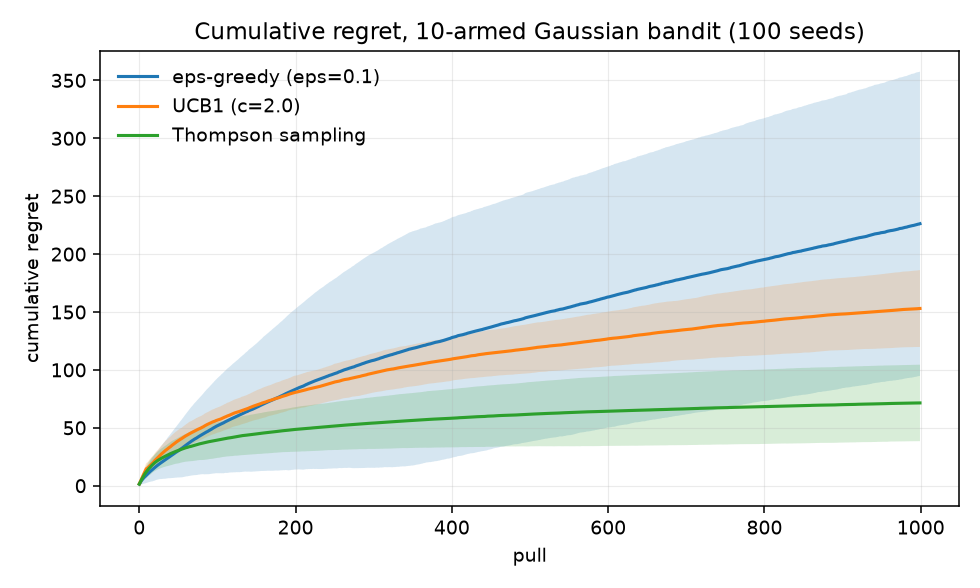
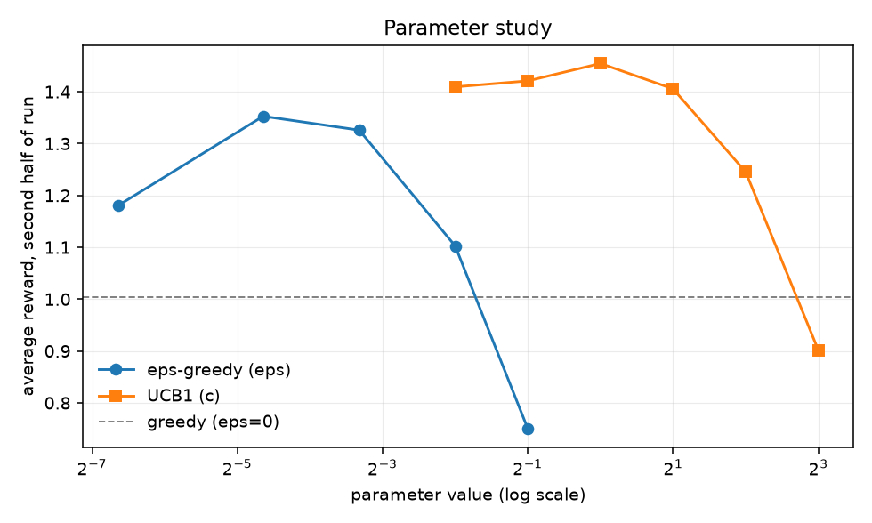
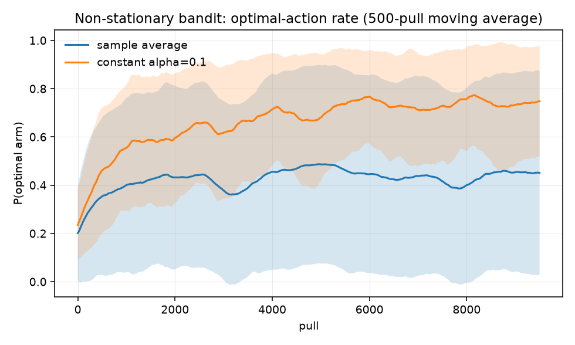

# A1 — Multi-Armed Bandits

**Goal.** The exploration/exploitation tradeoff in its purest form, before state
or function approximation get added.

**Prerequisites.** none — this is the first rung
**Companion lab.** Practical_RL week05_explore
**Compute.** CPU, seconds per run

Checklist items, reading and lab links live in
[`docs/ladder.md`](../../docs/ladder.md#a1). This README is the lab notebook.

## Code

| file | what it holds |
| --- | --- |
| `bandits.py` | `GaussianBandit`, `RandomWalkBandit`, the three agents, and `run_episode` |
| `run_comparison.py` | item 1 — the three agents head to head |
| `run_sweeps.py` | item 2 — sweeps of eps and the UCB constant |
| `run_nonstationary.py` | item 3 — sample-average vs constant step size under drift |

10-armed Gaussian testbed throughout, per Sutton & Barto ch. 2: `q*(a) ~ N(0,1)`,
`reward ~ N(q*(a), 1)`. Regret is *expected* regret against the best arm's true
mean, so the curves are not contaminated by reward noise.

## How to run

```bash
cd experiments/a1_bandits
python run_comparison.py    --seeds 100 --steps 1000     # ~13 s
python run_sweeps.py        --seeds 100 --steps 1000     # ~41 s
python run_nonstationary.py --seeds 100 --steps 10000    # ~65 s
```

## Results

All figures are mean ±1 std over **100 seeds**.

### Item 1 — three agents on a stationary bandit

`comparison__20260906-232044`, 1000 pulls.

| agent | final regret | opt. action (last 100) |
| --- | --- | --- |
| eps-greedy (eps=0.1) | 226.2 ± 131.4 | 0.840 |
| UCB1 (c=2) | 153.0 ± 33.2 | 0.855 |
| **Thompson sampling** | **71.5 ± 33.0** | **0.923** |



### Item 2 — parameter sweeps

`sweeps__20260906-232103`, 1000 pulls. Tail reward is the mean reward over the
second half of the run.

| eps | final regret | tail reward | | c | final regret | tail reward |
| --- | --- | --- | --- | --- | --- | --- |
| 0 (greedy) | 484.2 | 1.004 | | 0.25 | 88.0 | 1.409 |
| 0.01 | 359.2 | 1.180 | | 0.5 | 79.5 | 1.421 |
| **0.04** | **205.4** | **1.353** | | **1.0** | **62.1** | **1.454** |
| 0.1 | 226.2 | 1.326 | | 2.0 | 153.0 | 1.405 |
| 0.25 | 409.2 | 1.102 | | 4.0 | 376.3 | 1.245 |
| 0.5 | 751.5 | 0.750 | | 8.0 | 729.1 | 0.902 |



### Item 3 — non-stationary bandit

`nonstationary__20260906-232150`, 10 000 pulls, all arms starting at 0 and taking
independent random walks with `walk_std=0.01`. Both agents are eps-greedy with
eps=0.1; the only difference is the update rule.

| update rule | final regret | opt. action, first 10% | last 10% |
| --- | --- | --- | --- |
| sample average | 3301.9 ± 1687.3 | 0.278 | 0.452 |
| **constant alpha=0.1** | **1520.4 ± 193.7** | 0.348 | **0.741** |



## Findings

**Both sweeps are cleanly inverted-U, and the optima are not the textbook
defaults.** eps peaks at 0.04 and UCB's c at 1.0 — not the c=2 that gets quoted
as standard. c=2 more than doubles the regret of c=1 here (153 vs 62). The
"right" constant is horizon-dependent: c=2 explores at a rate that only pays off
over a longer run than 1000 pulls, and the sweep is measuring that, not a
property of UCB.

**Under-exploration is punished at this horizon, not just over-exploration.**
eps=0.01 (359) does worse than eps=0.1 (226) despite being closer to the
asymptotically-better setting. It has not finished identifying the best arm by
step 1000. Pure greedy is worst of all at 484 — it locks onto whatever looked
good first and never revisits.

**Thompson sampling wins on both mean and variance**, at 71.5 ± 33.0 against
eps-greedy's 226.2 ± 131.4. The variance gap is the more interesting half:
eps-greedy's exploration is a fixed random tax that never adapts, so different
seeds diverge wildly, while TS's exploration shrinks automatically as posteriors
sharpen. Comparing only mean regret would have hidden this — worth remembering
for A3/A4, where single-seed curves are the norm in papers.

**The non-stationary result is not subtle.** Sample averaging weights the reward
from pull 1 exactly as heavily as the reward from pull 9 999, so once the arms
drift its estimates describe a world that no longer exists: 45% optimal actions
at the end, barely above its own early-run rate, versus 74% for constant alpha.

The band on that plot is the real story. The sample-average agent's spread covers
almost the whole 0–1 range (final regret std 1687 against constant alpha's 194) —
it is not uniformly mediocre, it locks onto whichever arm happened to be best
early and then either gets lucky as the walk favours it or never recovers. That
is a **bias toward stale information**, not a variance problem, and no amount of
extra seeds fixes it. It is also the same failure mode that makes a replay buffer
dangerous in A3 once the policy has moved on.
