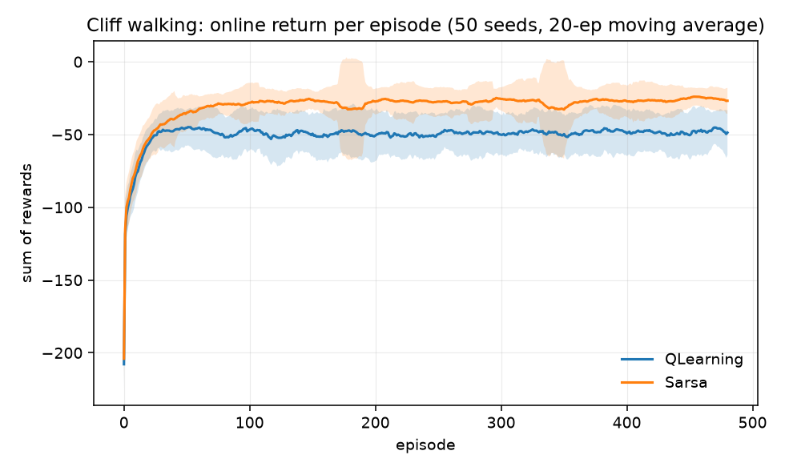
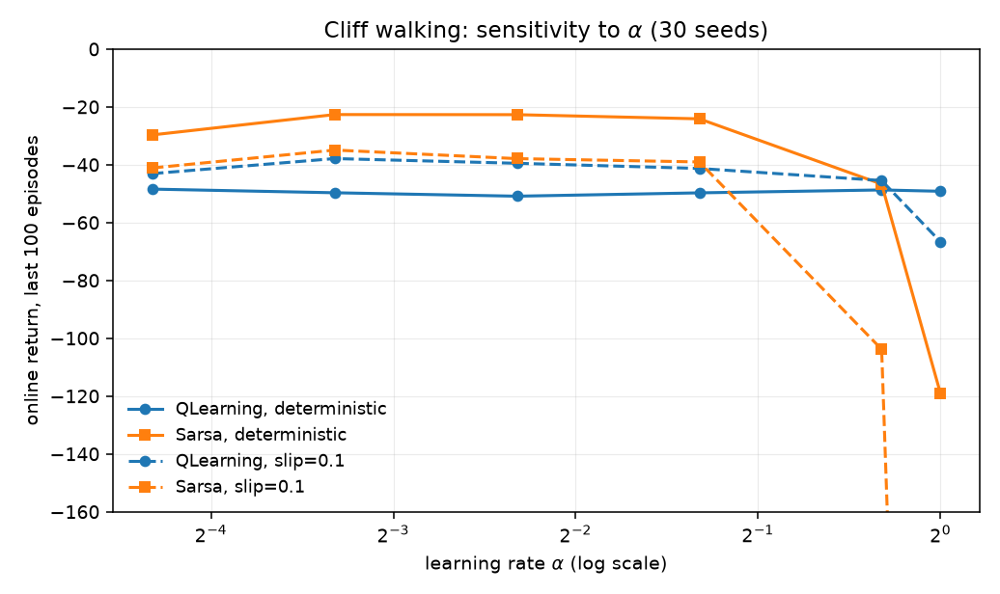
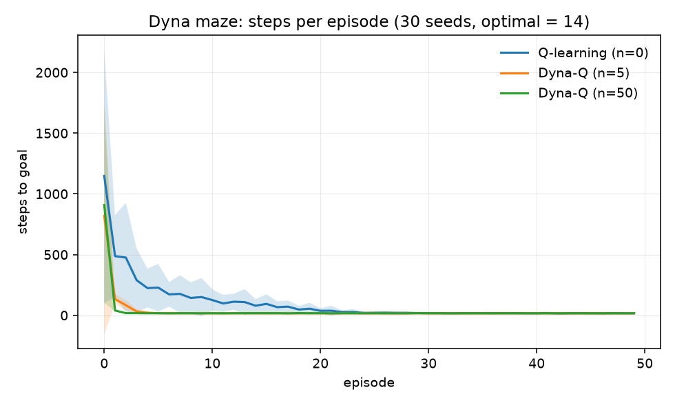

# A2 — Tabular RL: Q-Learning & SARSA

**Goal.** The on-policy/off-policy distinction concretely, and why TD
bootstrapping trades bias for variance reduction.

**Prerequisites.** A1
**Companion lab.** Practical_RL week02_value_based, week03_model_free
**Compute.** CPU, seconds to minutes per run

Checklist items, reading and lab links live in
[`docs/ladder.md`](../../docs/ladder.md#a2). This README is the lab notebook; the
reasoning — the Bellman operator, why PI needs a discount, and why SARSA needs a
smaller learning rate than Q-learning even without stochasticity — is in
[`docs/writeups/a2-tabular.md`](../../docs/writeups/a2-tabular.md).

## Code

| file | what it holds |
| --- | --- |
| `mdp.py` | `TabularMDP`, value iteration, exact policy evaluation, policy iteration |
| `gridworld.py` | one layout language for every env here, exposing both a model and `reset`/`step` |
| `td.py` | `QLearning`, `Sarsa`, `DynaQ`, and the training loop |
| `run_dp.py` | item 1 — DP, verified two independent ways |
| `run_cliff.py` | item 2 — Q-learning vs SARSA at a hazard |
| `run_sweeps.py` | item 3 — gamma on a corridor MDP, alpha on the cliff |
| `run_dyna.py` | item 4 — planning steps vs plain Q-learning |

The DP solvers read `GridWorld.to_mdp()`; the TD agents only ever call
`reset`/`step`. Same dynamics, so the comparison is honest.

## How to run

```bash
cd experiments/a2_tabular
python run_dp.py                                     # <1 s
python run_cliff.py  --seeds 50 --episodes 500       # ~60 s
python run_sweeps.py --seeds 30 --episodes 500       # ~13 min
python run_dyna.py   --seeds 30 --episodes 50        # ~27 s
```

## Results

### Item 1 — value iteration and policy iteration

`dp__20260906-233741`.

| check | result |
| --- | --- |
| deterministic grid, gamma=1: `V* == -BFS distance` | **exact match**, VI in 9 sweeps |
| slip=0.2, gamma=0.99: `max abs(V_VI - V_PI)` | 5.79e-13 |
| policies identical | yes |
| Bellman optimality residual | 3.25e-13 |
| iterations | VI 45 sweeps, PI 6 improvement steps |

### Item 2 — Q-learning vs SARSA on the cliff

`cliff__20260906-234222`, 50 seeds, 500 episodes, alpha=0.5, eps=0.1, gamma=1.
DP says the optimal return from the start is **-13.0**.

| agent | online return (last 100 ep) | greedy return, median | mean | reaches goal | optimal |
| --- | --- | --- | --- | --- | --- |
| Q-learning | -48.6 ± 6.4 | **-13.0** | -13.0 | 100% | **100%** |
| SARSA | **-26.3 ± 6.3** | -17.0 | -53.7 | 80% | 0% |

```
Q-learning greedy policy          SARSA greedy policy
>^>>>>>v>v>v                      >>>>>>>>>>>v
v>>v>>>v>v>v                      ^>^>>^^^^>>v
>>>>>>>>>>>v   <- hugs the cliff  ^>^^^^^^^>>v   <- routes a row higher
^CCCCCCCCCCG                      ^CCCCCCCCCCG
```



### Item 3 — sweeping gamma and alpha

`sweeps__20260906-234327`, 30 seeds.

**gamma** (DP on the corridor MDP; analytic switch at `(1/10)^(1/4) = 0.5623`):

| gamma | 0.5 | 0.55 | 0.56 | 0.57 | 0.6 | 0.8 |
| --- | --- | --- | --- | --- | --- | --- |
| Q(far) | 0.625 | 0.915 | 0.983 | 1.056 | 1.296 | 4.096 |
| choice | near | near | near | **far** | far | far |

Every swept value agreed with the analytic prediction.

**alpha** (online return, last 100 of 500 episodes):

| alpha | 0.05 | 0.1 | 0.2 | 0.4 | 0.8 | 1.0 |
| --- | --- | --- | --- | --- | --- | --- |
| Q-learning, deterministic | -48.4 | -49.7 | -50.9 | -49.7 | -48.7 | -49.2 |
| Q-learning, slip 0.1 | -43.1 | **-37.9** | -39.5 | -41.3 | -45.5 | -66.6 |
| SARSA, deterministic | -29.7 | **-22.7** | -22.7 | -24.1 | -46.7 | -118.9 |
| SARSA, slip 0.1 | -41.1 | **-34.9** | -37.9 | -39.0 | -103.8 | -688.7 |



### Item 4 — Dyna-Q

`dyna__20260906-235336`, 30 seeds on the S&B maze (optimal path 14 steps).
Every arm takes the same number of *real* environment steps.

| planning steps | steps in episode 2 | final episode | episodes to within 20% of optimal |
| --- | --- | --- | --- |
| n=0 (Q-learning) | 487.4 | 17.4 | 43 |
| n=5 | 133.5 | 16.7 | 12 |
| **n=50** | **39.8** | 16.7 | **7** |



## Findings

**Q-learning learns the better policy and earns the worse return, in the same
run.** Its greedy policy is optimal in 100% of seeds (-13, matching DP exactly)
while its online return is -48.6; SARSA's online return is nearly twice as good
at -26.3 but its greedy policy never once found the optimum. The max in
Q-learning's target evaluates a greedy policy the agent is not following — with
eps=0.1 it walks the cliff edge and falls in one step out of ten. SARSA's target
contains the same eps the behaviour uses, so it prices the exploration and steps
away from the hazard. Reporting only one of these two numbers would have told
the opposite story about which algorithm "won".

**SARSA's extracted greedy policy can contain an absorbing loop** (10 of 50
seeds, which is why the table reports a median). In the top row SARSA values
"up" — a wall bump that does nothing — at -12.33, above every real move. Under an
eps-greedy policy that is defensible: staying put is safe and exploration will
shake you loose. Set eps=0 and the same state becomes a trap. SARSA evaluates the
policy it follows, so **the greedy policy you extract is not the policy it
evaluated**. Q-learning's max makes wall-bumping strictly worse than progress
wherever it has data, so its greedy policy is coherent by construction.

**gamma is part of the problem, not a tuning knob.** On the corridor the optimal
action flips between gamma=0.56 and 0.57, straddling the analytic threshold
0.5623 — sweeping it does not find a better solution, it changes which solution
is correct.

**alpha's job depends on the algorithm, not just the environment.** Q-learning on
the deterministic cliff is flat across the whole alpha range including 1.0: its
target is a deterministic function of (s,a), so there is nothing for a small
alpha to average. SARSA on the *same deterministic environment* degrades from
-22.7 to -118.9 over the same range, because its target bootstraps from an
eps-greedy action — the exploration itself is the noise. Add slip and SARSA at
alpha=1 collapses to -688.7 as the two noise sources compound.

**Dyna-Q's gain is entirely credit propagation.** One-step Q-learning moves value
backward one state per real transition, so goal information crawls along the path
at roughly one cell per episode — hence 43 episodes to converge. Fifty planning
steps do that crawling in memory between real steps, reaching the same policy in
7 episodes on identical environmental experience. The catch to remember in A3:
the model is deterministic and trusted absolutely, so in a changing environment
those replays rehearse transitions that no longer happen — A1's
stale-information failure again, with the agent now generating the staleness.
