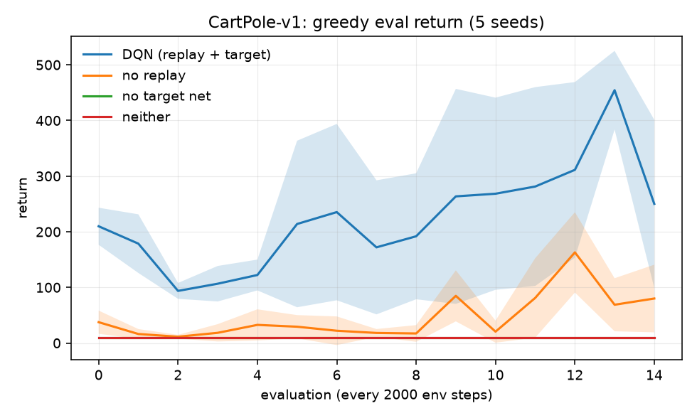
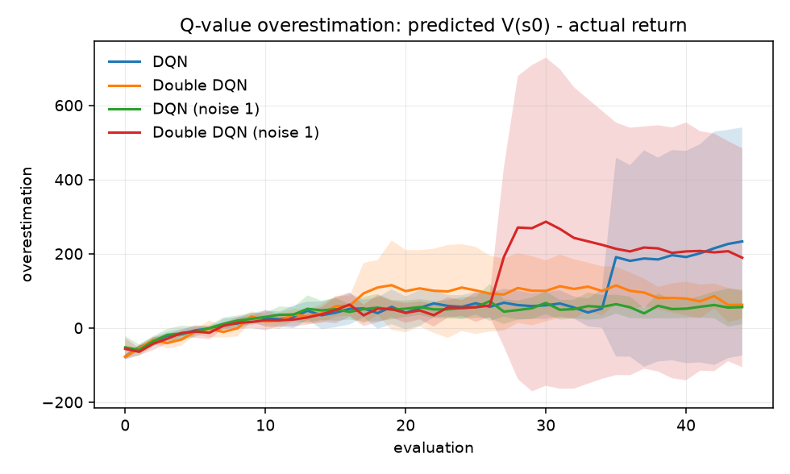
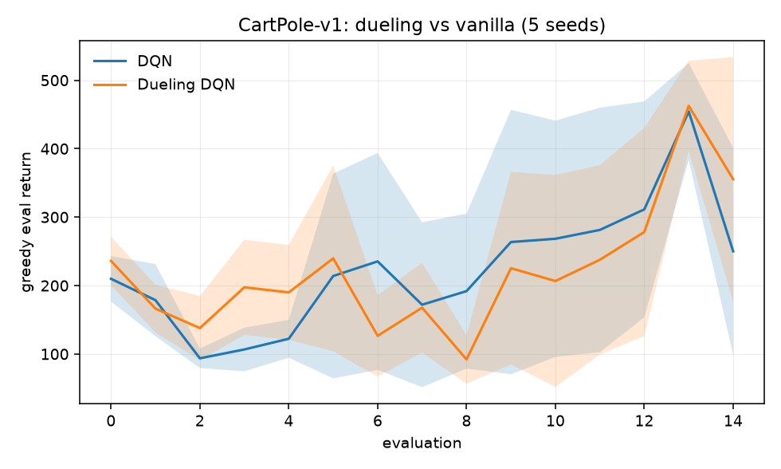

# A3 — Value-Function Approximation: DQN

**Goal.** The "deadly triad" (bootstrapping + off-policy + function
approximation) and which fix addresses which part of it.

**Prerequisites.** A2
**Companion lab.** Practical_RL week04_approx_rl
**Compute.** CPU. ~70 s per 30k-step run; runs parallelise across processes.

Checklist items, reading and lab links live in
[`docs/ladder.md`](../../docs/ladder.md#a3). This README is the lab notebook; the
reasoning — why the table has to go, what each stabiliser attacks, and the
Jensen argument behind the max operator's bias — is in
[`docs/writeups/a3-dqn.md`](../../docs/writeups/a3-dqn.md).

## Code

| file | what it holds |
| --- | --- |
| `dqn.py` | `QNetwork` (optionally dueling), `ReplayBuffer`, and `train` with four switches |
| `run_ablation.py` | item 1 — replay and target network removed independently |
| `run_double.py` | item 2 — Double DQN, on stock and reward-noised CartPole |
| `run_dueling.py` | item 3 — dueling vs vanilla at equal environment steps |

One agent, four flags (`replay`, `target_network`, `double`, `dueling`). Every
arm of every item is the same code path, so no comparison can be contaminated by
an incidental implementation difference.

## How to run

```bash
cd experiments/a3_dqn
python run_ablation.py --seeds 5 --steps 30000    # ~13 min on 4 cores
python run_double.py   --seeds 5 --steps 90000    # ~40 min
python run_dueling.py  --seeds 5 --steps 30000    # ~7 min
```

## Reference points for CartPole-v1

Measured, not assumed — they are what makes the item 1 result readable:

| policy | return |
| --- | --- |
| random | 22.7 ± 11.4 |
| always push left | 9.4 |
| always push right | 9.2 |
| time limit (maximum) | 500 |

## Results

### Item 1 — ablating replay and the target network

`ablation__20260907-210256`, 5 seeds, 30k steps, greedy evaluation.
*Retention* is final ÷ peak: the signature of instability is a high peak
followed by collapse.

| arm | final eval return | peak | retention |
| --- | --- | --- | --- |
| DQN (replay + target) | **250.1 ± 151.2** | 469.4 | 0.56 |
| no replay | 80.0 ± 60.8 | 179.5 | 0.50 |
| no target net | 9.2 ± 0.2 | 9.2 | 1.00 |
| neither | 9.1 ± 0.2 | 9.1 | 1.00 |



### Item 2 — Double DQN

Run twice. At **30k steps** (`double__20260907-210628`) every arm sat near zero
bias and nothing was distinguishable — see the findings for why that was the
wrong measurement window. At **90k steps** (`double__20260907-213008`, 5 seeds)
the bias is large and the arms separate.

Value divergence is heavy-tailed, so the median is the headline and every seed
is listed. With gamma=0.99 the largest achievable discounted return is ~99, so a
bias above that means the estimates exceed anything the environment can pay.

| arm | median bias | mean bias | bias per seed | median return |
| --- | --- | --- | --- | --- |
| DQN | +96.7 | +233.1 | 151, 97, 46, **841**, 30 | 90.2 |
| Double DQN | **+44.6** | +62.3 | 129, 45, 22, 40, 76 | **166.2** |
| DQN (reward noise 1) | +42.0 | +56.2 | 42, 147, 24, 45, 23 | 491.3 |
| Double DQN (reward noise 1) | +43.0 | +189.2 | 28, 34, 43, **779**, 62 | 147.0 |



### Item 3 — dueling architecture

`dueling__20260907-211350`, 5 seeds, 30k steps. Sample efficiency is steps to
first reach a greedy eval return of 400. A seed that never reaches it is
*censored*, not missing — dropping it would flatter the arm that failed more
often, so both medians are reported.

| arm | final | AUC | steps to 400, median (reached only) | median (censored at run end) | seeds reaching |
| --- | --- | --- | --- | --- | --- |
| DQN | 250.1 | **223.6** | 17000 | 20000 | 4/5 |
| Dueling DQN | **355.3** | 221.3 | 28000 | 28000 | **5/5** |

Per-seed steps to threshold — DQN `[28000, 12000, 14000, 20000, never]`,
dueling `[28000, 28000, 28000, 12000, 20000]`.



### Item 4 — Atari

Not run (it wants a GPU), but items 2 and 3 have changed why it matters — see
the last finding below. It is no longer "a scale demonstration with no new
concept"; it is the environment where items 2 and 3 would actually resolve.

## Findings

**Removing the target network is not a degradation, it is a collapse.** The
no-target arm scores 9.2 — and "always push right" scores exactly 9.2, while
random scores 22.7. The agent is not playing badly; its Q-function has
degenerated so that one action's value dominates in every state, making the
greedy policy constant. That is what divergence looks like from the outside, and
it is *worse than not learning at all*: a random policy would have scored 2.5×
higher.

**Removing replay is bad but not fatal** (80.0, against 250.1 with everything).
The no-replay agent does learn — it reaches 179 at its peak — it just learns
slowly and erratically, because each gradient step sees one correlated sample
and immediately forgets it. The ordering matters: **the two stabilisers are not
interchangeable**, and the one that prevents catastrophe is the one that
addresses bootstrapping, not the one that addresses data correlation.

**Even full DQN is unstable.** It peaks at 469 and ends at 250, retaining 56% of
its own best, with a final standard deviation of 151 across seeds — larger than
the mean-to-peak gap. Reporting only the final number would call this a 250-point
agent; reporting only the peak would call it a solved environment. Neither is
true, and the retention column exists so the summary cannot hide it.

**A note on what the ablation is.** The "no target net" arm is not a strawman: it
is the configuration of the 2013 NIPS workshop DQN, which had experience replay
but no target network. The gap between the two arms is the gap between that
paper and the 2015 Nature one.

**Dueling bought no sample efficiency here — and the reason is structural.** It
was *slower* to first reach 400 (median 28000 against DQN's 20000 with the
failing seed censored), while ending higher (355 vs 250) and reaching the
threshold on 5 seeds out of 5 rather than 4. Area under the learning curve is
identical to within noise (221.3 vs 223.6), which says the two learned the same
total amount over the run.

The explanation is in the architecture's own argument. A shared value stream pays
off when many actions have similar value, so that estimating "how good is this
state" once beats estimating it separately per action. **CartPole has two
actions.** There is almost nothing for the advantage stream to disentangle, and
the benefit should scale with the size of the action space — Wang et al.
demonstrated it on Atari, where there are up to 18. This is the worst case for
the method, and the result is what the theory predicts, not a contradiction of
it.

**Item 2's first run measured in the wrong window.** At 30k steps every arm sat
within noise of zero bias, and the natural conclusion would have been "no
effect". The curve shows why that was wrong: all four arms *start* around -80,
badly **under**estimating because the network has not finished learning, and only
cross zero at roughly 16-20k steps. The 30k run stopped almost exactly at the
crossing point. Overestimation is not a property of the algorithm that is present
from the start — it is what the max operator does once the estimates are good
enough for its bias to dominate, and measuring before that shows nothing.

**At 90k steps, Double DQN halves the typical overestimation** on stock CartPole
(median +96.7 to +44.6) and nearly doubles the median return (90 to 166). That is
the predicted direction. On the reward-noised variant the medians are
indistinguishable (+42.0 vs +43.0), so the effect did not reproduce there.

**But the dominant phenomenon is not the algorithm — it is per-seed divergence,
and it hits both.** One DQN seed ends at +841 and one Double DQN (noise) seed at
+779, against medians in the 20-150 range and a theoretical maximum of ~99. Both
blow-ups are seed index 3. Double DQN reduces the *typical* bias; it does not
prevent catastrophic value divergence.

This also matters for how the run was nearly reported. The means alone say
"Double DQN is three times worse on noisy CartPole" (189 vs 56) — an artifact of
one seed out of five. That is the second time in this phase that an
outlier-blind summary statistic pointed the wrong way; the first was the
censored median in item 3. Both are now fixed at the source, with per-seed values
recorded.

**And DQN got worse with more training.** Its eval return was 250 at 30k steps
and 90 at 90k, while its value estimates climbed past what the environment can
pay. Longer training did not converge it — it diverged it. That is the deadly
triad doing exactly what section 3 of the writeup predicts, and it is worth
remembering next time a training curve is extrapolated forward.

**Both item 2 and item 3 failed to show their effect cleanly for the same
underlying reason, and that revises the plan.** The overestimation Double DQN targets needs value
noise and a long horizon; the efficiency dueling targets needs a large action
space. CartPole supplies neither. Item 4 — Atari — is exactly where both
conditions hold, which is why both original papers used it. It was written off
above as a scale demonstration; it is better described as **the testbed that
would make items 2 and 3 conclusive**, and it should be revisited if a GPU
becomes available rather than dropped.
