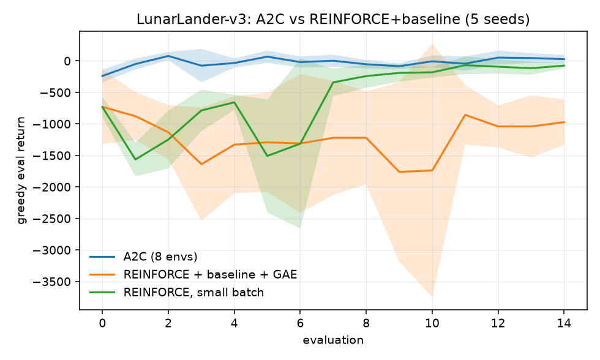

# A4 — Policy Gradient & Actor-Critic

**Goal.** The policy-gradient theorem — the throughline connecting almost every
algorithm in Part B.

**Prerequisites.** A3 (for the DQN comparison)
**Companion lab.** Practical_RL week06_policy_based
**Compute.** CPU. CartPole runs are seconds; LunarLander ~2 min per run.

Checklist items, reading and lab links live in
[`docs/ladder.md`](../../docs/ladder.md#a4). This README is the lab notebook; the
derivation of the policy-gradient theorem, why the baseline is provably free,
and the GAE telescoping argument are in
[`docs/writeups/a4-policy-gradient.md`](../../docs/writeups/a4-policy-gradient.md).

## Algorithms as implemented

**Estimator.** All arms are the same gradient with different advantage
estimates:

$$\nabla_\theta J(\theta) = \mathbb{E}\left[\nabla_\theta \log \pi_\theta(a_t \mid s_t)\, \hat{A}_t\right]$$

realised as the loss
$-\frac{1}{N}\sum_t \log \pi_\theta(a_t \mid s_t)\,\tilde{A}_t - \beta\,\mathcal{H}[\pi_\theta]$,
with $\tilde{A}$ the batch-normalised advantage and $\beta = 0.01$.

**Advantage estimates**, the only thing that differs between arms:

| arm | $\hat{A}_t$ |
| --- | --- |
| REINFORCE | $G_t$, the discounted reward-to-go |
| + baseline | $G_t - V_\phi(s_t)$ |
| + GAE($\lambda$) | $\sum_{l \ge 0} (\gamma\lambda)^l \delta_{t+l}$, $\;\delta_t = r_t + \gamma V_\phi(s_{t+1}) - V_\phi(s_t)$ |

**Critic.** Fitted by regression onto the returns,
$\phi \leftarrow \arg\min_\phi \sum_t (V_\phi(s_t) - G_t)^2$, with its own
optimiser and 40 gradient steps per batch — one shared step leaves it unfitted
(explained variance $\approx 0$) and the baseline then subtracts noise.

**A2C.** $N = 8$ environments stepped synchronously, updated every $n = 5$
steps, GAE computed per environment column with the truncated tail bootstrapped
from $V_\phi(s_N)$. Parallel environments decorrelate the batch without a replay
buffer, which on-policy methods cannot use.

**Reported.** Greedy evaluation takes $\arg\max_a \pi_\theta(a \mid s)$, matching
A3's protocol exactly. Advantage spread is recorded *before* normalisation,
since normalising rescales exactly the quantity $\lambda$ controls.

## Code

| file | what it holds |
| --- | --- |
| `pg.py` | `ActorCritic`, `discounted_returns`, `gae`, `train_reinforce`, `train_a2c` |
| `run_reinforce.py` | item 1 — REINFORCE against the A3 DQN baseline |
| `run_gae.py` | item 2 — the lambda sweep |
| `run_a2c.py` | item 3 — A2C vs REINFORCE on LunarLander |

## How to run

```bash
cd experiments/a4_policy_gradient
python run_reinforce.py --seeds 5 --steps 30000     # ~1 min
python run_gae.py       --seeds 5 --steps 30000     # ~4 min
python run_a2c.py       --seeds 5 --steps 300000    # ~20 min
```

## Results

### Item 1 — REINFORCE vs the A3 DQN

`reinforce__20260908-175136`. Identical protocol to A3: CartPole-v1, 30k
environment steps, greedy eval every 2000, 5 seeds.

| agent | final | peak | retention | advantage std |
| --- | --- | --- | --- | --- |
| REINFORCE | 333.4 ± 119.0 | 489.3 | 0.68 | 22.6 |
| REINFORCE + baseline | **450.9 ± 98.2** | 500.0 | **0.90** | 15.9 |
| DQN (A3 reference) | 250.1 ± 151.2 | 469.4 | 0.56 | — |

### Item 2 — the GAE lambda sweep

`gae__20260908-175211`, 5 seeds, 30k steps. Advantage std is measured before
normalisation; explained variance is the critic's fit, $1 - \mathrm{Var}(G - V)/\mathrm{Var}(G)$.

| arm | final eval return | advantage std | explained variance |
| --- | --- | --- | --- |
| no baseline | 333.4 ± 119.0 | 22.63 | — |
| GAE λ=0 | **20.8 ± 8.4** | **2.20** | 0.05 |
| GAE λ=0.5 | 394.6 ± 150.0 | 2.95 | 0.21 |
| GAE λ=0.9 | 363.0 ± 148.8 | 5.53 | 0.46 |
| GAE λ=0.95 | 435.7 ± 69.6 | 7.76 | 0.53 |
| **GAE λ=0.99** | **478.8 ± 26.0** | 12.54 | 0.47 |
| GAE λ=1 | 450.9 ± 98.2 | 15.86 | 0.43 |

### Item 3 — A2C vs REINFORCE on LunarLander

`a2c__20260908-180047`, 5 seeds, 300k environment steps. *Swing* is the mean
absolute change in eval return between consecutive evaluations — a measure of
how much the policy thrashes, independent of its level.

The third arm is a control. At equal environment steps the two algorithms do not
take equal numbers of gradient steps: A2C updates every $N \times n = 40$ steps,
while episodic REINFORCE updates once per 4000-step batch. That is a 100×
difference, and without holding it down the comparison measures batch size as
much as algorithm.

| arm | final | peak | swing | gradient updates |
| --- | --- | --- | --- | --- |
| A2C (8 envs) | **27.6 ± 65.4** | **165.7** | **115.3** | 7500 |
| REINFORCE + baseline + GAE | −972.2 ± 359.5 | −236.4 | 571.1 | 75 |
| REINFORCE, small batch (1000) | −75.6 ± 41.0 | −21.2 | 428.2 | 300 |



Per-seed finals — A2C `[111.5, 46.0, 60.8, -83.4, 3.0]`, REINFORCE
`[-809.5, -1568.6, -475.8, -914.9, -1091.9]`, small-batch REINFORCE
`[-106.1, -41.9, -35.5, -53.8, -140.7]`.

## Findings

**Both policy-gradient arms beat DQN, including on variance.** That runs against
the usual framing, so two things belong with it. First, "high variance" in the
textbook sense describes the *gradient estimator*, not the spread of outcomes
across seeds — and the estimator variance is exactly what the advantage-std
column shows (22.6 without a baseline, 15.9 with). DQN's spread of ±151 comes
from a different failure entirely: divergence, which A3 documented directly.
Second, both are lightly tuned at an equal 30k-step budget; a well-tuned DQN
solves CartPole reliably. The honest claim is about these implementations at
this budget, not about the algorithm families.

**The baseline is free and it works.** Advantage spread falls 30% (22.6 → 15.9)
while final return rises (333 → 451) and retention goes from 0.68 to 0.90. The
theory says subtracting $V(s)$ cannot change the gradient in expectation because
$\mathbb{E}_a[\nabla \log \pi_\theta \cdot b(s)] = b(s)\nabla_\theta 1 = 0$; the
experiment says it changes the variance a lot. Both are true and that is the
point.

**The lambda sweep is the bias/variance tradeoff, measured on both axes.**
Advantage spread rises monotonically with λ — 2.20, 2.95, 5.53, 7.76, 12.54,
15.86 — which is the variance side, exactly as the estimator predicts, since
larger λ admits more of the sampled return.

The bias side shows up at the bottom end, and violently: **λ=0 scores 20.8**,
barely above a random policy, despite having the lowest variance of any arm. The
one-step residual $\delta_t = r + \gamma V(s') - V(s)$ is only a good advantage
estimate if $V$ is accurate, and the critic's explained variance is 0.05 — so
the arm with the cleanest signal is estimating almost entirely its own critic's
error. Minimum variance is worthless when the thing being estimated is wrong.

Performance peaks at **λ=0.99** (478.8), with the *lowest* seed spread (±26.0)
of the entire sweep, and λ=1 is slightly worse (450.9 ± 98.2). So the optimum is
interior on both axes, which is the claim the item is there to test.

**Item 3's headline gap was mostly an artifact, and the control caught it.**
Taken at face value the first two rows say A2C beats REINFORCE by a thousand
points on LunarLander. But simply shrinking REINFORCE's batch from 4000 to 1000
— same algorithm, same environment steps, four times as many updates — recovers
about 900 of those points (−972 → −76). So the overwhelming majority of the
"algorithmic" gap was the update count.

What survives the control is real but much smaller: A2C still finishes ahead
(27.6 against −75.6) with a quarter of the thrash (swing 115 against 428), and
it is the only arm whose policies ever reach positive return. Some of that
remaining margin is still update count — A2C takes 25× more updates than even
the small-batch arm — and separating the last of it would need an arm matched on
updates rather than on environment steps.

The honest summary: **A2C's advantage at a fixed environment-step budget comes
substantially from extracting far more gradient steps from the same data**, which
is a consequence of bootstrapping after $n$ steps rather than waiting for
episodes to end. That is the mechanism, not a confound to be embarrassed about —
but it is a different claim from "actor-critic is a better estimator", and the
raw comparison would have supported the wrong one.

**Nothing here solves LunarLander.** The task is considered solved at 200 and
A2C's mean is 27.6 with a peak of 165.7, so this is a comparison between arms
partway up the curve, not between converged agents. At 300k steps that is
expected; A2C typically needs closer to a million.

**A consistency check worth noting:** GAE λ=1 and "REINFORCE + baseline" from
item 1 are the same estimator — the sum telescopes to $G_t - V(s_t)$ — and they
report identical numbers (450.9, advantage std 15.86 against 15.9). Two
independently-configured code paths agreeing to three digits is the kind of
check that catches a class of silent bugs.
