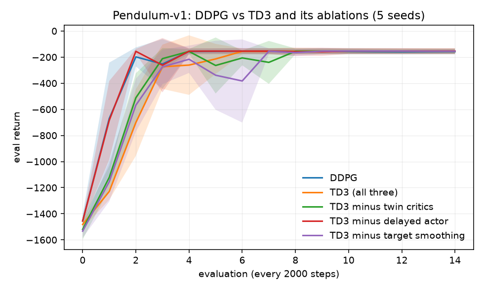
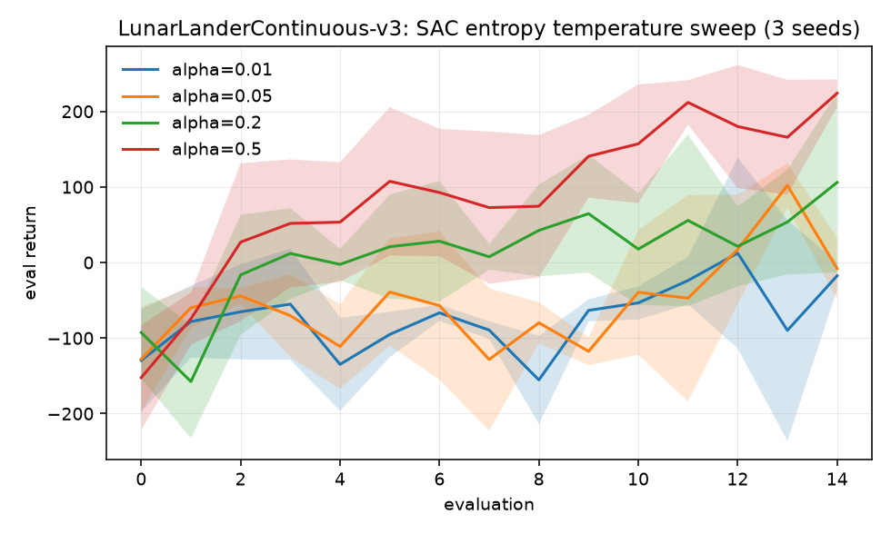
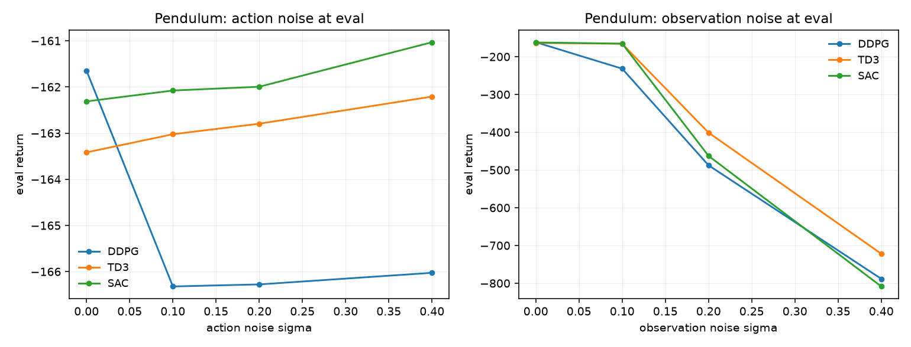

# A5 — Continuous Control (Robotics)

**Goal.** What changes with continuous actions, and why SAC's entropy
maximization tends to produce more robust policies.

**Prerequisites.** A4
**Companion lab.** Practical_RL week09_policy_II
**Compute.** CPU. Pendulum ~3 min per 30k-step run; LunarLanderContinuous ~12 min per 100k.

Checklist items, reading and lab links live in
[`docs/ladder.md`](../../docs/ladder.md#a5). This README is the lab notebook; the
deterministic policy gradient, why the min of twin critics biases downward, SAC's
Boltzmann optimal policy, and the tanh Jacobian correction are in
[`docs/writeups/a5-continuous-control.md`](../../docs/writeups/a5-continuous-control.md).

## Algorithms as implemented

**The problem.** With $a \in \mathbb{R}^d$, $\arg\max_a Q(s,a)$ is a non-convex
optimisation solved afresh every step and for every batch element. DDPG learns
the maximiser instead and updates it through the critic:

$$\nabla_\theta J = \mathbb{E}_s\!\left[\nabla_a Q_\phi(s,a)\big|_{a=\mu_\theta(s)}\,\nabla_\theta \mu_\theta(s)\right]$$

**Critic target**, which is where all three algorithms differ:

$$y_{\text{DDPG}} = r + \gamma(1-d)\,Q_{\phi'}\!\left(s', \mu_{\theta'}(s')\right)$$

$$y_{\text{TD3}} = r + \gamma(1-d)\min_{i}Q_{\phi_i'}\!\left(s', \mu_{\theta'}(s') + \mathrm{clip}(\epsilon,-c,c)\right)$$

$$y_{\text{SAC}} = r + \gamma(1-d)\left[\min_i Q_{\phi_i'}(s',a') - \alpha \log \pi_\theta(a'\mid s')\right],\quad a' \sim \pi_\theta$$

**TD3's three fixes are separate flags** (`twin_critics`, `policy_delay=2`,
`target_noise=0.2`), so each can be removed from the full algorithm.

**SAC's actor** is a squashed Gaussian, reparameterised, with the change-of-
variables correction that the tanh requires:

$$\log \pi(a\mid s) = \log \mathcal{N}(u \mid \mu_\theta, \sigma_\theta) - \sum_i \log\!\left(1 - \tanh^2(u_i)\right)$$

**Shared:** target networks with polyak $\tau = 0.005$, Adam at $3\times10^{-4}$,
batch 256, buffer 100k, $\gamma = 0.99$.

**Value-bias probe** (carried from A3): predicted $Q(s_0,a_0)$ minus the
discounted return the policy actually collects, averaged over the second half of
training. Twin critics exist to improve exactly this quantity.

## Code

| file | what it holds |
| --- | --- |
| `continuous.py` | actors, critics, replay buffer, and one `train` with all switches |
| `run_ddpg_td3.py` | items 1–2 — DDPG vs TD3, plus TD3 with each fix removed |
| `run_sac.py` | item 3 — entropy-temperature sweep on LunarLanderContinuous |
| `run_noise.py` | item 4 — action and observation noise at evaluation |

## How to run

```bash
cd experiments/a5_continuous_control
python run_ddpg_td3.py --seeds 5 --steps 30000     # ~30 min
python run_noise.py    --seeds 5 --steps 30000     # ~50 min
python run_sac.py      --seeds 3 --steps 100000    # ~25 min
```

## Results

### Items 1–2 — DDPG, TD3, and which fix does the work

`ddpg_td3__20260908-224854`, Pendulum-v1, 5 seeds, 30k steps. *Bias* is the
value probe over the second half; *swing* is the mean absolute change in eval
return between consecutive evaluations.

| arm | final return | peak | **value bias** | swing | per-seed final |
| --- | --- | --- | --- | --- | --- |
| DDPG | −158.5 ± 18.7 | −152.3 | **+26.3** | 102.7 | −161, −146, −145, −194, −147 |
| TD3 (all three) | −154.5 ± 21.3 | −152.0 | **−9.8** | 114.6 | −143, −143, −145, −197, −144 |
| TD3 − twin critics | −155.9 ± 20.7 | −153.6 | **+7.6** | 129.7 | −144, −144, −148, −197, −147 |
| TD3 − delayed actor | −153.7 ± 21.5 | −152.3 | −11.2 | 109.4 | −141, −141, −147, −197, −143 |
| TD3 − target smoothing | −155.3 ± 21.1 | −153.0 | −0.1 | 143.8 | −142, −147, −147, −197, −144 |



### Item 3 — SAC entropy temperature

`sac_alpha__20260908-235035`, LunarLanderContinuous-v3, 3 seeds, 100k steps.
The task is considered solved at 200.

| alpha | final return | peak | per-seed final |
| --- | --- | --- | --- |
| 0.01 | −17.6 ± 18.0 | 50.6 | −24, 7, −36 |
| 0.05 | −8.1 ± 40.7 | 102.1 | −16, −54, 45 |
| 0.2 | 106.0 ± 119.1 | 120.1 | −20, 72, 266 |
| **0.5** | **224.1 ± 18.3** | **230.3** | 221, 203, 248 |



### Item 4 — noise at evaluation

`noise__20260908-232414`, Pendulum, 5 seeds, trained clean and perturbed only at
evaluation.

| sigma | 0 | 0.1 | 0.2 | 0.4 | drop |
| --- | --- | --- | --- | --- | --- |
| **action noise** | | | | | |
| DDPG | −161.6 | −166.3 | −166.3 | −166.0 | 4.4 |
| TD3 | −163.4 | −163.0 | −162.8 | −162.2 | −1.2 |
| SAC | −162.3 | −162.1 | −162.0 | −161.0 | −1.3 |
| **observation noise** | | | | | |
| DDPG | −161.6 | −231.7 | −487.7 | −788.3 | 626.7 |
| TD3 | −163.4 | −165.8 | −401.1 | −721.9 | **558.5** |
| SAC | −162.3 | −165.3 | −462.7 | −808.5 | 646.2 |



## Findings

**The ablation attributes TD3's benefit to one fix, and the metric that shows it
is not return.** All five arms finish within 5 points of each other (−153.7 to
−158.5, against a seed spread of ±20), so on Pendulum at this budget the
*performance* comparison is a null result — the task is too easy to separate
them. The value bias is not a null result at all:

| arm | bias | change vs full TD3 |
| --- | --- | --- |
| TD3 (all three) | −9.8 | — |
| − twin critics | +7.6 | **+17.4** |
| − target smoothing | −0.1 | +9.7 |
| − delayed actor | −11.2 | −1.4 |
| DDPG (none of them) | +26.3 | +36.1 |

Removing twin critics moves the bias furthest and is the only ablation that
flips its sign back to positive. Removing the delayed actor update changes it by
1.4, which is nothing. That ordering is exactly what the theory predicts:
$\mathbb{E}[\min(X_1,X_2)] \le \min(\mathbb{E}[X_1],\mathbb{E}[X_2])$ makes the
minimum a direct downward correction, smoothing averages the target over a
neighbourhood and so removes spikes indirectly, and the delay is a timescale
argument that says nothing about bias at all.

**So "DDPG is unstable" is, here, a statement about its critic rather than its
returns.** Item 1 asks to note training instability, and the honest answer is
that DDPG's returns were *not* visibly less stable — its swing (102.7) is the
lowest of all five arms, not the highest. What it does show is a critic that
overestimates by +26.3 while every arm carrying twin critics sits near or below
zero. On a task this forgiving the overestimation never gets the chance to
translate into a policy failure, which is worth knowing about Pendulum as a
testbed rather than about DDPG.

**The temperature sweep is monotone, which means it was swept over the wrong
range.** Return rises the whole way from α=0.01 (−17.6) to α=0.5 (224.1), so the
optimum is at or beyond the top of the range and the inverted-U the item expects
is not visible. The right conclusion is that this reward scale wants α ≥ 0.5 and
that a proper sweep should extend upward until performance turns.

That α is scale-dependent is the point rather than an inconvenience: it is a
rate of exchange between reward and nats, so a task whose returns run to
hundreds needs a larger α than one whose returns run to single digits. It is
also why later SAC learns α automatically against a target entropy instead of
exposing it.

The variance is the more striking half. At α=0.2 the seeds land at −20, 72 and
266 (±119); at α=0.5 they land at 221, 203 and 248 (±18). Raising the
temperature cut the across-seed spread by a factor of six while also raising the
mean — so on this task the entropy term is buying reliability, not trading
performance for it.

**Item 4 does not support the robustness folklore.** Under action noise nothing
degrades at all — all three are flat, and TD3 and SAC very slightly *improve*,
which is what happens when small action noise perturbs a policy holding a
pendulum near an unstable equilibrium. Under observation noise everything
collapses, and SAC collapses the most (646.2 against TD3's 558.5 and DDPG's
626.7), which is the opposite of the hypothesis in section 6 of the writeup.

Two honest limits on that. The spread across seeds was not recorded for the
noise sweep, so a 90-point gap between arms whose training returns already vary
by ±20 cannot be called a real difference. And the entropy argument predicts
robustness to perturbations *of the action*, which is the axis where all three
were already flat — an observation perturbation moves the input to the policy,
which is a different failure and one the entropy objective says nothing about.
The experiment as designed tests the wrong axis for the claim it was meant to
check; a sharper version would perturb the dynamics, not the observation.
