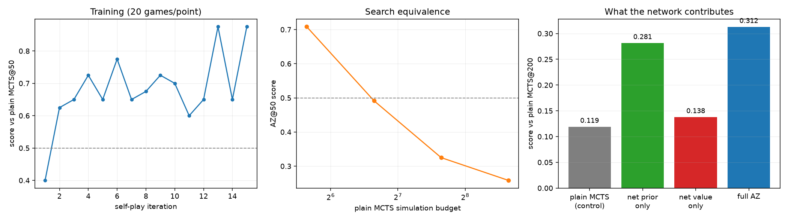

# A6 — Planning & Self-Play: MCTS / AlphaZero

**Goal.** How planning (search) and model-free learning combine — a useful
contrast to GRPO's rollout-averaging in B3.

**Prerequisites.** A4
**Companion lab.** Practical_RL week10_planning, week05_explore
**Compute.** CPU. Item 1 ~3 min; self-play training ~6 min; ablation ~5 min.

Checklist items, reading and lab links live in
[`docs/ladder.md`](../../docs/ladder.md#a6). This README is the lab notebook;
UCT as UCB1-on-a-tree, why its consistency proof is delicate, PUCT, and
search-as-policy-improvement are in
[`docs/writeups/a6-mcts.md`](../../docs/writeups/a6-mcts.md).

## Algorithms as implemented

**Selection.** Plain UCT uses A1's confidence bound applied to tree nodes:

$$\arg\max_a \left[ Q(s,a) + c\sqrt{\frac{\ln N(s)}{N(s,a)}} \right]$$

AlphaZero uses PUCT, where the exploration term is weighted by the prior, so
early search follows the network and later search follows the statistics:

$$\arg\max_a \left[ Q(s,a) + c\,P(s,a)\,\frac{\sqrt{\sum_b N(s,b)}}{1 + N(s,a)} \right]$$

**Backup** negates the value at every ply, since the players alternate.

**Leaf value** is either a uniform random playout to termination, or the
network's value head. **Priors** at expansion are either uniform over legal
moves, or the network's policy head. Both are arguments to `search`, which is
what makes the item-3 cross possible with one implementation.

**Training targets.** Self-play stores $(s, \boldsymbol{\pi}, z)$ where
$\boldsymbol{\pi}$ is the normalised root visit distribution and $z$ the game
result from that position's mover's perspective. The loss is

$$\mathcal{L} = -\boldsymbol{\pi}^\top \log p_\theta(s) + \left(v_\theta(s) - z\right)^2$$

**Board convention.** Always stored from the mover's perspective; `play` flips
the sign. One network serves both players and value targets need no player
index.

**Self-play exploration:** Dirichlet noise ($\alpha = 0.3$, weight $0.25$) at
the root, and moves sampled from the visit distribution for the first 8 plies,
greedy thereafter. Noise is *off* at evaluation, where it would only add error.

## Code

| file | what it holds |
| --- | --- |
| `games.py` | Tic-Tac-Toe, Connect Four, and an exact minimax solver |
| `mcts.py` | one search, with prior and leaf value as arguments |
| `net.py` | policy/value convnet and the MCTS evaluator adapter |
| `alphazero.py` | self-play, the training step, and match play |
| `run_uct.py` | item 1 — UCT against the exact solution |
| `run_alphazero.py` | item 2 — self-play training and search equivalence |
| `run_ablation.py` | item 3 — the prior/value 2x2 |

## How to run

```bash
cd experiments/a6_mcts
python run_uct.py        --seeds 5 --positions 150 --games 60     # ~3 min
python run_alphazero.py  --iterations 15 --games 60               # ~6 min, writes az_net.pt
python run_ablation.py   --sims 50 --opponent-sims 200 --games 80 # ~5 min
```

## Results

### Item 1 — plain UCT against the exact solution

`uct__20260909-100559`, Tic-Tac-Toe, 5 seeds, 150 positions and 60 games per
budget. Positions where every legal move is optimal are excluded. Perfect play
draws, so **the win rate must be exactly zero** — it is reported as a standing
check on the harness.

| simulations | optimal-move rate | draws vs perfect | losses | wins |
| --- | --- | --- | --- | --- |
| 10 | 0.539 ± 0.041 | 0.200 | 0.800 | 0.000 |
| 25 | 0.656 ± 0.020 | 0.503 | 0.497 | 0.000 |
| 50 | 0.761 ± 0.039 | 0.700 | 0.300 | 0.000 |
| 100 | 0.788 ± 0.029 | 0.770 | 0.230 | 0.000 |
| 200 | 0.880 ± 0.007 | 0.853 | 0.147 | 0.000 |
| 400 | 0.947 ± 0.016 | 0.897 | 0.103 | 0.000 |
| **800** | **0.993 ± 0.007** | **0.980** | 0.020 | 0.000 |

### Item 2 — self-play training, and what the network is worth in simulations

`alphazero__20260909-100656`, Connect Four, 15 iterations × 60 self-play games
at 50 simulations. Score is win + ½ draw, 60 games per opponent, colours
alternated.

| opponent | AZ@50 score | W / D / L |
| --- | --- | --- |
| plain MCTS@50 | **0.708** | 0.68 / 0.05 / 0.27 |
| plain MCTS@100 | **0.492** | 0.47 / 0.05 / 0.48 |
| plain MCTS@200 | 0.325 | 0.32 / 0.02 / 0.67 |
| plain MCTS@400 | 0.258 | 0.23 / 0.05 / 0.72 |

Training loss fell 2.54 → 1.73 over the 15 iterations.

### Item 3 — what the network actually contributes

`ablation__20260909-101222`. All four arms search at 50 simulations with PUCT
against the same opponent (plain MCTS@200, UCT), 80 games each. Only the
evaluator differs.

| arm | score | gain over control |
| --- | --- | --- |
| uniform prior + rollout value (plain MCTS) | 0.119 | — (control) |
| **net prior + rollout value** | **0.281** | **+0.162** |
| uniform prior + net value | 0.138 | +0.019 |
| net prior + net value (full AZ) | 0.312 | +0.194 |



## Findings

**UCT converges, and the convergence is verified rather than asserted.** Both
measures rise monotonically toward optimal — 0.539 → 0.993 on move accuracy,
0.200 → 0.980 on draws against a perfect opponent — and the win rate is exactly
0.000 at every budget, as it must be against an opponent that cannot lose.

Two details in those numbers are worth more than the headline. The seed spread
*tightens* as the budget grows (±0.041 at 10 simulations, ±0.007 at 800), which
is what asymptotic convergence looks like: more simulations means less
dependence on which random rollouts happened to occur. And at 800 simulations it
still loses 2% of games — UCT is consistent in the limit, so a small residual
error at a finite budget is correct behaviour, not a defect.

**The trained network is worth roughly a doubling of search.** AZ@50 beats plain
MCTS@50 (0.708) and is at parity with MCTS@100 (0.492), so 900 self-play games
bought about a 2× multiplier on the simulation budget. Expressing it this way
rather than as a win rate makes it comparable across settings: the learned prior
and value are, in this regime, exactly as valuable as doubling the compute spent
at decision time.

Two units of honesty on that number. It comes from 900 self-play games and a
two-layer convnet, which is nothing next to AlphaZero's scale, so 2× is a lower
bound that would grow with training. And the per-iteration training curve
(0.400 → 0.875) is measured on only 20 games per point, so its swings —
0.875 at iteration 13, 0.650 at 14, 0.875 at 15 — are mostly sampling noise
around a rising trend, not real oscillation.

**The prior does almost all the work; the value head does almost none.** This is
the ablation's payoff, and it is decisive:

- policy prior alone: **+0.162** over the control
- value head alone: **+0.019** — within noise of nothing
- both: +0.194, which is close to the prior's contribution plus a little

There are two reasons, and they compound. The first is a training-signal
argument: the policy target is a full visit distribution over 7 moves at every
position — dense information — while the value target is a single noisy $\pm 1$
shared by every position in a game. At 900 games the policy head has seen far
more usable signal than the value head.

The second is about the budget, and it generalises. **At 50 simulations, where
you spend them matters more than how accurately you evaluate the leaves.** Fifty
simulations across seven legal moves is barely enough to try each a handful of
times, so a prior that concentrates them on plausible moves changes which parts
of the tree exist at all, whereas a better leaf value only refines estimates
within a tree that has already been shaped. The value head's contribution should
grow with the simulation budget; the prior's should shrink. That is a prediction
this experiment does not test, and the cheap version of testing it would be to
re-run the 2×2 at 400 simulations.

**The contrast with B3 that this phase exists to set up.** GRPO estimates an
action's worth by averaging a group of independent rollouts — no tree, no reuse
between samples. MCTS spends the same budget building a *tree*, so simulations
share their prefixes and each one informs where the next should go. Here that
structure is worth a 2× search multiplier on top of the network. The reason
GRPO does not do this is that language has no cheap simulator to search over:
you cannot back up a value through a tree of token sequences without paying for
every node's generation.
