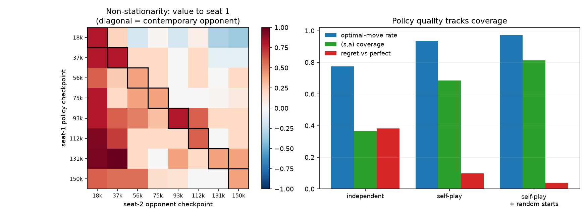

# A7 — Multi-Agent RL (optional)

**Goal.** Why multi-agent RL breaks single-agent convergence guarantees, and why
self-play sidesteps rather than solves that.

**Prerequisites.** A2 and A6 (side branch)
**Companion lab.** PettingZoo tutorials — not used here; see below.
**Compute.** CPU, ~8 min for the full run.

Checklist items and links live in [`docs/ladder.md`](../../docs/ladder.md#a7).
This README is the lab notebook; the reasoning is in
[`docs/writeups/a7-multi-agent.md`](../../docs/writeups/a7-multi-agent.md).

**On the lab pairing.** The ladder suggests PettingZoo. Tic-Tac-Toe is used
instead for one reason: it is *solvable*, so every number below is measured
against the exact optimum rather than against another learning agent. In a
two-player game a win rate says only that two policies are mismatched — it
cannot say how good either one is.

## Algorithms as implemented

Tabular Q-learning, terminal rewards only ($+1$ win, $-1$ loss, $0$ draw),
$\alpha = 0.1$, $\gamma = 1$, $\varepsilon = 0.2$.

**The two-player transition.** An agent's "environment step" spans its
opponent's reply, so the update bootstraps from the state it faces on its *next*
turn:

$$Q_i(s_t, a_t) \leftarrow Q_i(s_t,a_t) + \alpha\left[r + \gamma \max_{a'} Q_i(s_{t+1}, a') - Q_i(s_t,a_t)\right]$$

where $s_{t+1}$ is the position *after the opponent has moved*. That is exactly
where non-stationarity enters: the transition kernel contains the opponent's
policy, which is itself changing.

**Independent learners** keep $Q_1, Q_2$, one per seat. **Self-play** keeps a
single $Q$ used by both seats — a one-line change, possible only because boards
are stored from the mover's perspective (the same convention that let one
network serve both players in A6).

**Random starts** (the third arm) seed a fraction of episodes from a uniformly
chosen reachable position, as a control for coverage.

## What is measured, and why not win rates

| metric | definition |
| --- | --- |
| **exploitability** | exact value a perfect opponent extracts from the empty board; $0$ is unexploitable |
| **optimal-move rate** | fraction of all 4520 reachable positions where the greedy move is optimal |
| **regret vs perfect** | over random starts, the exact value a perfect opponent gets, minus what it would get against perfect play; $0$ iff optimal |
| **(s,a) coverage** | fraction of legal state-action pairs whose Q-value was ever updated |

Exploitability is the principled measure but is **all-or-nothing** on a
deterministic policy — one mistake anywhere on the exploiter's line scores
$1.0$ — so the graded measures carry the comparison.

## Code

| file | what it holds |
| --- | --- |
| `game.py` | Tic-Tac-Toe, exact solver, and the exploitability oracle |
| `learners.py` | Q-table, independent/self-play training, exact policy-vs-policy value |
| `run_multiagent.py` | both items |

```bash
cd experiments/a7_multi_agent
python run_multiagent.py --seeds 5 --episodes 150000 --checkpoints 8   # ~8 min
```

## Results

`multiagent__20260909-111317`, 5 seeds, 150k episodes.

| arm | seat | optimal-move | (s,a) coverage | regret | exploitability 1st/2nd |
| --- | --- | --- | --- | --- | --- |
| independent | first | 0.773 ± 0.007 | 0.364 | 0.383 | +0.00 / +0.99 |
| independent | second | 0.749 ± 0.006 | 0.320 | 0.458 | +0.92 / +1.00 |
| self-play | both | 0.936 ± 0.013 | 0.684 | 0.099 / 0.081 | +0.00 / +1.00 |
| **self-play + random starts** | both | **0.972 ± 0.003** | **0.813** | **0.038 / 0.027** | +0.00 / +1.00 |

### Item 1 — is the environment stationary?

Seat-1 policies from every checkpoint played against seat-2 policies from every
checkpoint, exact expected value to seat 1, averaged over 5 seeds.

| seat-1 policy | vs contemporary | vs future opponents | drop |
| --- | --- | --- | --- |
| @18k | +0.80 | −0.10 | **+0.90** |
| @37k | +0.80 | +0.07 | +0.73 |
| @56k | +0.40 | +0.12 | +0.28 |
| @75k | +0.40 | +0.03 | +0.37 |
| @93k | +0.80 | +0.33 | +0.47 |
| @112k | +0.60 | +0.10 | +0.50 |
| @131k | +0.40 | +0.40 | +0.00 |

**Mean drop +0.465, positive in 6 of 7 rows.**



## Findings

**Each agent learns a best response to the opponent it co-evolved with, and
that advantage evaporates against any other.** Every seat-1 checkpoint scores
better against its contemporary seat-2 opponent than against later ones, by
+0.465 on average. The 18k policy is the clearest case: +0.80 against the
opponent it trained alongside, −0.10 against the opponents that came later — it
went from winning to losing without changing at all.

The row-wise comparison matters here. The raw diagonal (+0.575) against
off-diagonal (+0.254) is *confounded*: column means fall from +0.79 to +0.13
across training, so later opponents are genuinely stronger and beating them is
harder for everyone. Comparing each policy against *its own* future opponents
controls for that, and the effect survives. This is the concrete content of
"non-stationary from each agent's view" — the transition kernel each agent
faces contains the other's policy, so what it converged to was a best response
to a distribution that no longer exists.

**Self-play is much better, and mostly for an unglamorous reason.** It reaches
0.936 optimal-move rate against independent learners' 0.773/0.749, and regret
0.099 against 0.383 — four times lower. But look at the coverage column:
0.684 against 0.320–0.364, almost exactly double.

That is the mechanism. A shared table receives updates from *both* seats every
episode, so at equal episode counts self-play gets roughly twice the data per
table. Framing self-play purely as a curriculum effect — "the opponent improves
with you" — misses that a large part of its advantage here is simply more
updates per parameter. The random-starts arm makes the same point from the other
side: it buys coverage 0.684 → 0.813 by a mechanism with nothing to do with
opponent quality, and quality follows (0.936 → 0.972, regret 0.099 → 0.038).
Across all three arms, policy quality tracks coverage.

**Independent learners are seat-specialists, and the numbers show it starkly.**
The seat-2 table scores +0.92 exploitability when made to play *first* — a seat
it never trained in — against +0.00 for the seat-1 table. Each learned only its
own side of the game. Self-play cannot have this failure by construction, which
is a second, distinct advantage over independent learning and one that has
nothing to do with data volume.

**Self-play sidesteps non-stationarity rather than solving it.** Sharing a table
removes the *asymmetry* — both seats improve together by construction — but it
does not make the learning target stationary: the shared policy is still
bootstrapping from values generated by an earlier version of itself. And the
proof that it does not reach equilibrium is in the exploitability column, which
stays at $+1.00$ as second player for every arm including the best one, at 0.972
optimal-move rate.

**Why that last number never moves is the most useful thing here.** It is not
coverage: exploitability stayed at 1.00 while coverage rose 0.509 → 0.947 in a
separate sweep. Walking the exploiter's best line to the first mistake shows the
mechanism — at a position where one move is forced, the never-tried actions sit
at their zero initialisation while every tried action is *negative*, because
those moves lose. **Zero-initialised Q is optimistic in a zero-sum game**, where
nearly every true value is $\le 0$, so the greedy policy is systematically drawn
to whatever it has not tried, which is precisely where a best-response exploiter
steers. Since exploitability demands correctness along the entire line, one such
state is fatal — which is why a policy that plays optimally in 97.2% of
positions is still beaten every time by an opponent allowed to choose the line.
