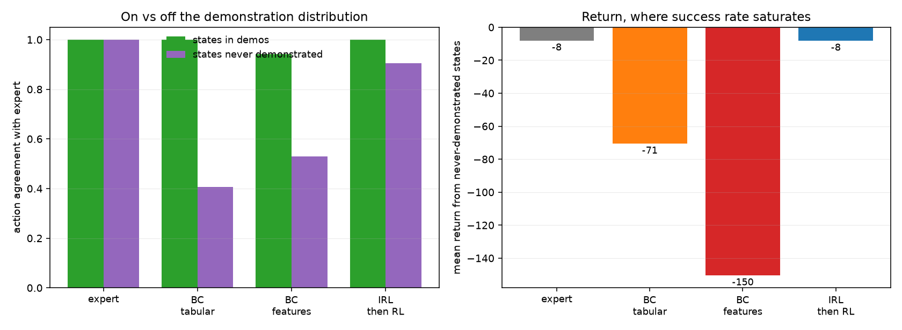

# A8 — Imitation Learning & Inverse RL (optional)

**Goal.** The difference between copying actions (imitation) and recovering the
objective behind them (inverse RL) — background for reward-model work in Part B.

**Prerequisites.** A2 and A4 (side branch)
**Companion lab.** Practical_RL week10_planning, yet_another_week
**Compute.** CPU, under a minute.

Checklist items live in [`docs/ladder.md`](../../docs/ladder.md#a8); the
reasoning is in [`docs/writeups/a8-imitation.md`](../../docs/writeups/a8-imitation.md).

**Deviation from the suggested task.** The ladder says "e.g. CartPole". This
uses an 8×8 gridworld instead, for two reasons: MaxEnt IRL's gradient needs
expected state-visitation frequencies, which are a dynamic program over a
*discrete* state space; and item 3 asks about "states the expert never visited",
which is an exactly enumerable set here and a fuzzy region in a continuous one.

## Algorithms as implemented

**Expert** = the exact optimal policy from value iteration. Demonstrations are
6 rollouts from a single start, with 10% slip, covering **49.5% of free states**
and leaving 21 never visited.

**Behavioural cloning** is supervised learning on $(s,a)$ pairs, in two forms:

- *tabular*: per-state action counts, uniform where the expert was never seen.
  The uniform fallback is not a weak choice, it is what tabular BC **is** — with
  no data at a state there is nothing to imitate.
- *feature-based*: multinomial logistic regression on coordinates and local wall
  structure. Included so BC is not represented only by its tabular form: this
  one *does* emit an action everywhere. Whether it is a good action is the
  question.

**MaxEnt IRL** (Ziebart et al. 2008) with one-hot state features. The model
makes trajectory probability proportional to $\exp(\sum_t r_{s_t})$, so the
log-likelihood gradient is the difference between the expert's expected feature
counts and the learner's:

$$\nabla_\theta \mathcal{L} = \boldsymbol{\phi}_{\text{expert}} - \sum_s D_\theta(s)\, \boldsymbol{\phi}(s)$$

with $D_\theta$ the expected state-visitation frequency under the reward's
soft-optimal policy, obtained by soft value iteration

$$V(s) = \log \sum_a \exp Q(s,a), \qquad \pi(a \mid s) = e^{Q(s,a) - V(s)}$$

and a forward pass over the horizon. The recovered reward is then planned
against with ordinary (hard) value iteration to give **IRL then RL**.

## Code

| file | what it holds |
| --- | --- |
| `gridworld.py` | the MDP, hard and soft value iteration, rollouts |
| `methods.py` | demonstrations, both BC variants, MaxEnt IRL |
| `run_imitation.py` | all three items |

```bash
cd experiments/a8_imitation && python run_imitation.py --seeds 5 --demos 6
```

## Results

`imitation__20260909-210853`, 5 seeds. Demonstrations cover 49.5% of free
states; 21 are never visited. Recovered-vs-true reward correlation **+0.556**.

| policy | agree: in demos | agree: never demoed | return @demo start | return @all | return @unseen | off-distribution |
| --- | --- | --- | --- | --- | --- | --- |
| expert (reference) | 1.000 | 1.000 | −11.7 | −4.7 | −8.1 | 0.012 |
| BC tabular | **1.000** | 0.406 | −12.3 | −37.3 | **−70.6** | 0.024 |
| BC features | 0.943 | 0.530 | −70.1 | −89.3 | −150.5 | **0.283** |
| **IRL then RL** | 1.000 | **0.906** | **−11.5** | **−4.7** | **−8.2** | 0.011 |

Success rates, for contrast: expert 1.000, BC tabular 0.869 on unseen starts,
BC features 0.247, IRL 1.000.



## Findings

**BC is perfect where it has data and near-worthless where it does not.**
Tabular BC agrees with the expert on 100% of demonstrated states and returns
−12.3 from the demonstrated start — indistinguishable from optimal. From states
the demonstrations never reached it returns −70.6 against the expert's −8.1,
nearly nine times worse. Nothing about the method is broken; there is simply no
signal at those states, and a conditional distribution over actions has nothing
to say where it was never conditioned.

**Generalising is not the same as generalising correctly.** The feature-based
BC does emit an action everywhere, and it is *worse than the tabular version at
every measurement* — including a return of −70.1 from the demonstrated start,
where the tabular one is optimal. Fitting a smooth function to a policy that
depends on local wall structure produces confident wrong answers instead of
absent ones, and the confident wrong answers actively steer the agent astray:
its off-distribution fraction is 0.283 against the expert's 0.012. This is the
compounding error of item 1, visible as a number — the policy drifts into states
it has no basis for, and each mistake makes the next state stranger.

**Recovering the objective transfers; copying the behaviour does not.** IRL
then RL matches the expert essentially everywhere: −11.5 / −4.7 / −8.2 against
the expert's −11.7 / −4.7 / −8.1, and 90.6% action agreement on the 21 states
that were never demonstrated. It never saw those states either. The difference
is that a reward function plus a planner *constructs* an action at an unseen
state, where a cloned policy can only look one up.

**The recovered reward is not the true reward, and that is the point.**
Correlation with the true reward is only **+0.556**, yet the policy planned
against it is near-optimal. Reward functions are not identifiable from
behaviour: potential shaping ($r' = r + \gamma\Phi(s') - \Phi(s)$) leaves the
optimal policy unchanged, so infinitely many rewards explain the same
demonstrations equally well. What IRL recovers is an *equivalence class member*,
useful for planning and unreliable as a description of what the expert wanted —
worth remembering in Part B, where a reward model's numbers get read as if they
meant something on their own.

**A measurement note, the third of its kind in Part A.** Success rate said BC
tabular scored 0.869 from unseen starts — respectable. Return said −70.6 against
−8.1. Both are true: in a small connected gridworld a uniform-random walk does
reach the goal inside the 200-step cap, it just takes forever, and a rate that
only asks *whether* the goal was reached cannot see that. This is the same shape
as A3's mean-vs-median and A7's saturated exploitability: **a metric that
saturates hides the effect you are looking for**, and the fix each time was to
report a second one that cannot.
