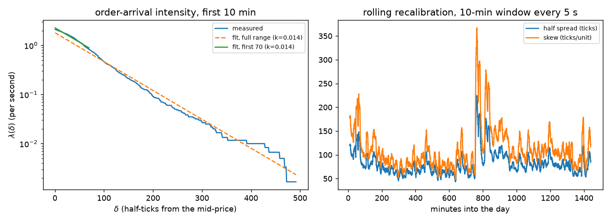
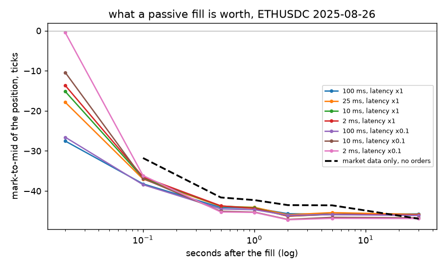

# C1 — Baseline: Calibrated GLFT (no RL)

**Goal.** A fixed-calibration benchmark that every RL variant below has to beat on held-out days.

**Prerequisites.** none — but A5 helps for what comes next
**Companion lab.** hftbacktest GLFT + grid-trading notebook
**Compute.** CPU. About 25 s per day per strategy at a 100 ms reaction interval;
a whole day is 60 million events and needs ~4 GB of RAM to replay.

Checklist items live in [`docs/ladder.md`](../../docs/ladder.md#c1); the
reasoning, the mathematics and the full result tables are in
[`docs/writeups/c1-glft-baseline.md`](../../docs/writeups/c1-glft-baseline.md).

## The split — fixed here, reused by C3, C4 and C5

Binance USDⓈ-M **ETHUSDC** perpetual, tick 0.01, lot 0.001, from the
`cardinalai/backtest_data` Hugging Face dataset. Chronological, because the
data is a time series and a random split of days leaks the regime:

| set | dates |
| --- | --- |
| **train** | 2025-08-26, 08-27, 08-28, 09-01, 09-08 (rule: everything to 2025-09-14) |
| **held out** | 2025-09-15, 09-18, 09-20, 09-22, 09-25 (rule: 2025-09-15 onward) |

The rule lives in [`config.py`](config.py) and every script reads it from there,
so it cannot drift. Held-out days are read once, at the end of a phase.

Standing assumptions, all of them load-bearing and none of them measured:
maker rebate −0.005% and taker fee 0.07% (Binance's best market-maker tier);
order latency synthesised from the recorded feed latency at 4× entry / 3×
response, giving ≈20 ms round trip; `power_prob_queue_model(2.0)`; book size
100,000, order size 1 ETH, position cap 20 ETH.

## How to run

```bash
# once: fetch the days (needs HF_TOKEN with read access to the dataset)
export HF_TOKEN=...            # never written into the repo; data/ is gitignored

# item 1 — calibration, with its checks
python experiments/c1_glft_baseline/run_calibrate.py --check-only
python experiments/c1_glft_baseline/run_calibrate.py

# describe the days (no orders, no PnL)
python experiments/c1_glft_baseline/measure_days.py

# items 2 and 3
python experiments/c1_glft_baseline/run_backtest.py --strategy glft-grid --days train --tag final
python experiments/c1_glft_baseline/run_backtest.py --strategy glft-grid --days test  --tag final

# free parameters, on training days only
python experiments/c1_glft_baseline/run_sweeps.py --sweep adj1
python experiments/c1_glft_baseline/run_sweeps.py --sweep percentile

# why the published baseline does not transfer
python experiments/c1_glft_baseline/run_interval_study.py --hours 4

# collect everything into one table
python experiments/c1_glft_baseline/summarise.py --tag final
```

## Results

Median over 5 days; `net/fill` and `gross/fill` are ticks after and before the
+22.0-tick maker rebate. Per-day values are in each run's `summary.json` and in
the writeup.

| run | strategy | set | SR | Return | days + | fills/day | gross/fill |
| --- | --- | --- | --- | --- | --- | --- | --- |
| `touch-final` | touch at the touch, no model | train | −176.5 | −19.3% | 0/5 | 106,101 | −45.2 |
| `glft-final` | (4.6)/(4.7) verbatim | train | −359.3 | −1.9% | 0/5 | 8,275 | −43.3 |
| `glft-adj-final` | + `adj2 = 0.05` | train | −58.5 | −1.4% | 0/5 | 5,735 | −45.7 |
| `glft-grid-final` | + 20-deep grid | train | **−32.3** | −0.9% | 0/5 | 2,886 | −56.6 |
| `simplified-final` | percentile 92 + micro-price | train | −62.9 | −3.6% | 0/5 | 12,928 | −45.0 |
| `simplified-mid-final` | percentile 92 + mid | train | −62.8 | −3.6% | 0/5 | 12,928 | −44.9 |
| `touch-final` | touch at the touch, no model | held out | −78.3 | −7.2% | 0/5 | 113,469 | −28.8 |
| `glft-final` | (4.6)/(4.7) verbatim | held out | −132.9 | −0.7% | 0/5 | 10,117 | −29.4 |
| `glft-adj-final` | + `adj2 = 0.05` | held out | −18.3 | −0.4% | 0/5 | 6,961 | −27.3 |
| `glft-grid-final` | + 20-deep grid | held out | **+0.37** | +0.0% | **3/5** | 3,868 | −21.7 |
| `simplified-final` | percentile 92 + micro-price | held out | −17.3 | −0.7% | 0/5 | 12,849 | −31.0 |
| `simplified-mid-final` | percentile 92 + mid | held out | −17.1 | −0.7% | 0/5 | 12,855 | −30.9 |

Calibration on 2025-08-26: $A = 2.28$, $k = 0.0136$, $\sigma = 47.1$ ticks$/\sqrt{s}$
over the day, $c_1 = 30.84$, $c_2 = 2.392$, half spread 119.6 ticks, skew 177.5
ticks per unit — a position of 0.67 units cancels the entire half spread.

`glft-grid` held-out Sharpe by day, ordered by that day's volatility:
+2.0 (σ 12.8), +0.7 (24.5), +0.4 (31.2), −43.1 (47.0), −57.6 (49.4).

## Findings

**The baseline loses, and the reason is one number.** Pooling all 60
strategy-days, the gross value of a fill is
`-0.72 × σ - 16.2` ticks (r = −0.58). Income per fill is the half spread (0.5
ticks, because the touch spread is one tick 98% of the time) plus the rebate
(22.0 ticks), so break-even needs σ below **8.0 ticks/√s**. The quietest day in
the split is 12.8; hftbacktest's published ETHUSDT day is 10.7. ETH's price
tripled between 2022 and 2025 without its tick size changing, so the rebate
grew 3.3× while volatility *in ticks* grew 4.4×, and the margin went from
thin-positive to negative.

**The reproduction succeeds in shape.** Unadjusted GLFT loses on both datasets
with the same signature (published SR −246, ReturnOverMDD −0.999; ours −359 and
−1.000); `adj2` roughly halves the bleed and lets the quoter hold inventory, as
published; the grid is the best variant, as published. Only the sign of the
final number differs. The exact published figures cannot be reproduced: they
are for ETHUSDT 2022-10-03..07 and that file is unobtainable — the host the
project links for sample data serves a certificate that does not match its
hostname.

**Every sweep is degenerate.** $\gamma$, `adj1` and the quote percentile are all
monotone in how little the strategy trades (`adj1` 0.02 → 1.0 moves the median
training Sharpe −667 → −32 while fills/day fall 664k → 2.9k). There is no
interior optimum; "tuning" walks towards not quoting. Reporting the winner of
such a sweep as a calibrated choice would be dishonest, so the README reports
the monotonicity instead.

**The parametric fit was never the problem.** On ETHUSDC the exponential
intensity fits with $R^2 = 0.984$ across the full range and the shallow refit
barely moves $k$ (0.0135 → 0.0136); in the source notebook that refit tripled
it (0.0170 → 0.0424), which is what motivated the non-parametric variant. Item
3 therefore tests a fix for a problem this asset does not have.



**The micro-price does nothing here, for a mechanical reason.** `simplified` and
`simplified-mid` agree to three significant figures on every metric. Quote
prices land on ticks, the micro-price differs from the mid by less than a tick
when the spread is one tick, and the grid then snaps the ladder to 30-tick
intervals. The source recommends the micro-price for large-tick assets, meaning
assets whose *spread* is wide in ticks; ETHUSDC's spread is one tick, so there
is nothing inside it to point at.



**Three independent measurements agree on the adverse selection**, which
matters because a −45-tick figure is also what a broken simulator would print.
(a) The touch quoter's mark-to-mid converges to −45 within 0.5 s at every
reaction interval from 100 ms to 2 ms. (b) Swapping hftbacktest's queue model
across all six variants moves it by less than one tick. (c) Measuring the same
thing from market data with no orders placed at all gives −41.6 at 0.5 s. Only
1.07% of 2 ms steps contain an aggressive trade, and one such trade calls the
next 100 ms with a 1.9σ mean — this market's price moves *at* trades, and a
passive maker is on the other side of every one.

**What reacting faster does and does not fix.** Execution quality is entirely a
function of reaction speed: at 2 ms with 2 ms latency a fill lands at the touch
and earns its half tick (mark-to-mid −0.45 at the instant of the fill, against
−27.5 at 100 ms). Post-fill drift is not: every configuration converges to −45
by 0.5 s. So the expensive fix buys the small term. This is the finding that
lets C2 keep a cheap 100 ms step.

**What I would do differently.** I chose ETHUSDC to be the closest analogue of
the notebook's ETHUSDT and only measured the touch spread afterwards — 1 tick
98.4% of the time, which makes GLFT's continuous quote-depth derivation
inapplicable before a single backtest is run. Measuring the spread distribution
should have been step one of item 1, not a by-product of it. The
`--symbol xrpusdt` cross-check exists for this reason and is still unrun; until
it is, this phase's negative result is about ETHUSDC, not about GLFT.
