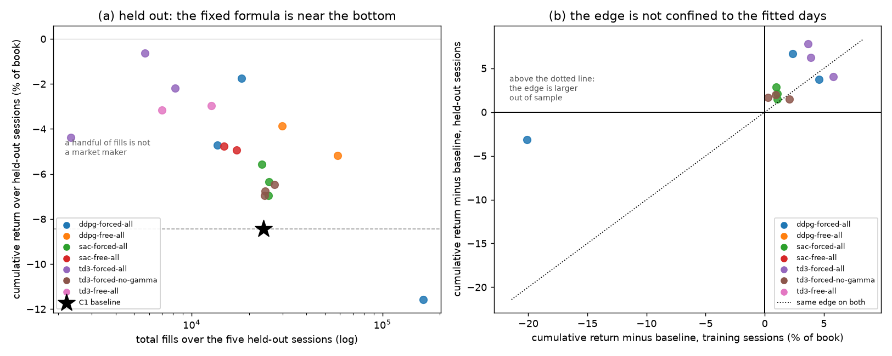

# C3 — Continuous Control on the Coefficient Set

**Goal.** A real answer to whether learned, state-conditioned coefficients beat
a well-calibrated fixed formula, and which coefficients are worth learning at all.

**Prerequisites.** A5 (the algorithms), C1 (the baseline and the split), C2 (the environment)
**Companion lab.** Stable-Baselines3 TD3 / SAC docs
**Compute.** CPU. About 140 s per training session; the full grid is 18 runs of
10 sessions, roughly 4 hours at two workers (a session holds ~4.5 GB).

Checklist items live in [`docs/ladder.md`](../../docs/ladder.md#c3); the
argument, the tables and the caveats are in
[`docs/writeups/c3-continuous-control.md`](../../docs/writeups/c3-continuous-control.md).

## What is here

| file | what it is |
| --- | --- |
| [`train.py`](train.py) | the outer loop: cycles over training sessions, one coefficient decision per second |
| [`evaluate.py`](evaluate.py) | replays a policy over a day set and scores it with C1's `LinearAssetRecord` call |
| [`summarise.py`](summarise.py) | collects the evaluations into one table, and the two-panel figure |

The algorithms themselves are **A5's**, imported not copied: `build_agent`,
`select_action` and `update_step` come from
[`../a5_continuous_control/continuous.py`](../a5_continuous_control/continuous.py).

## How to run

```bash
python experiments/c3_continuous_control/train.py --algo td3 --seed 0 --participation forced
python experiments/c3_continuous_control/evaluate.py --policy runs/c3/<run>/policy.pt --days test
python experiments/c3_continuous_control/evaluate.py --policy baseline --days test
python experiments/c3_continuous_control/summarise.py --days train --plot docs/assets/c3/held-out.png
```

`--participation free` uses C2's action ranges; `forced` caps the half-spread
scale so leaving the market costs more. `--learnable no-gamma` pins γ at its
calibrated 0.05 and removes it from the action space for item 3.

## Results

> **Corrected twice.** This README first reported the median of per-session
> Sharpes — blind to the tail, and it inverted the conclusion. It then
> reported a profitable policy that was an artefact: every
> forced-participation run had been replayed with the *free* action ranges,
> because the `participation` flag was added to the checkpoint in an edit
> that silently failed to apply. Both are dissected in the writeup; the
> tables below are the corrected ones.



The five held-out sessions as one track record, ranked by cumulative return.
The baseline is C1's `glft-grid` re-scored through this code path.

| configuration | seed | cumulative % | Sharpe (ann.) | worst session % | fills | up |
| --- | --- | --- | --- | --- | --- | --- |
| `td3-forced` | 2 | **−0.63** | −13.65 | **−0.30** | 5,689 | 1/5 |
| `ddpg-forced` | 2 | −1.74 | −5.98 | −1.70 | 18,234 | 1/5 |
| `td3-forced` | 1 | −2.19 | −11.34 | −1.38 | 8,182 | 1/5 |
| `td3-free` | 0, 1 | −2.96, −3.16 | −12.6, −7.5 | −1.66, −2.99 | 12,702, 7,003 | 1/5 |
| `ddpg-free` | 1 | −3.88 | −11.40 | −2.41 | 29,921 | 1/5 |
| `td3-forced` | 0 | −4.37 | −11.71 | −2.58 | 2,331 | 1/5 |
| `ddpg-forced` | 0 | −4.71 | −10.11 | −2.70 | 13,667 | 2/5 |
| `sac-free` | 0, 1 | −4.93, −4.76 | −15.3, −15.1 | −2.37, −2.43 | 17,189, 14,758 | 0/5 |
| `ddpg-free` | 0 | −5.19 | −11.31 | −3.22 | 58,109 | 1/5 |
| `sac-forced` | 0, 1, 2 | −5.56, −6.34, −6.95 | −15.3, −15.5, −13.9 | −2.64, −2.91, −3.67 | 23–25k | 0/5 |
| `td3-forced`, γ pinned | 1, 0, 2 | −6.48, −6.77, −6.95 | −10.1, −13.6, −8.6 | −4.86, −3.68, −5.93 | 24–27k | 1/5, 0/5, 2/5 |
| **C1 baseline** | — | **−8.44** | −11.19 | **−4.96** | 23,897 | 3/5 |
| `ddpg-forced` | 1 | −11.58 | −13.34 | −6.55 | 163,418 | 1/5 |

Per family, median seed: `td3-forced` **−2.19**, `td3-free` −3.06,
`ddpg-free` −4.54, `ddpg-forced` −4.71, `sac-free` −4.85, `sac-forced`
−6.34, `td3-forced` γ-pinned −6.77, **baseline −8.44**.

## Findings

**Nothing learned is profitable, and the fixed formula is still
second-worst.** Seventeen of eighteen configurations beat the baseline — the
exception takes 163,418 fills and loses 11.58% — but the best of them ends
the period at −0.63%. Item 2's answer is *no*: learned coefficients do not
beat the formula in the sense that matters, they reliably lose less.

**What RL bought is a smaller left tail, not an edge.** The baseline's worst
session is −4.96%; every configuration above it caps its worst session
between −0.30% and −3.7%. The baseline's five held-out sessions are +0.01,
+0.02, +0.04, **−4.96**, **−3.55** percent — it wins three by hundredths and
loses two by whole percents, on the two sessions where σ was 47.0 and 49.4
bp/√s against 12.8–31.2 elsewhere. C1 had already measured that the gross
value of a fill is `-0.72·σ - 16.2` ticks.

**That is also why the per-session median inverted the answer.** It made the
baseline look like the best row in the table, because its median session is
the best; a median over five sessions removes exactly the tail a market
maker's risk consists of.

**No generalisation gap.** Every configuration beats the baseline on both day
sets, and nine of twelve beat it by more out of sample than in. The edge is
tail-avoidance and the held-out set has more tail. C4 gets no positive
control for its reward-hacking item from here.

**Item 3: the ladder's prior is right about stability and wrong about what it
buys.** Pinning γ shrinks the seed-to-seed spread eightfold (0.47 points
against 3.74) — exactly what a smaller hypothesis class should do — and costs
4.6 points of cumulative return, with every γ-pinned seed worse than every
γ-free one. With γ free a policy widens by raising γ, which lifts `c1` and
`c2` together and keeps the spread-to-skew ratio the model intends; those
seeds end up quoting far less (2,331–8,182 fills against 24,160–27,136). With
γ pinned the widening must come from `c1_scale` alone, and all three seeds
converge tightly on trading three times as much and losing three times as
much. γ is the coefficient the other two are defined in terms of.

*(An earlier version of this item reported wild instability — zero-fill seeds
and a 79,332-fill seed. That was the confounded run and none of it
reproduces.)*

**SAC is the most stable and among the worst.** Three seeds within 1.4 points
of each other, all below every TD3 and DDPG seed except the blow-ups. The
entropy term rewards keeping the action distribution wide, which here means
continuing to quote into the volatile sessions.

**The forced-participation constraint is leaky in principle.** `c1_scale`
can route around the cap on `half_spread_scale`. No corrected run exploited
it — the lowest fill count is 2,331 — but C4 should cap the computed half
spread rather than one of its factors.

**What I would do differently.** Two things, and the second is the real one.

The grid was sized before I knew an episode's cost, so the first launch used
A5's (256, 256) network and took 429 s per session — 4× what a 10-dimensional
observation needs. Ten minutes of benchmarking up front would have bought two
more seeds, which is what this phase is short of.

Two process failures, and the second is the one that cost real time. I chose
the summary statistic before looking at the distribution it would summarise. The median was chosen for a good reason — to
stop one session dominating a mean — and it was the wrong tool for a
distribution whose whole character is two bad sessions out of five. C1 had
already measured that the loss scales with σ and that σ varies three-fold
across these days, so the shape was known before the first policy was
trained. The rule that survives: decide what a strategy's risk looks like
*before* choosing how to average it, and when the answer is "the tail",
report the tail.

And I edited three files with `str.replace` while asserting on only some of
the replacements, then described the result in a commit message without
checking it had taken effect. Three separate bugs came from that one habit:
the γ-pinned confound, the wrong evaluation ranges, and a plotting crash that
is the only reason any of it was noticed. Every multi-file edit in this phase
now asserts on every replacement, and a claim about what code does gets a
check that it does it.
